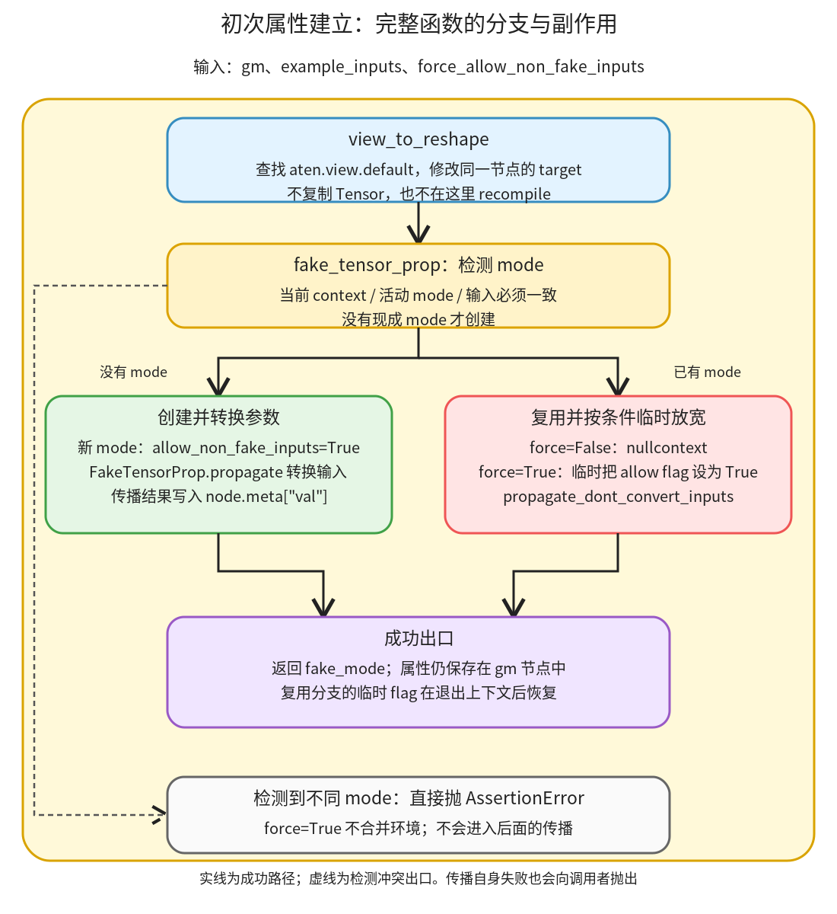

# 初次属性建立：改写 view 的 target，再选择同一个 FakeTensor 环境传播属性

```text
Inductor  本层完成
    └── 图准备  本层完成
        └── 属性与布局描述  本层完成
            └── 初次属性建立 ← 当前篇  叶子·逐行完成
```

<!-- child-links:start -->

<!-- child-links:end -->

[返回属性与布局描述](../README.md)。本单元接收 gm 和位置对应的示例参数，先替换 view target，再选择或创建 FakeTensor mode，使图节点获得张量属性。返回 mode，shape/stride/dtype/device 等主要结果则写在节点元数据中。本篇不再拆目录，完整覆盖这两项连续配合的实现。

## 1. 完整范围与整体流程

源码版本为本系列相同的本地 HEAD，完整解释两个函数：

| 文件 | 函数 | 完整源码行 |
| --- | --- | --- |
| torch/_inductor/fx_passes/post_grad.py | view_to_reshape | 974–981 |
| torch/_inductor/compile_fx.py | fake_tensor_prop | 392–417 |

源码块保留原实现，后面的逐行表是教学说明，不是加进产品源码的注释。覆盖包括签名、分支、上下文恢复、调用和返回；辅助库只解释相关接口语义，不把整个 FakeTensor 系统递归纳入 Inductor 子目录。



view 替换直接修改 FX 节点，不先计算 Tensor。随后 detect_fake_mode 综合当前 tracing context、活动 dispatch mode 与输入 FakeTensor，确认它们是否指向同一环境。有既有 mode 就复用；没有才创建。两条传播路径都使用 FX Interpreter 访问图节点，返回的张量属性保存在 gm 上；最后返回 mode 给后续图改写和增量维护。

FakeTensorProp 是这一单元调用的 FX 属性执行设施，依据 [实现](/work/pytorch/torch/fx/passes/fake_tensor_prop.py:25)：propagate 先转换 Tensor 参数，propagate_dont_convert_inputs 直接在给定 mode 中运行解释器；run_node 将适合的属性快照写入 node.meta['val']。这不是调用原模型后返回真实数值答案。

## 2. view_to_reshape：完整源码与逐行解释

[源码](/work/pytorch/torch/_inductor/fx_passes/post_grad.py:974)：

<!-- source:post_grad.view_to_reshape:start -->
```python
def view_to_reshape(gm):
    """
    Replace view ops in the GraphModule to reshape ops.
    """
    for nd in gm.graph.find_nodes(
        op="call_function", target=torch.ops.aten.view.default
    ):
        nd.target = torch.ops.aten.reshape.default
```
<!-- source:post_grad.view_to_reshape:end -->

| 行 | 操作的数据、状态与目的 |
| --- | --- |
| 974 | 接收 GraphModule 引用 gm；没有复制图，也没有返回新图的约定。 |
| 975–977 | 原函数说明文字，不执行张量或节点修改。 |
| 978 | 从 gm.graph 请求指定种类的节点；遍历得到的是原图里的节点对象 nd。 |
| 979 | 条件精确到 call_function 与 aten.view.default，不把所有名字含 view 的节点、方法调用或其他 overload 都改掉。 |
| 980 | 完成查询调用并进入 for 循环体；没有匹配节点时循环零次。 |
| 981 | 原地把该节点的 target 改为 aten.reshape.default；保留节点身份、名字、参数和使用者关系。没有在此创建 clone、复制输入或重新生成 gm.forward。 |

连续执行的效果是改变算子约束，而不是立即选定存储方案。原来合法的 view 在后续布局改变后未必还能无拷贝完成，reshape 提供可选择合法实现的空间；实际是否复制由图与后续实现决定。

此函数没有 recompile。刚调用后 gm.graph 中的 target 已变，gm.code 对应的旧 forward 仍可能没变。下一步 FakeTensorProp 直接解释 graph，所以可以看到新 target；整个图准备收尾再重新生成 forward，不能在这里把旧 Python 入口当作图已同步的证据。

## 3. fake_tensor_prop：完整源码与逐行解释

[源码](/work/pytorch/torch/_inductor/compile_fx.py:392)：

<!-- source:compile_fx.fake_tensor_prop:start -->
```python
def fake_tensor_prop(
    gm: torch.fx.GraphModule,
    example_inputs: List[torch.Tensor],
    force_allow_non_fake_inputs: bool = False,
):
    """
    If we can not detect fake mode from the context of inputs, create one.

    The created fake mode will be returned.
    """
    fake_mode = detect_fake_mode(example_inputs)
    if not fake_mode:
        fake_mode = torch._subclasses.FakeTensorMode(allow_non_fake_inputs=True)
        FakeTensorProp(gm, mode=fake_mode).propagate(*example_inputs)
    else:
        ctx = (
            contextlib.nullcontext()
            if not force_allow_non_fake_inputs
            else mock.patch.object(fake_mode, "allow_non_fake_inputs", True)
        )
        with ctx:  # type: ignore[attr-defined]
            FakeTensorProp(gm, mode=fake_mode).propagate_dont_convert_inputs(
                *example_inputs
            )

    return fake_mode
```
<!-- source:compile_fx.fake_tensor_prop:end -->

| 行 | 操作的数据、状态与目的 |
| --- | --- |
| 392 | 定义一次图属性传播入口，调用后会修改 gm 的节点元数据。 |
| 393 | gm 的类型提示是 FX GraphModule；函数本体会把它传给 FakeTensorProp。 |
| 394 | 示例参数按图的 placeholder 位置对应。List[Tensor] 是类型提示；FakeTensor 也是 Tensor 的一种，不表示每项必须是带真实数据的普通 Tensor。 |
| 395 | force_allow_non_fake_inputs 默认为 False；它只控制下面“已有 mode”路径的临时放宽，不是新建 mode 的总开关。 |
| 396 | 完成签名，开始函数体；无额外入口验证或嵌套参数展平。 |
| 397–401 | 原说明文字：缺少 mode 时创建，返回创建/复用的 mode。这里没有执行逻辑。 |
| 402 | 调用 detect_fake_mode，查看环境和输入。结果是同一现有 mode 或 None；若检测到互不相同的 mode，依赖接口会断言失败。 |
| 403 | mode 不存在时进入创建分支，不对输入数值或 shape 作该项判断。 |
| 404 | 创建 FakeTensorMode，明确 allow_non_fake_inputs=True。即使 force 参数为 False，这个新 mode 仍允许处理真实 Tensor。 |
| 405 | 创建绑定 gm 与该 mode 的 FakeTensorProp，并调用 propagate(*example_inputs)。它先把普通 Tensor 参数转换为该 mode 的 FakeTensor，再按图执行属性传播；传播返回值在此丢弃，节点 metadata 的副作用保留。 |
| 406 | 另一条分支复用已经存在的 mode，不创建互不相关的新环境。 |
| 407 | 计算一个上下文管理器 ctx，供后面传播过程使用；这不是实际开始传播。 |
| 408 | force 为 False 时选择 nullcontext，进入/退出不修改 mode.allow_non_fake_inputs。 |
| 409 | 条件是 not force_allow_non_fake_inputs；所以 False 不意味着强制把已有 mode 的 flag 设为 False，只是保持它原值。 |
| 410 | force 为 True 时选择 mock.patch.object，把同一个 mode 的 allow_non_fake_inputs 临时设为 True。不是换一个 mode，也不是把所有输入预先换成新对象列表。 |
| 411 | 完成条件表达式。ctx 现在是空上下文或临时属性补丁。 |
| 412 | 进入 ctx。若是补丁，允许真实输入的 flag 在此生效；正常退出或异常离开时由上下文管理器恢复原值。 |
| 413 | 使用同一个 mode 创建传播器，调用不预转换参数的接口。原 FakeTensor 输入保持在该 mode 下，不重新建立一套符号/存储环境。 |
| 414 | 将原 example_inputs 展开为位置参数。其中若仍有真实 Tensor，是否允许由当前 mode 的 flag 决定；dont_convert 并不等于任意混合输入都合法。 |
| 415 | 完成调用。节点属性已经在传播中写入；没有把传播结果作为该函数返回值。 |
| 416 | 空行，无状态改变。 |
| 417 | 返回新建或复用的 fake_mode。调用者继续用它安装后续编译上下文；图属性仍在 gm 的各节点上。 |

两条路径的区别集中在参数转换和环境继承。新 mode 没有需要延续的旧环境，propagate 统一转换参数；复用 mode 时通过 dont_convert 接口保留已有关系，必要时临时允许真实参数由该 mode 处理。

force=True 也无法解决两个 FakeTensor 分别来自不同 mode 的冲突：检测发生在 402，早于 410 的属性补丁；补丁只改允许真实输入，不合并两个环境。

## 4. 用具体图追踪两项产物

CPU float32 x=`[[0,1,2],[3,4,5]]`，shape `(2,3)`、stride `(3,1)`，图为 `return (x.view(6),)`。

**替换 target。** 进入 view_to_reshape 时节点名为 view。循环找到这个原节点，把 target 改成 aten.reshape.default；节点身份和 gm.code 暂时不变。这个名字仍叫 view 的节点，语义已经由 target 决定。

**检测 mode。** 本次不安装环境 mode，示例参数是普通 x，得到 None。进入 404，新建允许真实参数的 mode。

**转换并传播。** 405 用该 mode 的 FakeTensor 输入解释 placeholder 与 reshape。采集的 node.meta['val'] 为：

```text
x_1：shape [2,3]，stride [3,1]，float32，CPU
view：shape [6]，stride [1]，float32，CPU
```

这些对象描述布局，不存放“结果已经为 [0,1,2,3,4,5]”这样的真实输出。函数返回 FakeTensorMode，而不是这两项属性的字典；上面的字典是实验为阅读采集的化简。

**交给后续。** 图改写读取 metadata，增量更新复用返回的 mode；收尾再执行 recompile。实验确认替换后但收尾前旧 code 未变，recompile 后 code 才改变，两个输入/节点表示不能混为一谈。

## 5. 复用、临时放宽和失败路径

[initial_properties.py](../../../experiments/initial_properties.py) 还实际运行以下条件，不只是按代码猜测：

| 输入与环境 | 分支与实际结果 | 退出后的 flag |
| --- | --- | --- |
| 无 mode，输入普通 x | 创建 mode；得到 reshape 属性 | 新 mode 为 True |
| 输入为同一 mode 的 FakeTensor | 返回对象就是原 mode；传播成功 | 原 False 保持 False |
| FakeTensor 加普通 Tensor，原 flag=False，force=False | AssertionError，拒绝混合 | 仍 False |
| 相同混合输入，force=True | 临时允许，add 属性为 `(2,3)` | 恢复 False |
| tracing context 有 mode，输入普通 x，force=True | 检测到环境 mode并复用，传播成功 | 恢复 False |
| 两个输入来自不同 mode，即使 force=True | 检测阶段 AssertionError | 不进入合并/传播路径 |

所有成功的 `(2,3)` 结果均为 float32、CPU；输入真实数据保持不变。结果及属性见 [initial_properties.json](../../../experiments/initial_properties.json)。没有生成后端 kernel，也没有把 FakeTensor 属性执行当成模型正式运行。

传播失败时本函数没有图事务回滚。FakeTensorProp 可能已写入前面节点的 metadata，不能因某一步报错就假定 gm 完全没有变化；调用者应按失败处理，而不是使用一个部分传播图冒充成功结果。临时 flag 的恢复由 412 的上下文管理器保证，与图元数据是否回滚是不同问题。

## 6. 覆盖与依赖边界

本篇逐行覆盖两段完整实现，没有省略函数分支。detect_fake_mode 的相关契约据 [torch._guards 源码](/work/pytorch/torch/_guards.py:869) 核对：优先参考 tracing context，再检查活动 mode 与输入，要求检测到的 mode 身份一致。FakeTensorProp 的参数转换和 metadata 行为也据其源码核对；二者是本单元使用的外部设施，不重复扩展为上游系统教程。

本单元没有决定后续图重写规则、物化、调度或动态符号内部算法。输入数值、节点身份、环境身份、参数转换和元数据副作用分别已经交代；下一个同层职责是图改写后的增量属性维护。
