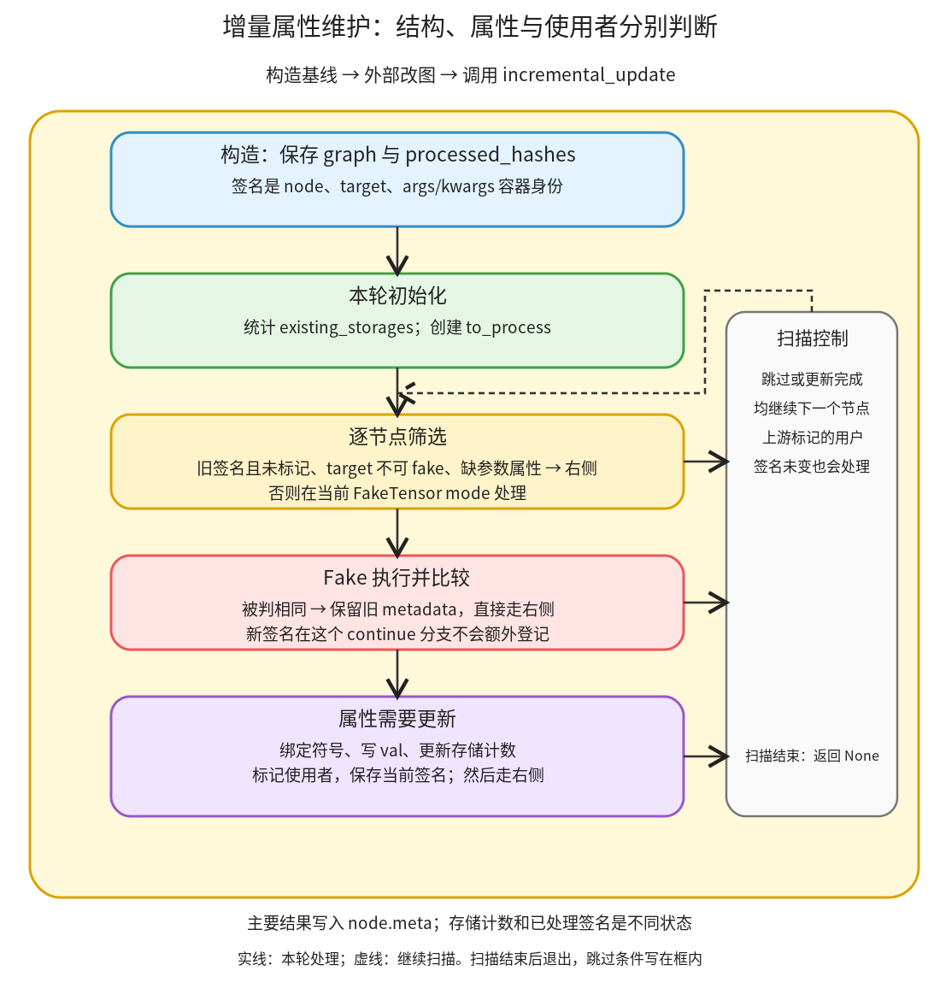

# 增量属性维护：发现结构变化后，只在属性改变时更新节点并标记使用者

```text
Inductor  本层完成
    └── 图准备  本层完成
        └── 属性与布局描述  本层完成
            └── 增量属性维护 ← 当前篇  叶子·逐行完成
```

<!-- child-links:start -->

<!-- child-links:end -->

[返回属性与布局描述](../README.md)。本单元在改图前记录节点结构签名，改图后沿图顺序执行变化节点的 FakeTensor 算子；属性需要更新时才写回并标记使用者。它接收 graph，通过 node.meta 修改图属性，正常返回 None；不会返回一张新图或真实计算结果。

## 1. 完整范围和整体流程

完整源码范围为 [fx_utils.py](/work/pytorch/torch/_inductor/fx_utils.py:55) 的 FakeTensorUpdater 类 55–185，以及同文件 get_storage、get_node_storage、get_fake、get_fake_args_kwargs 四项辅助实现 188–219。下面保留完整原实现，再按原顺序逐行解释；不再按嵌套函数增加子目录。



构造 updater 时保存每个节点的 `(node,target,id(args),id(kwargs))`。调用 incremental_update 时先统计当前 Tensor 元数据的存储标识，再单趟扫描节点：旧签名且没被上游标记的跳过；不是可 fake 执行的 target 或缺少参数属性的跳过；其余在 V.fake_mode 下执行。若比较器认为新旧属性相同，保持旧 metadata；否则更新符号绑定与 metadata，再将用户 id 加入本轮 to_process。

这里有三个不同状态：processed_hashes 跨调用保留结构签名；to_process 只在本次扫描里传播上游变化；existing_storages 是本次比较的存储计数。三者不是同一个缓存，也不是 Tensor 数值是否相等的判断。

## 2. FakeTensorUpdater：完整源码

<!-- source:fx_utils.FakeTensorUpdater:start -->
```python
class FakeTensorUpdater:
    """
    The main idea here is that it's difficult to maintain accurate fake
    tensors (our primary form of metadata) for each node in our graph as we
    transform it.

    The most reliable way to obtain this information is by rerunning
    faketensor propagation. However, in general, faketensor propagation is
    fairly expensive. So, instead we'd like to only rerun faketensor
    propagation on nodes that have changed.

    In order to detect which nodes have changed, we first hash its node,
    target, and argument lists (which are immutable in FX).

    Then, whenever we call incremental_update, we check which FX nodes have a
    new hash, and recompute the faketensor metadata for that node. Then, we
    continue to recursively compute the faketensors for all users until the
    fake tensors stop changing.
    """

    def __init__(self, graph: torch.fx.Graph) -> None:
        self.processed_hashes = set()
        self.graph = graph

        for node in self.graph.nodes:
            self.processed_hashes.add(self.hash_node(node))

    def hash_node(self, node: torch.fx.Node):
        # todo(chilli): Not a great hash function
        return (node, node.target, id(node.args), id(node.kwargs))

    def incremental_update(self):
        processed = set()
        existing_storages: DefaultDict[Optional[int], int] = defaultdict(int)
        for node in self.graph.nodes:
            existing_storages[get_node_storage(node)] += 1

        def is_intlist_same(new, old):
            return statically_known_true(sym_eq(new, old))

        def is_fake_tensor_same(new, old):
            if type(new) != type(old):
                return False
            if isinstance(new, (list, tuple)):
                if len(new) != len(old):
                    return False
                return all(
                    is_fake_tensor_same(new_i, old_i) for new_i, old_i in zip(new, old)
                )
            if new is None:
                return old is None
            if not isinstance(new, torch.Tensor):
                assert isinstance(
                    new, (torch.SymInt, torch.SymBool, torch.SymFloat)
                ), f"Unknown type {type(new)} in {self.graph}"
                return (
                    new.node.shape_env._maybe_evaluate_static(
                        sympy.Eq(new.node.expr, old.node.expr)
                    )
                    == sympy.true
                )
            if not is_intlist_same(new.shape, old.shape) or new.layout != old.layout:
                return False
            if new.layout == torch.strided and (
                not is_intlist_same(new.stride(), old.stride())
                or not statically_known_true(
                    new.storage_offset() == old.storage_offset()
                )
            ):
                return False

            if new.device != old.device:
                return False

            if get_storage(new) == get_storage(old):
                return True

            # This is the case where it returns a completely fresh storage that's used nowhere else.
            if (
                existing_storages[get_storage(old)] == 1
                and get_storage(new) not in existing_storages
            ):
                return True
            return False

        def should_process_node(node):
            # node.target for nodes returning true from this function
            # are called under fake mode and does not work for inductor
            # lowerings. We check if the node.target is an aten operator
            # or operator.getitem which is used when returning multiple
            # tensors from an op.
            return node.op == "call_function" and (
                isinstance(node.target, torch._ops.OpOverload)
                or node.target == operator.getitem
            )

        to_process = set()
        for node in self.graph.nodes:
            if (
                self.hash_node(node) in self.processed_hashes
                and id(node) not in to_process
            ):
                continue

            if not should_process_node(node):
                continue

            is_valid, args, kwargs = get_fake_args_kwargs(node)
            if not is_valid:
                continue
            with V.fake_mode:
                new_fake_tensor = node.target(*args, **kwargs)
            if "val" in node.meta and is_fake_tensor_same(
                new_fake_tensor, node.meta["val"]
            ):
                continue

            rebind_unbacked(V.fake_mode.shape_env, node, new_fake_tensor)

            node.meta["val"] = new_fake_tensor
            if (shape_env := V.fake_mode.shape_env) and (
                symbol_to_path := compute_unbacked_bindings(shape_env, new_fake_tensor)
            ):
                # Refresh the bindings to the new symbols
                node.meta["unbacked_bindings"] = symbol_to_path

            existing_storages[get_node_storage(node)] += 1

            to_process.update([id(user) for user in node.users])

            self.processed_hashes.add(self.hash_node(node))
```
<!-- source:fx_utils.FakeTensorUpdater:end -->

### 2.1 建立基线与结构签名：55–84

| 行 | 数据、状态与目的 |
| --- | --- |
| 55 | 定义持有 graph 和已处理签名的对象；一个 updater 服务这张图的改写过程。 |
| 56–73 | 原类说明介绍增量传播意图。实际机制以随后的一次 for 扫描和使用者标记为准，不是另起递归工作队列。 |
| 75 | 构造时收到 graph 引用；应在需要检测的改写前建立基线。 |
| 76 | processed_hashes 初始化为空 set，跨多次 incremental_update 保留。 |
| 77 | 保存同一 graph，不复制节点或张量。 |
| 79–80 | 遍历当前节点，将各自结构签名加入基线集合。已有 metadata 内容本身不参与该签名。 |
| 82 | hash_node 接收一个节点，返回可放进集合的 tuple。 |
| 83 | 原注释承认这是一种粗略签名，不额外执行逻辑。 |
| 84 | 保留节点对象、target，以及 args/kwargs 容器的 Python 身份。不是对参数值或 Tensor 数据做内容 hash；换 target 或参数容器可改变签名。 |

例如把同一 relu 节点的 target 改成 sum，节点身份仍是 N1，但 tuple 中的 target 变了；仅修改 node.meta 则不一定触发这项结构检测。

### 2.2 建立存储比较环境：86–138

| 行 | 数据、状态与目的 |
| --- | --- |
| 86 | 开始一轮增量维护，使用已保存的 graph 和 processed_hashes。 |
| 87 | 建一个 processed set；当前实现之后没有使用它，不能将其当作实际已完成队列。 |
| 88 | existing_storages 是存储标识到计数的 defaultdict(int)，缺项读取默认为 0。 |
| 89–90 | 对每个节点取 get_node_storage，累计当前 metadata 所引用的 Tensor 存储；非 Tensor/缺属性等会累计在 None 桶，不递归统计任意嵌套返回的全部 Tensor。 |
| 92–93 | is_intlist_same 用符号相等表达式及 statically_known_true 判断尺寸/步长列表，只有能静态确定为真才认作相同。 |
| 95 | 定义本轮的新旧属性递归比较器，可以比较序列、None、符号对象与 Tensor。 |
| 96–97 | Python 类型不同直接视为变化，例如 list 与 tuple 不相同；这不是对 Tensor.dtype 的检查。 |
| 98–100 | list/tuple 先比较长度，长度变化立即返回 False。 |
| 101–103 | 对序列逐项递归并要求全部相同；不会仅看容器整体 shape。 |
| 104–105 | 新值为 None 时要求旧值也是 None；与前面的类型检查配合。 |
| 106–109 | 非 Tensor 的其他新值必须是 SymInt/SymBool/SymFloat，否则断言失败；不支持任意 Python int/对象在此统一比较。 |
| 110–115 | 用新值所属 ShapeEnv 尝试静态求解新旧符号表达式相等；只有结果恰为 sympy.true 才视为相同。 |
| 116–117 | Tensor 的 shape 无法确定相同，或 layout 不同，立即视为变化。layout 是 torch.strided 等布局种类，不是逐维 stride。 |
| 118–124 | 对 strided Tensor，进一步检查 stride 列表与 storage_offset；任何一项不能确定相同就返回 False。非 strided Tensor 不走这个逐维步长分支。 |
| 126–127 | device 不同返回 False；即使 shape/stride 相同也不能忽略设备变化。 |
| 129–130 | 以上条件满足且存储标识一致时返回 True，保留旧属性对象。 |
| 132 | 原注释说明另一种可接受情况：本次结果为独立的新存储，不改变共享关系。 |
| 133–137 | 旧存储在计数中仅出现一次，且新存储未在现有集合出现，视为等价的新分配并返回 True。存储标识不同不必然触发传播。 |
| 138 | 其余存储关系变化返回 False，要求更新。 |

这段比较器**没有显式比较 dtype**。对同类型 FakeTensor，只改 dtype 而保持这些 shape/layout/stride/offset/device 条件，并且满足新旧独立分配条件时，可能被判断为相同。第 6 节有真实局部实验，不能把此比较器描述成完整的 Tensor 属性相等验证器。

existing_storages 也是本轮比较用的记录，不是实时精确的全部存储所有权图：后面更新后增加新计数，却没有在这里看到对应的旧计数扣减。

### 2.3 单趟扫描与向使用者传播：140–185

| 行 | 数据、状态与目的 |
| --- | --- |
| 140 | 定义哪些节点能直接以 FakeTensor 参数执行 target。 |
| 141–145 | 原注释界定目标：ATen 等 OpOverload 或取多输出项的 getitem，不能调用任意 Inductor lowering handler。 |
| 146–149 | 要求 op 为 call_function，且 target 是 OpOverload 或 operator.getitem。placeholder、output、get_attr、高阶/普通 Python handler 不自动通过。 |
| 151 | 本轮 to_process 初始化为空 set，保存需因上游变化重算的用户 id。 |
| 152 | 沿当前 graph.nodes 正向扫描一次；依赖有效的图顺序，不在此修复拓扑或循环扫描到收敛。 |
| 153–157 | 若结构签名已在 processed_hashes，且没有被变化上游加入 to_process，则直接跳过。结构没改但被标记的用户仍会处理。 |
| 159–160 | 不适合 fake 执行的节点跳过。跳过并不证明其 metadata 已是新的。 |
| 162 | 用辅助函数把 args/kwargs 内的 FX Node 换成各自 meta['val']；同时取得参数是否齐备的布尔值。 |
| 163–164 | 还有缺 metadata 的参数引用时跳过，保留旧属性且不在末尾登记新签名。 |
| 165–166 | 安装当前 V.fake_mode，调用原 target 推导新属性。此处执行的是 FakeTensor 算子接口，不是生成后的 CPU/GPU kernel。 |
| 167–170 | 有旧 val 且比较器返回 True 时直接 continue。既不写回新对象，也不在 185 加入新签名；若结构签名变过，下次仍可能重新处理。 |
| 172 | 对需要更新的值先按当前 ShapeEnv 重新绑定 unbacked 符号与该节点的关系。 |
| 174 | 将新值写入 node.meta['val']，替换旧 metadata。 |
| 175–177 | 有 ShapeEnv 且新结果包含相关符号绑定时，取得 symbol_to_path；两项条件都满足才进入赋值。 |
| 178–179 | 用新符号路径刷新 node.meta['unbacked_bindings']。该分支未命中时，当前函数没有显式删除旧字段。 |
| 181 | 按更新后的 metadata 取存储标识并增加计数；没有在此扣去旧存储的次数。 |
| 183 | 将当前节点的所有用户 id 加入 to_process；后面即使其 target/参数容器没变，也会重算。 |
| 185 | 把当前结构签名加入 processed_hashes，供下次调用跳过未再变化的节点。 |

空行和括号结束相应表达式，不另有隐式图提交。正常结束没有 return 值；函数修改节点属性和 updater 状态。异常会向外传播，也没有图级事务回滚。

## 3. 参数与存储辅助实现：完整源码

<!-- source:fx_utils.metadata_helpers:start -->
```python
def get_storage(t: torch.Tensor) -> int:
    return t.untyped_storage()._cdata


def get_node_storage(node: torch.fx.Node) -> Optional[int]:
    if "val" not in node.meta:
        return None
    if not isinstance(node.meta["val"], torch.Tensor):
        return None
    if not torch._C._has_storage(node.meta["val"]):
        return None
    return get_storage(node.meta["val"])


def get_fake(x):
    if isinstance(x, torch.fx.Node):
        if "val" not in x.meta:
            return x
        return x.meta["val"]
    return x


def get_fake_args_kwargs(x: torch.fx.Node) -> Tuple[bool, Tuple[Any], Dict[str, Any]]:
    """
    First value returns a boolean if any of the input nodes don't have a faketensor.
    """
    args, kwargs = tree_map(get_fake, (x.args, x.kwargs))
    if any(
        isinstance(a, torch.fx.Node) for a in pytree.arg_tree_leaves(*args, **kwargs)
    ):
        return False, args, kwargs
    return True, args, kwargs
```
<!-- source:fx_utils.metadata_helpers:end -->

| 行 | 数据、状态与目的 |
| --- | --- |
| 188–189 | get_storage 取得 untyped_storage 的内部 _cdata 标识。这里判断存储关系，不读取真实元素，也不对 FakeTensor 调实际数据指针。 |
| 192 | get_node_storage 的输入是 FX Node。 |
| 193–194 | 缺 val 时返回 None。 |
| 195–196 | val 不是单个 Tensor 时返回 None，不递归展开序列。 |
| 197–198 | Tensor 没有可用存储时返回 None。 |
| 199 | 其余情况返回该 Tensor 的存储标识。 |
| 202–207 | get_fake 对 FX Node 取 val；缺 val 则保留 Node 作为“未解析”标记；非 Node 的常量参数原样返回。 |
| 210 | get_fake_args_kwargs 收到一个调用节点，返回是否可用及变换后的参数。 |
| 211–213 | 原 docstring 的措辞容易反向理解；实际返回语义以下面的分支为准。 |
| 214 | tree_map 遍历 args/kwargs，把其中 FX Node 交给 get_fake，保留容器结构和普通常量。 |
| 215–217 | 展平参数叶子，检查是否还残留 FX Node；这表示至少一个引用缺 metadata。 |
| 218 | 有残留时返回 False，以及已经做过部分替换的 args/kwargs。False 才是本实现的无效标志。 |
| 219 | 全部引用解析成功时返回 True。不表示所有参数都是 Tensor，普通数字/维度列表仍可保留。 |

这些辅助函数也被 noop 等职责使用，主要归属在本篇，其它篇链接复用，不再重复一份实现。statically_known_true/sym_eq、符号重绑定和 tree_map 的相关接口在上述位置解释；它们所属通用库不无限递归成新的目录树。

## 4. 主案例：一个节点 shape 变化，为什么乘法也更新

CPU float32 连续 x=`[[-2,-1,0],[1,2,3]]`，初始图为 x→relu→mul(2)→output。初次传播已经让 relu、mul 都有 shape `(2,3)`。

**建立基线。** updater 保存 relu 和 mul 的签名；存储计数在调用增量更新时建立。随后把原 relu 节点 target 改为 sum.dim_IntList，args 改为 `(x_node,[1])`，节点身份不变。

**检查 sum 节点。** 新 target/args 产生新签名，未在基线；fake 执行产生 shape `(2,)`。116 的尺寸判断返回 False，因此 174 写入新属性，183 标记 mul，185 保存新签名。

**检查 mul 节点。** 它自己的结构没有改，但 id 已在 to_process 中，所以不走 157 的跳过。162 取得前驱新 shape 的 FakeTensor，再传播乘二，得到 `(2,)`；更新其属性。

```text
结构变化前：relu [2,3]，mul [2,3]
改 target/args 后但尚未维护：两者旧 metadata 仍可为 [2,3]
本轮维护后：sum 节点 [2]，mul [2]
```

两个节点的新签名都在 processed_hashes。重新生成 FX forward 后真实结果为 `[-6,12]`；该真实执行由已有 properties.py 验证，而增量维护本身只推导属性。

## 5. 三条改变处理范围的路径

**结构变了，属性等价。** 把 relu 改为 neg，shape/stride/device 不变，结果仍是独立的新分配。比较器可走 133–137 返回 True，保留旧 metadata 对象；新签名没有在 185 登记。再次调用会重新执行该候选。实验记录 neg 的 OpOverload 调用累计增加，计数含底层 fake 派发，不把它当作精确 FX 节点个数。

**上游缺属性。** 删除输入节点 val，再把 relu 改为 neg。get_fake_args_kwargs 返回 False，164 跳过，结果节点仍保留旧属性，新签名未登记。这个出口不是“成功补齐全部属性”，不能拿它证明图可以继续无条件编译。

**共享关系变化。** 把 `alias(x)` 改成 clone，shape 保持 `(2,3)`。原存储同时由 x 和 alias metadata 引用，不能套用“旧存储唯一”条件。更新后节点不再共享 x 的存储，新签名被登记；这说明仅 shape 相等并不足以停止传播。

## 6. dtype-only 改写的当前实现限制

受控地将 relu target 改成 `_to_copy.default`，指定 dtype=float64，其余 shape/stride/device 保持不变。这个算子产生独立新存储，本例旧 relu 存储计数为 1。

真实观察：

```text
incremental_update 后 node.meta['val'].dtype = torch.float32
recompile 后执行这个 FX 图，实际输出 dtype = torch.float64
新结构签名未保存
```

这条路径说明局部比较器的完整语义，而不是为它补上源码里没有的 dtype 检查。它也不证明完整 torch.compile 的所有 dtype 改写都会出错：其他 pass 可以主动维护 metadata 或重新传播，完整链还受其它条件约束。本轮只记录直接调用该 updater 的行为，没有修改产品源码。

五条路径的精确证据见 [incremental_properties.json](../../../experiments/incremental_properties.json)，复现 [incremental_properties.py](../../../experiments/incremental_properties.py)。脚本中的进程内调用观察在 finally 恢复，未生成后端 kernel。

## 7. 覆盖结论与下一职责

本篇逐行覆盖整个类及四个辅助函数，包含跳过、比较、存储关系、符号绑定和状态更新。非空 unbacked 绑定、非 strided/复杂序列、异常回滚以实际条件解释，未声称全部做过运行验证。

当前算法是顺序增量维护工具，使用前提是已有合理图顺序与可用 fake 环境；不是通用 metadata 完整性证明器。图重写的其它职责接下来按同深度顺序展开，先看清理与局部重排。
