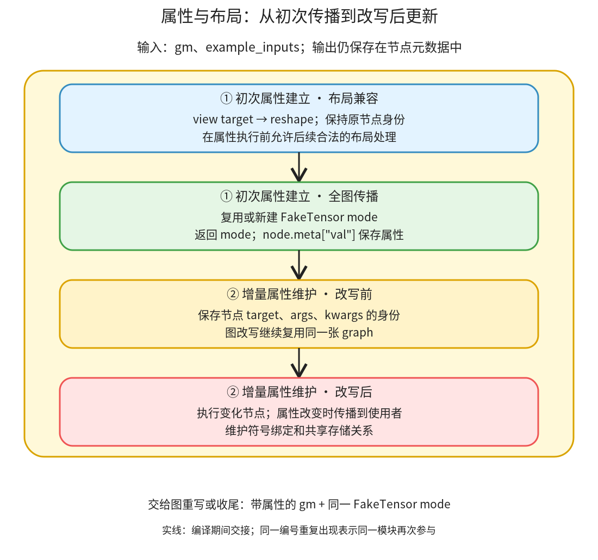

# 属性与布局描述：建立节点属性，并在图改写后沿使用者更新

```text
Inductor  本层完成
    └── 图准备  本层完成
        └── 属性与布局描述 ← 当前篇  本层完成
            ├── 初次属性建立  叶子·逐行完成
            └── 增量属性维护  叶子·逐行完成
```

<!-- child-links:start -->
直接子篇：[初次属性建立](01-initial/README.md)、[增量属性维护](02-incremental/README.md)。
<!-- child-links:end -->

[返回图准备](../README.md)。本模块接收 `gm` 和示例输入，先允许布局兼容的表示，再在 FakeTensor 环境中推导节点属性；图改写后，它按变化范围补算元数据。返回值是 FakeTensor mode，主要数据产物是节点的 `meta['val']`，不能把两者当作同一个对象。

## 1. 两个模块怎样接力



①在整个准备入口执行：改 view target，检测输入的 FakeTensor mode，初次传播。②在 post-grad 主要图重写之前建立基线，在收尾时检查图是否变化并增量更新。图中重复编号表示同一职责多次参与，不增加目录层级。

调用位置与状态交接分别在 [compile_fx.py](/work/pytorch/torch/_inductor/compile_fx.py:760)、[post_grad_passes](/work/pytorch/torch/_inductor/fx_passes/post_grad.py:72)、[FakeTensorUpdater](/work/pytorch/torch/_inductor/fx_utils.py:55)。初次传播与后续增量维护共用同一 FakeTensor mode，后续使用者不另建一套互不相容的符号与存储环境。

## 2. 初次属性建立收到什么，交给谁

输入是 FX 节点和按 placeholder 顺序排列的示例参数。对本地 `x.view(6)`，`view_to_reshape` 修改节点 target，不删除节点；节点名字和来源信息可以继续保留。这样后续调整布局时，不被原 view 的严格步长兼容要求提前拦住。该处理不自行决定最终是否复制。

随后 `fake_tensor_prop` 检测当前 tracing context、活动 mode 与输入中的 FakeTensor mode。无现成 mode 时，新建 `allow_non_fake_inputs=True` 的环境并调用 `FakeTensorProp.propagate`；有 mode 时，调用 `propagate_dont_convert_inputs`，按参数条件临时允许非 fake 输入。两个分支最终都返回 mode。

例如 x 是 CPU float32，shape `(2,3)`、stride `(3,1)`，`relu(x)*2` 的 relu 和 mul 节点属性也描述同样的尺寸、步长、设备与类型。FakeTensor 描述的是输出张量的性质，不保存 `relu(x)` 的实际六个计算值。

模块将带属性的图交给图重写，同时把 mode 留给后续属性计算。保留同一 mode 关系到符号尺寸及假存储的一致性；无法用 FakeTensor 推导的算子可能在这里报错，而不是保证所有数据依赖逻辑都可静态执行。

依据：[view_to_reshape](/work/pytorch/torch/_inductor/fx_passes/post_grad.py:974)、[fake_tensor_prop](/work/pytorch/torch/_inductor/compile_fx.py:392)。FakeTensorProp 本体位于 FX 属性执行设施，作为本模块的依赖说明其相关接口，不扩展成 torch.compile 上游教程。

## 3. 增量属性维护收到什么，怎样知道该更新谁

②收到已经有属性的 `graph`，构造 updater 时保存每个节点的结构签名：节点对象、target、args 容器身份与 kwargs 容器身份。这里主要检测结构变化，不是对真实 Tensor 内容做 hash。

图改写可以替换 target、重接 args、插入新节点；但 FX 不会因此自动同步旧的 `meta['val']`。updater 再次遍历时，结构签名变化的节点先执行一遍 FakeTensor 算子；如果属性确实变化，则将它的使用者放入待更新集合。后面的用户即使自己的 target/args 容器没改，也要重算，因为它读取的输入属性变了。

例如 relu 原输出 `(2,3)`，把它改成沿维度 1 求和后，输出变 `(2,)`。后面的乘二节点仍然引用同一个前驱节点，但输出也应变 `(2,)`，所以不能只更新直接被编辑的那个节点。

更新过程取节点参数里的 `meta['val']` 代替 FX Node，再在 `V.fake_mode` 下调用 target。缺少某个参数的属性时，该节点会被跳过；非 ATen/getitem 等不适合 fake 执行的节点也不会直接调用。这个跳过不是证明属性正确，调用者仍需确保下游需要的元数据已经具备。

对新旧属性的比较不只看 shape，还检查结构、布局、步长、offset、设备和存储关系。对全新且不与其他节点共享的存储，允许把等价新分配当作未发生可观察变化；对共享存储则不能仅因为尺寸相同就忽略别名关系。符号绑定也会按变化刷新。本地比较器没有显式比较 dtype；单独 dtype 变化可留下旧 metadata 的局部行为，见[增量属性维护的完整实现](02-incremental/README.md)。

本模块的状态产物是更新后的 `node.meta['val']`、符号绑定及已处理签名集合；没有返回一张替换图。收尾拿到更新后的原 graph，继续写入恢复与结构检查。依据：[增量维护完整实现](/work/pytorch/torch/_inductor/fx_utils.py:55)、[取属性参数](/work/pytorch/torch/_inductor/fx_utils.py:211)。具体每行和各类相等判断见两个子篇的完整展开。

## 4. 受控案例：改图以后，旧元数据如何变成新元数据

本案例单独测试属性维护，不运行 Inductor kernel，也不作为优化收益。真实输入是 CPU float32 `(2,3)`、stride `(3,1)`：

```text
x = [[-2,-1,0], [1,2,3]]
初始图：x → relu → mul(2) → output
```

**① 接收图与输入。** `fake_tensor_prop(gm,[x])` 返回 FakeTensorMode，relu 和 mul 的 `meta['val'].shape` 都是 `(2,3)`。真实 x 没有被修改。

**② 记录基线。** 构造 `FakeTensorUpdater(gm.graph)`，保存 relu 与 mul 现有签名。接着受控实验模拟一次图改写：

```python
relu_node.target = torch.ops.aten.sum.dim_IntList
relu_node.args = (x_node, [1])
```

这里保留原节点对象，名字仍叫 relu；语义已成为 sum。此刻 relu 节点旧属性仍为 `(2,3)`，mul 的旧属性也为 `(2,3)`。单独改 target/args 并不会自动刷新它们。

**② 检测并传播。** 在原 mode 下调用 `incremental_update()`。relu 的 target/args 签名改变，得到新的 FakeTensor shape `(2,)`，于是把 mul 标记待处理。mul 虽然结构没改，仍重新执行属性计算，得到 `(2,)`。输入 placeholder 属性保持不变。

实际采集：

```text
                    relu 名字的节点       mul 节点
初次传播后           [2,3]                 [2,3]
改图但未更新         [2,3]                 [2,3]
incremental_update 后 [2]                   [2]
```

**交给图收尾。** `gm.recompile()` 使 Python forward 采用新图，`lint()` 检查结构。之后另行用真实 x 执行该 FX 图，输出为 `[-6,12]`，与 `x.sum(1)*2` 一致。这里的真实执行验证改写后的图可运行；增量更新本身只处理属性，没有生成这些数值。

[实验脚本](../../experiments/properties.py) 保留精确操作，[结果](../../experiments/properties.json) 包含改写前后的图和三个时刻的 shape。节点名与 target 的差异也保存在记录中。

## 5. 两个容易混淆的出口

当图结构和输入属性没有变化时，②可以跳过已处理节点；这与①初次全图传播不同。当节点执行后属性和有效存储关系没有变化时，也可以停止向使用者传播；“结构被编辑”不必然意味着所有下游都重算。

相反，某个节点缺失属性而被跳过，只表示 updater 没有可执行的 fake 参数，不代表这个图已经准备完成。符号表达式无法静态判等、非标准布局和复杂别名会改变比较分支，本案例没有覆盖所有情况。

两个子篇分别完整解释布局 target 替换和 mode 选择，以及签名、等价比较、传播与符号绑定。两个子模块现已完整逐行解释；本单元的模式选择与增量维护实现均可从上方子篇进入。
