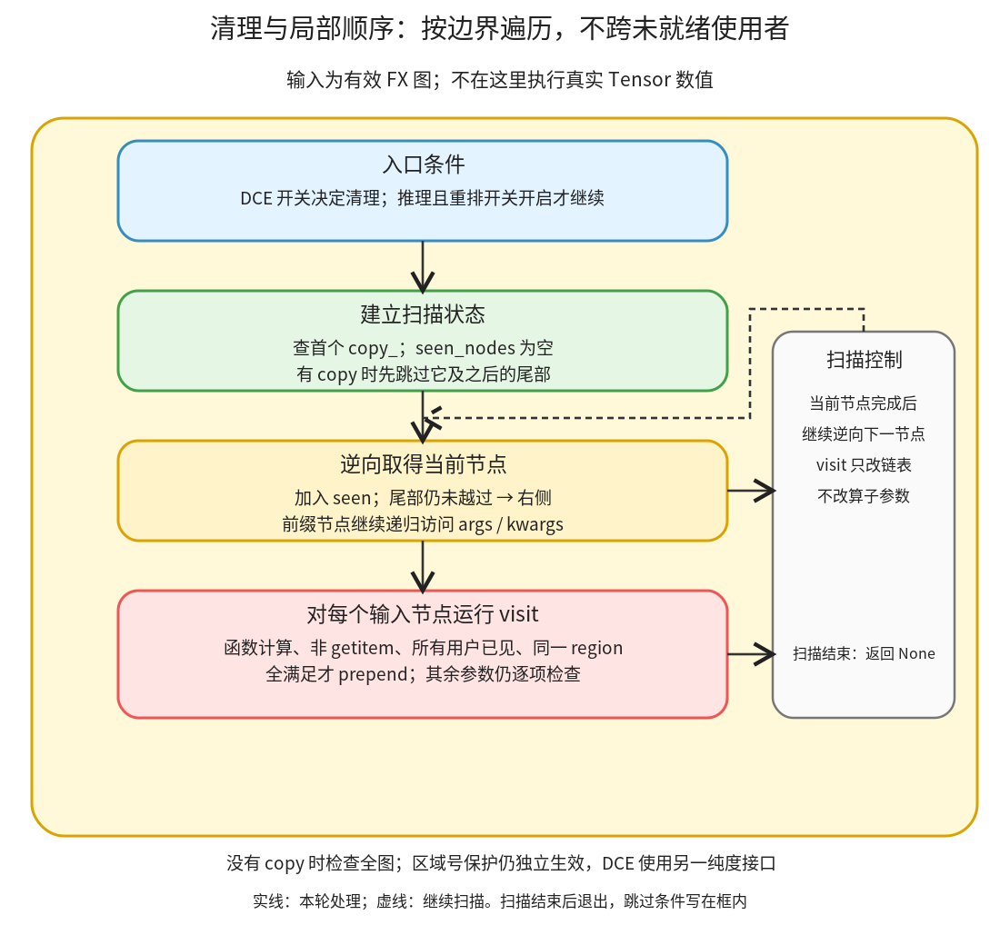

# 清理与局部顺序：删无用纯计算，再把允许移动的产生者靠近使用者

```text
Inductor  本层完成
    └── 图准备  本层完成
        └── 图重写  本层完成
            └── 清理与局部顺序 ← 当前篇  叶子·逐行完成
```

<!-- child-links:start -->

<!-- child-links:end -->

[返回图重写](../README.md)。本单元接收准备中的 FX 图，按配置删除无用计算，再在推理路径调整局部顺序。移动不会重新计算 Tensor，只修改节点链表；是否允许移动取决于使用者是否都已访问，以及是否处在同一写入区域。

## 1. 完整范围与整体流程

本篇完整覆盖 post_grad.py 的两个入口条件块 79–84、reorder_for_locality 函数 160–189，以及 pattern_matcher.py 的区域辅助实现 1609–1657。入口块是 post_grad_passes 内这项职责的完整调用范围，不冒充整个 post_grad_passes；其余各项函数与正则定义均完整保留。



入口先看 dce 开关，调用通用 FX DCE；推理且 reorder_for_locality 开启时，再逆向遍历节点。第一个 copy_ 及它后面的尾部不在重排范围；对前面的每项输入，只有它是普通函数计算、不是 getitem、所有用户都已经在逆向遍历中见过、区域一致，才移到当前节点前。

区域编号由共享 helper 根据操作名字和 out 参数建立或补算，模式匹配也使用它。它不是完整的算子副作用 schema 分析；DCE 的纯度判定与这套区域名字规则也不是同一个接口。

## 2. 两个入口条件块：完整源码

<!-- source:post_grad.cleanup_entry:start -->
```python
    if config.dce:
        # has some issues with mutation in inference mode
        gm.graph.eliminate_dead_code()

    if is_inference and config.reorder_for_locality:
        reorder_for_locality(gm.graph)
```
<!-- source:post_grad.cleanup_entry:end -->

| 行 | 操作的数据、状态与目的 |
| --- | --- |
| 79 | dce 开启才请求删除死代码；不与后面的推理重排开关绑定。 |
| 80 | 原注释提醒 mutation 条件的限制，不证明任意带副作用的 FX 图都安全。 |
| 81 | 修改 gm.graph，删除无用且被通用接口判定可删的节点；接口的 changed 结果没有在这里保存。 |
| 82 | 空行，两项独立条件之间无额外数据处理。 |
| 83 | 只有 is_inference 与 reorder_for_locality 同时为真才重排；训练图不从这项条件进入。 |
| 84 | 将同一 graph 交给下面的局部重排，不返回新 GraphModule。 |

通用 [Graph.eliminate_dead_code](/work/pytorch/torch/fx/graph.py:1599) 先检查拓扑，再逆序删除没有用户且不被认定有副作用的节点。[Node.is_impure](/work/pytorch/torch/fx/node.py:644) 会保留输入、输出、schema 标明 mutable 的调用等。这里仅说明调用的实际契约，不把 FX 通用库再拆成 Inductor 子模块，也不声称其启发式覆盖所有自定义副作用。

## 3. reorder_for_locality：完整源码与逐行解释

<!-- source:post_grad.reorder_for_locality:start -->
```python
def reorder_for_locality(graph: torch.fx.Graph):
    def visit(other_node):
        if (
            other_node.op == "call_function"
            and other_node.target != operator.getitem
            and all((n in seen_nodes) for n in other_node.users)
            and get_mutation_region_id(graph, node)
            == get_mutation_region_id(graph, other_node)
        ):
            # move node's producers right before it
            node.prepend(other_node)

    seen_nodes = set()

    # only reorder nodes before the first copy_ in the graph.
    # copy_ will appear at the end of functionalized graphs when there is mutation on inputs,
    # and this reordering doesnt work well with mutation
    first_copy = next(
        iter(graph.find_nodes(op="call_function", target=torch.ops.aten.copy_.default)),
        None,
    )
    past_mutating_epilogue = True if first_copy is None else False

    for node in reversed(graph.nodes):
        seen_nodes.add(node)
        if not past_mutating_epilogue:
            past_mutating_epilogue = node is first_copy
            continue

        torch.fx.map_arg((node.args, node.kwargs), visit)
```
<!-- source:post_grad.reorder_for_locality:end -->

| 行 | 操作的数据、状态与目的 |
| --- | --- |
| 160 | 收到 graph；只改变节点排序，无新图返回值。 |
| 161 | 定义访问一个输入节点的 callback。它闭包引用外层当前 node 和 seen_nodes。 |
| 162–163 | 要求 other_node 是 call_function 计算。placeholder/get_attr 等不在这里被挪动。 |
| 164 | 排除 operator.getitem，不用这条规则移动取多输出项的节点。 |
| 165 | 要求 other_node 的所有用户都已进入 seen_nodes；不能只顾当前用户，把产生者挪到另一个尚未访问的用户后面。 |
| 166–167 | 取得当前 node 与输入 other_node 的区域编号，要求相同；不把产生者跨写入边界拖到后面。 |
| 168 | 完成所有条件，它们同时满足才进入移动。 |
| 169 | 原注释说明动作是把当前节点的产生者移到它前面。 |
| 170 | node.prepend(other_node) 将同一个节点对象插到当前 node 之前，不改它的计算参数，也不创建第二份计算。 |
| 172 | seen_nodes 从空集合开始，记录逆向遍历已经抵达的节点。 |
| 174–176 | 原注释限定 copy_ epilogue 处理范围；实际边界由下面查到的第一个 copy_ 决定。 |
| 177–180 | 查找图中按顺序出现的首个 aten.copy_.default；没有则 first_copy=None。 |
| 181 | 无 copy 时，从逆向遍历开始就允许检查；有 copy 时先停用，直到逆向走到这个边界。 |
| 183 | 从图尾向前遍历原节点链表；移动动作仍作用在这张 graph 上。 |
| 184 | 先把当前 node 记入 seen_nodes；它的产生者若只有这个用户，165 的用户条件可成立。 |
| 185 | 尚未越过 copy 尾部时，不处理当前节点的输入。 |
| 186 | 当前节点恰好是 first_copy 时，打开后续逆向位置的处理；否则继续停用。 |
| 187 | 当前 node 无论是不是边界都跳过 callback；所以 first_copy 本身及它后面的尾部都不被这条遍历重排。 |
| 189 | map_arg 递归访问 args/kwargs 中的 FX Node，将其交给 visit。回传的嵌套结构被忽略；这里只利用 callback 的排序副作用，不把 node.args 换成 None。 |

“所有用户已见过”在逆向扫描中意味着：若把产生者挪到当前用户前面，不会越过另一个仍需要它的更早用户。区域条件再防止读到不同存储版本。这两个条件缺一不可。

## 4. 区域 helper：完整源码

<!-- source:pattern_matcher.mutation_regions:start -->
```python
def is_start_of_fx_graph(graph: torch.fx.Graph, node: torch.fx.Node) -> bool:
    # first node in the graph
    return node is next(iter(graph.nodes))


# match: copy_, relu_, _set_grad_enabled, manual_seed, _enter_autocast, etc
# doesn't match: __rshift__, etc
_mutation_op_re = re.compile(r"(?<!_)(_$|_[.]|(\b|_)(set|enter|exit|seed)(\b|_))(?!_)")


def is_mutation_op(node: torch.fx.Node) -> bool:
    if node.op == "call_function":
        if _mutation_op_re.search(node.target.__name__):  # type: ignore[union-attr]
            return True
    elif node.op == "call_method":
        if _mutation_op_re.search(node.target):  # type: ignore[union-attr, arg-type]
            return True
    return node.kwargs.get("out") is not None


def same_mutation_regions(a: torch.fx.Node, b: torch.fx.Node) -> bool:
    assert "mutation_region_id" in a.meta
    assert "mutation_region_id" in b.meta
    return a.meta["mutation_region_id"] == b.meta["mutation_region_id"]


def get_mutation_region_id(graph: torch.fx.Graph, node: torch.fx.Node) -> int:
    n = node
    while "mutation_region_id" not in n.meta and not is_start_of_fx_graph(graph, n):
        n = n.prev
    mutation_region_id = n.meta.get("mutation_region_id", 0)
    while n is not node:
        n = n.next
        if is_mutation_op(n):
            mutation_region_id += 1
        n.meta["mutation_region_id"] = mutation_region_id
    return mutation_region_id


def should_compute_mutation_region_ids(graph: torch.fx.GraphModule) -> bool:
    return "mutation_region_id" not in next(iter(graph.nodes)).meta


def compute_mutation_region_ids(graph: torch.fx.GraphModule) -> None:
    mutation_region_id = 0
    for nd in graph.nodes:
        if is_mutation_op(nd):
            mutation_region_id += 1
        nd.meta["mutation_region_id"] = mutation_region_id
```
<!-- source:pattern_matcher.mutation_regions:end -->

| 行 | 操作的数据、状态与目的 |
| --- | --- |
| 1609–1611 | is_start_of_fx_graph 用对象身份判断是否为 graph.nodes 首项；没有复制或比较节点名字。 |
| 1614–1616 | 注释与正则定义。正则识别单下划线结尾/overload 分隔处及 set/enter/exit/seed 等名字形态，并排除部分双下划线形式。 |
| 1619 | is_mutation_op 取得一个节点，判断本工具是否视它为区域边界。 |
| 1620–1622 | call_function 时匹配 target.__name__；如 copy_.default 的下划线与点可命中，返回 True。 |
| 1623–1625 | call_method 时对字符串 target 做相同匹配，命中返回 True。 |
| 1626 | 名字未命中时，非 None 的 out 参数也算边界；否则返回 False。不是任意自定义目标的完整 schema 分析。 |
| 1629–1632 | same_mutation_regions 要求两项 metadata 都已有 mutation_region_id，再比较数值；它自己不补算缺失区域。 |
| 1635 | get_mutation_region_id 收到 graph 与目标 node，允许按需补区域。 |
| 1636 | 从目标 node 开始向前寻找可用基线。 |
| 1637–1638 | 当前没有缓存且不是首节点时向 prev 走；遇到缓存或首节点停止。 |
| 1639 | 有缓存就用缓存值，没有就以 0 为起点；这一步未强制给首节点写 meta。 |
| 1640–1641 | 从找到的基线向 next 前进，直到最初请求的 node。 |
| 1642–1643 | 每推进到一个被识别的修改节点，区域号加 1。 |
| 1644 | 给经过的节点写 mutation_region_id，供后面的查询复用。 |
| 1645 | 返回到达目标时的区域号。 |
| 1648–1649 | should_compute_mutation_region_ids 只检查首节点是否缺该字段；不是扫描所有节点的一致性验证。虽然注解写 GraphModule，此处实际需要有 nodes 的 graph 接口。 |
| 1652–1653 | 批量计算函数从区域 0 开始。 |
| 1654–1656 | 正序经过所有节点，遇到识别出的修改先递增。 |
| 1657 | 每个节点都写缓存，包括首节点；它与懒查询不强制写首节点的行为要区分。 |

本篇把这组共享 helper 完整解释一次，后续模式篇链接使用。调用方若进行会改变区域的结构改写，不能把沿用旧缓存当作已经重新验证；本函数没有在每次查询时清空并重新计算全部区域。

## 5. 主案例：两个支路的中间计算靠近各自用户

输入 x/y 为 CPU float32、shape `(2,3)`、stride `(3,1)`：

```python
a = x.sin()
b = y.cos()
c = a + 1
d = b + 2
return (c, d)
```

进入重排时原链表为 `x_1,y_1,sin,cos,add,add_1,output`，没有 copy_，181 从一开始为 True。

逆向先见 output，再到最后的 add_1。visit 看到其产生者 cos：它是 call_function、不是 getitem、唯一用户 add_1 已在 seen 中、区域都为 0，因此把 cos 接到 add_1 前。sin/add 的原有依赖保持。

真实出口顺序为：

```text
x_1,y_1,sin,add,cos,add_1,output
```

参数边没有改，原对象没有复制。新 forward 执行结果与原函数相同，输入保持不变。这个动作让本例 sin 的计算和使用紧邻，不据此声称峰值内存或耗时已改善；输出 c 的存活区间也可能相应变化，需要实际评估。

## 6. 三种不能照搬移动的条件

**同一产生者有两个用户。** sin 的结果同时给 add 和 mul，在逆向到 mul 时，较早的 add 尚未见过；165 不成立，不能把 sin 拖到 mul 前而越过 add。真实 shared 案例的节点顺序保持不变。

**copy 后还有计算。** `a=sin(x); x.copy_(y); b=cos(x); c=a+1` 中，逆序扫描在到首个 copy_ 前一直跳过，copy_ 本身也跳过；不会把 sin 拖到 copy 后。真实 copy_tail 案例顺序保持，旧 sin 与新 cos 仍读取正确版本。

**首个 copy 之前另有 add_。** sin 在 add_ 前，消费它的 add 在 add_ 后；虽然两者都在首个 copy 前，区域号分别为 0 与 1，166–167 仍阻止跨越。真实 other_mutation 案例中的 copy_ 是区域 2，旧值计算未被移到错误区域。

这些案例均执行重排后的 FX 图，并比较结果和调用后输入，不只是比较节点数。

## 7. DCE 删除无用纯读，但保留修改

对 `unused=x.sin(); x.copy_(y); return x`，通用 DCE 删除没有用户的 sin，保留 mutable schema 的 copy_ 与图接口节点。执行后 x 正确变为 y。

这证明当前案例的效果，不证明全部任意 Python 副作用都已被识别。入口注释与 FX 接口条件都要求调用方提供合适的图；本模块不替所有用户函数重新推导完整副作用模型。

精确原/新图和输出见 [cleanup-noops/results.json](../../../experiments/cleanup-noops/results.json)，复现 [cleanup_noops.py](../../../experiments/cleanup_noops.py)。本单元没有生成后端 kernel，也没有性能计时。

## 8. 覆盖结论

本篇完整解释两项入口条件、局部排序函数及区域 helper 家族，没有按每个小函数建目录。接口之外的 FX DCE、map_arg 与链表 prepend 只交代相关语义；不是另开上游源码系列。下一同层职责进入 noop 候选和存储保护。
