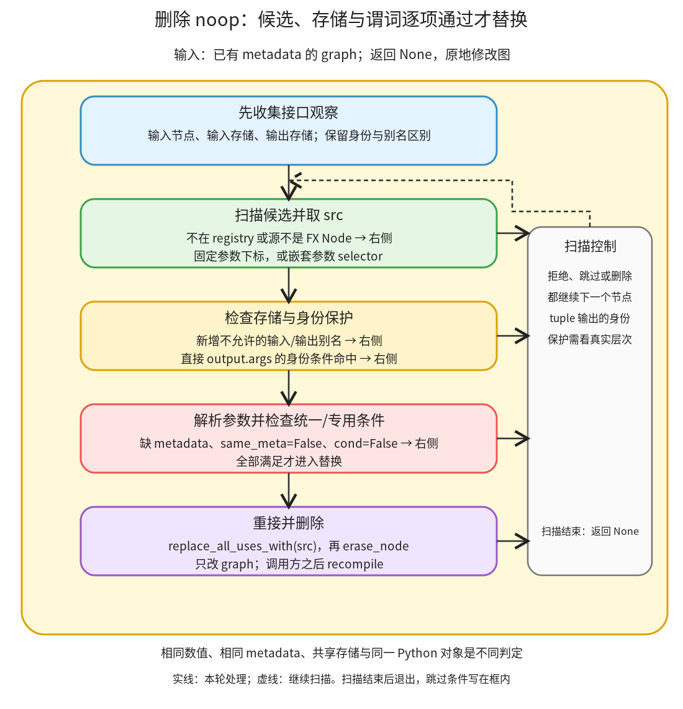

# 无效操作与存储边界：满足元数据、算子条件和接口约束后，才重接到源节点

```text
Inductor  本层完成
    └── 图准备  本层完成
        └── 图重写  本层完成
            └── 无效操作与存储边界 ← 当前篇  叶子·逐行完成
```

<!-- child-links:start -->

<!-- child-links:end -->

[返回图重写](../README.md)。本单元收到有 FakeTensor 属性的 FX 图，按 registry 识别候选，检查元数据与输入输出存储关系，再将可删除节点的用户接到源节点。图对象原地修改，返回 None；名字为 noop 并不表示只检查结果数值。

## 1. 完整范围与整体流程

完整范围为 [post_grad.py](/work/pytorch/torch/_inductor/fx_passes/post_grad.py:636) 的 same_meta、noop_registry 与所有本地谓词注册 636–736，以及 remove_noop_ops 739–797。原始顺序、所有分支和装饰器均完整保留，不为每个小谓词建立目录。



先收集输入节点、输入存储、输出存储，再扫描候选。registry 交出 `(cond,src_index)`：可能从固定参数位置取源，也可能用 selector 从嵌套参数中取源。若会新增不允许的输入/输出共享就跳过，再检查对象身份条件、参数属性是否齐全、same_meta 与算子专用谓词，最后 replace_all_uses_with 与 erase_node。

metadata 和存储辅助函数主要归属[增量属性维护](../../01-properties/02-incremental/README.md)，这里使用其 get_node_storage/get_fake_args_kwargs 契约。same_meta 是本单元另一套比较条件，不能和 updater 的新旧结果比较器混用。

## 2. 元数据比较和全部候选注册：完整源码

<!-- source:post_grad.noop_registry:start -->
```python
def same_meta(node1: torch.fx.Node, node2: torch.fx.Node):
    """True if two nodes have the same metadata"""
    val1 = node1.meta.get("val")
    val2 = node2.meta.get("val")
    return (
        val1 is not None
        and val2 is not None
        and statically_known_true(sym_eq(val1.size(), val2.size()))
        and val1.layout == val2.layout
        and val1.dtype == val2.dtype
        and val1.device == val2.device
        and (
            val1.layout != torch.strided
            or statically_known_true(sym_eq(val1.stride(), val2.stride()))
        )
    )


noop_registry: Dict[Any, Any] = {}


def register_noop_decomp(targets, nop_arg=0):
    def register_fun(cond):
        register_decomposition(targets, registry=noop_registry, unsafe=True)(
            (cond, nop_arg)  # type: ignore[arg-type]
        )
        return cond

    return register_fun


@register_noop_decomp(aten.slice)
def slice_noop(self, dim=0, start=None, end=None, step=1):
    if start is None or end is None:
        return False
    if (
        statically_known_true(sym_eq(start, 0))
        and statically_known_true(end >= 2**63 - 1)
        and statically_known_true(sym_eq(step, 1))
    ):
        return True
    return False


@register_noop_decomp(aten.slice_scatter, 1)
def slice_scatter_noop(self, src, dim=0, start=None, end=None, step=1):
    if start is None:
        start = 0
    if end is None:
        end = 2**63 - 1
    if start == 0 and end >= 2**63 - 1 and step == 1:
        return True
    return False


@register_noop_decomp(aten.repeat)
def repeat_noop(self, repeats):
    return all(r == 1 for r in repeats)


@register_noop_decomp(aten.constant_pad_nd)
def constant_pad_nd(x, padding, fill_value=0):
    return all(p == 0 for p in padding)


@register_noop_decomp(torch.ops.prims.convert_element_type)
def convert_element_type_noop(x, dtype: torch.dtype):
    return x.dtype == dtype


@register_noop_decomp(torch.ops.prims.device_put)
def device_put_noop(x, device):
    return x.device == decode_device(device)


@register_noop_decomp([aten.ceil, aten.floor, aten.round, aten.trunc])
def int_noop(x):
    return is_integer_dtype(x.dtype)


@register_noop_decomp([aten.pow])
def pow_noop(a, b):
    return isinstance(b, int) and b == 1


@register_noop_decomp([aten.cat], lambda args: args[0][0])
def cat_noop(inputs, dim=0):
    return len(inputs) == 1


@register_noop_decomp(aten.view)
def view_noop(arg, size):
    return arg.shape == size


# Note, we also always have a check for identical metadata, which is why these
# are safe
@register_noop_decomp([aten.copy], nop_arg=1)
@register_noop_decomp([aten.alias, aten.clone])
def true_noop(*args, **kwargs):
    return True
```
<!-- source:post_grad.noop_registry:end -->

### 2.1 same_meta 与注册协议：636–664

| 行 | 数据、状态与目的 |
| --- | --- |
| 636–639 | 接收两个节点，从各自 meta 取得 val；没属性时为 None。 |
| 640–643 | 两个 val 都必须存在，尺寸相等还要能被静态确定为真。 |
| 644 | layout 类型一致，例如不能将两种不同布局当成相同。 |
| 645 | 显式要求 dtype 相同；这一项与 updater 比较器不同。 |
| 646 | device 相同，不能把设备转换仅因值看起来相同就删除。 |
| 647–650 | strided 布局还要求 stride 静态相同；非 strided 不走该项。这里没有额外比较 storage_offset。 |
| 651 | 结束整个布尔表达式，返回是否满足本工具的 metadata 条件，不是任意 Tensor 的完整相等证明。 |
| 654 | 建立这个 pass 自己的 registry，不是把谓词当普通 Tensor decomposition 执行。 |
| 657 | register_noop_decomp 接收 targets 和源参数选择，默认 nop_arg=0。 |
| 658 | 内层装饰器接收算子的判定函数 cond。 |
| 659–661 | 借 register_decomposition 将 `(cond,nop_arg)` 写入指定 noop_registry；unsafe=True 允许这种非普通函数的注册项。它不把此 tuple 加到默认全局分解表。 |
| 662 | 返回原 cond 函数，保留装饰后可直接调用的对象。 |
| 664 | 返回装饰器，供随后每个函数注册使用。 |

same_meta 没有把任意非 Tensor 的 val 自动转换为 Tensor；若传入不具备这些属性的值，异常会向调用者传播，不走一个无条件安全的 False 出口。

register_decomposition 的 overload 扩展与 registry 参数语义据 [torch._decomp 实现](/work/pytorch/torch/_decomp/__init__.py:150) 核对；不在这里重复讲整个分解系统。

### 2.2 每个算子谓词：667–736

| 行 | 专用条件、源节点与它不单独保证的内容 |
| --- | --- |
| 667–668 | slice 注册到默认源参数 0，并给出 dim/start/end/step 默认值。 |
| 669–670 | start 或 end 缺失直接 False；不将缺参自动归一化为全范围。 |
| 671–676 | start 静态为 0、end 静态至少为大整数上界、step 静态为 1 时 True。 |
| 677 | 其他 slice 情况 False，不因某组数值偶然相同删除。 |
| 680–681 | slice_scatter 的源选择为参数 1，即 src；判定的是全范围覆盖可替换为 src，不是替换为原 self。 |
| 682–685 | 此谓词将缺省 start/end 分别补成 0/最大界，和 slice 谓词的缺参处理不同。 |
| 686–688 | start=0、end 足够大、step=1 才 True，否则 False；metadata/存储条件仍由扫描器另查。 |
| 691–693 | repeat 所有 repeats 都为 1 才满足谓词；并不直接许可返回值新增别名。 |
| 696–698 | constant_pad_nd 所有 padding 为 0 才满足；fill_value 不影响这项零 padding 条件。 |
| 701–703 | prims.convert_element_type 只在输入 dtype 与目标 dtype 相同时满足。 |
| 706–708 | prims.device_put 比较输入设备与 decode_device 后的目标；不能只按原字符串相等判断。 |
| 711–713 | ceil/floor/round/trunc 使用 is_integer_dtype 的分类条件；不是对所有浮点输入判定恒等。 |
| 716–718 | pow 仅在 b 是 Python int 且等于 1 时满足，不对任意动态指数做值猜测。 |
| 721–723 | cat 的 selector 从 args[0][0] 取第一个输入；专用条件要求 inputs 长度恰好为 1。 |
| 726–728 | view 直接比较 arg.shape 与 size；这里没有额外做 size 容器或负维的归一化。 |
| 731–732 | 原注释强调还有统一 metadata 检查；不能把这个注释扩展成所有对象身份都已保护的证明。 |
| 733 | aten.copy 的源是参数 1，和默认源位置不同。 |
| 734 | aten.alias、aten.clone 使用默认源参数 0。 |
| 735–736 | true_noop 总是 True；实际是否删除完全依赖外层 metadata 与存储等检查。不是直接无条件删 clone。 |

同形状 view 的 target 在普通准备入口还可能已被换成 reshape，因此 registry 有一项不等于每次都能遇到它。具体输入图和 target 决定扫描是否进入候选分支。

## 3. remove_noop_ops：完整源码

<!-- source:post_grad.remove_noop_ops:start -->
```python
def remove_noop_ops(graph: torch.fx.Graph):
    """
    Removes both operations that are essentially aten.clone and operations that are essentially aten.alias from the graph.
    """
    inputs = set()
    input_storages = set()
    output_storages = set()

    for node in graph.find_nodes(op="placeholder"):
        inputs.add(node)
        input_storages.add(get_node_storage(node))

    output_node = next(iter(reversed(graph.nodes)))
    assert output_node.op == "output"
    outputs = output_node.args[0]
    if not isinstance(outputs, (list, tuple)):
        # nested subgraphs can have singleton outputs
        outputs = (outputs,)
    for out in outputs:
        if isinstance(out, torch.fx.Node):
            output_storages.add(get_node_storage(out))

    for node in graph.nodes:
        if node.target in noop_registry:
            cond, src_index = noop_registry[node.target]
            if isinstance(src_index, int):
                src = node.args[src_index]
            else:
                src = src_index(node.args)
            if not isinstance(src, torch.fx.Node):
                continue
            # Don't introduce new aliasing between inputs and outputs.
            # See fx_passes/README.md for a discussion of why this is
            # necessary.
            node_storage = get_node_storage(node)
            src_storage = get_node_storage(src)
            node_is_view = node_storage == src_storage
            if (
                not node_is_view
                and node_storage in output_storages
                and (src_storage in input_storages or src_storage in output_storages)
            ):
                continue

            # Even if input and outputs are expected to alias,
            # don't make "node is src" True
            if (
                node_is_view
                and node in output_node.args
                and (src in inputs or src in output_node.args)
            ):
                continue

            is_valid, args, kwargs = get_fake_args_kwargs(node)
            if not is_valid:
                continue
            if same_meta(node, src) and cond(*args, **kwargs):
                node.replace_all_uses_with(src)
                graph.erase_node(node)
```
<!-- source:post_grad.remove_noop_ops:end -->

### 3.1 先建立外部接口观察范围：739–759

| 行 | 数据、状态与目的 |
| --- | --- |
| 739–742 | 接收 graph，原说明限定本工具处理 clone/alias 类等价操作。 |
| 743–745 | 分别初始化输入节点、输入存储、输出存储集合。节点身份与存储身份是不同信息。 |
| 747–749 | 遍历 placeholder，记节点对象和 get_node_storage 的结果；不将图常量自动当成 placeholder。 |
| 751–752 | 取图最后节点并断言为 output；依赖图结构有效。 |
| 753 | 取 output.args[0] 作为图返回对象。注意这比 output.args 少一层。 |
| 754–756 | 返回对象不是 list/tuple 时包装为单元素 tuple，兼容某些单输出子图。 |
| 757–759 | 记录直接输出 FX Node 的存储。不递归收集任意深度嵌套结构里的所有观察。 |

get_node_storage 可返回 None，集合中也可能包含 None。它是当前 pass 的标识接口，不应把缺少存储信息当成已完成物理别名证明。

### 3.2 取源、保护接口、替换与删除：761–797

| 行 | 数据、状态与目的 |
| --- | --- |
| 761–763 | 正向扫描，target 在 registry 才取得 cond 和源选择；其它节点保持。 |
| 764–765 | 固定整数位置直接取 node.args[src_index]。 |
| 766–767 | 否则调用 selector，例如 cat 从嵌套输入列表选第一个节点。 |
| 768–769 | 源不是 FX Node 时跳过，不拿普通字面量当作可直接重接的图节点。 |
| 770–772 | 原注释说明下一段避免新增输入/输出别名；正文以实际条件判断范围为准。 |
| 773–775 | 取候选与源存储，标识相等时 node_is_view=True。None==None 也会使它为 True，变量名本身不是更强的存储证明。 |
| 776–781 | 候选不是已有同存储 view，且候选存储被输出观察、源存储又被输入或输出观察时，拒绝替换。这样输出 clone 等独立存储不会直接变成观察到的源存储。 |
| 783–784 | 原注释希望即使原本共享存储，也不要把 node 与 src 合成同一对象。下一段的容器层次决定其实际效果。 |
| 785–790 | 已同存储，node 直接在 output_node.args 中，且 src 是输入或也直接在 output_node.args 中时跳过。这里写的是 args，不是前面归一化的 outputs；普通 tuple 输出不一定满足此 membership。 |
| 792 | 将参数里的 Node 换成 fake 值，并取得是否所有引用都有可用 metadata。 |
| 793–794 | 参数不完整则跳过，保留节点，不把缺属性当作删除许可。 |
| 795 | 同时满足统一 same_meta 和专用 cond 才替换；Python and 会在前者失败时不再求 cond。 |
| 796 | 将候选的全部用户接到 src，更新使用者关系；不是仅改 graph output。 |
| 797 | 删除已无用途的候选节点。没有在函数末尾自行 recompile，调用方仍需收尾。 |

存储保护与对象身份保护要分开核对。下一节既有符合存储约束的删除，也有当前身份条件未覆盖普通 tuple 的反例，不能只照抄注释当成保证。

## 4. 主案例：为什么内部 clone 能删，输出 clone 不能删

CPU float32 连续 x shape `(2,3)`、stride `(3,1)`，值为 `[[-2,-1,0],[1,2,3]]`。

**内部 clone。** 图为 `return (relu(x.clone()),)`。输入存储 S0，clone 为新存储 S1，图输出 relu 在 S2。761 找到 clone，src 为输入 x；S1 不属于输出存储，所以 776 的拒绝条件不成立。fake 参数齐全，same_meta 与 true_noop 都满足，relu 的输入重接到 x，再删 clone。

真实出口只剩 aten.relu.default；执行后输出和输入存储关系与原函数相同，结果仍为 `[[0,0,0],[1,2,3]]`，输入不变。

**输出 clone。** 改成 `return (x.clone(),)`，S1 属于输出，S0 属于输入。node_is_view=False，776–781 直接跳过，尚未进入 true_noop 就已经拒绝。真实出口保留 clone，输出仍不与 x 共享存储。

因此“谓词总是 True”不能推出“节点总被删除”。决定这两个分支的关键状态是输出观察了哪份存储。

## 5. 更多候选：Tensor 值相同仍不足以删

独立单输入 cat 的输出也有新存储：`return cat([x])` 会保留，内部 `relu(cat([x]))` 可以删 cat。它与 clone 的区别在源选择：从嵌套 args[0][0] 取 x，而不是普通 args[0]。

`relu(pow(x,1))` 与零 padding 后 relu 的候选在实验中删除；对应其它指数或非零 padding 不满足这里的条件。注册项只给出要检查的情形，不代替元数据和外部存储约束。

primitive convert_element_type 的两条真实对照为：目标仍是 float32 时删除内部转换；改为 float64 时保留，relu 的实际输出也为 float64。另一个 `_to_copy` 转换保留的原因包括它根本不在这份 registry，不能把两项不同 target 都解释成同一谓词分支。

## 6. 对象身份保护的 tuple 层次边界

原始图为 `return (aten.alias.default(x),)`。执行前，输出与 x 共享存储，但不是同一 Python Tensor 对象。

metadata 中候选和源存储标识相同，所以第一段“禁止新增别名”的拒绝不命中。普通 FX output 的 args 是 `((alias_node,),)`：alias_node 在内层 tuple，但不直接在 output_node.args 中。787 的条件为 False，身份保护分支没有进入；same_meta 和 true_noop 使 alias 被删。

真实直接-pass 观察：

```text
                 处理前       处理后
结果数值          相同         相同
结果共享 x 存储   True         True
result is x       False        True
```

换成非 tuple 的单个 Node 输出，output.args=(alias_node,)，787 命中，alias 保留，result is x 仍为 False。两条路径的差别正是代码使用的容器层次。

这是局部 remove_noop_ops 对原始 FX 图的实测，不声称完整 torch.compile 的最终包装必然得到同样的对象身份结果；上层可能还有接口恢复。本文也没有修改实现去迎合注释。若只测数值或 data_ptr，共享身份的这项差别会被漏掉。

## 7. 复现与覆盖边界

[cleanup_noops.py](../../../experiments/cleanup_noops.py) 真正运行 FakeTensor 传播和此 pass，重新生成 FX forward 后比较结果、存储和身份。精确前后图与结果见 [results.json](../../../experiments/cleanup-noops/results.json)。没有把局部图 pass 的执行当成后端 kernel 性能结果。

本篇完整覆盖全部本地注册谓词、统一元数据检查与扫描删除实现。没有单独运行所有 slice、repeat、device_put、整数 rounding、动态符号或无存储布局组合；这些分支的源码语义已逐行说明，运行覆盖明确限于上面的互补案例。后续同层进入模式匹配与子图替换。
