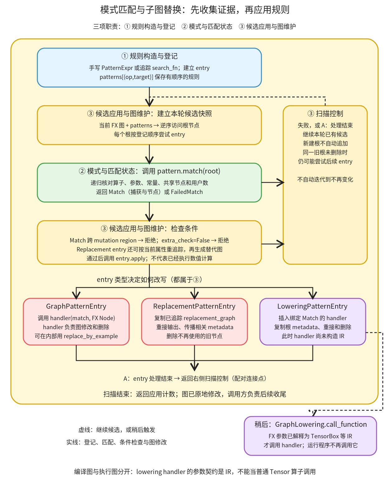

# 模式匹配与子图替换：把结构证据交给受条件约束的改写

```text
Inductor  本层完成
    └── 图准备  本层完成
        └── 图重写  本层完成
            └── 模式匹配与子图替换 ← 当前篇  本层完成
                ├── 规则构造与登记  待展开
                ├── 模式与匹配状态  待展开
                └── 候选应用与图维护  待展开
```

<!-- child-links:start -->

<!-- child-links:end -->

[返回图重写](../README.md)。本模块收到当前 FX 图与已登记的模式集合，找出满足结构和附加条件的子图，并通过对应 entry 修改原图。`PatternMatcherPass.apply` 返回应用计数；改写结果保存在 `graph` 上。它不返回一个 Tensor，也不直接生成完整 kernel。

规则决定“这块子图该变成什么”，匹配器负责“这块图是否符合规则”。结构匹配不会自动证明数值等价、别名等价或可原地写入。相同结构的两个候选，可能因为用户数、写入区域、shape 或额外检查而得到不同结果。

## 1. 从规则登记到图上的一次应用



图中只有三项职责：①规则构造与登记、②模式与匹配状态、③候选应用与图维护。③先使用①建立的索引选根，再调用②取得结构证据，回到③检查条件并执行对应 entry。三个 entry 是同一图维护职责的不同策略，不另设三个模块。

①不必在每次扫描前重新运行。[post_grad_passes](/work/pytorch/torch/_inductor/fx_passes/post_grad.py:72) 先初始化规则，再依次应用已有 pass；规则可跨图复用，`Match` 则属于当前图上的一次匹配。把注册和匹配混在一起，会误以为每个 FX 节点都需要重新追踪一遍整个规则库。

③首先按规则的 `op/target` 收集当前候选节点，随后逆序扫描这个集合。结构失败、跨 mutation region、额外检查失败，都继续尝试候选；通过才进入 `entry.apply`。图中配对的 A 表示 entry 处理后也回到扫描控制。它没有把新建根自动加入本轮候选，更没有自动重复扫描到图不再改变。

Lowering entry 的虚线出口表示以后由 `GraphLowering` 调用 handler，不是从改写现场直接跳到数值运行。一次图改写、一次 IR 构造、一次编译后程序调用，是三个不同时间点。

## 2. 三项职责交换什么

### 2.1 规则构造与登记：把搜索条件和处理策略放入索引

输入可以是一段手写的 `PatternExpr`，也可以是搜索函数、替代函数、示例输入和追踪函数。输出是登记在某个 pass 中的 `PatternEntry`。它至少包含 `pattern` 和 `extra_check`，具体 entry 再保存 handler 或参数规范化逻辑。

例如要识别两次取负：

```python
CallFunction(
    aten.neg.default,
    CallFunction(aten.neg.default, KeywordArg("x")),
)
```

这里 `KeywordArg("x")` 表示捕获叶子输入，之后把对应 FX Node 放入 `match.kwargs["x"]`；不是要求模型本身必须用名为 x 的关键字调用。外层 `neg` 是根，因此这条规则登记在：

```text
pass.patterns[("call_function", aten.neg.default)] = [entry, ...]
```

[PatternEntry.register](/work/pytorch/torch/_inductor/pattern_matcher.py:980) 也支持一个 pattern 的多个 target、多个 pass，以及 `prepend` 插到已有列表前面。相同 key 下的列表顺序决定尝试顺序；它不是自动评估所有替代方案成本的调优器。

三种常用入口的接口如下：

| 登记入口 | 保存的策略 | 条件通过后的交接 |
| --- | --- | --- |
| `register_graph_pattern` | GraphPatternEntry + 图 handler | handler 收到 Match 与捕获的 FX 参数，自行改图 |
| `register_lowering_pattern` | LoweringPatternEntry + IR handler | 先把 handler 插进 FX；以后给它 IR 参数 |
| `register_replacement` | ReplacementPatternEntry + 检查闭包、参数顺序 | 按当前属性构造替代图，再复制进原图 |

函数式 replacement 有两次不同用途的搜索。登记时先从示例生成较宽泛的 pattern；候选出现后，检查闭包取当前捕获节点的 `meta['val']`，按对应属性重新追踪搜索函数并再次匹配，然后才运行用户 `extra_check`、追踪替代函数。它解决的是初始追踪可能把示例尺寸等常量固化的问题；不能只凭初始结构命中就直接套用示例替代图。

这个闭包还处理 `requires_grad`、符号 shape/stride、预追踪 pattern 等条件。缺少所需命名输入会抛异常；部分搜索重追踪的 RuntimeError 会转成拒绝；不能把所有错误都理解为安静跳过。准确实现分别在 [register_replacement](/work/pytorch/torch/_inductor/pattern_matcher.py:1205)、[gen_pattern](/work/pytorch/torch/_inductor/pattern_matcher.py:1532)、[fx_to_pattern](/work/pytorch/torch/_inductor/pattern_matcher.py:1744)。这些内部细节归规则子篇。

### 2.2 模式与匹配状态：从一个根反向核对具体节点关系

输入是 pattern 与待检查根 Node，输出是 `Match` 或布尔值为假的 `FailedMatch`。[PatternExpr.match](/work/pytorch/torch/_inductor/pattern_matcher.py:354) 为这次检查创建上下文，递归访问输入关系。

两次取负的候选可写为：

```text
x_1 → neg → neg_1 → output
```

对 `neg_1` 匹配成功后，真实实验中的交接为：

```text
Match.args         = []
Match.kwargs       = {"x": x_1}
Match.nodes        = [neg, neg_1]
Match.output_nodes = [neg_1]
```

`x_1` 被捕获但不在 `Match.nodes` 里：它是子图的输入边界，不是本规则要删除的计算。`output_nodes` 指模式的输出节点，也不是整张 FX 图的 output 容器节点。前者用来重接后续使用者，后者仍承担整个图的返回接口。

[MatchContext](/work/pytorch/torch/_inductor/pattern_matcher.py:303) 保存 pattern 到 node 的绑定，确保同一个 pattern 对象再次出现时仍指向同一节点。命名捕获合并时也检查同名参数是否一致。例如两个分别创建的 `KeywordArg("x")` 用在 `add(x,x)` 两侧，能匹配同一输入的重复使用，却不能把两个 shape 一样的不同 placeholder 当作同一个输入。真实对照的失败信息为 `kwarg mismatch: x`。

算子 pattern 不仅比较 target，还检查 op、位置参数数量、关键字与嵌套结构、常量和内部节点的用户数。内部节点默认要求一个用户；模式输出是边界，允许有多个外部使用者。`MULTIPLE` 等声明可显式放宽内部用户约束。这个机制避免把仍被其他支路使用的内部计算无条件吞掉，具体判断在 [_TargetExpr](/work/pytorch/torch/_inductor/pattern_matcher.py:452) 和 [_TargetArgsExpr._match](/work/pytorch/torch/_inductor/pattern_matcher.py:612)。

除了固定算子关系，还有变长参数、列表重复、多输出和沿共享节点寻找其他输出的模式。它们共享 Match 状态与失败出口，但搜索方法不同；尤其多输出匹配不是仅沿第一个根的输入递归就足够。完整实现由匹配子篇覆盖。

### 2.3 候选应用与图维护：条件通过后才重接图

输入是已有规则的 pass 和当前 GraphModule 或 Graph，输出有两个部分：返回的应用计数，以及原地改变的图。入口也处理不支持的候选类型；CPU 候选不是一律跳过，本地 CPU 实验实际进入了 handler。

[PatternMatcherPass.apply](/work/pytorch/torch/_inductor/pattern_matcher.py:1674) 在结构成功后，先检查 `Match.nodes` 的 mutation region 是否一致，再执行 entry 的额外检查。区域编号的主要实现已在[清理与局部顺序](../01-cleanup-order/README.md)完整解释，这里复用同一个边界服务。

Graph entry 只在根之前建立插入位置，调用 handler；它不自动替 handler 重接输出或删除旧图。实验 handler 在该位置新建 `mul(x,1)`，将旧根使用者改接到 mul，再调用 `match.erase_nodes()` 清理无用户的旧节点。`erase_nodes` 逆序检查且保留仍有用户的节点，不是“把 nodes 列表无条件逐个删除”。

Replacement entry 则解释替代图的结构，把其中的 `call_function` 复制到原图；这里的 Interpreter 在复制图，不是在算真实张量。随后按对应输出重接，并处理单节点、多个输出、打包返回与 getitem 的情况。它保留相关 metadata，并对 recompute 等标签做尽力传播；不是对任意标签都有逐节点精确对应保证。替代图若含此复制器不支持的节点类型，会抛异常。依据是 [ReplacementPatternEntry.replace_with_graph](/work/pytorch/torch/_inductor/pattern_matcher.py:1034)。

Lowering entry 新建 `call_function(handler, ...)`，handler 已绑定这次 Match；参数仍是捕获的 FX Node。它复制旧根 metadata、重接使用者、清理旧计算，但此刻不调用 IR handler。后来 [GraphLowering.call_function](/work/pytorch/torch/_inductor/graph.py:981) 识别 `_inductor_lowering_function`，把已经解释成 TensorBox 等 IR 的参数交给 handler。这条路径允许模式直接构造 Inductor IR，跳过“先变回另一组 ATen 节点”的中间步骤。

扫描与修改还存在两个容易误读的状态：

- 同一根的一个 Graph handler 若未删除根，后面的 entry 仍有机会执行；成功一次不保证立即退出该根的规则列表。
- 新建节点不属于本轮开始收集的根集合；把它放在旧根之前，不等于此次 apply 会自动把它重新匹配。

所以返回计数是满足条件后进入 apply 的次数。实验里一个只观察、不改图的 Graph handler 加上一个实际改图的 handler，计数为 2，而不是两次结构变化。调用方仍要负责必要的拓扑、属性、recompile 与 lint；matcher 没有独立完成整个图准备。

## 3. 主案例：两次 neg 如何变成一条 mul

这里使用独立教学规则，不修改 Inductor 的产品规则，也不声称这条替换能加速模型。输入是 CPU float32，shape `(2,3)`，stride `(3,1)`：

```text
x = [[-2,-1,0], [1,2,3]]
原图：x_1 → neg → neg_1 → output((neg_1,))
替代：x_1 → mul(x_1,1) → output((mul,))
```

**登记交接。** ①把两次 neg 的 pattern、返回 True 的额外检查和图 handler 登记到本实验的局部 pass。产品规则集合没有改变；索引 key 是外层 neg 的 call_function/target。

**选根交接。** ③拿到两个 neg 候选。逆序先检查 `neg_1`；它的输入恰好是另一个 neg，因此调用②得到上面的 Match。捕获 x_1，准备修改的是 neg 和 neg_1。

**条件交接。** 两个计算节点区域号均为 0，通过写入边界检查。额外检查收到 Match 并返回 True，随后 Graph handler 收到的 x 是 `Node`，不是输入数据 `Tensor`。

**改图交接。** handler 插入 `aten.mul.Tensor(x_1,1)`，复制根 metadata，将 output 接到新节点，再删除不再被使用的两个 neg。候选集合中的旧 neg 已被删除，继续扫描时不会再应用它。最终计数为 1。

**另行执行。** 完成 lint 与 recompile 后，以真实输入执行改写后的 FX 图，输出为 `[[−2,−1,0],[1,2,3]]`。数值和原图一致，输入不变，输出不共享输入存储。这里保留一次产生新输出存储的运算，也检查了别名；仅验证数值不能证明接口语义相同。证据见[改写前](../../../experiments/pattern-protocol/graph_success_before.txt)、[改写后](../../../experiments/pattern-protocol/graph_success_after.txt)。

## 4. 改变条件，在哪一步退出

下列案例沿用上述规则和输入；每项都实际运行过对应局部 pass。

| 改变什么 | 分岔位置 | 实际交付 |
| --- | --- | --- |
| `extra_check` 返回 False | ③的条件检查 | 有 Match，但没有 handler 调用；两个 neg 保留，计数 0 |
| 内层 neg 同时交给外层 neg 和 sin | ②的用户数检查 | 结构失败，不进入 extra_check；原支路保留，计数 0 |
| 外层 neg 同时返回并交给 add | ②允许模式输出有多个用户 | 成功；两个外部使用者都改接到 mul，计数 1 |
| 两个 neg 之间有输入的 `add_` | ③的 mutation region 检查 | 区域 0/1 不一致，extra_check 未调用，计数 0 |

最后一个案例的具体图是：

```python
z = -x
x.add_(1)
return (-z, x)
```

匹配关系仍能从外层 neg 找到 z，但它们跨过写入屏障。真实结果保持第一项为旧 x 的值，第二项为 x+1 且共享被修改的输入；这些数值、输入修改和存储关系都单独验证。不能为了匹配两次 neg 就把第一项改成写入后的 x。

两组扫描控制对照也已执行。第一组在同根登记“只观察”和“实际修改”两个 entry，事件顺序为 `[observe_without_edit, edit]`，返回 2。第二组把一个 neg 改成新建的同 target neg，返回 1，事件只有旧根一次；新 neg 没有在同轮被追着改写。它说明这是有界候选遍历，不是自动求不动点。

## 5. 同一个计算意图，另外两类 entry 如何交接

### 5.1 函数式替代：两次搜索分别发生在哪

登记 `search(x)=-(-x)`、`replacement(x)=x*1`，使用真实 `fwd_only` 追踪。实验观察的顺序为：

```text
登记时：trace(search, 示例 shape=(2,3))
应用时：
  初始 pattern 在原图命中
  trace(search, 当前捕获属性 shape=(2,3))
  对具体 pattern 再匹配，执行用户 extra_check
  trace(replacement, 当前捕获属性 shape=(2,3))
  保存 match.replacement_graph
  ReplacementPatternEntry 复制、重接、删除
```

最终仍是一个 mul，计数 1，数值、输入和别名检查通过。这次只有静态 shape 与无梯度 CPU 输入，不能据此说符号输入、多输出或训练图的分支都已运行验证。那部分按源码接口说明并在规则子篇继续展开。

### 5.2 Lowering 替代：为什么 handler 此刻还没执行

局部 lowering handler 收到 TensorBox 后，调用已有 mul lowering 构造 `x*1` 的 IR。apply 后的真实图可概括为：

```text
x_1 → call_function(lower_double, kwargs={x: x_1}) → output
```

绑定的 Match 由 handler 闭包保存，不作为普通 FX 输入传入。观察计数如下：

| 时点 | handler 累计调用 | 收到的参数 |
| --- | --- | --- |
| 局部 matcher.apply 完成 | 0 | 尚未调用 |
| 完整 CPU 编译完成 | 1 | `TensorBox` |
| 调用编译后程序完成 | 1 | handler 不再参与这次数值执行 |

完整编译实验从原始 neg 图进入单图编译器，借本地 custom post pass 在初次属性传播之后插入规则，再走真实 GraphLowering、CPU codegen 和加载。没有把预先插入 IR handler 的图重新送入最初的全图属性解释。

这项顺序约束也有反例：对已插入该 IR handler 的图直接调用 `fake_tensor_prop`，普通 FX Interpreter 会把 FakeTensor 交给 handler，本实验实际抛 `StopIteration`，因为所调用 mul lowering 期待的是 IR 输入。这不是完整编译的失败；它表明这个中间图有明确的消费者契约，不能当成任意阶段都能解释的普通 ATen 图。

真实编译产物执行后得到原数值，输入保持不变，输出不共享输入存储。见[插入后的图](../../../experiments/pattern-protocol/lowering_after.txt)和[生成程序](../../../experiments/pattern-protocol/lowering_output.py)。没有运行 GPU，也没有测量性能。

## 6. 继续读哪些实现

规则构造与登记子篇解释手写/追踪规则、当前属性复查、登记顺序与序列化；模式与匹配状态子篇解释捕获一致性、用户数、列表、重复和多输出搜索；候选应用与图维护子篇完整解释扫描和三类 entry 的图操作。它们共同构成一次改写，不把每个 pattern 类都单独拆成目录。

复现：[pattern_protocol.py](../../../experiments/pattern_protocol.py)。精确事件和结果：[results.json](../../../experiments/pattern-protocol/results.json)。原始 neg、mul 等名字来自本地 checkout；本系列使用的源码版本与二进制版本限制见[总入口](../../../README.md)。
