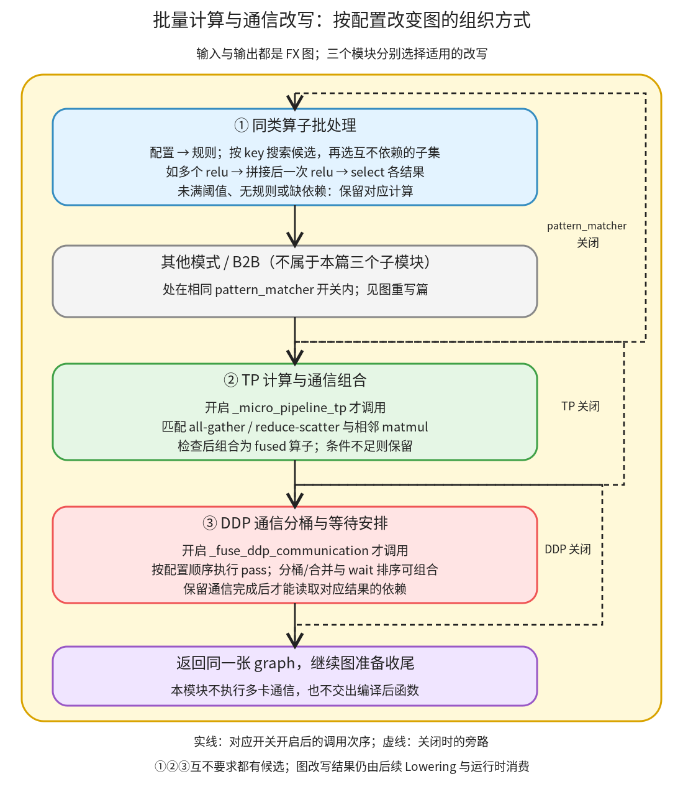

# 批量计算与通信改写：把一组计算或通信重新组织成图

```text
Inductor  本层完成
    └── 图准备  本层完成
        └── 图重写  本层完成
            └── 批量计算与通信改写 ← 当前篇  本层完成
                ├── 同类算子批处理  待展开
                ├── TP 计算与通信组合  待展开
                └── DDP 通信分桶与等待安排  待展开
```

<!-- child-links:start -->

<!-- child-links:end -->

[返回图重写](../README.md)。本模块接收 FX 图和相关配置，改变同类算子的批处理方式，或把通信与计算组织成新的组合。输出仍是修改后的 FX 图；真正的通信和数值计算由生成程序及运行时执行。

这里有三个直接子模块：同类算子批处理、TP 计算与通信组合、DDP 通信分桶与等待安排。它们共享图准备的调用环境，但选择候选和改写的单位不同，不是一条规则命中后必须依次通过的三个步骤。

## 1. 先分清在图准备中各自何时参与



[post_grad_passes](/work/pytorch/torch/_inductor/fx_passes/post_grad.py:72) 在 pattern matcher 开关内先调用同类算子批处理，再调用普通模式等改写；TP 和 DDP 分别受后面的独立开关控制。关闭 pattern matcher 不会自动关闭后两项。图中灰色框只标出其他改写的插入位置，不是第四个子模块。

同类算子批处理收到配置后生成规则，按共同特征收集节点，再找互不依赖的子集；每个子集交给具体规则合并。TP 从 collective 关系识别 all-gather/reduce-scatter，再检查是否能和相邻 matmul 组合。DDP 按配置顺序运行分桶、合并或 wait 排序等 pass。各模块没有候选时，原图继续前行，不必创建一个“空 fused 算子”。

图中的“返回图”表示图状态交回调用者：这几个入口本身不返回新的 GraphModule，而是原地修改传入 graph。后面的排序、属性维护和其他收尾仍不可省略。

## 2. 三个子模块怎样交换数据

### 2.1 同类算子批处理：先同组，再保证组内没有计算依赖

输入是当前 graph、post-grad fusion 配置及可用的规则实现；输出是加入批量算子、重新接回各结果的图。主要驱动为 [group_batch_fusion_passes](/work/pytorch/torch/_inductor/fx_passes/group_batch_fusion.py:1284)。

配置可把规则标记为 `require_fbgemm`。入口将它们与普通规则分开，仅在对应扩展可用时加入依赖该扩展的规则；普通规则仍可继续。未知于批量规则表的配置项在这里跳过，可能归普通 pattern pass 处理，不能由此认为拼写错误的所有配置都会报错。

每个规则有两个核心交接：

```text
rule.match(node) → 分组 key，或 None
rule.fuse(graph, subset) → 原地修改 graph
```

例如本地 post-grad relu 规则的 key 包含输入 shape 等信息；同样是 relu，shape `(2,3)` 和 `(3,)` 不会自动混成一批。默认最小组为 5、最大组为 300，搜索深度为 5，具体规则还可有自己的限制。[配置生成](/work/pytorch/torch/_inductor/fx_passes/group_batch_fusion.py:1271) 从默认选项复制后覆盖用户选项，避免每个实例都直接修改共享默认字典。

[候选搜索](/work/pytorch/torch/_inductor/fx_passes/group_batch_fusion.py:1203) 从某个根的输入向前广度优先访问，按 key 装入候选列表；遇到已匹配节点不会继续穿透它去无条件寻找更远祖先。随后[独立子集选择](/work/pytorch/torch/_inductor/fx_passes/group_batch_fusion.py:1121)检查候选之间的传递依赖，只有不互相依赖的一组才可交给 fuse。

这个“组”与 Scheduler 的循环融合不同：这里仍在 FX 层增删算子。例如五个独立 relu 变成拼接、一个 relu、五个 select；后面的 Lowering 和调度还会决定怎么实现它们。算子调用数变少不等于已证明运行更快，拼接也可能产生额外搬运。

### 2.2 TP 计算与通信组合：把 collective 边界交给专用 fused 算子

TP 指 tensor parallel，此处关注张量并行图中的通信和矩阵乘关系。输入是包含函数式 collective 和 wait 的图；匹配结果保存通信输入、collective 节点、可读结果节点、通信维度和 group 名称等。输出可能是 `_symmetric_memory` 相关 fused 算子的 FX 调用，而非通信已经完成的数据。

例如：

```text
shard → all_gather_into_tensor → wait_tensor → mm(结果, weight)
```

[find_all_gather_patterns](/work/pytorch/torch/_inductor/fx_passes/micro_pipeline_tp.py:82) 把这段结构识别成一个 `_AllGatherMatch`。更复杂的非零维拼接和 dtype 视图也有专门模式；不能把每个 all-gather 都认成同一种直接 wait 形状。

[fuse_all_gather_matmul](/work/pytorch/torch/_inductor/fx_passes/micro_pipeline_tp.py:505) 消费该匹配并检查运行设施、group 的 symmetric-memory 支持、gather 维度及 matmul 其他参数的依赖。可行时，新 fused 调用同时交出需要的聚合结果与矩阵乘结果，原使用者分别改接相应输出。某个结果还有其他使用者时，不能把它直接丢掉。

另一方向是 `mm → reduce_scatter → wait`。[对应融合](/work/pytorch/torch/_inductor/fx_passes/micro_pipeline_tp.py:668) 使用只交出 reduce-scatter 结果的 fused 算子，因此检查矩阵乘中间结果的用户数；当前代码不允许把仍被其他地方使用的该中间结果直接消失。两条路径都可能调整输入 stride，并把必要的参数祖先移到新调用之前以恢复合法顺序。

如果开启 compute/communication overlap 重排，[micro_pipeline_tp_pass](/work/pytorch/torch/_inductor/fx_passes/micro_pipeline_tp.py:834) 先排除估计能用简单重叠隐藏的 collective。这个选择使用源码中的启发式，例如把 mm 视为计算密集节点并以一对一方式分配候选；它不是本机测到的精确通信耗时模型。

### 2.3 DDP 通信分桶与等待安排：合并传输与延后等待是两件事

DDP 指 distributed data parallel。输入为图、一个有顺序的 pass 列表和 bucket 大小配置。入口 [fuse_ddp_communication](/work/pytorch/torch/_inductor/fx_passes/ddp_fusion.py:581) 按列表顺序解析函数名或直接调用 callable；函数签名含 `bucket_size_mb` 时才传入该关键字。输出是执行完这些图 pass 的原 graph。

底层先把 collective、wait 和相关拆分/视图节点识别为 [CommBlock](/work/pytorch/torch/_inductor/fx_passes/ddp_fusion.py:74)：

```text
CommBlock:
  comm_node = 发起通信的节点
  inputs = 输入 FX 节点
  wait_nodes = 等待可读的节点
  node_list = 这段通信块中的节点
  outputs = 离开该块、供外部使用的结果节点
  shape = 分桶需要的张量尺寸
```

这里存的是图上的描述，不是已启动的网络传输句柄。具体融合先过滤 DDP reducer 风格的块，再按字节大小分桶，合并为 concat 或 coalesced 通信，并把结果拆回原来的使用者。`bucket_size_mb` 是容量参数，不是节点个数；源码内部以 `1024**2` 换算字节，首个 bucket 的初始阈值为 1 MiB，后续才采用配置容量。依据是[分桶及融合驱动](/work/pytorch/torch/_inductor/fx_passes/ddp_fusion.py:436)。

[schedule_comm_wait](/work/pytorch/torch/_inductor/fx_passes/ddp_fusion.py:532) 则移动 wait 及块内后续节点到首个外部使用者之前。collective 发起节点不必跟着一起移动；这给图中独立计算留出位于发起与等待之间的空间。它只是保持依赖的图顺序调整，实际是否发生通信重叠仍取决于后端和运行环境。

## 3. 主案例：五个 relu 如何合成一批

五个输入 `x0` 到 `x4` 都是 CPU float32、shape `(2,3)`、stride `(3,1)`，其中 `xi=arange(6).reshape(2,3)-i`。原函数返回五个独立 relu 结果。

**配置交接。** 顶层配置只有 `batch_aten_relu: {}`，使用默认阈值 5。当前环境没有 FBGEMM 扩展，但这项普通规则仍被生成并交给批量驱动。

**搜索交接。** 从 output 输入关系收集到五个 relu，各输入 shape 一致，key 相同，候选数量达标。没有任一 relu 依赖另一个，因此五个节点构成一个可融合子集。

**规则改图。** [BatchPointwiseOpsPostGradFusion.fuse](/work/pytorch/torch/_inductor/fx_passes/group_batch_fusion.py:1012) 把五个输入各加一个前置维度，再沿第 0 维拼接成 `(5,2,3)`。一次 relu 处理这个大张量；第 i 个旧输出改接为 `select(batch_result,0,i)`。原始五个 relu 删除，返回接口仍是五项。

```text
旧图：x0→relu0，x1→relu1，…，x4→relu4 → 五项输出
新图：
  x0…x4 → 各自 unsqueeze(0) → cat(dim=0)
        → 一次 relu → select(0,0)…select(0,4) → 五项输出
```

**执行交接。** 对新 FX 图执行 lint/recompile，再运行真实 CPU 输入。五个结果逐项与原函数一致，输入均保持不变，输出都不共享任何输入存储。精确图见[改写前](../../../experiments/batch-communication/default_five_before.txt)、[改写后](../../../experiments/batch-communication/default_five_after.txt)。没有进行 kernel 编译或性能测量。

这次改写还有可观察的存储变化：原来的五个独立输出各有存储；直接运行改写后的 FX 图时，五个 select 输出共享同一个 batch 结果的存储，元素偏移分别为 `0、6、12、18、24`，每项逻辑 shape 仍为 `(2,3)`。它们占据不同区段。实验保留了输出之间的存储矩阵，没有把“都不别名输入”扩大成“所有输出别名关系完全不变”。后续完整编译还可能改变存储计划，这里描述的是该局部 pass 的真实 FX 执行出口。

## 4. 哪些条件会改变分组

| 对照 | 候选/条件怎样变化 | 改写后的真实图 |
| --- | --- | --- |
| 只有四个同形状输入 | 低于默认最小组 5 | 四个 relu 保留 |
| 五个中有一个 shape 为 `(3,)` | 分成大小 4 和 1 两个 key | 都不足阈值，五个 relu 保留 |
| 最小组改为 2，最大组改为 2 | 五个独立节点分为 2、2、1 | 两组 batch relu，加一个原 relu；两个 cat |
| 配置规则 `require_fbgemm=True` | 当前 `has_fbgemm=False`，规则未加入 | 五个 relu 保留 |

这四项都实际执行了新图并检查数值与输入。不能把“规则未加入”和“匹配到了但条件失败”混成同一个内部路径。

独立性还有单独的真实算法对照：

```text
x → relu → relu_1
 y → relu_2
输入候选顺序：[relu, relu_1, relu_2]
最小组=2，最大组=3
交出的子集：[relu, relu_2]
```

`relu_1` 依赖 relu，留到下一轮；下一轮只有它自己，不足最小组，因此不交出。这个对照运行的是实际子集选择器，不是人为写出一个理想分组再当作结果。

## 5. 通信案例只验证了什么

### 5.1 all-gather 匹配交出了哪些对象

实验直接构造函数式通信的 FX 关系：

```text
shard → all_gather_into_tensor(shard,2,"teaching_group")
      → wait_tensor → mm(wait,weight) → output
```

真实 finder 返回 1 个匹配，其中 `shard_node=shard`、`ag_node=all_gather_into_tensor_default`、`res_node=wait_tensor_default`、`gather_dim=0`、`group_name="teaching_group"`。这些对象随后才会交给 TP 融合条件检查。

没有创建 process group，也没有执行 collective 或 symmetric-memory fused kernel。这个结果只证明该结构能被识别，不证明 group 可用、matmul 尺寸合法、GPU 路径成功或微流水有性能收益。图见[TP 模式输入](../../../experiments/batch-communication/tp_pattern.txt)。

### 5.2 wait 重排怎样留下独立计算

另一个实验构造 all-reduce 图，为输入登记真实 TensorMetadata，直接调用实际的 `get_all_comm_blocks` 和 `schedule_comm_wait`。原次序为：

```text
all_reduce(a) → wait
relu(y)
add(wait,relu_result) → output
```

它识别到一个块，通信输出是 wait，首个外部使用者是 add。重排后为：

```text
all_reduce(a)
relu(y)
wait
add(wait,relu_result) → output
```

collective 没有移动，wait 从独立 relu 之前移到之后，仍在 add 之前。真实 graph.lint 通过。这是对图链表和依赖顺序的验证，没有启动通信，因此不报告传输正确性或重叠时长。

最后一个 dispatcher 对照配置 `[first, "schedule_comm_wait", second]`、bucket 参数 7，实际事件按顺序为 `first(bucket_size_mb=7)`、已有图重排、`second()`。它验证字符串解析和签名传参，没有拿自定义 callback 的执行当作 DDP 分桶通信本身已经通过。

## 6. 后续实现分别放在哪里

同类算子批处理子篇完整展开候选搜索、独立子集和 post-grad 规则；TP 子篇展开通信结构、matmul 条件和 fused 图维护；DDP 子篇展开通信块、分桶、合并还原与等待安排。pre-grad 专属规则属于本篇已知输入边界之外，不重新讲上游 AOTAutograd。

复现脚本：[batch_communication.py](../../../experiments/batch_communication.py)。逐项结果、输出存储矩阵和图顺序：[results.json](../../../experiments/batch-communication/results.json)。以上 CPU 批处理执行与通信结构实验明确分开，均未更改产品源码。
