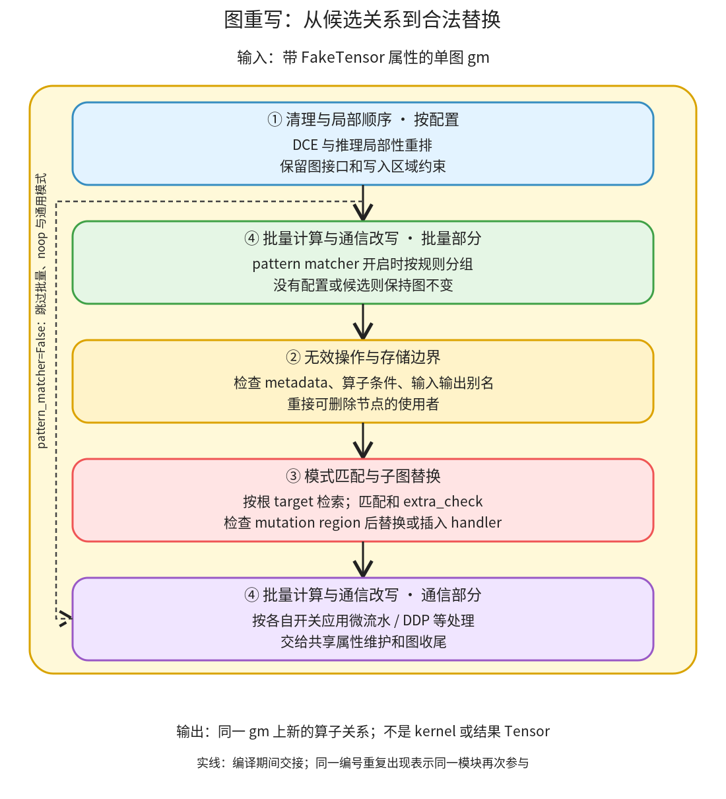

# 图重写：检查节点关系、属性和写入边界，再替换算子子图

```text
Inductor  本层完成
    └── 图准备  本层完成
        └── 图重写 ← 当前篇  本层完成
            ├── 清理与局部顺序  叶子·逐行完成
            ├── 无效操作与存储边界  叶子·逐行完成
            ├── 模式匹配与子图替换  本层完成
            └── 批量计算与通信改写  本层完成
```

<!-- child-links:start -->
直接子篇：[清理与局部顺序](01-cleanup-order/README.md)、[无效操作与存储边界](02-noop-storage/README.md)、[模式匹配与子图替换](03-patterns/README.md)、[批量计算与通信改写](04-batch-communication/README.md)。
<!-- child-links:end -->

[返回图准备](../README.md)。本模块收到带 FakeTensor 属性的 FX 图，在相同接口约束下删除节点、重接输入或替换子图。交出的仍是 FX 图，不是 kernel。匹配到图形只是候选，尺寸、存储和写入顺序等条件决定能否实际替换。

## 1. 从一张图到另一种算子关系



主线在 [post_grad_passes](/work/pytorch/torch/_inductor/fx_passes/post_grad.py:72)。先按开关执行清理和局部重排，再在 pattern matcher 开启时初始化规则、调用批量计算融合、清理 noop，依次应用三个通用模式集合及配置的其他模式。之后还可调用 B2B GEMM、张量并行流水和 DDP 通信改写。自定义 pre/post pass 包围部分过程。

图中的④出现两次：批量计算规则在通用匹配前参与，独立通信改写在后参与。通用模式开关关闭时，不能把①的独立配置分支或后面的通信开关一并认定关闭。这个调用次序不要求每个模块都成功改动图；没有候选或条件不满足时，原图继续流向收尾。

每次替换修改的是同一 `graph` 上的节点和边。新节点的属性和顺序需要后续属性维护与收尾协作，不存在“只要 matcher 返回成功，任何下游状态都自然更新”的保证。

## 2. 四个职责如何接力

### 2.1 清理与局部顺序

收到当前图后，`config.dce` 控制无用节点删除；`is_inference && config.reorder_for_locality` 控制局部重排。二者都不改变外部输入输出约定。

例如独立支路 `a=f(x); b=g(y); c=h(a)` 中，a 的计算可能被挪到更接近最后使用的位置，缩短需保留它的区间。但 [reorder_for_locality](/work/pytorch/torch/_inductor/fx_passes/post_grad.py:160) 不是按任意“相邻更快”原则排序：它从后往前检查使用者是否已访问、是否跨 mutation region，并避开输入修改的 copy 尾部。

交出的状态仍是 graph 的节点链表；后续模式遍历会看到这个新顺序。FX 的 DCE 是依赖服务，本模块解释调用条件和可观察作用，其通用纯度实现不在 Inductor 内重复建立一套教程。

### 2.2 无效操作与存储边界

收到带有 `meta['val']` 的图，[remove_noop_ops](/work/pytorch/torch/_inductor/fx_passes/post_grad.py:739) 先收集输入、输出存储，再按 noop_registry 找候选。候选要通过布局等元数据一致性和具体算子条件，才可以被源节点替换。

例如 `relu(x.clone())+y` 中 clone 可以被删，`return x.clone()` 则不能因此新增输入输出共享存储。这与删除一次数值恒等运算不是完全相同的问题。shape 相同不够，dtype、device、stride 和外部存储关系都会影响能否删。

该模块重接候选的所有使用者，再删除无用节点；不直接返回一个新 Tensor。本版对普通 tuple 输出的对象身份保护还有具体层次限制，不能把保持存储别名等同为保持 Python 对象身份，见[完整 noop 实现](02-noop-storage/README.md)。完整前后证据和数值/别名结果见 [图准备案例](../README.md) 及 [clone_output 出口](../../experiments/stages/clone_output_after_post.txt)。

### 2.3 模式匹配与子图替换

收到清理后的图和已经注册的规则，[PatternMatcherPass.apply](/work/pytorch/torch/_inductor/pattern_matcher.py:1674) 按根节点的 op/target 筛候选，从后向前尝试结构匹配，再检查 mutation region 和 entry.extra_check。只有所有条件满足才调用 entry.apply，并记录匹配计数。

不同 entry 的交付不同：GraphPatternEntry 调用用户注册的图处理函数；ReplacementPatternEntry 用替代图重接关系；LoweringPatternEntry 在 FX 图里插入一个专门的 lowering handler，等到 GraphLowering 才执行其 IR 构造。不能把“模式应用”统一解释为立即计算 Tensor，也不能假定替换后只会出现 ATen target。

例如本地规则把 `add(mm(mat1,mat2), bias)` 变成 `addmm(bias,mat1,mat2)`。结构上找到了 mm→add 还不够，[is_valid_addmm_fusion](/work/pytorch/torch/_inductor/fx_passes/post_grad.py:1005) 要求 bias 是有 Tensor 属性的节点、尺寸可广播到 mm 输出，并考虑特定设备/使用者条件下是否更应保留分离形式。

mutation region 限制模式跨越写入障碍。把两段形似算子拼起来但跨过输入修改，可能让它读错值的版本，因此 matcher 在 extra_check 之前还检查匹配节点属于同一区域。这里讨论 Inductor 的规则应用，不展开 Dynamo 捕获。

### 2.4 批量计算与通信改写

这个模块接收图、配置和适用规则，用同类计算集合或通信相关结构作为改写单位。它不是把每个普通模式都再走一遍。

[group_batch_fusion_passes](/work/pytorch/torch/_inductor/fx_passes/group_batch_fusion.py:1284) 根据配置生成 fusion rule，区分依赖 FBGEMM 的规则与普通规则，再按组应用。不存在“机器没装某个扩展就对所有组都报错”的统一路径；源码会按可用依赖选择相应集合。

[micro_pipeline_tp_pass](/work/pytorch/torch/_inductor/fx_passes/micro_pipeline_tp.py:834) 搜索 all-gather、reduce-scatter 相关模式，再尝试和矩阵乘组合。开启 compute/comm overlap 时，会排除能用简单重叠隐藏的集合通信候选；不能把所有通信都认定需要拆成微流水。

[fuse_ddp_communication](/work/pytorch/torch/_inductor/fx_passes/ddp_fusion.py:581) 按配置顺序调用 pass，可根据函数签名传入 bucket 大小。交出的是改写后的通信和计算图；真正多设备执行、stream 和 collective 语义还需要后续 IR 与运行机制支持。

本轮没有通信硬件运行证据。这里只据实际调用与条件界定接口，批量搜索、具体替换及通信规则继续由子篇覆盖，不能用下面 CPU addmm 案例证明通信行为。

## 3. 主案例：Tensor bias 的 mm+add 怎样变成 addmm

输入全部为 CPU float32：

```text
a shape=(2,3), stride=(3,1): [[-2,-1,0], [1,2,3]]
b shape=(3,2), stride=(2,1): [[1,2], [3,4], [5,6]]
bias shape=(2,), stride=(1,): [10,20]
return (a@b + bias,)
```

**进入清理。** 图含三个 placeholder、mm、add、output，没有可删的死计算。清理模块交出相同的有用节点。

**进入 noop 处理。** mm 与 add 都不满足该处的 noop 删除条件，继续保留。这里没改变图不等于这个阶段没有被调用。

**进入模式匹配。** 匹配根节点 add 时找到内嵌的 mm。match 保留两项矩阵输入和名为 inp 的 bias；extra_check 从 FakeTensor 取得 bias 尺寸 `(2,)`，检查能否扩展为 mm 输出 `(2,2)`。本例在 CPU 上不触发偏好分离 addmm 的 CUDA 分支，因此允许替换。

[实际替换前](../../experiments/rewrites-mutation/addmm_tensor_before.txt)：

```text
a ─┐
   mm ─ add ─ output
b ─┘     ↑
        bias
```

规则中的 [addmm handler](/work/pytorch/torch/_inductor/fx_passes/post_grad.py:1041) 通过 replace_by_example 构造替代图，把 add 的使用者接到新 addmm，再删除被替代且不再需要的节点。[实际替换后](../../experiments/rewrites-mutation/addmm_tensor_after.txt) 为：

```text
a、b、bias → aten.addmm.default → output
```

**继续批量/通信与收尾。** 本例没有适用的通信模式；图经排序、属性维护、写入恢复、recompile 和 lint。返回的 gm 仍有原参数顺序和单元素输出序列。

**另行执行新图。** 结果为 `[[5,12],[32,48]]`，与原函数相同；输入内容保持不变，输出不共享 a 的存储。实验真实执行的是图 pass 和新 FX 图，没有调用完整 kernel 编译器，也没有由节点数减少推定具体速度提升。

## 4. 条件改变：bias 是标量 1

将函数改为 `a@b + 1`，矩阵形状保持不变。结构匹配仍能看到 mm→add，但 inp 现在是数值 1，不是带 Tensor 属性的 FX 节点，extra_check 返回 False。这个候选不会调用替换 handler，后续仍接收 mm 和 add 两个节点。

[真实出口图](../../experiments/rewrites-mutation/addmm_scalar_after.txt) 保留 `aten.mm.default` 与 `aten.add.Tensor`，输出 `[[-4,-7],[23,29]]`，输入不变。这里“不改写”是该条规则的条件结果，不代表 Inductor 无法编译标量加法，也不代表以后任何阶段都不能组合其实现。

这两个案例从相同结构根开始，在语义条件处分岔，再交回相同的图收尾接口。复现见 [rewrites_mutation.py](../../experiments/rewrites_mutation.py)，原始结果见 [results.json](../../experiments/rewrites-mutation/results.json)。

## 5. 后续打开哪些实现

清理与局部顺序子篇说明顺序和写入区域；noop 子篇完整解释存储保护与具体候选条件；匹配与替换子篇把登记、结构证据、extra_check、三类 entry 和图维护串起，再按三个完整职责展开内部；批量与通信子篇说明批处理、TP 和 DDP 三项改写的交接。前两个子篇已逐行完成；模式篇与批量通信篇已完成本层流程，内部实现继续由各自子篇展开。
