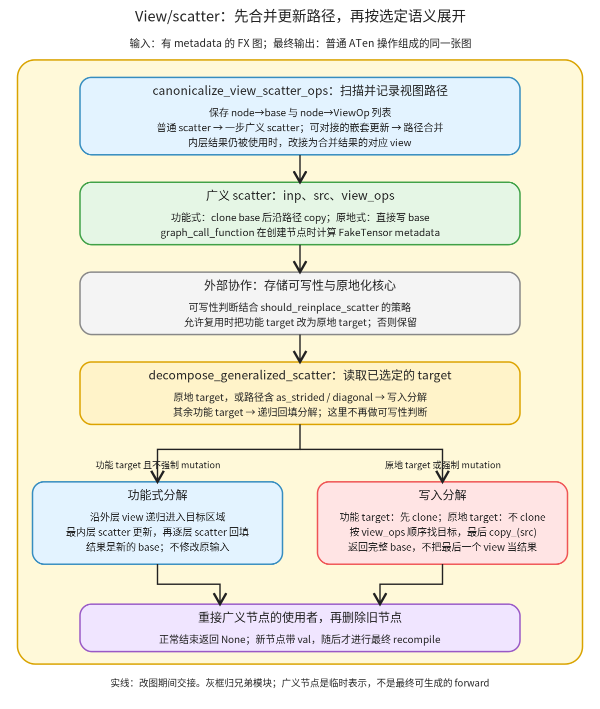

# View/scatter 表示与分解：把多层回填合成一条有序视图路径

```text
Inductor  本层完成
    └── 图准备  本层完成
        └── 写入语义恢复  本层完成
            └── View/scatter 表示与分解 ← 当前篇  叶子·逐行完成
```

<!-- child-links:start -->

<!-- child-links:end -->

[返回写入语义恢复](../README.md)。本单元把 `slice_scatter`、`select_scatter` 等功能式更新统一成广义 scatter，合并能够对接的嵌套回填；原地化核心选定语义后，再把广义节点展开成普通 ATen 操作。它接收带 metadata 的 FX 图，原地修改 graph，正常返回 None。

## 1. 完整范围与执行过程

本篇完整覆盖 [reinplace.py](/work/pytorch/torch/_inductor/fx_passes/reinplace.py:36) 36–325：两张 scatter/view 映射、`graph_call_function`、`ViewOp`、两个广义 scatter、两类分解、分解策略及规范化。原文分为连续的四段，均保持源顺序；表中的行号是源文件行号。顶部 `aten=torch.ops.aten`、导入的 `dataclass`、pytree 和 V 为这些实现提供依赖。



运行顺序与函数在文件里的定义顺序不同。入口先调用 `canonicalize_view_scatter_ops`：记录 view 的 base 和路径，把一次次回填转换或合并成 `_generalized_scatter(inp,src,view_ops)`。中间交给兄弟模块的原地化核心，检查是否允许修改已有存储；该核心可能把 target 换成 `_inplace_generalized_scatter`。最后 `decompose_generalized_scatter` 读取 target，选择功能式回填或 clone/view/copy 分解，再重接使用者、删除广义节点。

路径不是一组无序维度。例如对 `(3,4)` 的 x，`select(0,1)` 先取第 1 行，得到 `(4,)`；随后 `slice(0,1,3)` 才在该行中取第 1、2 项，得到 `(2,)`。倒过来做会选择另一块数据。`ViewOp` 保存 target 及除第一个 Tensor 之外的参数，因此路径可以直接从当前 base 顺序重放。

本篇的策略函数回答“是否倾向原地化”，不授予写输入的权限。是否合法由[写入语义恢复中的存储判断](../README.md)负责；本篇会用实际原地化核心连接两段过程，但不在这里重复其完整实现。

## 2. 原始实现一：路径描述与两个广义 scatter

```python
_SCATTER_OP_TO_VIEW = {
    torch.ops.aten.diagonal_scatter.default: torch.ops.aten.diagonal.default,
    torch.ops.aten.select_scatter.default: torch.ops.aten.select.int,
    torch.ops.aten.slice_scatter.default: torch.ops.aten.slice.Tensor,
    torch.ops.aten.as_strided_scatter.default: torch.ops.aten.as_strided.default,
}
_VIEW_OP_TO_SCATTER = {v: k for k, v in _SCATTER_OP_TO_VIEW.items()}


def graph_call_function(graph: torch.fx.Graph, fn, *args, **kwargs):
    fake_args, fake_kwargs = pytree.tree_map(
        lambda node: node.meta["val"] if isinstance(node, torch.fx.Node) else node,
        (args, kwargs),
    )
    with V.fake_mode:
        fake_result = fn(*fake_args, **fake_kwargs)

    node = graph.call_function(fn, args, kwargs)
    node.meta["val"] = fake_result
    return node


@dataclass
class ViewOp:
    target: torch._ops.OpOverload
    args: Tuple[Any, ...]
    kwargs: Dict[str, Any]


def _inplace_generalized_scatter(
    inp: torch.Tensor, src: torch.Tensor, view_ops: List[ViewOp]
) -> torch.Tensor:
    tmp = inp
    for view in view_ops:
        fake_args, fake_kwargs = pytree.tree_map(
            lambda node: node.meta["val"] if isinstance(node, torch.fx.Node) else node,
            (view.args, view.kwargs),
        )
        tmp = view.target(tmp, *fake_args, **fake_kwargs)
    try:
        tmp.copy_(src)
    except RuntimeError as e:
        raise RuntimeError(
            f"shape error in scatter op, can not broadcast {src.shape} to {tmp.shape}"
        ) from e
    return inp


def _generalized_scatter(
    inp: torch.Tensor, src: torch.Tensor, view_ops: List[ViewOp]
) -> torch.Tensor:
    out = inp.clone()
    return _inplace_generalized_scatter(out, src, view_ops)
```
### 2.1 映射和带属性的图节点构建

| 源码行 | 当前对象、操作与目的 |
| --- | --- |
| 36、41 | 建立 scatter 到对应 view 的字典。它定义本模块能直接规范化的四类更新，不是所有可能 view 的完整目录。 |
| 37 | diagonal_scatter 对应 diagonal：沿对角线找写入位置。 |
| 38 | select_scatter 对应 select.int：选择一个索引后，该维会消失。 |
| 39 | slice_scatter 对应 slice.Tensor：保留维度，按 start/end/step 选择区域。 |
| 40 | as_strided_scatter 对应 as_strided：用显式尺寸、stride、偏移定位区域。 |
| 42 | 将映射反转，功能式分解时从 view 找回对应 scatter。 |
| 45 | helper 接收 graph、调用目标及原始图参数；返回新 FX Node。 |
| 46–49 | 递归遍历参数容器；FX Node 换成其 `meta['val']`，常量保留，得到用于属性执行的参数。缺失 val 会在这里失败，不会静默填一个 Tensor。 |
| 50–51 | 在当前 V.fake_mode 中调用目标，计算结果描述；此时处理的是 FakeTensor 等属性，不是把真实输入算一遍。 |
| 53 | 用原来的图参数建立 call_function，保持 FX 依赖；没有把 fake_args 写进图。插入位置由外层上下文指定。 |
| 54–55 | 给新节点保存 val，返回节点。没有自动复制 tensor_meta、完整调试标签或旧节点的所有 metadata。 |

`graph_call_function` 同时交出节点和属性，但这两个产物来自不同参数：属性执行用 fake_args，图结构用原 args。以 `select(x,0,1)` 为例，x 的 FakeTensor 产生 `(4,)` 的新 FakeTensor；图中保存的仍是 x 对应 Node。

### 2.2 ViewOp 与真正的写入位置

| 源码行 | 当前对象、操作与目的 |
| --- | --- |
| 58–59 | dataclass 自动提供初始化和结构比较；两个路径描述的 target/args/kwargs 都参与默认相等判断。这里没有冻结对象。 |
| 60 | target 是实际的 OpOverload，如 aten.select.int。 |
| 61–62 | args/kwargs 不包含最前面的输入 Tensor；重放时把当前 tmp 放回第一位。 |
| 65–67 | 原地 helper 接收完整 base inp、源 src 和有序路径；正常返回完整 base。 |
| 68 | tmp 最初指向 inp，此刻没有 clone。 |
| 69 | 按路径顺序逐个处理 view。 |
| 70–73 | 解析当前 ViewOp 参数中的 FX Node 为 val；它们没有依靠最外层 pytree 自动穿透 dataclass。 |
| 74 | 对当前 tmp 应用 view，并让 tmp 指向更深一层的目标区域。 |
| 75–76 | 在最终 tmp 上 copy_ src；src 可按 copy_ 的规则广播。修改的是 tmp 所共享的 base。 |
| 77–80 | 仅捕获 copy_ 抛出的 RuntimeError，改写消息并用 `from e` 保存原因。前面的 view 构造错误不在这个 try 内。 |
| 81 | 返回 inp；不是返回最终的局部 tmp 或 copy_ 的返回值。 |
| 84–86 | 功能式 helper 保持相同输入契约，但不应直接修改原 inp。 |
| 87 | 先 clone 完整 inp，新存储承担后续更新。 |
| 88 | 将 clone 交给同一个原地 helper，复用路径定位和 copy 逻辑，返回更新后的完整 clone。 |

对 `x=arange(12).reshape(3,4)`、`src=[90,91]`，两者都得到：

```text
[[ 0,  1,  2,  3],
 [ 4, 90, 91,  7],
 [ 8,  9, 10, 11]]
```

真实直接调用对照中，功能 helper 的 x 保持原值，结果与 x 不共享存储；原地 helper 的 x 也变成上面的结果，并且返回对象就是 x。相同输出值掩盖不了这项契约差异。

`shape error` 是这里包装 RuntimeError 使用的固定上下文，不代表捕获范围内的所有原始错误一定只是 shape 错误。底层原因仍可从 `__cause__` 读取。实验的长度 3 源写入长度 2 区域被包装成 RuntimeError；`select(0,99)` 则在 view 阶段直接抛 IndexError。

## 3. 原始实现二：把广义节点分解成两类普通图

```python
def _decompose_scatter_functional_helper(
    graph: torch.fx.Graph,
    inp: torch.Tensor,
    src: torch.Tensor,
    view_ops: List[ViewOp],
) -> torch.fx.Node:
    view_op, view_ops_tail = view_ops[0], view_ops[1:]

    if view_ops_tail:
        view = graph_call_function(
            graph, view_op.target, inp, *view_op.args, **view_op.kwargs
        )
        src = _decompose_scatter_functional_helper(graph, view, src, view_ops[1:])  # type: ignore[assignment]

    return graph_call_function(
        graph,
        _VIEW_OP_TO_SCATTER[view_op.target],
        inp,
        src,
        *view_op.args,
        **view_op.kwargs,
    )


def _decompose_scatter_functional(
    graph: torch.fx.Graph, node: torch.fx.Node
) -> torch.fx.Node:
    """Decompose _generalized_scatter to a sequence of view_scatter operations

    e.g. _generalized_scatter(inp, src, [(aten.slice, 0, 0, 10), (aten.slice, 1, 10, -10)])

    will become

    view = aten.slice(inp, 0, 0, 10)
    view_updated = aten.slice_scatter(view, src, 1, 10, -10)
    inp_updated = aten.slice_scatter(inp, view_updated, 0, 0, 10)
    """
    assert node.target is _generalized_scatter
    inp, src, view_ops = node.args
    return _decompose_scatter_functional_helper(graph, *node.args)  # type: ignore[arg-type]


def _decompose_scatter_mutating(
    graph: torch.fx.Graph, node: torch.fx.Node
) -> torch.fx.Node:
    """Decompose _generalized_scatter using mutations

    e.g. _generalized_scatter(inp, src, [(aten.slice, 0, 0, 10), (aten.slice, 1, 10, -10)])

    will become

    inp_updated = aten.clone(inp)
    slice1 = aten.slice(inp_updated, 0, 0, 10)
    slice2 = aten.slice(slice1, 1, 10, -10)
    slice2.copy_(src)

    """
    assert node.target in (_generalized_scatter, _inplace_generalized_scatter)
    inp, src, view_ops = node.args
    assert not node.kwargs

    if node.target is _generalized_scatter:
        inp = graph_call_function(graph, aten.clone, inp)

    tmp = inp
    for view in view_ops:  # type: ignore[union-attr]
        tmp = graph_call_function(graph, view.target, tmp, *view.args, **view.kwargs)  # type: ignore[union-attr]

    graph_call_function(graph, aten.copy_.default, tmp, src)
    return inp  # type: ignore[return-value]
```
### 3.1 功能式分解：先深入，再逐层回填

这里的 inp/src 虽然有 Tensor 类型注解，在实际改图调用中是 FX Node；函数返回的也是图节点。它构造计算过程，不直接更新真实输入值。

| 源码行 | 当前对象、操作与目的 |
| --- | --- |
| 91–96 | 递归 helper 接收当前层 base、该区域最终要获得的 src、剩余 view 路径。 |
| 97 | 取路径第一个 view，分出 tail；因此功能式递归要求路径非空。 |
| 99 | tail 非空说明当前 view 还不是最终写入区域，需要继续深入。 |
| 100–102 | 在当前 base 上建立这层 view 节点，供下一层更新。 |
| 103 | 用 view 作为下一层 inp，递归更新剩余路径；返回的新节点覆盖局部变量 src，成为本层要写回的完整子区域。 |
| 105–112 | 按反向映射查本层 scatter，以当前 inp、已更新 src 和原 view 参数创建功能式回填；返回该层新 base。 |
| 115–117 | 包装器接收 graph 和一个广义节点。 |
| 118–127 | 原注释说明两层 slice 的递归展开顺序；它是实现示意，不是本篇实验采集的日志。 |
| 128 | 断言只接受功能式 `_generalized_scatter`，不会对原地 target 直接走这条路径。 |
| 129 | 解出三个位置参数；源码随后直接展开 node.args 调 helper。 |
| 130 | 返回递归创建的最外层更新节点；调用者随后重接原广义节点的使用者。 |

对 `[select(0,1),slice(0,1,3)]`，递归状态如下：

```text
第 0 层：inp=x，src=s，view_op=select(0,1)，tail=[slice]
  建立 row=select(x,0,1)
第 1 层：inp=row，src=s，view_op=slice(0,1,3)，tail=[]
  返回 row_updated=slice_scatter(row,s,0,1,3)
回到第 0 层：src 改成 row_updated
  返回 x_updated=select_scatter(x,row_updated,0,1)
```

`view_ops_tail` 判断是否深入；每层返回的节点更新的是该层完整 inp，而不只是一段局部切片。这让最外层最终仍具有 x 的 `(3,4)` 形状。

### 3.2 写入分解：先决定存储，再沿路径 copy

| 源码行 | 当前对象、操作与目的 |
| --- | --- |
| 133–135 | 写入分解接收同一个 graph/node 接口，返回代表最终完整 base 的节点。 |
| 136–147 | 原注释展示功能 target 在 clone 上写入的展开；是否 clone 还取决于下面的 target 分支。 |
| 148 | 允许功能和原地两种广义 target。 |
| 149–150 | 解出位置参数，并要求没有 kwargs；该内部表示有固定格式。 |
| 152–153 | 功能 target 必须先创建 clone 节点，把局部 inp 改成 clone；原地 target 跳过。走写入分解不等于可以修改原图输入。 |
| 155 | tmp 从选好的 base 节点开始。 |
| 156–157 | 顺序创建各层 view 节点，每个新 view 都连接前一层 tmp，并由 helper 设置 val。 |
| 159 | 创建 copy_ 节点，在图中表达局部写入。该节点的返回值没有作为函数返回；副作用本身必须保留。 |
| 160 | 返回完整 base 节点 inp；如果创建了 clone，就返回 clone，否则返回已有 base。 |

同一条路径的写入展开是 `base → select → slice → copy_(s)`，但外部使用者接到 base。对功能 target，它是新的 clone；对原地 target，它就是原来的 inp。这一区别一直保留到最终图接口。

## 4. 原始实现三：原地化倾向与最终分解不是同一个判断

```python
# View ops whose view_scatter op is lowered into mutations anyway,
# so is never a pessimisation to decompose.
_ALWAYS_MUTATING_SCATTER_OPS = {
    aten.as_strided.default,
    aten.diagonal.default,
}


def scatter_always_uses_mutation(node: torch.fx.Node) -> bool:
    _, _, view_ops = node.args
    return any(view.target in _ALWAYS_MUTATING_SCATTER_OPS for view in view_ops)  # type: ignore[union-attr]


def should_reinplace_scatter(node: torch.fx.Node) -> bool:
    """Choose between mutating and functional scatter decompositions

    Reinplacing view scatter ops can be pessimising as it blocks fusion with the
    input or output tensor computations. However, it is still profitable if the
    input and output would have been realized anyway.

    """
    inp, src, view_ops = node.args

    # Mutating scatter ops unconditionally realize input and output
    if scatter_always_uses_mutation(node):
        return True

    if is_node_realized(inp) and is_node_realized(node):  # type: ignore[arg-type]
        return True

    # If the output is copied back into the input, this forces both to be
    # realized as the output is a user of the input
    if inp.op in ("placeholder", "get_attr") and any(  # type: ignore[union-attr]
        user.target is aten.copy_.default and user.args[0] is inp for user in node.users
    ):
        return True

    # Otherwise, assume fusions will make functional variants profitable
    return False


def decompose_generalized_scatter(graph: torch.fx.Graph) -> None:
    """Replace _generalized_scatter with normal aten ops"""
    for node in itertools.chain(
        graph.find_nodes(op="call_function", target=_generalized_scatter),
        graph.find_nodes(op="call_function", target=_inplace_generalized_scatter),
    ):
        use_mutation = (
            node.target is _inplace_generalized_scatter
            or scatter_always_uses_mutation(node)
        )

        with graph.inserting_before(node):
            if use_mutation:
                new_node = _decompose_scatter_mutating(graph, node)
            else:
                new_node = _decompose_scatter_functional(graph, node)

        node.replace_all_uses_with(new_node)
        graph.erase_node(node)
```
### 4.1 为什么策略返回 True 仍不一定原地化

| 源码行 | 当前对象、操作与目的 |
| --- | --- |
| 163–168 | 列出当前按写入路径处理的 as_strided 和 diagonal view；保存的是 view target，不是 scatter target。 |
| 171–172 | 取广义节点的 view_ops；inp/src 在本判断里不使用。 |
| 173 | 路径任一层命中集合就返回 True，不要求所有层都是这两种 view。 |
| 176、184 | 策略函数接收广义节点并解出 inp/src/path；实际条件使用 inp、node 及路径。 |
| 177–183 | 原注释说明倾向：写入可能阻碍输入输出计算融合，若本来就需要物化则更适合考虑原地化。这是策略依据，不是本机测量。 |
| 186–188 | 特定 view 最终本来就按 mutation 降低，直接倾向原地化。 |
| 190–191 | 如果 inp 和当前节点都被 is_node_realized 判断为需要物化，也返回 True。 |
| 193–198 | 对 placeholder/get_attr，检查当前更新是否有 copy_ 用户、且 copy 目的恰好就是 inp；已有回写可形成另一个倾向条件。 |
| 200–201 | 其余情况倾向保留功能式版本，期待后续融合机会；返回 False 不代表该算子无法编译。 |

`is_node_realized` 的结果是本阶段的保守预测，不是“已经分配过真实内存”的证据。它检查 placeholder、已知 fallback、某些 getitem 的来源以及需要物化输入的用户，也可能漏掉后面启发式决定的物化。相关契约见 [fx_utils.py](/work/pytorch/torch/_inductor/fx_utils.py:222)，完整实现归[物化与副作用](../../../02-lowering/03-materialization/README.md)。

最直接的反例就是主案例：inp 是 placeholder，结果直接返回，所以两个 realized 预测均为 True，策略也为 True；但没有 copy 回写意图，兄弟模块仍拒绝修改输入，功能 target 保留。策略不替代语义合法性检查。

### 4.2 最终分解只读已经选择的表示

| 源码行 | 当前对象、操作与目的 |
| --- | --- |
| 204–205 | 分解入口修改原 graph，正常没有显式返回值。 |
| 206–209 | 先遍历功能 target，再遍历原地 target 的 call_function 节点；不是对全图重复执行原地化搜索。 |
| 210–213 | 原地 target 或含强制写入 view 时用 mutation 分解；其余用功能分解。没有再调用 should_reinplace_scatter。 |
| 215 | 新操作插到当前广义节点之前，便于替换其使用者。 |
| 216–219 | 调用所选分解器，拿到新完整 base 节点。 |
| 221–222 | 将广义节点的全部使用者接到新节点，再删除旧广义节点。不会在这里自动 DCE 所有历史 view。 |

功能式 diagonal 更新即使没有输入回写，也会走 mutation 分解，但 152–153 仍会先 clone。它表达的是“在新存储上用写入完成功能式计算”，不是修改输入权限被放宽。

## 5. 原始实现四：规范化及嵌套更新合并

```python
def canonicalize_view_scatter_ops(graph: torch.fx.Graph) -> None:
    """
    This canonicalizes view scatter ops into a generalized form, defined as:
      def scatter(inp, src, views):
        tmp = inp.clone()
        for view in views:
          tmp = view(tmp)
        tmp.copy_(src)

    We also fuse consecutive view scatter ops of the form
        a = scatter(view2(self), src, [view1])
        b = scatter(self, a, [view2])
    which can be rewritten as
        b = scatter(self, src, [view2, view1])
        a = view2(b)

    This is both more efficient as we only do a single scatter, and also
    easier to reinplace since there is only one use of `self`
    """

    node_to_view_base: Dict[torch.fx.Node, torch.fx.Node] = {}
    node_to_view_op: Dict[torch.fx.Node, List[ViewOp]] = defaultdict(list)

    def handle_views(node: torch.fx.Node):
        inp = node.args[0]
        node_to_view_base[node] = node_to_view_base.get(inp, inp)  # type: ignore[arg-type]
        node_to_view_op[node] = [
            *node_to_view_op[inp],  # type: ignore[index]
            ViewOp(
                node.target,  # type: ignore[arg-type]
                args=node.args[1:],
                kwargs=node.kwargs,
            ),
        ]

    def handle_view_scatter(node: torch.fx.Node):
        assert len(node.args) >= 2
        inp, src = node.args[:2]

        scatter_view_op = ViewOp(
            _SCATTER_OP_TO_VIEW[node.target],
            args=node.args[2:],
            kwargs=node.kwargs,
        )

        def can_fuse():
            if src.target is not _generalized_scatter:  # type: ignore[union-attr]
                return False
            src_inp, src_src, src_scatter_view_op = src.args  # type: ignore[union-attr]

            inp_base = node_to_view_base.get(inp, inp)  # type: ignore[arg-type]
            src_base = node_to_view_base.get(src_inp, src_inp)  # type: ignore[arg-type]
            return inp_base is src_base and node_to_view_op[src_inp] == [  # type: ignore[index]
                *node_to_view_op[inp],  # type: ignore[index]
                scatter_view_op,
            ]

        if not can_fuse():
            with graph.inserting_before(node):
                new_node = graph_call_function(
                    graph,
                    _generalized_scatter,
                    inp,
                    src,
                    [scatter_view_op],
                )
            node.replace_all_uses_with(new_node)
            graph.erase_node(node)
            return

        src_inp, src_src, src_scatter_view_op = src.args  # type: ignore[union-attr]
        with graph.inserting_before(src):  # type: ignore[arg-type]
            new_node = graph_call_function(
                graph,
                _generalized_scatter,
                inp,
                src_src,
                [scatter_view_op, *src_scatter_view_op],  # type: ignore[misc]
            )
            node.replace_all_uses_with(new_node)
            graph.erase_node(node)

            if src.users:  # type: ignore[union-attr]
                new_src = graph_call_function(
                    graph,
                    _SCATTER_OP_TO_VIEW[node.target],
                    new_node,
                    *node.args[2:],
                    **node.kwargs,
                )

                handle_views(new_src)
                src.replace_all_uses_with(new_src)  # type: ignore[union-attr]

            graph.erase_node(src)  # type: ignore[arg-type]

    for node in graph.nodes:
        if _is_view_op(node.target):
            handle_views(node)
        elif node.target in _SCATTER_OP_TO_VIEW:
            handle_view_scatter(node)
```
### 5.1 两张表记录同一条视图链的不同事实

| 源码行 | 当前对象、操作与目的 |
| --- | --- |
| 225 | 规范化接收 graph，原地替换相关 scatter；正常返回 None。 |
| 226–243 | 原注释定义广义 scatter 并展示连续回填的合并，以及内层结果的重新表达；本篇下面对同一关系用具体行列推演。 |
| 245 | node_to_view_base 保存当前 view 链的起点节点，比较时使用 Node 身份，不按数值或 shape 猜同一 base。 |
| 246 | node_to_view_op 保存从起点到当前 view 的有序描述；缺失 key 访问时得到空列表。 |
| 248–250 | handle_views 取 node 的第一个参数为直接输入；沿已有表找到链起点，未登记的输入直接当起点。 |
| 251–258 | 复制输入已有路径，在尾部加入当前 ViewOp。保存 target、除第一个输入之外的 args，以及 kwargs。 |
| 260–262 | handle_view_scatter 要求至少两个参数，取出被更新 inp 和要写入的 src；后面的参数用于定位视图。 |
| 264–268 | 从当前 scatter target 找对应 view，args 从第三个位置开始保留，kwargs 原样保存。 |

这是结构路径，不是对所有共享存储别名的统一证明。例如两个不同 placeholder 即便运行时共享存储，node_to_view_base 也不会仅凭这一事实把它们合并成同一 Node；这里没有读取 storage id 来做 can_fuse。

### 5.2 can_fuse 核对“内层在哪个 view 上更新”

| 源码行 | 当前对象、操作与目的 |
| --- | --- |
| 270–272 | 只有 src 已经是功能式广义 scatter，才尝试把两次更新接起来；普通 src 或其他 target 返回 False。 |
| 273 | 分解内层广义节点为其 base、真正写入源和内层路径；命名虽为单数，第三项实际是路径列表。 |
| 275–276 | 分别找外层 inp 与内层 src_inp 的视图链起点。 |
| 277–280 | 要求起点是同一 Node，而且内层 base 的路径恰好等于“外层 inp 的已有路径 + 当前外层 scatter 对应 view”。只比较尺寸相同不够。 |
| 282–290 | 若不能合并，在原 scatter 前创建只有一个 ViewOp 的广义节点，仍表达原来那一次更新。 |
| 291–293 | 重接旧 scatter 的使用者、删除旧节点，结束本次处理。后续扫描还会处理其他节点。 |

以外层 `select_scatter(x,row_updated,0,1)` 为例，内层输入 row 必须来自 `select(x,0,1)`。如果 row 来自 x 的第 1 行而外层要回填第 0 行，就不能把路径当成连续的同一区域更新；实验中保留两个广义节点。

### 5.3 合并成功后还要处理内层的其他用户

| 源码行 | 当前对象、操作与目的 |
| --- | --- |
| 295 | 取内层输入、源和路径；合并后真正 src 使用 src_src，不再把整个内层更新结果再拷一次。 |
| 296 | 把合并后的新节点插在旧 src 广义节点之前；这比旧外层 scatter 的位置更早。 |
| 297–303 | 以外层 inp 为 base、内层 src_src 为源，路径是 `[当前外层 view, *内层更新路径]`，顺序从外到内。 |
| 304–305 | 外层旧节点的使用者全部改接到合并结果，删除旧外层节点。 |
| 307 | 此时检查内层 src 是否仍有其他用户；已删除的外层使用不再计入。 |
| 308–314 | 如果还有用户，在新完整结果上重新建立外层对应的 view，取回更新后的内层区域。 |
| 316 | 新 view 也登记到两张表中，供后续更外层更新继续判断。 |
| 317 | 内层 src 的所有剩余使用者改接到这个新 view，保持该区域的结果值可供后续读取。 |
| 319 | 内层广义节点已不再需要，删除它。 |
| 321–323 | 正向扫描图节点；用外部 _is_view_op 的 schema 判断识别 view，然后记录路径。 |
| 324–325 | 不是 view、且 target 属于四类 scatter 时，调用上面的规范化逻辑。其余节点不改。 |

`_is_view_op` 的相关接口在 [FX reinplace.py](/work/pytorch/torch/fx/passes/reinplace.py:23)：只对 OpOverload 检查第一个参数的 alias_info，要求它不标记写入。这是本模块复用的 view 识别条件，不是在这里完整重建整个 FX 别名系统。

保留内层用户需要额外说明存储：把独立的内层结果改成完整新结果的一个 view，保留了本例的值，却能改变两个输出之间的存储关系。下面的返回内层对照实际记录了这项差异，不能把 317 行笼统解释成保留所有对象身份和存储关系。

## 6. 沿同一个具体更新走完整过程

### 6.1 输入、原图与规范化表

x 为 CPU float32，shape `(3,4)`、stride `(4,1)`，值为 0 到 11；s 为同设备同 dtype 的 `(2,)`，值 `[90,91]`：

```python
row = aten.select.int(x, 0, 1)
row_updated = aten.slice_scatter.default(row, s, 0, 1, 3)
whole = aten.select_scatter.default(x, row_updated, 0, 1)
return (whole,)
```

扫描 row 后，两张表为 `base[row]=x`、`path[row]=[select(0,1)]`。遇到 row_updated 时，s 不是广义节点，先建立：

```text
g0 = _generalized_scatter(row, s, [slice(0,1,3)])
```

遇到 whole 时，src 已是 g0。外层 inp=x 的路径为空，当前外层 view 是 select(0,1)，恰好等于 row 的已有路径。合并为：

```text
g1 = _generalized_scatter(x, s, [select(0,1), slice(0,1,3)])
output → g1
```

whole 与 g0 删除。原 row 节点可能仍在图中但已无用户；本函数不承诺将整张图清理成最少节点。精确输入和中间图分别见[before](../../../experiments/view-scatter/nested_before.txt)、[canonical](../../../experiments/view-scatter/nested_canonical.txt)。

### 6.2 可写性判定与功能式分解

本例策略 should_reinplace 为 True，因为输入和输出都被预测为物化；但核心看不到输入的 copy_ 回写意图，不能把 x 改掉，因此 g1 仍为功能 target。

最终分解不重新按这个 True 选择路径。它看到“功能 target，且没有 as_strided/diagonal”，调用功能递归，建立 select、slice_scatter、select_scatter，重接 output 后删除 g1。实际图还保留原来的死 select，因此日志里有两个 select；不能据此误认为执行了两条有效更新路径。

分解后正常 recompile、执行新 FX 图。结果为前面的 `(3,4)` 更新矩阵，x 仍是 0 到 11，输出不共享 x 或 s 的存储。中间的广义图则用真实 FX Interpreter 执行相同检查，因为它不是最终 Python forward 表示。最终图见[decomposed](../../../experiments/view-scatter/nested_decomposed.txt)。

### 6.3 有回写意图时，不再需要完整 clone

在原函数后加 `x.copy_(whole); return (x,)`，规范化路径不变。copy 回写条件使策略为 True，核心也确认这项修改符合原语义，于是把 g1 target 换为原地版本并移除多余回写。

最终分解创建 `select(x,0,1) → slice(…,0,1,3) → copy_(s)`，返回接口接 x，没有新 clone。真实运行后 x 与输出都为更新后的矩阵，输出共享 x；这些都与原函数一致。已原地化后的策略快照可能变化，因为 copy 用户已删除，不能用“改写后的 should 值”倒推改写前是否允许。

### 6.4 返回内层结果时，值保留但输出之间可共享存储

将函数改为 `return (whole,row_updated)`。合并外层后，g0 还有一个 output 用户，因此代码在 g1 上创建 `select(g1,0,1)`，把原 row_updated 的剩余用户接过去。

实际返回值分别为完整更新矩阵与 `[4,90,91,7]`，x 保持不变。改写前两项输出拥有独立存储；规范化并分解后，两项输出共享新 whole 的存储，第二项偏移为 4 个 float32 元素。实验保存前后存储矩阵，明确这是局部 FX pass 的输出关系，不宣称任意可观察别名都保持不变，也不将它等同于完整 torch.compile 的最终存储计划。

## 7. 分支和失败边界的真实对照

| 条件变化 | 实际路径与结果 |
| --- | --- |
| 内层来自第 1 行，外层回填第 0 行 | 路径不等，保留两个广义节点；最后两个功能式 scatter，值与原图一致。 |
| 内层 view 来自另一个 base y | base Node 身份不同，保留两个广义节点；不凭相同 shape 合并。 |
| base 改成内部 `x+1` | 本例输入物化预测为 False、输出为 True，策略为 False；保留功能 target。 |
| diagonal 更新 | always_mutating=True；即便不能写输入，仍分解成 clone + diagonal + copy_，输入保持不变。 |
| as_strided 更新 | 同样走 clone + as_strided + copy_；本例明确选择 `(2,2)`、元素 stride `(4,1)`、元素偏移 5 的区域。 |
| 直接 helper 的 src 是标量 7 | copy_ 向最后 `(2,)` 视图广播，更新 x 的第 1 行第 1、2 项；这是广义 helper 契约，不是声称原始 ATen scatter 接受任意广播。 |
| 直接 helper 的 src 长度为 3 | 最终视图长度为 2，copy_ 的 RuntimeError 被包装，并保留 cause。 |
| view 使用越界 select 索引 99 | 在 copy_ 的 try 之前抛 IndexError。 |
| 人工构造空路径的功能广义节点 | 直接 helper 可以表达整块 copy，但功能图分解在 view_ops[0] 抛 IndexError；规范化器不会创建这种空路径。 |

还有一个被真实复现的表示边界：直接对包含 ViewOp dataclass 的规范化图调用 gm.recompile，本版本生成的 Python 源包含不可执行的 OpOverload repr，抛 SyntaxError。正常源码先分解掉这些节点再 recompile；实验中间验证使用 FX Interpreter 读取当前图，最终普通 ATen 图才走 recompile。这是私有临时表示的消费顺序，不是一次最终模型编译失败。

以上八组图案例均记录规范化、核心原地化、最终分解，并在中间和最终阶段对照数值、输入修改、输出对输入的别名；另有直接 helper 与错误边界，共十五项证据。脚本为 [view_scatter.py](../../../experiments/view_scatter.py)，精确路径、策略快照和存储关系为 [results.json](../../../experiments/view-scatter/results.json)。没有修改产品源码，没有运行 GPU、完整 kernel 编译、符号形状或重叠 as_strided 写入案例。

本篇完整解释了表示与分解；存储可写性核心归兄弟模块，is_node_realized 的完整实现归物化子模块，FX 图与 pytree 作为边界外容器接口使用。这里不把这些依赖尚未展开的内部实现算作本篇已经覆盖。
