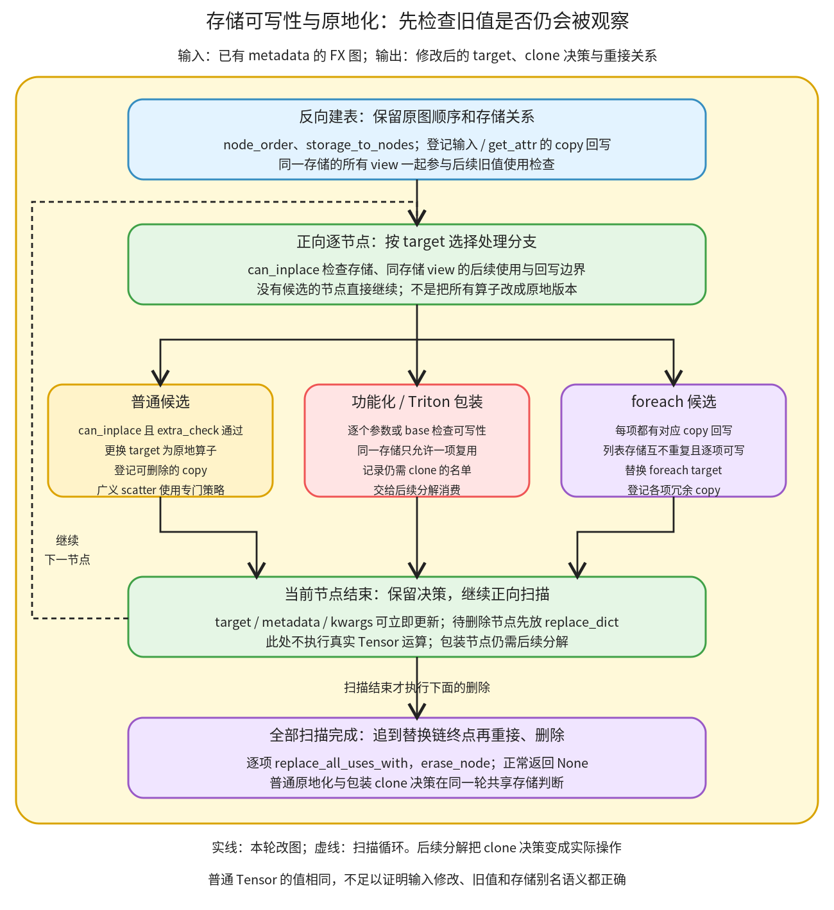

# 存储可写性与原地化：保留仍需观察的旧值，只复用允许修改的存储

```text
Inductor  本层完成
    └── 图准备  本层完成
        └── 写入语义恢复  本层完成
            └── 存储可写性与原地化 ← 当前篇  叶子·逐行完成
```

<!-- child-links:start -->

<!-- child-links:end -->

[返回写入语义恢复](../README.md)。本单元收到有 FakeTensor 属性的图，判断候选参数能否被提前修改，再直接更换普通算子 target，或记录高阶包装仍需保留的 clone。它正常返回 None，结果同时保存在图结构、node.meta 和 kwargs 上。

## 1. 完整源码范围与运行顺序

完整覆盖 [reinplace.py](/work/pytorch/torch/_inductor/fx_passes/reinplace.py:29) 的 InplaceableOp 定义 29–33、登记与 metadata-only 集合 328–368、完整核心 371–682，以及三步调用入口 685–688。核心按原始顺序分块展示，没有跳过嵌套函数或分派分支。被调用的 view/scatter 实现见[前一篇](../01-view-scatter/README.md)，不重复复制。



核心先逆序扫描原图，登记位置、存储分组和输入回写；再正序扫描，针对当前节点检查所有共享存储的 view 是否仍有旧值读取。普通候选通过后直接换 target；高阶包装逐参数形成 clone 名单；foreach 要求列表各项都有对应回写。此时只登记需要删除的节点，扫描结束才沿替换链统一重接和删除。

这不等于计算“哪个 Tensor 变量后面没出现”。一个叫 tmp 的 view 仍可能让调用者观察输入的同一存储；反过来，后续只问 shape 的使用，不必阻止一个不改变 shape 的写入。判断使用的是 metadata 中的存储身份、图顺序与具体用户。

三个跨阶段状态也要分开：`replace_dict` 用于本轮收尾；`only_clone_these_tensors` 由下一模块读取；`node.target` 的改动立即留在图上。包装的 clone 名单不会自动改变该高阶算子的普通 eager 调用语义，必须被后续分解消费。

## 2. 原始实现：候选登记与只读属性操作

```python
@dataclass(frozen=True)
class InplaceableOp:
    inplace_op: Callable[..., Any]
    mutated_arg: int
    extra_check: Callable[[torch.fx.Node], bool] = lambda node: True
```
```python
inplaceable_ops = {
    aten.index_put.default: InplaceableOp(aten.index_put_.default, 0),
    aten._unsafe_index_put.default: InplaceableOp(inductor_prims._unsafe_index_put_, 0),
    _generalized_scatter: InplaceableOp(
        _inplace_generalized_scatter,
        0,
        extra_check=should_reinplace_scatter,
    ),
}

try:
    c10d_functional = torch.ops._c10d_functional
    inplaceable_collective_ops = {
        c10d_functional.all_reduce.default: InplaceableOp(
            c10d_functional.all_reduce_.default, 0
        ),
        c10d_functional.all_reduce_coalesced.default: InplaceableOp(
            c10d_functional.all_reduce_coalesced_.default, 0
        ),
    }
    inplaceable_ops.update(inplaceable_collective_ops)
except AttributeError:
    # _c10d_functional ops are only available when torch
    # is built with USE_DISTRIBUTED=1.
    pass

inplaceable_foreach_ops: Dict[torch._ops.OpOverload, InplaceableOp] = {}
for outplace_op, inplace_op in inplaceable_foreach_ops_lowerings.items():
    inplaceable_foreach_ops[outplace_op] = InplaceableOp(inplace_op, 0)


inplaceable_triton_ops = {triton_kernel_wrapper_functional}


# Operators that don't depend on the tensor data
META_ONLY_OPS = {
    aten.sym_size.int,
    aten.sym_stride.int,
    aten.sym_numel.default,
    aten.sym_storage_offset.default,
}
```
| 源码行 | 数据与状态怎样变化 |
| --- | --- |
| 29–30 | 用冻结 dataclass 表示普通候选规则；实例字段不在扫描中重新赋值。 |
| 31 | 保存通过判定后使用的原地算子。 |
| 32 | 保存被修改参数的位置索引，不是 Tensor 元素下标。 |
| 33 | 默认额外检查返回 True；具体规则可替换这个回调。 |
| 328–330 | 登记普通/unsafe index_put，修改第 0 个参数。没有把任意 add 都纳入此字典。 |
| 331–336 | 广义 scatter 对应原地广义版本，额外调用前篇解释的 should_reinplace_scatter 策略。 |
| 338–347 | 若分布式算子存在，构造 all_reduce 与 coalesced 版本的原地映射，均以第 0 个参数为候选。 |
| 348 | 将可用的通信映射加入普通候选字典。 |
| 349–352 | 缺少这些算子的构建会抛 AttributeError，在这里跳过；其他普通候选仍保留。 |
| 354–356 | 从 lowering 提供的 foreach 映射建立独立表，将列表所在的第 0 个参数作为修改对象。 |
| 359 | Triton functional wrapper 单独成集合，后面修改的是 clone 参数而不是把它当普通 target 映射。 |
| 362–368 | 声明 sym_size、sym_stride、sym_numel、sym_storage_offset 不读取张量数据；作为旧值观察的豁免终点。 |

候选集合不是性能模型。能够复用存储还要通过后面的语义检查；通信映射存在也不证明本机能运行 collective。foreach 映射的生成接口见 [lowering.py](/work/pytorch/torch/_inductor/lowering.py:5960)，完整 lowering 归后续算子接入讲解。

## 3. 原始实现：反向建立位置、存储与回写表

```python
def reinplace_inplaceable_ops_core(graph: torch.fx.Graph) -> None:
    """
    Reinplaces in-placeable operations.
    If there are no uses of a view of the mutated arg after the current node,
    it is possible to inplace the op.
    This above algorithm could be justified by observing side effects. While
    we traverse the graph in forwards direction, only latter nodes could view
    side effects of the current node. If the current node is not used later as
    well as no view of this node is used later in the graph, then it is safe to
    inplace as there would be no way to observe the side effects.
    This condition is slightly different for graph inputs where they can only
    be inplaced if the above condition is true and there's a copy_ in the
    epilogue that signals that the caller wants to observe the mutation.

    Unlike JIT Inductor, AOTInductor currently unlifts weights and buffers from
    input args, so instead of checking mutation on placeholder, AOTInductor
    checks mutation on get_attr. This is subject to change in future.
    """

    copy_args_to_copy_nodes = {}
    # maps argument to the first copy_ node that mutates it.
    copy_nodes = {}
    mutated_inputs = set()
    storage_to_nodes = defaultdict(list)
    node_order: Dict[Any, int] = {}
    for i, node in enumerate(reversed(graph.nodes)):
        node_order[node] = len(graph.nodes) - i - 1
        storage_to_nodes[get_node_storage(node)].append(node)
        if node.target == aten.copy_.default and node.args[0].op in (
            "placeholder",
            "get_attr",
        ):
            dst = node.args[0]
            src = node.args[1]
            # If the target is a getitem and it indexes a possible clone,
            # then skip over it
            if src.target == operator.getitem and (
                (
                    src.args[0].target == triton_kernel_wrapper_functional
                    and src.args[0].kwargs["kwargs"][src.args[1]] == node.args[0]
                )
                or (src.args[0].target in inplaceable_foreach_ops)
                or (src.args[0].target == torch.ops.higher_order.auto_functionalized)
            ):
                src = src.args[0]

            copy_args_to_copy_nodes[(dst, src)] = node
            copy_nodes[dst] = node

            mutated_inputs.add(node.args[0])
```
| 源码行 | 数据与状态怎样变化 |
| --- | --- |
| 371 | 核心输入是当前 graph，正常没有返回新图。 |
| 372–388 | 原注释给出旧值观察原则，并说明 placeholder/get_attr 两种外部持有状态的入口；具体实现按下面的判断执行。 |
| 390 | copy_args_to_copy_nodes 按 `(被修改参数,计算节点)` 查对应回写。 |
| 391–392 | copy_nodes 按被修改参数记录原图中最早的 copy，用作旧值检查的时间边界。 |
| 393 | 创建 mutated_inputs；420 行填入后，本函数其余代码没有读取这个集合。它不等于最终编译产物上的 mutated_input_idxs。 |
| 394 | storage_to_nodes 把共享同一存储身份的所有节点收在一起，包括 view；未知存储可能落到 None 组。 |
| 395–397 | 逆序遍历，但保存正向位置编号 `len(graph.nodes)-i-1`，供后续比较先后。 |
| 398 | 通过 get_node_storage 读取 metadata 的存储身份，登记当前节点。 |
| 399–404 | 仅登记目的为 placeholder/get_attr 的 copy_，取出目的 dst 和源 src；内部临时量 copy 不成为这种输入回写边界。 |
| 405–415 | 部分 copy 的源是包装结果 getitem；对相应 Triton、foreach、auto_functionalized v1 情况，把源归一到产生结果的节点。这里没有列入 v2。 |
| 417 | 登记 `(dst,归一后的 src)→copy`，便于确定某个候选对应的冗余 copy。 |
| 418 | 更新 dst 的 copy 时间边界。因为逆序遍历不断覆盖，最终留下正向最早的 copy。 |
| 420 | 将目的加入上述本地集合。 |

两张 copy 表解决不同问题。`copy_nodes[x]` 说明旧 x 在什么时候允许被覆盖；`copy_args_to_copy_nodes[(x,z)]` 则说明 z 的计算结果是否就是要写回 x 的那一项。不能只看到某处有 `x.copy_(...)`，就把所有候选后面的 copy 都删掉。

[get_node_storage](/work/pytorch/torch/_inductor/fx_utils.py:192) 的完整实现已在[增量属性维护](../../01-properties/02-incremental/README.md)解释。它从 `meta['val']` 的 Tensor 存储取身份；缺失 val、非 Tensor 或无存储时返回 None。这里不把 None 组当作已证明共享同一真实存储。

## 4. 原始实现：旧值观察检查与 can_inplace

```python
    def any_use_of_views_after_node(node, shared_view_nodes, *, copy_node, mutated_arg):
        node_loc = node_order[node]
        copy_node_loc = node_order[copy_node] if copy_node is not None else None

        def is_meta_only_user(node):
            if _is_view_op(node.target):
                return all(is_meta_only_user(u) for u in node.users)
            return node.target in META_ONLY_OPS

        for view in shared_view_nodes:
            for user in view.users:
                user_loc = node_order[user]
                # Skip all users before node
                if user_loc <= node_loc:
                    continue
                # Ignore uses after the copy_ epilogue node, where the input
                # has already been mutated anyway
                if copy_node_loc is not None and copy_node_loc <= user_loc:
                    continue
                # Reinplacing does not change shape metadata
                if is_meta_only_user(user):
                    continue
                # If our graph looks like:
                # foo(mutated_arg)
                # mutated_arg.copy_(other)
                # then it's safe for us to reinplace foo because mutated_arg
                # will get overwritten anyways.
                if (
                    user.target is torch.ops.aten.copy_.default
                    and mutated_arg is user.args[0]
                ):
                    continue
                return True
        return False

    def can_inplace(node, mutated_arg):
        if isinstance(mutated_arg, (list, tuple)):
            unique_storages = {get_node_storage(arg) for arg in mutated_arg}
            if len(unique_storages) != len(mutated_arg):
                # at least two Tensors in mutated_arg alias each other, so we can't reinplace it.
                # We can probably do better (that is, reinplace one of them and clone the other)
                # but that requires more work and mutable List[Tensor] are not that common.
                return False
            return all(can_inplace(node, arg) for arg in mutated_arg)

        if get_node_storage(mutated_arg) is None:
            return False
        shared_view_nodes = storage_to_nodes[get_node_storage(mutated_arg)]

        if mutated_arg.op in ("placeholder", "get_attr"):
            # Get the first copy_ node that mutates the mutated_arg.
            copy_node = copy_nodes.get(mutated_arg, None)
            if copy_node is None:
                # There is no copy_ back to the candidate mutated_arg (which is a graph input).
                # Therefore the semantics of the program are that it does not mutate
                # mutated_arg, so we cannot re-inplace it.
                return False
            if any_use_of_views_after_node(
                node, shared_view_nodes, copy_node=copy_node, mutated_arg=mutated_arg
            ):
                return False

            return True
        elif any(view.op in ("placeholder", "get_attr") for view in shared_view_nodes):
            # This should never happen in auto_functionalize_v2 non-inference mode,
            # since all mutated_arg are bases.

            # If mutated arg is view of any of the inputs of the graph,
            # do not allow for inplacing.
            # This would require more sophisticated algorithm to handle
            return False
        else:
            return not any_use_of_views_after_node(
                node, shared_view_nodes, copy_node=None, mutated_arg=mutated_arg
            )
```
### 4.1 哪些后续使用确实需要旧数据

| 源码行 | 数据与状态怎样变化 |
| --- | --- |
| 422–424 | 取得候选位置和可选 copy 边界；内部临时存储没有输入回写边界。 |
| 426–429 | view 本身不读数据，递归检查它的所有用户；非 view 只有落在 META_ONLY_OPS 中才视为纯属性使用。无用户 view 的 all 结果为 True。 |
| 431–433 | 检查共享存储组中每个节点的每个用户，而不是只检查候选参数的直接 users。 |
| 434–436 | 候选之前或候选本身的使用不观察提前写入之后的旧值，跳过。 |
| 437–440 | 位于输入原本 copy 回写时刻及之后的使用，本来就应看到更新后的值，跳过。 |
| 441–443 | 仅访问 metadata 的使用也跳过；候选写入不应改变这里询问的尺寸等属性。 |
| 444–453 | 如果某个 copy_ 直接覆盖 mutated_arg，即使源不是当前候选，也不把其目的写入当成旧数据读取。 |
| 454 | 找到一个不能豁免的用户就返回 True，表示存在旧值观察。 |
| 455 | 所有共享 view 的使用都安全才返回 False。 |

例如 `z=index_put(x,...); old=x.view(2,2).sin(); x.copy_(z)`，sin 经 view 仍要读取旧 x，阻止原地化。如果 sin 位于 copy 之后，它本来就读新 x，不需要保留旧版本。只有 view→sym_size 的后续链也不读取旧数值，实验中的这种链允许复用内部存储。

### 4.2 列表、外部输入与内部临时存储分别怎么判定

| 源码行 | 数据与状态怎样变化 |
| --- | --- |
| 457–458 | can_inplace 接收当前候选和拟修改参数；先区分列表/元组与单节点。 |
| 459–464 | 列表各项的存储身份必须互不重复，否则整列表拒绝；没有在这里挑其中一项允许、另一项 clone。 |
| 465 | 列表无重复后，还要递归检查每个元素是否可写。 |
| 467–468 | 单节点没有可辨认存储时拒绝，避免从未知关系推断安全。 |
| 469 | 查出全部共享存储节点，用于旧值检查和外部别名检查。 |
| 471–478 | 参数本身是 placeholder/get_attr 时，必须存在输入回写 copy；否则原语义要求外部持有者看到它不变。 |
| 479–484 | 有回写仍要检查从候选到 copy 边界的旧值使用；没有观察才允许。 |
| 485–492 | 参数不是外部输入，但与某个 placeholder/get_attr 同存储，例如输入的 view，也拒绝。当前实现不从这一条分支继续推导更复杂的安全写入。 |
| 493–496 | 剩下是内部存储，只需没有任何后续旧值观察便允许；这里没有 copy 边界豁免。 |

“列表不能有重复存储”与下一节“两个不同参数可复用一个、clone 另一个”是两个层次。前者把一个列表参数作为整体判定；后者在一个操作的多个可变参数之间逐项分配复用资格。后面的真实列表包装对照会分别展示整列表复用与整列表保留 clone。

## 5. 原始实现：为多个可变参数保留必要 clone

```python
    def log_inplace_results(
        node_name,
        old_tensors_to_clone,
        tensors_to_clone,
        possibly_missed_reinplacing_opportunities,
    ):
        log.info(
            "For node %s, attempted to reinplace %s. We were unable to reinplace %s; "
            "%s (if non-empty) are possible missed reinplacing opportunities that may be bad for "
            "memory usage and performance.",
            node_name,
            old_tensors_to_clone,
            tensors_to_clone,
            possibly_missed_reinplacing_opportunities,
        )
        torch._dynamo.utils.counters["inductor"][
            "possibly_missed_reinplacing_opportunities"
        ] += len(possibly_missed_reinplacing_opportunities)

    replace_dict: Dict[torch.fx.Node, torch.fx.Node] = {}

    def reinplace_and_refine_tensors_to_clone(
        old_tensors_to_clone, kwargs, node_name, auto_functionalize_v2=False
    ):
        tensors_to_clone: List[str] = []
        storage_of_reinplaced_args = set()
        possibly_missed_reinplacing_opportunities = []

        def tensor_with_same_storage_already_reinplaced(arg):
            if isinstance(arg, (list, tuple)):
                return any(
                    get_node_storage(a) in storage_of_reinplaced_args for a in arg
                )
            return get_node_storage(mutated_arg) in storage_of_reinplaced_args

        for arg in old_tensors_to_clone:
            assert arg in kwargs

            mutated_arg = kwargs[arg]

            # Let's say we have:
            # - op(x, y) that mutates both x and y
            # - new_x, new_y = functional_op(x, y) is the functional variant
            # If we are presented with functional_op(x, x), we must not reinplace
            # this into op(x, x), because then it would be writing to the same Tensor.
            # Instead, it's OK to reinplace one of them and to clone the other:
            # >>> y = x.clone()
            # >>> op(x, y)
            # This also applies if we have views: functional_op(x, x[0])
            # should not reinplace into op(x, x[0]).
            should_attempt_reinplace = not tensor_with_same_storage_already_reinplaced(
                mutated_arg
            )
            if should_attempt_reinplace and can_inplace(node, mutated_arg):
                # In general, we probably do not need those optimizations.
                copy_node = copy_args_to_copy_nodes.get((mutated_arg, node))
                if copy_node is not None:
                    replace_dict[copy_node] = copy_node.args[0]
                if not auto_functionalize_v2:
                    for user in node.users:
                        # For auto_functionalize_v2, arg is the index of the base, where base at index i corresponds to
                        # output atindex size(out)+i.
                        # This used to compare string with integers before for auto_functionalize_v2. Not sure
                        # if it was needed for inplaceable_triton_ops?
                        if user.target == operator.getitem and user.args[1] == arg:
                            replace_dict[user] = mutated_arg

                if isinstance(mutated_arg, (list, tuple)):
                    for a in mutated_arg:
                        storage_of_reinplaced_args.add(get_node_storage(a))
                else:
                    storage_of_reinplaced_args.add(get_node_storage(mutated_arg))
            else:
                if should_attempt_reinplace:
                    possibly_missed_reinplacing_opportunities.append(arg)
                tensors_to_clone.append(arg)

        log_inplace_results(
            node_name,
            old_tensors_to_clone,
            tensors_to_clone,
            possibly_missed_reinplacing_opportunities,
        )
        return tensors_to_clone
```
### 5.1 日志与克隆名单

| 源码行 | 数据与状态怎样变化 |
| --- | --- |
| 498–503 | 日志 helper 接收节点名、原名单、保留名单和可能错过的机会；不改变图。 |
| 504–512 | 记录这几份状态，供定位为什么某项仍需 clone。 |
| 513–515 | 累加可能错过机会的数量。这是诊断计数，不是测得的耗时、节省字节或已经证明可优化的数量。 |
| 517 | replace_dict 在核心本轮中共享，保存之后统一重接的节点。 |
| 519–521 | refine helper 接收原 clone 名单、参数字典或 base 索引字典、日志名称和 v2 标志。 |
| 522 | 新名单只收仍须 clone 的项；v1 通常是名字，v2 实际是整数索引，源码这里的 List[str] 注解没有表达这个两用情况。 |
| 523 | storage_of_reinplaced_args 只属于当前 wrapper 的这次 helper 调用，记录已经被某个参数占用的可复用存储。 |
| 524 | 单独记录因可写性检查失败而可能错过的机会。 |
| 526–530 | 如果待查的是列表/元组，任一元素存储已被其他参数复用，就认为冲突。 |
| 531 | 标量分支实际读取外层当前 mutated_arg，而不是形式参数 arg；当前调用传入的正是同一个对象，不能将该小函数理解为无闭包的通用 API。 |
| 533–536 | 按原名单顺序取参数，要求 key 存在。这个顺序决定共享存储时优先给谁复用。 |

### 5.2 成功与失败都要更新对应状态

| 源码行 | 数据与状态怎样变化 |
| --- | --- |
| 538–547 | 原注释说明两个可变参数共享存储的情形：不能一起原地修改，应允许一项复用、另一项保留 clone。 |
| 548–550 | 未与已有复用存储冲突时，才设置 should_attempt_reinplace=True。 |
| 551 | 无冲突且 can_inplace 成功，进入复用分支；这里不调用普通候选的 extra_check。 |
| 552–555 | 查该参数与当前节点的回写 copy，存在则登记替换为其目的。查表使用的 FX immutable_list 实现了按元素组成的 tuple 求 hash，因此实际列表参数也可参与该查询。 |
| 556–563 | 非 v2 时，还可把 key 等于当前 arg 的 getitem 替换成原参数。v1 通常用字符串参数名，实际 tuple 输出的整数 getitem 不会因此自动命中。v2 显式跳过这段。 |
| 565–569 | 将本次成功复用的存储加入占用集合：列表逐元素加入，单节点加入一项。 |
| 570–573 | 冲突或不安全则保留 clone；只有确实尝试过、但可写性失败的项才加入“可能错过”的诊断列表，主动避开别名冲突不算在内。 |
| 575–581 | 输出诊断并返回保留名单；此时还没有实际插入 clone。 |

以 `functional_op(x=u,y=u)` 为例，x 安全且先处理，存储 u 被占用；处理 y 时因同存储冲突保留它的 clone。结果名单为 `['y']`。它不会把第二个输出直接改成第一个输出，因为两次独立的功能式更新原本可以有不同结果。

## 6. 原始实现：各类节点的分派与统一图收尾

```python
    for node in graph.nodes:
        if (inplaceable_op := inplaceable_ops.get(node.target, None)) is not None:
            mutated_arg = node.args[inplaceable_op.mutated_arg]
            if can_inplace(node, mutated_arg) and inplaceable_op.extra_check(node):
                # TODO(yifu): this doesn't properly remove copy epilogues for
                # ops that mutate multiple inputs. Need to revise the copy
                # node tracking logic to support the case.
                copy_node = copy_args_to_copy_nodes.get((mutated_arg, node))
                if copy_node is not None:
                    replace_dict[copy_node] = copy_node.args[0]
                node.target = inplaceable_op.inplace_op
        elif node.target == torch.ops.higher_order.auto_functionalized_v2:
            _mutable_op = node.args[0]
            kwargs = node.kwargs

            all_bases = kwargs["_all_bases"]
            bases_to_clone = range(len(all_bases))
            base_tensors_dct = dict(enumerate(all_bases))
            new_bases_to_clone: List[int] = reinplace_and_refine_tensors_to_clone(
                bases_to_clone,
                base_tensors_dct,
                node.target,
                auto_functionalize_v2=True,
            )
            # Stash the metadata. There is a pass later on where we decompose
            # auto_functionalized into clones + a mutable op; this metadata
            # tells the decomp to only clone the following inputs
            node.meta["only_clone_these_tensors"] = new_bases_to_clone
        elif node.target == torch.ops.higher_order.auto_functionalized:
            _mutable_op = node.args[0]
            from torch._higher_order_ops.auto_functionalize import get_mutable_args

            tensors_to_clone, _ = get_mutable_args(_mutable_op)
            # Don't try to reinplace Optional[Tensor] args that are None.
            tensors_to_clone = [
                t for t in tensors_to_clone if node.kwargs[t] is not None
            ]
            tensors_to_clone = reinplace_and_refine_tensors_to_clone(
                tensors_to_clone,
                node.kwargs,
                _mutable_op._name,
                auto_functionalize_v2=False,
            )

            # Stash the metadata. There is a pass later on where we decompose
            # auto_functionalized into clones + a mutable op; this metadata
            # tells the decomp to only clone the following inputs
            node.meta["only_clone_these_tensors"] = tensors_to_clone
        elif node.target in inplaceable_triton_ops:
            kernel_idx = node.kwargs["kernel_idx"]
            kernel = kernel_side_table.get_kernel(kernel_idx)
            from triton.runtime.autotuner import Autotuner
            from triton.runtime.jit import JITFunction

            if isinstance(kernel, JITFunction):
                kernel_name = kernel.fn.__name__
            elif isinstance(kernel, Autotuner):
                if config.is_fbcode():
                    # Autotuner has different implementations for AMD and NV
                    if torch.version.hip is None:
                        kernel_name = kernel.base_fn.__name__
                    else:
                        kernel_name = kernel.fn.__name__
                else:
                    kernel_name = kernel.base_fn.__name__
            else:
                raise AssertionError("Unknown triton kernel type")

            # inplaceable_triton_ops take an additional argument called
            # tensors_to_clone which contain a list of tensors to clone
            # This pass iterates over them and sees which ones are safe
            # to eliminate (i.e. no longer need the clones)
            tensors_to_clone = reinplace_and_refine_tensors_to_clone(
                node.kwargs["tensors_to_clone"], node.kwargs["kwargs"], kernel_name
            )

            kwargs = dict(node.kwargs)
            kwargs["tensors_to_clone"] = tensors_to_clone
            node.kwargs = immutable_dict(kwargs)
        elif (
            inplaceable_op := inplaceable_foreach_ops.get(node.target, None)
        ) is not None:
            mutated_args = node.args[inplaceable_op.mutated_arg]

            if not all((arg, node) in copy_args_to_copy_nodes for arg in mutated_args):
                continue

            if can_inplace(node, mutated_args):
                for arg in mutated_args:
                    copy_node = copy_args_to_copy_nodes[(arg, node)]
                    replace_dict[copy_node] = copy_node.args[0]

                node.target = inplaceable_op.inplace_op
    for node, replacement in replace_dict.items():
        while replacement in replace_dict:
            replacement = replace_dict[replacement]
        replace_dict[node] = replacement

        node.replace_all_uses_with(replacement)
        graph.erase_node(node)
```
### 6.1 普通候选和 auto_functionalized

| 源码行 | 数据与状态怎样变化 |
| --- | --- |
| 583–586 | 正向扫描；普通规则取指定参数，先做 can_inplace，再调用 extra_check；前者 False 时短路，不运行额外策略。 |
| 587–589 | 原 TODO 明确当前 copy 跟踪不足以完整消除多输入修改算子的回写；不能把一参数路径泛化为任意多输入。 |
| 590–593 | 有精确对应 copy 就登记删除，然后把当前节点 target 改成原地算子。没有返回新 Node，也不在此重跑 metadata。 |
| 594–596 | v2 分支取操作和 kwargs；_mutable_op 本地变量后面没有直接使用。 |
| 598–600 | v2 用 `_all_bases` 建立 `0..N-1` 的候选及索引字典。这里的索引是 base 编号。 |
| 601–606 | 逐 base 运行 refine，并以 v2=True 关闭错误含义的 getitem 替换路径。 |
| 607–610 | 把仍需 clone 的 base 整数编号保存到 node.meta；字段名沿用 only_clone_these_tensors。 |
| 611–615 | v1 从操作 schema 找到可变参数名字，而不是把 kwargs 全部当作要修改的 Tensor。 |
| 616–619 | Optional Tensor 为 None 时从候选中排除，不对 None 尝试可写性判断。 |
| 620–630 | refine 名字列表，保存仍需 clone 的参数名到相同 metadata 字段。 |

v1 的 `['x']` 与 v2 的 `[0]` 都是“保留哪些 clone”，不是“允许哪些原地写”。混淆方向会把仍需保护的旧值写坏；混淆名字与 base 索引则会克隆错误对象。

### 6.2 Triton 参数与 foreach 列表

| 源码行 | 数据与状态怎样变化 |
| --- | --- |
| 631–635 | Triton wrapper 根据 kernel_idx 取 side table 中的 kernel，导入实际的 JITFunction/Autotuner 类型供分类。 |
| 637–638 | JITFunction 取 Python 函数名称，仅用于诊断。 |
| 639–647 | Autotuner 分支按构建环境与 HIP 情况从 base_fn/fn 读取名称；没有在这里执行调优或发射 kernel。 |
| 648–649 | 不认识的 kernel 类型抛 AssertionError，不继续猜测。 |
| 651–657 | 将 wrapper 自带 tensors_to_clone 与内层 kwargs 参数字典交给同一个 refine helper。 |
| 659–661 | 复制外层 kwargs，把新名单写回，再封装成 immutable_dict；不是直接向原不可变字典赋值。 |
| 662–665 | foreach 从单独映射取规则，第 0 个参数实际是待修改节点列表。 |
| 667–668 | 每一项都必须有 `(arg,node)` 的回写记录，否则整节点跳过。即使全部是内部临时量，也不绕过这一入口条件。 |
| 670–675 | 整列表通过 can_inplace 后，登记各回写并更换 foreach target。存储重复会在列表判断中拒绝。 |

本机未安装 Triton，实验在 import 时得到 ModuleNotFoundError；上面 Triton 分支为完整源码解释，没有伪造 JITFunction、Autotuner 或 GPU 执行证据。普通 CPU 与 auto_functionalized 实验不依赖该包。

### 6.3 扫描结束后才真正删节点

| 源码行 | 数据与状态怎样变化 |
| --- | --- |
| 676 | 遍历本轮登记的 replace_dict。 |
| 677–678 | 若替代对象本身也有替代关系，沿链找到终点；不只重接一层。 |
| 679 | 记录终点，缩短该项的替代链。这里仅覆盖已有 key 的值，不新增字典项。 |
| 681–682 | 重接所有使用者，删除被替代的旧节点。没有自动删除所有已经无用户的 getitem。 |

节点顺序与存储分组在扫描开始时建好；延后删除避免查旧用户位置时出现正在遍历的结构被任意拆散。函数正常结束仍返回 None，不能把 replace_dict 当作返回给调用者的一张新图。

## 7. 三步入口怎样把决策交给后续处理

```python
def reinplace_inplaceable_ops(graph: torch.fx.Graph) -> None:
    canonicalize_view_scatter_ops(graph)
    reinplace_inplaceable_ops_core(graph)
    decompose_generalized_scatter(graph)
```
| 源码行 | 交接 |
| --- | --- |
| 685 | 完整入口只接收 graph。 |
| 686 | 先将 view/scatter 统一成核心能够处理的广义节点。 |
| 687 | 运行上面的完整核心，改 target 并保存 clone 决策。 |
| 688 | 将广义 scatter 分解成正常操作；其他功能化包装的分解由 post-grad 后面的另一个调用完成。 |

auto_functionalized 的 metadata 消费接口是 [decompose_auto_functionalized](/work/pytorch/torch/_inductor/fx_passes/post_grad.py:800)，完整展开见[功能化包装分解](../03-functional-wrappers/README.md)。本篇的 wrapper 实验调用它来验证决策确实变成 clone 和 mutable 操作，不把调用该接口等同于已经讲完其每行实现。

## 8. 主案例：同一存储的两个参数，为什么只保留一个 clone

本实验在进程内登记一个真实的 CPU/Fake mutable 算子 `twice(x,y)`，顺序执行 `x.add_(1)`、`y.mul_(2)`，没有普通返回值。auto_functionalized v1 把更新后的参数作为额外输出。

输入为 CPU float32，x 的 shape `(4,)`、stride `(1,)`、值 `[0,1,2,3]`。原始图的逻辑是：

```python
u = x + 0
_, out_x, out_y = auto_functionalized(twice, x=u, y=u)
return (out_x, out_y)
```

**反向建表。** u 是内部新存储，只被这个高阶节点使用；外部 x 使用的是另一存储。高阶节点的多个 getitem 输出按旧功能语义具有对应属性，不把它们当成原 u 的共享旧值用户。不存在输入 copy 回写需求。

**处理 x。** 参数名单按 schema 为 `['x','y']`。当前占用集合为空，u 没有后续旧值观察，允许复用。x 不加入保留名单，将 u 的存储放入占用集合。

**处理 y。** y 对应同一个 u，查到存储已被 x 复用，因此不再尝试原地写 y。保留名单变成 `['y']`。这时只写 metadata，高阶 target 仍在图上。

**消费决策。** 下一个分解模块读取名单，在调用 mutable 算子前只复制 y：

```text
u = x + 0
y_clone = clone_preserve_strides(u)
twice(x=u, y=y_clone)
return (u, y_clone)
```

精确生成图使用 as_strided/clone/as_strided 保持相关布局；上面只省去布局包装来突出数据交接，没有把教学表示冒充原始图。见[核心出口](../../../experiments/reinplace-storage/af_shared_core.txt)与[分解后图](../../../experiments/reinplace-storage/af_shared_after.txt)。

真实执行得到 `out_x=[1,2,3,4]`、`out_y=[0,2,4,6]`，外部输入仍为 `[0,1,2,3]`，两项均不共享外部输入。若把 y 的 clone 也删掉，顺序写入会让同一存储先加 1 再乘 2，结果就不再是两个独立功能式更新。

## 9. 普通候选与包装的互补对照

### 9.1 普通 index_put 的旧值边界

x 为上述 float32 输入，index 为 int64 `[1]`，value 为 float32 `[9]`：

| 原图条件 | 核心出口 | 真实检查 |
| --- | --- | --- |
| 更新内部 `x+0`，之后无旧读 | index_put_ | 输出 `[0,9,2,3]`，外部 x 不变 |
| 直接更新 x，没有 copy | 保留 index_put | 输出更新，x 不变 |
| 更新 x，随后 x.copy_(结果) | index_put_，删除 copy | x 与返回值均更新，结果共享 x |
| copy 之前有 x.view(...).sin() | 保留 index_put 和 copy | sin 读取旧值，最终 x 更新 |
| copy 之后才计算 x+2 | index_put_ | 后续读新值，返回 `[2,11,4,5]` |
| 参数是输入的 view | 保留 index_put | 不把内部名字当成新存储 |
| 人工移除内部参数的 val | 保留 index_put | 存储未知时拒绝，正常图数值仍可执行 |
| 后续只有内部 view→sym_size | index_put_ | shape 仍为 2，不因纯属性查询保留旧数据 |

这些对照真实运行了核心和改写后的 FX 图，检查返回值、调用后输入、输出对输入的存储别名。metadata-only 案例用直接构造的有效 FX 图避免静态 shape 查询被 make_fx 提前折成常量，不用一个其实不存在的节点当证据。

### 9.2 八个包装决策怎样落实

所有输入均为 CPU float32 `(4,)`；第二输入 y 为 `[10,11,12,13]`。以下名单来自真实核心，clone 数来自随后实际分解图：

| 条件 | 保留 clone 名单 | 分解后 clone 数 |
| --- | --- | --- |
| v1 两个独立内部临时量 | `[]` | 0 |
| v1 两个参数是同一内部临时量 | `['y']` | 1 |
| v1 的内部 x 还要被后续旧值读取 | `['x']` | 1 |
| v1 两项都是无回写的外部输入 | `['x','y']` | 2 |
| v1 两项输入都有明确 copy 回写 | `[]` | 0 |
| v2 的 base0 内部，base1 是外部输入 | `[1]` | 1 |
| v2 两个 base 都是内部量 | `[]` | 0 |
| v2 外部同一个 base 的两个不同区域 | `[0]` | 1 |

最后一项把 x 前两项视为 mutable x、后两项视为 mutable y，v2 以一个 base 表示它们；保留一次完整 base clone，结果 `[1,2,4,6]`，原输入不变。索引 `[0]` 不是“只 clone 第一个 mutable 参数”。

这八项均在名单消费之后执行，数值、输入和对输入别名检查通过。有 copy 的 v1 对照在核心出口已经删除回写；此时若忽略 metadata、直接按 eager HOP 的默认全 clone 行为运行，就不能当成原地化最终结果。它需要分解协作才能实现决策。

## 10. foreach 的结果约定与当前实现边界

完整回写案例为：

```python
zs = aten._foreach_add.Scalar([x,y], 1)
x.copy_(zs[0])
y.copy_(zs[1])
return (x,y)
```

两项独立存储都有精确回写，核心更换为 `_foreach_add_.Scalar` 并删除 copy；如果只回写 x，保留功能 foreach；如果列表是 `[x,x]`，重复存储也会使整列表拒绝。三条路径都有真实对照。

完整回写的核心图仍有无用户 getitem。直接 eager FX 执行时，ATen 原地 foreach 返回 None，这些 getitem 实际抛 TypeError；实验再做显式 DCE，删除死 getitem 后的 FX 图可以正确执行。这个额外 DCE 是局部实验的观察步骤，不冒充产品核心已经做过的事。

正常单图编译另外从原始功能图完整运行并成功。Inductor 的 [foreach 原地 lowering](/work/pytorch/torch/_inductor/lowering.py:5960) 构造并返回 mutation IR 结果列表，与 eager ATen 返回值约定不同。真实生成 wrapper 调用 `cpp_fused_0(x,y,x,y)`，返回原 x/y；执行后为 `[1,2,3,4]` 和 `[11,12,13,14]`，`mutated_input_idxs=[0,1]`，数值、输入修改和返回别名均通过。见[生成程序](../../../experiments/reinplace-storage/foreach_compiled_output.py)。不能只用局部 eager 错误推断正常 Inductor 编译失败。

还验证了两项实际 mutable Tensor 列表包装。列表是两个独立可写内部量时，名单为 `[]`、分解后 clone 为 0；列表两项是同一个内部量时，整列表保留，名单为 `['xs']`、分解后 clone 为 2。这里的 FX immutable_list 与普通 Python list 不同，[它实现了按元素求 hash](/work/pytorch/torch/fx/immutable_collections.py:59)，所以列表作为 copy 查询 key 的组成部分能够执行；不能只凭容器名称推断它不可哈希。两项均完成实际分解、执行与输入/别名对照。

复现：[reinplace_storage.py](../../../experiments/reinplace_storage.py)；精确图、clone 名单、值及限制：[results.json](../../../experiments/reinplace-storage/results.json)。本机 Triton 不可用，未运行 GPU、Autotuner、分布式 collective 或 AOT get_attr 权重案例；没有用诊断计数宣称性能收益。所有已展示原始范围已完整逐行解释，外部 wrapper 分解与 foreach lowering 的完整实现归其各自模块。
