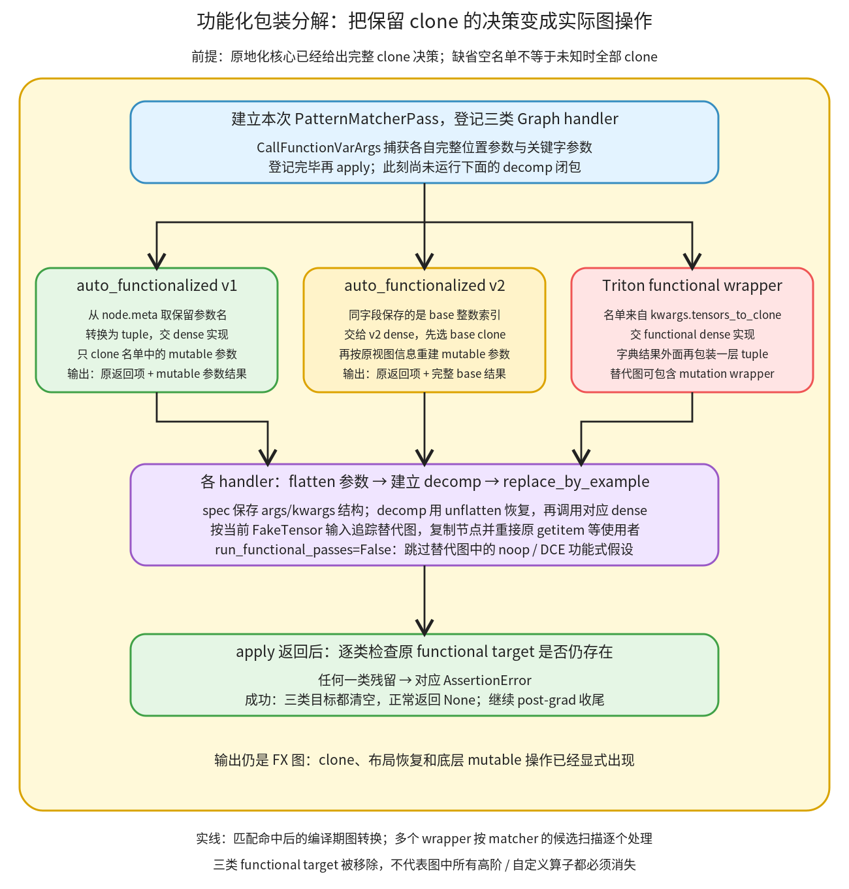

# 自动功能化包装分解：按 clone 名单恢复底层写入

```text
Inductor  本层完成
    └── 图准备  本层完成
        └── 写入语义恢复  本层完成
            └── 自动功能化包装分解 ← 当前篇  叶子·逐行完成
```

<!-- child-links:start -->

<!-- child-links:end -->

[返回写入语义恢复](../README.md)。本单元把三类 functional 高阶节点换成实际 clone、布局恢复与底层 mutation 调用。输入是已完成原地化决策的 FX 图；输出仍在原 graph 上，正常返回 None，并要求三类 functional target 全部移除。

它不在这里重新判断旧值是否可写。前篇的 `only_clone_these_tensors` 或 Triton kwargs 中的 `tensors_to_clone` 是它消费的决定。缺省空名单意味着不 clone，不是“还没决定，暂时全部保护”。

## 1. 整体过程和完整源码范围

完整覆盖 [post_grad.py](/work/pytorch/torch/_inductor/fx_passes/post_grad.py:800) 800–892 的 decompose_auto_functionalized，包括三个注册的 handler、内部追踪闭包、apply 和三项残留断言。dense 实现属于被调用的高阶算子设施，本篇按实际源码说明它们与 Inductor 的接口，不将整个上游功能化系统纳入模块树。



函数先建立局部 PatternMatcherPass，登记 v1、Triton 和 v2 三种 target 的 Graph handler。登记不会立即执行 decomp；直到 apply 在当前图上匹配到某个 wrapper，才调用相应 handler。handler 读取决策、将 args/kwargs 展平、建立一个能够恢复原参数结构的闭包，再追踪和插入替代图。apply 结束后逐项检查目标是否仍存在；任一残留都是失败，不当成“这次没优化上”。

三个分支的输出约定不同。v1 的额外输出对应可变参数，v2 对应完整 base；Triton dense 返回按键组织的字典，handler 会再包装一层 tuple。它们共享替换协议，但不能共享一种参数/输出编号解释。

## 2. 原始完整实现

```python
def decompose_auto_functionalized(graph):
    """Decomposes auto_functionalized and triton_kernel_wrapper_functional
    nodes into clones and the underlying mutation node.

    We assume that the reinplacing pass runs before this; the reinplacing pass
    tells us (via rewriting the arguments or .meta to those nodes) which
    Tensors we should clone and which Tensors are safe to reinplace.
    """
    graph_pass = PatternMatcherPass()

    @register_graph_pattern(
        CallFunctionVarArgs(torch.ops.higher_order.auto_functionalized),
        pass_dict=graph_pass,
    )
    def _(match: Match, *args, **kwargs):
        from torch._higher_order_ops.auto_functionalize import auto_functionalized_dense

        only_clone_these_tensors = tuple(
            match.nodes[0].meta.get("only_clone_these_tensors", [])
        )

        flat_args, spec = pytree.tree_flatten((args, kwargs))

        # NB: we combine (args, kwargs) into flat args for replacing.
        # This is replace_by_example uses make_fx which does not support
        # tracing a function with kwargs.
        def decomp(*flat_args):
            args, kwargs = pytree.tree_unflatten(flat_args, spec)
            return auto_functionalized_dense(*args, only_clone_these_tensors, **kwargs)

        match.replace_by_example(decomp, flat_args, run_functional_passes=False)

    @register_graph_pattern(
        CallFunctionVarArgs(torch.ops.higher_order.triton_kernel_wrapper_functional),
        pass_dict=graph_pass,
    )
    def _(match: Match, *args, **kwargs):
        from torch._higher_order_ops.triton_kernel_wrap import (
            triton_kernel_wrapper_functional_dense,
        )

        flat_args, spec = pytree.tree_flatten((args, kwargs))

        # NB: we combine (args, kwargs) into flat args for replacing.
        # This is replace_by_example uses make_fx which does not support
        # tracing a function with kwargs.
        def decomp(*flat_args):
            args, kwargs = pytree.tree_unflatten(flat_args, spec)
            return (triton_kernel_wrapper_functional_dense(*args, **kwargs),)

        match.replace_by_example(decomp, flat_args, run_functional_passes=False)

    @register_graph_pattern(
        CallFunctionVarArgs(torch.ops.higher_order.auto_functionalized_v2),
        pass_dict=graph_pass,
    )
    def _(match: Match, *args, **kwargs):
        from torch._higher_order_ops.auto_functionalize import (
            auto_functionalized_v2_dense,
        )

        only_clone_these_bases = tuple(
            match.nodes[0].meta.get("only_clone_these_tensors", [])
        )

        flat_args, spec = pytree.tree_flatten((args, kwargs))

        # NB: we combine (args, kwargs) into flat args for replacing.
        # This is replace_by_example uses make_fx which does not support
        # tracing a function with kwargs.
        def decomp(*flat_args):
            args, kwargs = pytree.tree_unflatten(flat_args, spec)
            return auto_functionalized_v2_dense(*args, only_clone_these_bases, **kwargs)

        match.replace_by_example(decomp, flat_args, run_functional_passes=False)

    graph_pass.apply(graph)

    for node in graph.find_nodes(
        op="call_function", target=torch.ops.higher_order.auto_functionalized
    ):
        raise AssertionError("auto_functionalized was not removed")

    for node in graph.find_nodes(
        op="call_function", target=torch.ops.higher_order.auto_functionalized_v2
    ):
        raise AssertionError("auto_functionalized_v2 was not removed")

    for node in graph.find_nodes(
        op="call_function",
        target=torch.ops.higher_order.triton_kernel_wrapper_functional,
    ):
        raise AssertionError("triton_kernel_wrapper_functional was not removed")
```

## 3. 按源顺序逐行解释

### 3.1 建立本次 pass，登记 v1 handler

| 源码行 | 操作的数据、状态与目的 |
| --- | --- |
| 800 | 接收当前 FX Graph；函数名中的 decompose 指改图，不是马上对真实输入执行算子。 |
| 801–807 | 原注释明确前提：原地化已先运行，并给出哪些 Tensor 仍需 clone 的决定。 |
| 808 | 创建只供本次分解使用的 pass，后面三种规则登记到同一个集合。 |
| 810–813 | 用 CallFunctionVarArgs 识别 auto_functionalized target，保留完整参数；不是按某个固定 mutable 操作写死形状模式。 |
| 814–815 | handler 收到 Match、捕获参数，延迟导入 v1 dense；仅登记规则时不会运行这个导入。 |
| 817–819 | 从匹配根 metadata 读取保留名单，缺失时取空列表，再转换为 tuple；名单里的元素是 mutable 参数名。 |
| 821 | 把 `(args,kwargs)` 作为一个整体展平，得到 flat_args 和恢复结构的 spec。 |
| 823–825 | 原注释说明为何统一为位置序列：这条 replace_by_example/make_fx 用法需要闭包接收扁平位置参数，内部再恢复 kwargs。 |
| 826–827 | 定义 decomp 闭包，捕获当前 spec 与名单；被追踪调用时将 flat_args 恢复成原来两部分参数。 |
| 828 | 调用 v1 dense，显式把名单作为第二个位置参数传入，原 kwargs 原样作为可变操作的命名参数。 |
| 830 | 用当前捕获参数追踪替代图并重接；False 要求跳过替代图上依赖功能式假设的清理。 |

以输入为 `auto_functionalized(twice,x=u,y=v)`、名单为 `('y',)` 为例，参数结构可表示为：

```text
原结构：(args=(twice,), kwargs={x:u,y:v})
flat_args：[twice,u,v]
spec：保存这两部分容器、位置与关键字键
闭包恢复：args=(twice,), kwargs={x:fake_u,y:fake_v}
调用：auto_functionalized_dense(twice, ('y',), x=fake_u, y=fake_v)
```

这里的 flat_args 不只是 Tensor；mutable OpOverload 等常量仍可保留。spec 只描述结构，没有复制张量数据。外层选定的名单通过闭包捕获，不必重新作为每个 Tensor 的输入边传来传去。

[v1 dense 的实现](/work/pytorch/torch/_higher_order_ops/auto_functionalize.py:550) 从 schema 取可变参数，名单内的参数使用 clone_preserve_strides，名单外复用原参数，随后调用底层 mutable 操作；返回普通结果及更新后的可变参数。Tensor 列表按元素复制，Optional None 保持 None。具体可写性已经由前篇决定，dense 不再次检查后续旧值读取。

### 3.2 Triton handler 使用 kwargs 中的名单，并保留字典输出层次

| 源码行 | 操作的数据、状态与目的 |
| --- | --- |
| 832–835 | 登记 triton_kernel_wrapper_functional 的完整参数匹配。 |
| 836–839 | 命中后导入该 wrapper 的 dense 实现，不在这里解析 kernel 类型或重新调优。 |
| 841 | 同样展平 args/kwargs；名单本来就在 wrapper kwargs 中，不读 only_clone_these_tensors 元数据。 |
| 843–845 | 同一位置参数追踪约束的原注释。 |
| 846–847 | 建立闭包并恢复参数结构。 |
| 848 | 调 dense，再把其字典结果放入单项 tuple，保留“一个包装结果”的外层输出层次。 |
| 850 | 追踪并插入替代图，仍禁用该条路径的功能式清理。 |

[Triton dense](/work/pytorch/torch/_higher_order_ops/triton_kernel_wrap.py:666) 根据 tensors_to_clone 选择复制哪些命名参数，调用 mutation wrapper，再返回需要以字典键交出的更新参数。核心已把允许复用的 getitem 重接到原输入，所以不能把“字典里没有某键”解释成该参数没有参与底层 kernel。

外层 tuple 也不是多创建一份 Tensor；它维护替换图输出的结构，使对应 getitem 使用者仍能按各自键获得新节点。分解后可以存在 triton_kernel_wrapper_mutation，这正是底层调用；末尾断言只禁止原 functional target 残留，并不要求所有高阶算子都消失。

当前环境没有 Triton 包，没有运行这个 dense 路径或任何 GPU kernel；上面是按本地源码解释接口。

### 3.3 v2 handler 按 base 编号消费名单

| 源码行 | 操作的数据、状态与目的 |
| --- | --- |
| 852–855 | 登记 auto_functionalized_v2 的完整参数匹配。 |
| 856–859 | 命中后导入 v2 dense。 |
| 861–863 | 从相同 metadata 字段取名单，但变量名明确为 bases；元素实际是 `_all_bases` 中的整数索引。 |
| 865 | 展平参数，包括 base 列表和序列化视图信息的结构。 |
| 867–869 | 同一条关于追踪位置参数的原注释。 |
| 870–871 | 闭包恢复原始结构。 |
| 872 | 把需要复制的 base 索引 tuple 交给 v2 dense，并传入完整 kwargs。 |
| 874 | 用同一替换协议应用结果，跳过相同的功能式清理。 |

[v2 dense](/work/pytorch/torch/_higher_order_ops/auto_functionalize.py:623) 先选择复制哪些完整 base，再用所保存的 size、stride、storage_offset 等信息重建可变参数的 view，调用底层操作，返回普通结果和更新后的完整 base。base0 的两个 view 只需一次 base clone；不能按两个参数名字各 clone 一份、把它们原本的视图关系拆掉。

例如 x 为 float32 `[0,1,2,3]`，两个 mutable 参数分别指向其前两项与后两项。`_all_bases=[x]`，保护外部输入的名单为 `(0,)`。dense 复制完整 x，再重建两个 `(2,)`、元素 stride `(1,)`、元素偏移分别为 0 和 2 的视图；一边加 1、一边乘 2，返回完整 base `[1,2,4,6]`。输入 x 不变。这个实际案例见前篇的 v2_views 证据。

### 3.4 应用与三个强制出口检查

| 源码行 | 操作的数据、状态与目的 |
| --- | --- |
| 876 | 所有规则登记完成后才 apply 当前图。它采用 matcher 的候选遍历、类型过滤与 Graph handler 协议。 |
| 878–881 | 查 v1 functional target；只要还找到一个节点，就抛对应 AssertionError。 |
| 883–886 | 同样检查 v2，错误消息保留具体类别。 |
| 888–892 | 检查 Triton functional wrapper。三类都清空时正常走到函数末尾，返回 None。 |

这些循环不是把残留节点强行删除。未匹配可能来自候选过滤，也可能来自图条件；下游要求这种功能式包装已经展开，所以函数显式报告失败。没有这三类节点的普通图会保持不变并正常返回 None。

## 4. 一次替换怎样从 FakeTensor 变成可执行图

规则回调是 GraphPatternEntry：它在旧根前设置插入位置，调用 handler；[Match.replace_by_example](/work/pytorch/torch/_inductor/pattern_matcher.py:225) 再用捕获节点的 `meta['val']` 追踪 decomp。追踪得到的是要复制进当前图的操作关系，而不是把实验真实 Tensor 提前改掉。

[fwd_only](/work/pytorch/torch/_inductor/pattern_matcher.py:1821) 在 run_functional_passes=True 时额外运行 remove_noop_ops 和 DCE。这里传 False，跳过的正是这些额外步骤；它不表示关闭所有 decomposition、关闭 FakeTensor 或“把函数重新功能化的总开关”。替代图包含实际写入，不能不加区分地套用该条清理路径的功能式假设。

替换器复制新图、传播相关属性、把原高阶结果的 getitem 重接到对应结果，再清理旧节点。完整匹配与复制机制归[模式匹配篇](../../02-rewrites/03-patterns/README.md)，本篇只解释这三个实际用户怎样提供参数、闭包和输出约定。

## 5. 主案例：只 clone y，保留两项独立更新

沿用前篇的真实 mutable 算子 twice：先 x.add_(1)，再 y.mul_(2)。输入 x 为 CPU float32 `(4,)`，值 `[0,1,2,3]`，功能图内 `u=x+0`，两个参数都指向 u。核心已确认保留名单为 `['y']`。

**分解入口。** graph 包含 auto_functionalized 及两个结果 getitem；metadata 中的名单是输入状态，不由本函数重新推导。

**v1 handler。** 取出 `('y',)`，把操作常量与两次出现的 u 展平，spec 保留参数名。decomp 恢复结构，将两项都绑定回原来的值关系。

**dense 追踪。** x 直接使用内部 u；y 经过 clone_preserve_strides。底层 mutable 调用接到这两个存储。真实替代图用 as_strided/clone/as_strided 表达保留 stride 的复制，不能把它误认为独立做了一次 y 的计算。

**图重接。** 旧 x 结果接到 u，旧 y 结果接到复制的存储，删除 functional 根及对应 getitem。检查三类 target 均无残留，返回调用方，最后再 recompile 执行。

真实结果分别为 `[1,2,3,4]`、`[0,2,4,6]`；外部输入不变。这里有且只有一个 clone。两项不是同一个被依次加再乘的结果，名单因此既影响内存，也影响数值正确性。源码图见[分解后的主案例](../../../experiments/reinplace-storage/af_shared_after.txt)。

已有八项 v1/v2 对照和两项列表对照都真实运行过本模块：名单分别覆盖无 clone、单参数 clone、两个输入都 clone、按 base clone、一个 base 重建多个 view，以及列表独立/别名情况。完整结果见 [reinplace-storage/results.json](../../../experiments/reinplace-storage/results.json)，不把这些重复引用的十项当成新跑出的十份独立证据。

## 6. 前置顺序和失败出口的八项独立对照

### 6.1 没有核心决策时，默认空名单会怎样

用仅执行 x.add_(1) 的 mutable 操作，输入 x 为 `[0,1,2,3]`。对 v1 和 v2，分别直接跳过原地化核心调用本分解入口，实际得到：

```text
保留名单缺失 → 默认 () → 不生成 clone
返回值：[1,2,3,4]
分解图执行后的输入：[1,2,3,4]
原 functional 函数执行后的输入：[0,1,2,3]
```

返回值相同，输入修改语义不同。这个受控对照刻意违反函数声明的前置顺序，用来证明“核心已经给出决策”是必要契约；没有据此认定正常 post-grad 调用顺序错误。

同样两个输入图先运行真实核心，则分别写入 `['x']` 或 `[0]`，分解后都有一次 clone，真实执行时外部输入保持不变。这形成两组只改变前置阶段的直接对照。

### 6.2 matcher 跳过候选时，不能返回成功

另两项 v1/v2 对照开启 `disable_cpp_codegen=True`，让本版真实候选过滤跳过带 CPU FakeTensor 输出的节点。handler 没有执行，最后分别抛：

```text
AssertionError: auto_functionalized was not removed
AssertionError: auto_functionalized_v2 was not removed
```

来源是 [unsupported_output_tensor](/work/pytorch/torch/_inductor/lowering.py:1734) 与 matcher 调用的候选过滤，不是用自定义异常模拟残留。

Triton 的出口检查单独用一个带 CPU Fake metadata 的 FX functional wrapper 目标验证，同样因过滤而未进入 handler，最终抛 `triton_kernel_wrapper_functional was not removed`。这个案例没有读取 kernel side table、没有验证 kernel 参数，也没有执行 Triton；它只验证函数末尾对这一目标的强制检查。

最后一项普通 add 图没有任何 wrapper，执行后 graph 文本不变，返回 None。以上共八项独立边界对照，复现为 [functional_wrapper_boundaries.py](../../../experiments/functional_wrapper_boundaries.py)，结果为 [results.json](../../../experiments/functional-wrapper-boundaries/results.json)。

本篇完整覆盖的是 Inductor 的决策消费和图替换入口。clone_preserve_strides、v1/v2 的视图编码、Triton dense 属于高阶算子依赖：本篇核对其相关接口与结果，未宣称完整展开整个外部系统。没有 GPU 或 Triton 正常执行证据，也没有性能结论。
