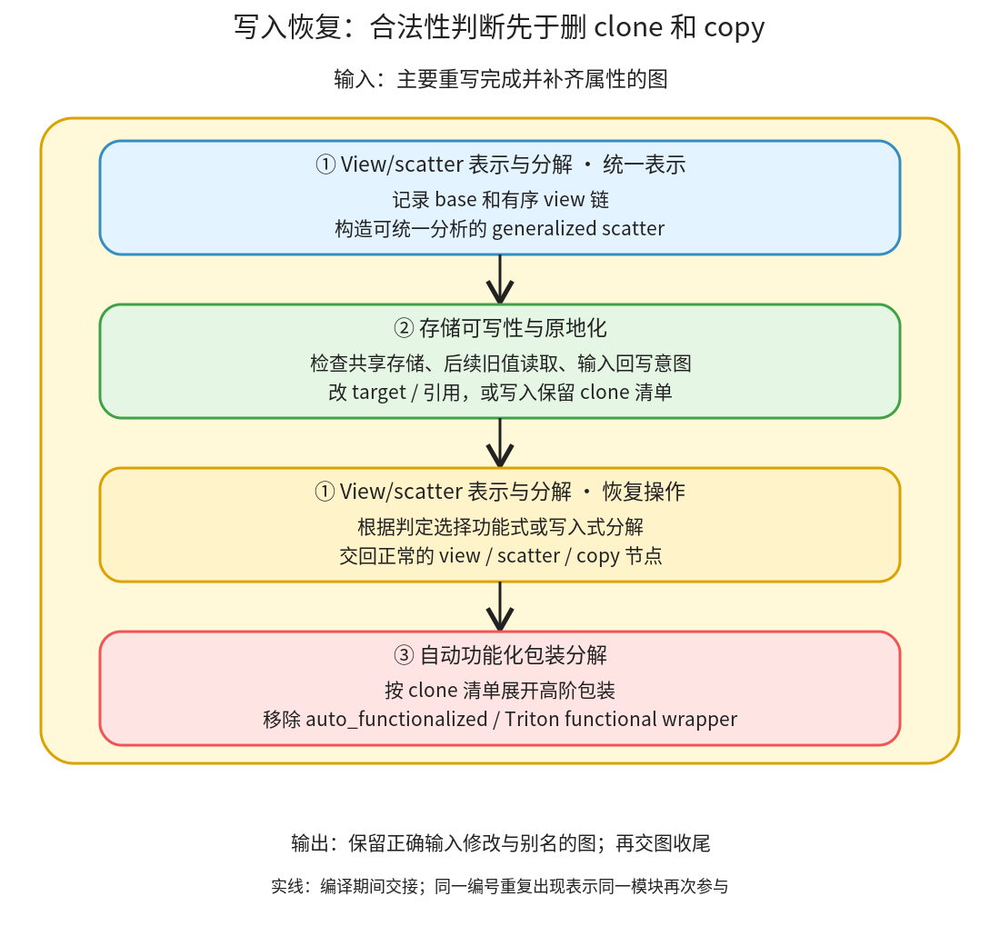

# 写入语义恢复：确认旧值不会再被观察，才让计算直接修改存储

```text
Inductor  本层完成
    └── 图准备  本层完成
        └── 写入语义恢复 ← 当前篇  本层完成
            ├── View/scatter 表示与分解  叶子·逐行完成
            ├── 存储可写性与原地化  叶子·逐行完成
            └── 自动功能化包装分解  叶子·逐行完成
```

<!-- child-links:start -->
直接子篇：[View/scatter 表示与分解](01-view-scatter/README.md)、[存储可写性与原地化](02-storage-reinplace/README.md)、[自动功能化包装分解](03-functional-wrappers/README.md)。
<!-- child-links:end -->

[返回图准备](../README.md)。本模块收到主要图重写完成、张量属性已补齐的图，检查哪些功能式结果可以直接写到已有存储，再将高阶功能化包装分解为必要的 clone、view 和实际写入。图出口可以包含 mutation；后续 Lowering 与 Scheduler 必须保留这些可观察副作用。

## 1. 准备表示、判断可写、展开实际操作



入口 [reinplace_inplaceable_ops](/work/pytorch/torch/_inductor/fx_passes/reinplace.py:685) 先统一 view/scatter 表示，再运行核心原地化，最后将广义 scatter 分解回正常操作。之后 post-grad 调用 [decompose_auto_functionalized](/work/pytorch/torch/_inductor/fx_passes/post_grad.py:800)。这些步骤先判断是否可复用，再决定保留哪些 clone，而不是先删 clone 再碰运气验证。

图中①两次出现：统一表示时参与一次，合法性判定后再选择分解路径。③使用②写在 node.meta 或 kwargs 里的 clone 决策。状态交接既有图结构变化，也有不直接改变算子 target 的元数据变化。

通信相关的 FSDP all-gather 原地化还有独立调用，其通信细节归入通信与专用算子后续覆盖。本篇 CPU 案例验证普通 index_put 的存储判断，不拿它替代分布式语义验证。

## 2. 三个模块接收和交出什么

### 2.1 View/scatter 表示与分解

功能式 view-scatter 可以表达“把 src 写到 inp 某个视图覆盖的区域，但返回新 inp，旧 inp 不变”。若多层视图与回填交织，直接判断每个 scatter 会把本来一次完整更新拆散。

[canonicalize_view_scatter_ops](/work/pytorch/torch/_inductor/fx_passes/reinplace.py:225) 记录 view 的 base 和 view 操作序列，把关联更新统一为 `_generalized_scatter(inp,src,view_ops)`。例如先取第 0 行，再取该行第 1～2 列，可用一个有序的 view_ops 序列描述写入位置。

功能式广义 scatter 先 clone inp，再沿 view_ops 找到目标并 copy src；原地广义 scatter 则直接使用 inp。两者数值都能完成覆盖，但是否修改输入存储不同。该模块先把统一表示交给②，等②选定是否原地化后，再由 [decompose_generalized_scatter](/work/pytorch/torch/_inductor/fx_passes/reinplace.py:204) 变成正常 view/scatter 或 clone/view/copy 操作。

选择 mutation 未必总更好：[should_reinplace_scatter](/work/pytorch/torch/_inductor/fx_passes/reinplace.py:176) 还考虑输入输出是否本来就要物化，以及某些 scatter 是否必然按写入降低。不能把“能原地”自动等同为“总是有利于融合”。

### 2.2 存储可写性与原地化

核心入口是 [reinplace_inplaceable_ops_core](/work/pytorch/torch/_inductor/fx_passes/reinplace.py:371)。它收到图和 FakeTensor 存储关系，先从后往前登记节点顺序、共享存储的节点、图输入的 copy 回写位置，再从前往后尝试候选。

候选不是任意算子：本地 inplaceable_ops 列出 index_put、unsafe_index_put、广义 scatter 和可用的集合通信等；foreach 和特定 Triton/高阶包装有专门分支。源码没有一个把所有 `aten.add` 自动改成 `aten.add_` 的通用步骤。

对内部临时量，只要其存储和所有共享 view 后面都没有需要观察旧值的使用者，可能允许写入。对图输入或 get_attr，则还需要已有 copy epilogue 表明调用者原本就应观察输入被修改；“图内部以后不再读 x”不等于调用者允许把 x 改掉。

此外，输入的 view 不是随意可写候选；可修改的参数列表也必须避免两个参数共享同一存储。否则 `functional_op(x,x)` 若直接变成会同时写两个参数的 op，可能互相覆盖。核心会保留必要 clone，不能仅按参数名字判断不相同。

交出的状态包括被替换的算子 target、待删除 copy/getitem 的替换映射，以及高阶节点的 `only_clone_these_tensors` 元数据。最后统一重接引用、删除冗余节点，不在遍历中任意留下引用已删除节点的使用者。

### 2.3 自动功能化包装分解

这个模块接收已经带有② clone 决策的高阶节点。功能化包装把原来会修改参数的算子表示成返回新值，便于前面的功能式图改写；到这里需要恢复可执行的 clone 与底层写入。

`decompose_auto_functionalized` 为 auto_functionalized、auto_functionalized_v2 和 triton_kernel_wrapper_functional 建立临时 PatternMatcherPass。处理函数把 args/kwargs 展平成参数序列，以便 replace_by_example 捕获替代图，再根据元数据中的保留列表只 clone 仍有必要的输入或 base。

例如两个参数共享旧存储时，②可能允许其中一个复用，却要求另一个 clone。③必须按这个清单展开，不能因为算子有原地版本就把所有 clone 删掉。v2 的清单按 base 索引表达，不能误当成 v1 的参数名字。

替换使用 `run_functional_passes=False`，跳过替代图上的 remove_noop_ops 和 DCE；这些额外清理依赖功能式 IR 假设。该开关不是关闭所有功能化机制。最后明确检查这三种高阶包装是否仍留在图中，未移除会抛 AssertionError；“没有匹配到”不能直接当作成功。

本模块交回常规 FX 操作组成的图，供收尾重新生成入口，再进入 Lowering。底层 auto_functionalized_dense 等依赖的相关接口会在子篇说明，不扩展到 AOTAutograd 的上层整体流程。

## 3. 主案例：输入原本要被修改，可以删掉 copy 吗

输入均为 CPU：x 是 float32、shape `(4,)`、stride `(1,)`，值 `[0,1,2,3]`；index 为 int64 `(1,)`，值 `[1]`；value 为 float32 `(1,)`，值 `[9]`。

```python
z = torch.index_put(x, [index], value)  # 功能式：暂不改 x
x.copy_(z)                            # 已有明确的输入回写
return (x,)
```

**①统一表示。** 这个图没有 view-scatter，原节点继续交给②；不是每个图都必须生成广义 scatter。

**②登记状态。** 核心看到 placeholder x、index_put、copy_ 和 output。登记 `(x,index_put) → copy_`，明确 x 的回写意图；共享存储集合和节点顺序可用于查找 index_put 与 copy_ 之间有无旧值读取。

**②判断并改写。** 本例没有中间读取旧 x 的用户，候选可原地化。target 从 `aten.index_put.default` 变成 `aten.index_put_.default`；copy_ 的使用者改接 x，冗余 copy 被删除。

[实际出口](../../experiments/rewrites-mutation/copy_back_after.txt) 可概括为：

```text
x、index、value → index_put_(x, index, value)
output → x
```

**①分解与③展开。** 没有广义 scatter 或功能化包装需要展开，继续交给图收尾；recompile 后执行新的 FX 图。

真实结果为 `[0,9,2,3]`，调用后的 x 也是 `[0,9,2,3]`，返回输出与 x 共享存储。三项都与改写前函数一致：既验证值，也验证调用者应看到的修改和别名。

## 4. 改变两个条件，为什么就不能删

### 4.1 输入没有回写意图

只有 `return (torch.index_put(x,[index],value),)`，图没有 copy_ epilogue。即使图内以后不再使用 x，调用者也仍持有它，原语义要求 x 不变。

②找不到 x 的 copy 节点，拒绝原地化；[出口](../../experiments/rewrites-mutation/input_only_after.txt) 保留 index_put。实际输出 `[0,9,2,3]`，但 x 仍是 `[0,1,2,3]`，输出不共享 x 存储。若只比较结果值而不检查 x，会漏掉最关键的错误。

### 4.2 copy 前还有旧值读取

```python
z = torch.index_put(x, [index], value)
old = x + 2
x.copy_(z)
return (old, x)
```

虽然有回写，index_put 与 copy_ 之间还要读取旧 x。若把第一步改为 index_put_，old 的第 1 项会由正确的 3 变成 11。

核心根据节点顺序发现这项旧值使用，拒绝原地化；[出口](../../experiments/rewrites-mutation/old_reader_after.txt) 保留 index_put、add 与 copy_。实际 old 为 `[2,3,4,5]`，最终 x 为 `[0,9,2,3]`；第一项输出不共享 x，第二项输出共享 x。

## 5. 内部临时量为什么更容易允许写入

把候选参数改成 `tmp=x+0; return index_put(tmp,...)`，tmp 是新建内部存储，不是调用者持有的输入。后面没有旧 tmp 的读取，也没有需要保留旧版本的共享 view，因此可以直接改为 index_put_。

[实际出口](../../experiments/rewrites-mutation/internal_after.txt) 保留 add、把 index_put 改成 index_put_。结果 `[0,9,2,3]`，调用者的 x 仍是 `[0,1,2,3]`，输出不共享 x。这与主案例的共同点是复用可写存储，不同点是没有“修改图输入”的需求。

四个案例均由真实 reinplace pass 改图，再执行 FX 图，对照数值、输入内容和输出别名。脚本为 [rewrites_mutation.py](../../experiments/rewrites_mutation.py)，结果见 [results.json](../../experiments/rewrites-mutation/results.json)。没有运行完整 kernel 编译，也没有测试通信、Triton 或 auto_functionalized_v2 的实际执行。

## 6. 下一层保留的问题

三个子篇均已完整逐行解释：View/scatter 的表示与分解、共享存储及旧值观察判定、clone 决策消费与包装展开。原地化需要这些约束，是因为 Tensor 的可观察状态包括共享存储和执行后输入，而不仅是返回值。
