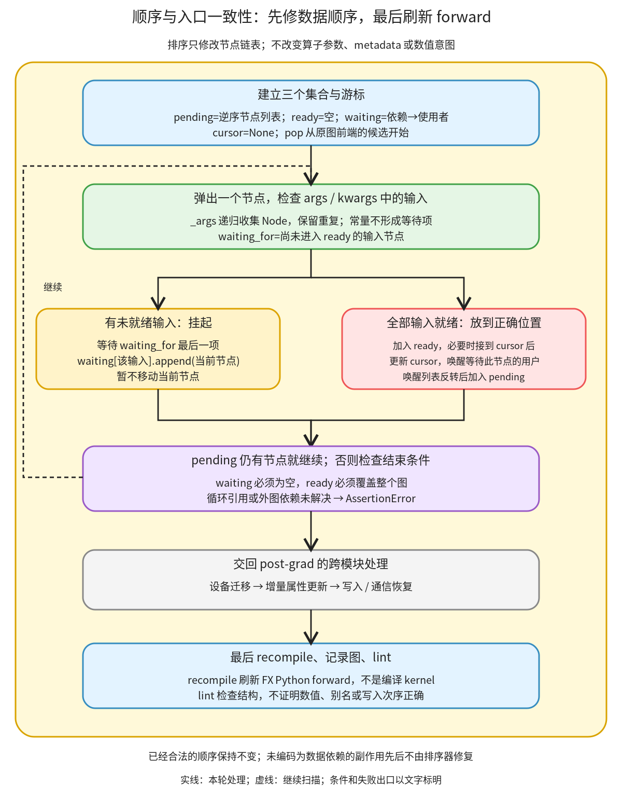

# 顺序与入口一致性：按数据依赖修复链表，最后重新生成 FX forward

```text
Inductor  本层完成
    └── 图准备  本层完成
        └── 图收尾  本层完成
            └── 顺序与入口一致性 ← 当前篇  叶子·逐行完成
```

<!-- child-links:start -->

<!-- child-links:end -->

[返回图收尾](../README.md)。本单元调整 FX 节点链表，使每个节点的输入先于它出现，并在其他收尾完成后刷新 gm.forward、检查图结构。它没有重新计算张量属性，也不在这里生成后端 kernel。

## 1. 完整范围与两个交接时点

完整解释 [pattern_matcher.py](/work/pytorch/torch/_inductor/pattern_matcher.py:1893) 1893–1932 的依赖收集和 stable_topological_sort，以及 [post_grad.py](/work/pytorch/torch/_inductor/fx_passes/post_grad.py:133) 133–148 的完整收尾调用段。后一段是 post_grad_passes 中本职责对应的调用范围，不冒充整个 post_grad_passes 实现。



先排序，随后交给设备迁移、属性维护和写入恢复。它们改完图后才最终 recompile、lint。图中灰框为跨模块处理，不能把它简化成“排序后马上生成入口，中间不再改图”。

排序接收同一个 graph，只改节点链表；操作参数仍是原来的 Node 引用，Node 身份与 metadata 保留。recompile 则让已经生成的 Python forward 跟上当前图。两个动作分别解决图顺序与入口代码一致性，互相不能代替。

## 2. 完整原始实现：输入收集与稳定拓扑排序

```python
def _args(n: torch.fx.Node) -> List[torch.fx.node.Argument]:
    args: List[torch.fx.node.Argument] = []
    torch.fx.map_arg((n.args, n.kwargs), args.append)
    return args


def stable_topological_sort(graph: torch.fx.Graph) -> None:
    # Nodes are in exactly one of these three collections:

    # - Nodes in `pending` are waiting to be processed (in reverse order):
    pending = list(reversed(graph.nodes))

    # - Nodes in `ready` have been processed and are already in the correct
    #   order.
    ready = set()

    # - `waiting` is a mapping from a dependency to nodes which depend on that
    #   dependency.
    waiting = defaultdict(list)

    # The cursor indicates the last processed node so we can add new nodes
    # after it.
    cursor = None
    while pending:
        node = pending.pop()
        waiting_for = [x for x in _args(node) if x not in ready]
        if waiting_for:
            # We have unprocessed input nodes. Might as well wait for the last
            # arg so an already sorted list will only recheck this node once.
            waiting[waiting_for[-1]].append(node)
        else:
            ready.add(node)
            if cursor and cursor.next is not node:
                cursor.append(node)
            cursor = node
            # Mark the nodes that have been waiting for this node to finish as
            # ready to check again.
            pending.extend(reversed(waiting.pop(node, ())))

    assert not waiting and len(ready) == len(graph.nodes)
```

### 2.1 四份状态怎样建立

| 源码行 | 处理的数据、状态和目的 |
| --- | --- |
| 1893–1894 | 为某个节点建立输入 Node 列表；虽然类型注解较宽，实际收集的是 map_arg 访问到的 Node。 |
| 1895 | 同时递归访问 args 与 kwargs 中的嵌套容器，遇到 Node 就 append；普通常量不加入，重复引用不去重。 |
| 1896 | 返回本节点的输入列表，不读取 metadata 中其他对象。 |
| 1899 | 排序直接修改传入 graph，正常返回 None。 |
| 1900–1903 | pending 用原链表逆序建立；后面 pop 从尾部取，所以首次检查顺序仍由原图前到后。它不是已排序结果。 |
| 1905–1907 | ready 是已经处理完成的 Node 集合，用于快速判断输入是否就绪；集合本身不表示输出顺序。 |
| 1909–1911 | waiting 把一个未就绪输入映射到等待它的用户列表。一个候选此刻只挂在所选的一个输入下。 |
| 1913–1915 | cursor 指向最近放好的节点；开始时没有前一项。 |

实验中构造了带列表、字典及 kwargs 的参数，`_args` 返回 `[p,q,p,z]`。p 出现两次仍保留两次，这没有把它变成两个不同依赖；等待策略稍后只选择未就绪列表的最后一项。

### 2.2 挂起和唤醒都只改变处理状态

| 源码行 | 处理的数据、状态和目的 |
| --- | --- |
| 1916–1917 | pending 非空就弹出一个待检查节点；被唤醒的节点也从同一个栈进入本轮。 |
| 1918 | 从当前输入列表找出不在 ready 的部分；这是显式数据引用，不是存储别名或副作用依赖。 |
| 1919–1922 | 有未就绪输入时，把本节点挂到最后一项的 waiting 列表，暂不进入 ready，也暂不移动链表位置。 |
| 1920–1921 | 原注释解释等待最后参数可减少已近有序场景的重复检查；不是所有乱序图只检查一次的保证。 |
| 1923–1924 | 全部输入就绪才进入 ready，表示这次检查已满足数据前驱约束。 |
| 1925–1926 | 有 cursor，且当前节点不正好紧随其后时，把节点从当前位置移到 cursor 后；不克隆 Node。 |
| 1927 | cursor 更新成当前节点，供下一个成功处理的节点接续。 |
| 1928–1930 | 取出等待当前节点的列表，反转后加入 pending，使后续 pop 仍按该列表的原顺序唤醒。原来 pending 中更早的其他工作暂时留在下面。 |
| 1932 | pending 空后，要求没有 unresolved waiting 且 ready 覆盖全图；否则抛 AssertionError。 |

挂到一个输入下不是已经确认其他输入都会更早完成。被唤醒时仍从 1918 行重新检查：如果另一项还没 ready，可以再次挂起。这正是下面主案例发生的事。

## 3. 主案例：最后一个参数先就绪，用户会等待两次

真实 CPU 输入 x=`[0,1,2,3]`、y=`[10,11,12,13]`，都是 float32 `(4,)`、stride `(1,)`。图表达 `-x + relu(y)`；实验只把节点链表改成：

```text
x_1，y_1，add，relu，neg，output
数据关系：x_1→neg；y_1→relu；(neg,relu)→add→output
```

下表来自运行真实 sorter 时采集的状态；只缩去无变化的输入检查：

| 轮到谁 | 输入检查 | 状态交接 |
| --- | --- | --- |
| x_1、y_1 | 无输入 | 先后 ready，cursor=y_1 |
| add 第一次 | neg、relu 都未就绪 | 挂在 waiting[relu]，尚不移动 add |
| relu | y_1 已就绪 | 接到 cursor 后，ready；把 add 放回 pending 顶部 |
| add 第二次 | relu 就绪，但 neg 未就绪 | 再挂到 waiting[neg] |
| neg | x_1 就绪 | 接到 relu 后，ready；唤醒 add |
| add 第三次 | 两项输入都就绪 | 进入 ready，接在 neg 后 |
| output | add 就绪 | 完成，waiting 空且 ready 覆盖所有节点 |

真实出口为 `x_1,y_1,relu,neg,add,output`，执行结果 `[10,10,10,10]`。所有 Node 对象和实验附加 metadata 保持身份；再次排序顺序不变。若初始链表中 neg 已排在 relu 前面，则 add 只挂起一次，因为最后一项 relu ready 时 neg 也已经 ready。

采集通过 Python 行跟踪观察产品函数自己的 locals，未改排序代码。原始 pending、ready、waiting、waiting_for 和 cursor 记录见 [results.json](../../../experiments/order-entry/results.json)；实验脚本为 [order_entry.py](../../../experiments/order_entry.py)。

## 4. “stable”和结束断言各自保证什么

对于已经合法的拓扑顺序，输入总在当前节点之前 ready，cursor 也已紧邻当前节点，通常无需移动；真实二次排序对照保持原链表不变。

但它不承诺保留一张无效原图里所有无依赖节点对的相对次序。实验中的两项输出为 `(x+1)*2` 与 `sin(x)`，乱序链表为：

```text
排序前：x_1，mul，sin，add，output
排序后：x_1，sin，add，mul，output
```

mul 与 sin 互无依赖，原本 mul 在前，修复后 sin 在前；因为 mul 先等 add，sin 已经可以处理。两项真实输出仍与原表达式一致。所以不能把函数名里的 stable 扩大为一种全局相对次序约束。

另两个失败对照分别让 add↔mul 成环，或让 add 引用另一个 graph 的 placeholder。它们都留下无法唤醒的 waiting，实际抛 AssertionError。函数没有修补非法引用、打破循环或回滚此前的链表改动；调用者需要修正产生它们的图改写。

## 5. 完整收尾调用段：先修图，再生成入口

```python
    stable_topological_sort(gm.graph)

    move_constructors_to_gpu(gm.graph)

    fake_tensor_updater.incremental_update()

    # Keep these last, since they introduces mutation. Look at
    # ./fx_passes/README.md for a discussion of mutation invariants.
    reinplace_inplaceable_ops(gm.graph)
    decompose_auto_functionalized(gm.graph)

    comms.reinplace_fsdp_all_gather(gm.graph)

    gm.recompile()
    optimus_scuba_log["after_recompile_post_grad"] = upload_graph(gm.graph)
    gm.graph.lint()
```

| 源码行 | 交接的数据与责任 |
| --- | --- |
| 133 | 调用上面完整解释的 sorter，保证后续按图顺序分析时生产者先出现。 |
| 135 | 设备迁移可能修改构造 kwargs；内部实现由[同层设备迁移篇](../02-constructor-devices/README.md)展开。 |
| 137 | 改写后的属性由既有 FakeTensorUpdater 增量更新，不由 sorter 重新计算。 |
| 139–142 | 保留写入恢复在后，依次规范化/原地化和展开功能化包装；完整实现见[写入恢复](../../03-mutation/README.md)。 |
| 144 | 再执行通信专用 FSDP all-gather 原地化辅助；它修改同一图，不是启动 collective。此处只解释调用交接，通信算法另归通信模块。 |
| 146 | 从当前 graph 重新生成 FX Python forward。 |
| 147 | 保存图观察结果到诊断字典；不改变计算结果，也不是后端编译缓存。 |
| 148 | 检查当前 graph 的结构，发现错误会抛异常。 |

[GraphModule.recompile](/work/pytorch/torch/fx/graph_module.py:755) 的相关接口是从 graph 生成 PythonCode、更新源码并替换 forward；[Graph.lint](/work/pytorch/torch/fx/graph.py:1514) 检查拥有关系、定义先于使用、target 等结构。它们属于边界外 FX 容器设施，本篇没有递归讲整个 Python 代码生成器。

## 6. 入口一致、结构合法、语义正确是三个不同判断

### 6.1 改 graph 后不 recompile，旧 forward 仍会运行

受控图原来计算 `x+1`。把 add 的参数常量改成 3，先调用 lint，它可以通过，因为引用和 target 仍合法。但真实调用的结果分别为：

```text
gm(x)，尚未 recompile：        [1,2,3,4]
Interpreter 读取当前 graph：   [3,4,5,6]
gm.recompile() 后 gm(x)：      [3,4,5,6]
```

这证明改图不等于已生成入口同步更新；也证明 lint 没有验证 forward 与当前 graph 的数值关系。recompile 后仍需判断常量改成 3 是否符合预期算法，lint 不会替作者决定。

外图引用的单独 lint 对照则得到 RuntimeError，指出节点不属于本 Graph；它与 sorter 最后的普通 AssertionError 不是同一个错误接口。

### 6.2 排序不会补出未表示的数据版本依赖

实验手工建立合法的 mutable 图：

```text
tmp = x+0
copy_(tmp,y)
read = tmp+1           # 图参数直接引用 tmp，不引用 copy_ 的返回节点
return read
```

原序运行得到 y+1。把 read 链表位置移到 copy_ 之前后，所有显式输入仍先于使用者；排序器保持该顺序，lint 也通过，但真实结果变成 x+1。x=`[0,1,2,3]`、y=`[10,11,12,13]` 时两者分别为 `[11,12,13,14]` 与 `[1,2,3,4]`。

这是刻意制造的语义错误重排，不是一次合法优化。它说明为什么 post-grad 把主要功能式重写、排序与 mutation 恢复按顺序组织：普通拓扑排序不分析共享存储的读写版本，不会修复任意副作用先后。

以上共九项运行/结构对照，未修改产品源码；没有 GPU 或 kernel 编译。排序、入口刷新和 lint 的相关结果已分别验证，不能把它们合称为对任意图改写的完整正确性证明。
