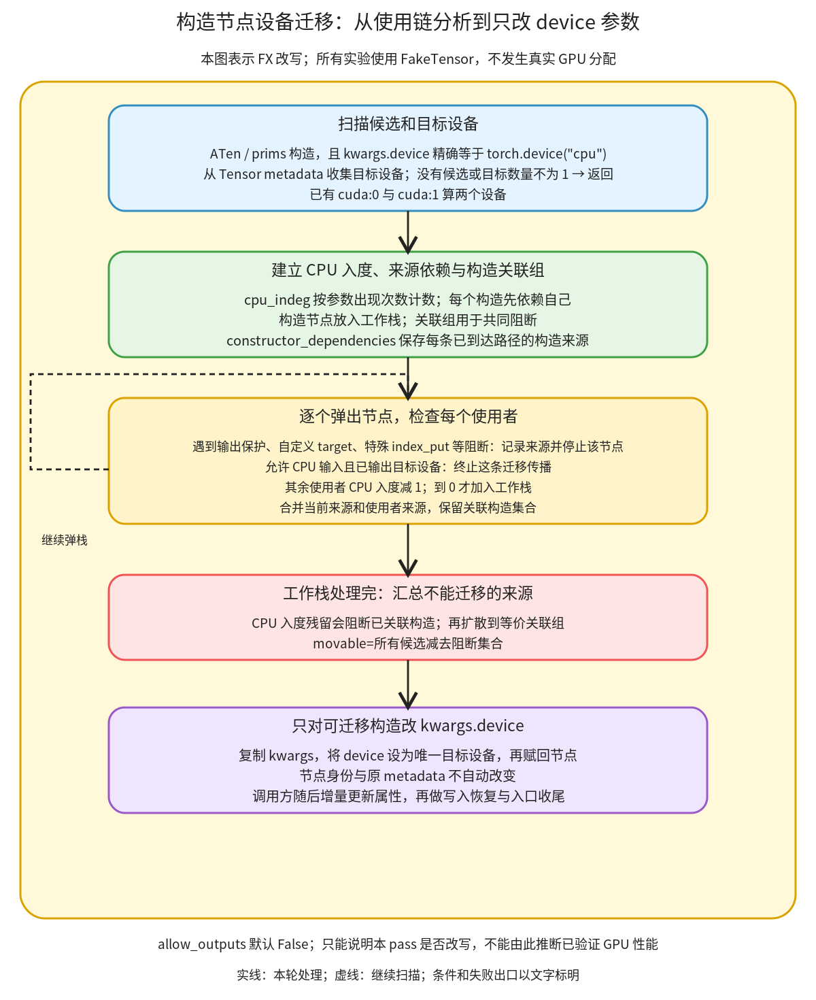

# 构造节点设备迁移：沿使用链决定哪些 CPU 构造可以改到目标设备

```text
Inductor  本层完成
    └── 图准备  本层完成
        └── 图收尾  本层完成
            └── 构造节点设备迁移 ← 当前篇  叶子·逐行完成
```

<!-- child-links:start -->

<!-- child-links:end -->

[返回图收尾](../README.md)。本单元收到已有张量属性的 FX 图，查找显式 CPU 构造及其下游使用链，选择可以改为目标设备构造的节点。它只修改 kwargs.device；不搬动真实 Tensor，也不自动更新原 metadata。

接入新设备时，这一段影响构造节点的放置。它消费当前设备类型选择和 node.meta 的设备信息；设备类型怎样登记、由哪个调度和代码生成后端接手，将由后续优先展开的设备后端篇解释。

## 1. 完整源码范围与整体过程

完整解释 [post_grad.py](/work/pytorch/torch/_inductor/fx_passes/post_grad.py:1088) 1088–1114 的 index_put 保护谓词、1117–1311 的 ConstructorMoverPass 全类、1314–1318 的入口。原文中的说明与实际条件不一致时，下面明确按执行语句解释。



先从 metadata 收集目标设备，从算子 schema 和 kwargs 找 CPU 构造。只有存在候选且目标设备恰好一个，才继续。分析从候选构造向用户传播，维护 CPU 输入计数、构造来源和关联组：阻断点拒绝相关构造；GPU 边界可以停止传播；其余节点等 CPU 输入都被处理后再继续。最后只改通过分析的构造 device，交给调用方的增量属性维护。

这里不能只看单个构造的直接用户。两个构造共同参与一个 CPU 计算时，它们的迁移决定可能相互绑定；某一条来源还有 CPU 输出观察，会阻止整个关联组。

## 2. 原始实现：index_put 的 CPU 单元素 value 保护

```python
def is_index_put_and_requires_h2d_sync_for_gpu_value(node):
    from torch.fx.operator_schemas import normalize_function

    if node.target not in [
        torch.ops.aten.index_put.default,
        torch.ops.aten.index_put_.default,
    ]:
        return False
    # Inductor falls back to aten.index_put_.
    # index_put_ will will call nonzero() and perform a H2D sync if
    # any of its indices are bool/byte tensors
    # However, it will short-circuit this H2D sync and run mask_fill_
    # if the value we are putting is a cpu scalar.
    # Therefore, when inductor sees an index_put_ with byte tensor indices,
    # it should *not* convert the cpu scalar value into a gpu tensor.
    args_, kwargs_ = normalize_function(node.target, node.args, node.kwargs)  # type: ignore[misc]
    any_byte_bool_indices = False
    indices = args_[1]
    for i in indices:
        if i is not None and i.meta["val"].dtype in [torch.bool, torch.int8]:
            any_byte_bool_indices = True

    val = args_[2].meta["val"]
    val_is_cpu_scalar = val.device.type == "cpu" and val.numel() == 1
    # If both these conditions hold, then converting the val
    # to a gpu tensor will incur a H2D sync when inductor calls aten.index_put_
    return any_byte_bool_indices and val_is_cpu_scalar
```

| 源码行 | 实际操作与判断 |
| --- | --- |
| 1088–1089 | 谓词接收当前 FX Node，局部导入 schema 参数规范化工具。 |
| 1091–1095 | 只对功能和原地 index_put 检查；其他 target 直接 False。 |
| 1096–1102 | 原注释解释希望保留 CPU 单元素 value 的动机：相关外部实现有不同处理路径。下面依据实际 dtype 分支，不把注释的 byte 一词当作精确 dtype 集合。 |
| 1103 | 按 schema 规范化 args/kwargs，然后使用三个位置参数。这里假定该已准备图中的调用可以正常规范化。 |
| 1104–1105 | 初始化标志并取索引列表。 |
| 1106–1108 | 跳过 None，任一索引 metadata 的 dtype 为 bool 或 int8 时置标志；不会在首次命中时退出循环。 |
| 1110–1111 | value 取自节点 val；要求设备类型为 cpu 且 numel()==1，不要求 rank==0。 |
| 1112–1114 | 两个条件同时成立才保护；没有执行 index_put，也没有在这里测量同步耗时。 |

本版实际枚举的是 `torch.bool`、`torch.int8`，没有枚举 `torch.uint8`。Fake metadata 对照里 bool/int8 命中，uint8/int64 不命中；这些测试只验证当前谓词与图改写，不证明每种索引 dtype 都是该 ATen 算子的合法运行输入。

标量条件同样按实现而非名字推断：shape `(1,)` 也只有一个元素，因此受保护；shape `(2,)` 不受此条件保护。value 已在 GPU 时该谓词为 False。

## 3. ConstructorMoverPass：完整原始类

```python
class ConstructorMoverPass:
    def __init__(self, target: str, allow_outputs: bool = False) -> None:
        """
        Move constructors from cpu to the target_device.

        Sweeps through the module, looking for constructor nodes that can be moved
        to the target_device.

        A constructor node can be moved to the target_device iff all of its users
        can also be moved (tested by cannot_be_moved). Otherwise, all dependent
        constructor nodes won't be moved.

        - target: target device type
        - allow_outputs: allow outputs to be moved
        """

        self.target = target
        self.allow_outputs = allow_outputs

        assert isinstance(target, str), (
            "target should be a string representing the device type. "
            f"Got: {type(target).__name__}"
        )

    def allow_cpu_device(self, node: fx.Node) -> bool:
        """
        Returns whether a node that returns a tensor on the target device may have
        cpu tensors as input.
        """
        return node.target in (
            torch.ops.aten.index.Tensor,
            torch.ops.aten.index_put.default,
            torch.ops.aten.index_put_.default,
            torch.ops.aten.copy.default,
            torch.ops.aten.copy_.default,
            torch.ops.aten.slice_scatter.default,
        )

    def cannot_be_moved(self, node: fx.Node) -> bool:
        """
        Returns whether a node can be moved to the target device.

        If this function returns False, it means that this node and all of its users
        won't be moved into the target device.
        """
        if node.target == "output":
            return not self.allow_outputs

        if not (
            isinstance(node.target, torch._ops.OpOverload)
            and node.target.namespace in ("prims", "aten")
        ):
            return True
        if is_index_put_and_requires_h2d_sync_for_gpu_value(node):
            return True

        return False

    def get_node_device(self, node: fx.Node) -> Optional[torch.device]:
        """
        Get the device of a node.
        """
        ten = node.meta.get("val")
        return None if not isinstance(ten, torch.Tensor) else ten.device

    def get_cpu_indeg_count(self, graph: fx.Graph) -> Dict[fx.Node, int]:
        """
        Get the number of cpu inputs to a node
        """
        cpu_indeg: Dict[fx.Node, int] = Counter()

        for node in graph.nodes:
            cpu_count = 0

            def add_cpu_inp(node):
                nonlocal cpu_count
                device = self.get_node_device(node)
                cpu_count += device is not None and device.type == "cpu"

            pytree.tree_map_only(fx.Node, add_cpu_inp, (node.args, node.kwargs))

            if cpu_count:
                cpu_indeg[node] = cpu_count

        return cpu_indeg

    def __call__(self, graph: fx.Graph) -> None:
        target_devices = set()
        constructors = []

        for node in graph.nodes:
            device = self.get_node_device(node)
            if device and device.type == self.target:
                target_devices.add(device)

            if not (
                isinstance(node.target, torch._ops.OpOverload)
                and node.target.namespace in ("prims", "aten")
            ):
                continue

            if not torch._subclasses.fake_tensor._is_tensor_constructor(node.target):
                continue

            if not node.kwargs.get("device") == torch.device("cpu"):
                continue

            constructors.append(node)

        # not handling multiple target devices initially
        if not constructors or len(target_devices) != 1:
            return

        movable_constructors = self.find_movable_constructors(graph, constructors)

        for node in movable_constructors:
            kwargs = node.kwargs.copy()
            kwargs["device"] = next(iter(target_devices))
            node.kwargs = kwargs

    def find_movable_constructors(
        self, graph: fx.Graph, constructors: List[fx.Node]
    ) -> Set[fx.Node]:
        """
        Starting from the cpu constructors, iterate through the graph and test that all of their
        downstream uses can safely be moved to cpu.
        """
        cpu_indeg: Dict[fx.Node, int] = self.get_cpu_indeg_count(graph)

        # which constructors cannot be moved to gpu
        cannot_move_to_gpu: Set[fx.Node] = set()

        # For any node in the graph, which constructors does it have a dependency on
        constructor_dependencies: Dict[fx.Node, Set[fx.Node]] = defaultdict(set)

        # if a cpu node has a dependency on two different cpu constructors,
        # then if either constructor cannot be moved to gpu, the other cannot as well.
        # In this case any node with a dependency on one will have a dependency on the other
        equal_constructor_sets: Dict[fx.Node, Set[fx.Node]] = {
            c: {c} for c in constructors
        }

        def make_dependencies_equivalent(
            set1: Set[fx.Node], set2: Set[fx.Node]
        ) -> Set[fx.Node]:
            # could use union find but not worth complexity here
            set1.update(set2)
            for obj in set1:
                equal_constructor_sets[obj] = set1
            return set1

        queue: List[fx.Node] = list(constructors)

        for c in queue:
            constructor_dependencies[c].add(c)

        while queue:
            node = queue.pop()
            dependencies = constructor_dependencies[node]

            for user in node.users:
                if self.cannot_be_moved(user):
                    cannot_move_to_gpu.update(dependencies)
                    break

                # this node was used on a op which takes in multiple devices and output a gpu
                # tensor. we can convert its cpu input to gpu without making further changes
                node_device = self.get_node_device(user)
                if (
                    self.allow_cpu_device(user)
                    and node_device
                    and node_device.type == self.target
                ):
                    del cpu_indeg[user]
                else:
                    # otherwise, we should continue look at its downstream uses
                    cpu_indeg[user] -= 1
                    if cpu_indeg[user] == 0:
                        del cpu_indeg[user]
                        queue.append(user)

                unioned_set = make_dependencies_equivalent(
                    dependencies, constructor_dependencies[user]
                )
                constructor_dependencies[user] = unioned_set

        for node in cpu_indeg:
            if constructor_dependencies[node]:
                cannot_move_to_gpu.update(constructor_dependencies[node])

        all_cannot_move_to_gpu = cannot_move_to_gpu.copy()
        for constructor in cannot_move_to_gpu:
            all_cannot_move_to_gpu.update(equal_constructor_sets[constructor])

        return set(constructors) - all_cannot_move_to_gpu
```

### 3.1 初始化、阻断谓词和设备读取

| 源码行 | 数据、状态与目的 |
| --- | --- |
| 1117–1118 | pass 保存目标设备类型字符串与输出策略，allow_outputs 默认 False。 |
| 1119–1131 | 原类注释说明从 CPU 构造沿使用者判断是否可迁移，以及两个参数。 |
| 1133–1134 | 在对象上保存两个配置字段，供后续调用重用。 |
| 1136–1139 | 要求 target 是字符串，例如 'cuda'；torch.device('cuda') 本身不是此接口接受的类型。 |
| 1141–1153 | allow_cpu_device 列出可以接收 CPU Tensor 输入的特定算子。只有它们的输出 metadata 已属于目标类型时，传播才可在该边界停下。 |
| 1155–1161 | cannot_be_moved 的原 docstring 有返回方向不一致的文字，执行逻辑以接下来三处分支为准：True 表示阻断。 |
| 1162–1163 | output 默认阻断；allow_outputs=True 则放开。 |
| 1165–1169 | 不是 ATen/prims OpOverload 的用户阻断，例如普通 Python callable 或自定义 namespace。 |
| 1170–1173 | 命中特殊 index_put 保护就阻断，否则这一谓词放行。放行后仍需 CPU 入度与下游检查。 |
| 1175–1180 | 从 meta.get('val') 取 Tensor 的 device；非 Tensor、无 val 均为 None，不递归遍历 tuple/list 中的 Tensor。 |

allow_cpu_device=True 不代表用户会被重新生成一份 GPU 节点。若它本来就输出 GPU，而且允许 CPU 输入，本 pass 只需把上游 CPU 构造移过去，不必继续要求它后面的使用者一起迁移。

### 3.2 CPU 入度按参数出现次数计数

| 源码行 | 数据、状态与目的 |
| --- | --- |
| 1182–1186 | 返回 CPU 输入计数字典，实际容器是 Counter。 |
| 1188–1189 | 对图中每个节点单独从 0 开始统计。 |
| 1191–1194 | 回调读取某个输入 Node 的 Tensor 设备；是 CPU 就给局部计数加 1。 |
| 1196 | 递归访问 args/kwargs 的每次 Node 出现；同一 c 被引用两次会计两次，不去重。 |
| 1198–1201 | 只存正计数并返回 Counter；未列出的 key 读取时为 0。 |

这与 node.users 的去重视图不同。`add(c,c)` 的 CPU 入度是 2，但从 c 遍历用户只会遇到这个 add 一次，后面只减到 1。实际实验因此保留 c 在 CPU，属于本版的保守出口，不把“没有其他 CPU 来源”自动当作必然迁移。

### 3.3 入口扫描与实际 device 改写

| 源码行 | 数据、状态与目的 |
| --- | --- |
| 1203–1205 | 调用时创建目标设备集合和构造候选列表。 |
| 1207–1210 | 遍历所有节点；val 是目标类型 Tensor 时收集完整 torch.device，包括设备编号。未使用的目标输入也能进入集合。 |
| 1212–1216 | 候选必须是 ATen/prims OpOverload；这不限制前面的设备集合只从同类节点收集。 |
| 1218–1219 | 用实际 schema 辅助函数确认是 Tensor constructor；不是依靠名字包含 full/empty 判断。 |
| 1221–1224 | kwargs.device 必须精确等于 torch.device('cpu')，才加入候选；缺省 device 或字符串 'cpu' 在这个条件下不等价。 |
| 1226–1228 | 没有候选，或目标设备数量不是 1，直接返回，不改图。 |
| 1230 | 将图与候选交给下节的完整传播分析，取得可迁移集合。 |
| 1232–1235 | 每个可迁移节点复制 kwargs，将 device 改为唯一目标 torch.device，再赋回；节点身份、val 对象都不在这里更新。 |

[_is_tensor_constructor 的相关实现](/work/pytorch/torch/_subclasses/fake_impls.py:115) 检查 schema 不含 Tensor 类参数，且只有一个 Tensor 返回，结果有缓存。这里复用这个边界外设施，不重新建立一套算子构造器目录。

cuda:0 与 cuda:1 是两个设备，不会被合并成一个“cuda 类型”。本阶段也不将 metadata 里嵌套的多输出 Tensor 集合自动展开为设备集合，所以调用前的 metadata 形式很重要。

### 3.4 三组分析状态怎样协同

| 源码行 | 数据、状态与目的 |
| --- | --- |
| 1237–1244 | 分析接收 graph 与候选；建立固定的 CPU 入度。原注释中的“move to cpu”方向文字不代表执行目标，实际从 CPU 构造向 self.target 分析。 |
| 1246–1247 | cannot_move_to_gpu 保存已经遇到阻断的构造来源。变量名写 gpu，实际 target 是调用者传入的字符串。 |
| 1249–1250 | constructor_dependencies 为节点保存它关联的构造来源集合，缺省为空。 |
| 1252–1257 | equal_constructor_sets 把可能需要共同迁移的构造分组；开始时每项只与自己一组。 |
| 1259–1263 | 合并时将 set2 加入 set1，原地扩大 set1。 |
| 1264–1266 | 让合并组的每个构造都指向同一集合对象，返回该组；没有创建独立 union-find 结构。 |
| 1268–1271 | 候选按列表建立工作栈，每个构造的来源先包含自身。 |
| 1273–1275 | pop 从尾部取得当前节点及其来源，因而是栈式处理，不是 FIFO 广度优先队列。 |
| 1277–1280 | 用户一旦阻断，就把当前来源标为不能迁移，并停止当前节点余下用户的处理；其他栈项仍继续。 |

constructor_dependencies 描述“已经沿哪些关系到达这里”，equal_constructor_sets 则使后面的阻断能覆盖共同迁移的构造。不能拿其中任意一张表替代整个判定。

### 3.5 传播、停止与最终阻断扩散

| 源码行 | 数据、状态与目的 |
| --- | --- |
| 1282–1289 | 用户允许 CPU 输入，且其 Tensor 输出已为目标类型时，认为这条跨设备边界可以承接迁移，不再沿它向后推进。 |
| 1290 | 从 cpu_indeg 删除该用户；Counter 对缺失项删除的语义也适用于多条来源先后到达同一边界。 |
| 1291–1296 | 其他用户的 CPU 入度减 1；到 0 才删计数并入栈，说明其相关 CPU 输入都已被处理。 |
| 1298–1301 | 无论停止在边界还是继续传播，都合并当前来源与用户已知来源，保存关联集合。 |
| 1303–1305 | 扫描最终未消耗完的 CPU 入度；若对应节点已有构造来源，阻断这些来源。外部 CPU 输入无法由本构造迁移覆盖，往往在这里形成限制。 |
| 1307–1309 | 从已阻断集合出发，把各自等价关联组都加入不可迁移集合。 |
| 1311 | 只返回所有候选扣除不可迁移项；真正改 kwargs 在调用者的 1232–1235 行。 |

没有每到一个 CPU 节点就立即改它的 device。这个算法先做完整选择，最后集中改构造参数；一些中间 CPU 算子的输出位置将在后续根据新输入重新传播，不能拿旧 metadata 的 device 当最终执行设备。

## 4. 完整原始入口：目标类型来自哪里

```python
def move_constructors_to_gpu(graph: fx.Graph) -> None:
    """
    Moves intermediary tensors which are constructed on the cpu to gpu when safe
    """
    ConstructorMoverPass(get_gpu_type())(graph)
```

1314 行接收原 graph；1315–1317 是该 placement 改写的目的说明；1318 行用 get_gpu_type() 得到设备类型，创建 pass 并执行，正常返回 None。

当前 [get_gpu_type](/work/pytorch/torch/_inductor/utils.py:55) 从源码列出的 cuda/xpu 中查询可用类型，结果缓存；没有可用项时默认字符串 cuda。这不是证明本机有 CUDA 硬件。显式 ConstructorMoverPass('某类型') 的分析接口与默认入口使用的类型选择范围也要分开，支持新设备时需要核对整条调用链。

## 5. 主案例：两个构造共同经过 CPU add，再遇到 GPU copy 边界

实验中 c、d 都是 full 构造，metadata 为 CPU float32 `(2,)`，kwargs.device 是 torch.device('cpu')；已有 p 的 metadata 为 cuda:0 float32 `(2,)`：

```text
c=full(cpu) ─┐
            add(cpu) → copy(p,add_result) [输出 cuda:0] → output
d=full(cpu) ─┘
```

**扫描。** 目标设备集合为 `{cuda:0}`，候选为 `[c,d]`。add 的 CPU 入度为 2，copy 的 CPU 入度为 1。

**处理栈顶 d。** d 的来源是 `{d}`，add 可移动且尚未到 GPU 边界，CPU 入度从 2 减到 1；把 d 加入 add 的来源，但 add 暂不入栈。

**处理 c。** add 的入度从 1 减到 0，入栈；合并来源得到 `{c,d}`，两项关联为共同迁移组。

**处理 add。** copy 在 allow_cpu_device 集合中，且输出 metadata 已是 cuda:0，因此删掉 copy 的 CPU 计数，停止沿它向后传播。分析知道 c/d 的未来目标输入可以被这个既有 GPU 操作接受。

**应用选择。** 没有残余阻断，返回 `{c,d}`；只把 c、d 的 kwargs.device 改为 cuda:0。实验断言节点身份与两项原 val 对象都不变，旧 metadata 仍为 CPU。真实精确图见[改写前](../../../experiments/constructor-devices/two_constructors_before.txt)、[改写后](../../../experiments/constructor-devices/two_constructors_after.txt)。

这个过程没有创建 GPU Tensor、执行 add/copy 或测传输；它验证的是实际 pass 在设备属性上的决策。完整 post-grad 主线随后调用增量属性更新，才使 val 与新构造参数一致。

## 6. 相同主线上的其他出口

| 条件变化 | 实际 device kwargs 出口 | 分岔原因 |
| --- | --- | --- |
| 单个 c 只喂给 GPU copy | cuda:0 | 可以停在允许 CPU 输入的 GPU 边界 |
| c 也直接返回，默认配置 | cpu | output 阻断 |
| 同一图 allow_outputs=True | cuda:0 | 允许改变该输出设备的显式配置 |
| 图中没有目标类型 Tensor metadata | cpu | 目标集合为空 |
| 图中同时有 cuda:0、cuda:1 | cpu | 不是唯一目标，即使第二设备输入未用于该链 |
| full 没有 device kwarg | 缺省保持 | 不满足候选的显式 CPU device 条件 |
| full 的 device 是字符串 'cpu' | 字符串保持 | 没有自动把 kwargs 转成 torch.device 再比较 |
| add 的另一项是外部 CPU 输入 | cpu | CPU 入度残留，阻断构造来源 |
| 两个构造共同参与 add，其中 c 还输出 | 两者 cpu | 共同迁移关系与残余入度限制另一来源 |
| add(c,c) | cpu | 参数出现计数 2，用户遍历只减 1 |
| 中间用户是普通 Python callable | cpu | target 不属于允许的 ATen/prims OpOverload |
| int64 索引构造和两元素 value 构造共同喂给 GPU index_put | 两者 cuda:0 | 两条来源都在该 GPU 边界停止，未命中单元素特殊保护 |

还有七种 index_put 谓词对照：bool/int8 索引配 CPU 单元素 value 受保护；uint8/int64 不命中本版 dtype 分支；bool 配 `(1,)` 命中，配 `(2,)` 不命中，配 GPU value 也不命中。目标参数传 torch.device 而非字符串实际抛 AssertionError；tuple 形式 val 的设备查询实际返回 None。

以上共二十二项真实谓词/metadata 图对照，均使用 meta 存储上的 FakeTensor 表示 CUDA 属性，没有 GPU 数值或性能结论。复现为 [constructor_devices.py](../../../experiments/constructor_devices.py)，具体设备、CPU 入度和约束结果见 [results.json](../../../experiments/constructor-devices/results.json)。

## 7. 与支持新设备的交接

此处需要三类已有能力：设备能够出现在 torch.device/FakeTensor 属性中；默认设备类型选择能得到它；后续 Lowering、调度、kernel 与 wrapper 能消费改写后的图。仅将构造 device 改为新名字不会自动补齐这些能力。

后续优先沿实际源码讲设备后端注册与调度/代码生成接口，再讲 wrapper 的设备调用和编译加载衔接。这里的 helper 主要归属为图准备 placement；外部 constructor schema 与设备查询设施仅解释相关接口，不复制成新的子模块。
