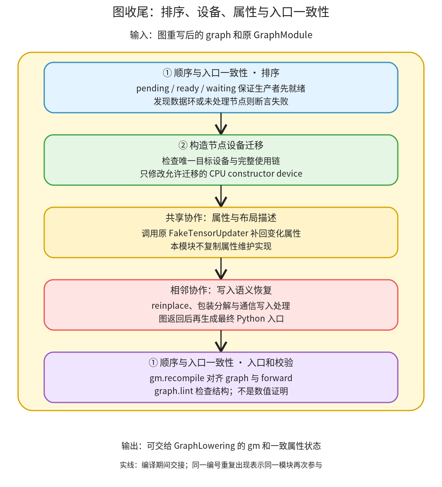

# 图收尾：修复执行顺序、检查设备迁移条件，再交出可解释的图

```text
Inductor  本层完成
    └── 图准备  本层完成
        └── 图收尾 ← 当前篇  本层完成
            ├── 顺序与入口一致性  叶子·逐行完成
            └── 构造节点设备迁移  叶子·逐行完成
```

<!-- child-links:start -->
直接子篇：[顺序与入口一致性](01-order-entry/README.md)、[构造节点设备迁移](02-constructor-devices/README.md)。
<!-- child-links:end -->

[返回图准备](../README.md)。图收尾接收被改写的 graph，恢复生产者先于使用者的顺序，按适用条件调整构造节点的设备，再协调属性更新与写入恢复，最后使 `gm.forward` 和图一致，并检查图结构。它交给 Lowering 的仍是同一 GraphModule，不会在这里返回模型计算结果。

## 1. 为什么收尾在写入恢复前后都参与



[post_grad_passes 的收尾](/work/pytorch/torch/_inductor/fx_passes/post_grad.py:135) 先执行 stable_topological_sort，再 move_constructors_to_gpu，然后调用共享的 FakeTensorUpdater；随后把图交给 reinplace 与功能化包装分解，回来执行 recompile、记录图并 lint。

内部只有两个直接子模块：①维护顺序与入口一致性，②维护构造节点的设备选择。属性更新由已经讲过的[属性模块](../01-properties/README.md)提供，写入恢复属于[相邻模块](../03-mutation/README.md)，在图中明确标为跨模块交接，不复制为新的子目录。

这种顺序保证迁移改写后，后续写入分析拿到更新的属性；写入恢复改过图后，最后重新生成入口。普通拓扑排序只看数据依赖，不能替代完整的 mutation 顺序分析，所以不能在任意写入图中单独调用它就宣称语义正确。

## 2. 两个模块怎样修改图

### 2.1 顺序与入口一致性

[stable_topological_sort](/work/pytorch/torch/_inductor/pattern_matcher.py:1899) 收到 graph 的节点链表。它维护 pending、ready、waiting 三组状态：尚待检查的节点、已放到正确位置的节点、等待某项输入的使用者。没有完成输入的节点暂存；生产者就绪后，再唤醒等待它的节点。

例如链表暂时是 `x → mul → add → output`，但 mul 的参数引用 add。遍历到 mul 时，add 未 ready，因此先等待；add 放好后再把 mul 接在它之后。交出 `x → add → mul → output`，仍保留原节点对象和节点间引用，改变的是链表顺序。

最后断言等待集合为空且 ready 数量覆盖所有节点。如果数据引用成环，没有合法顺序，会抛 AssertionError，不是把未处理节点悄悄丢掉。

写入恢复返回后，①通过 `gm.recompile()` 使 Python forward 对应当前 graph。这个 recompile 生成的是 FX 的 Python 入口，不是 Inductor 后端 kernel。`gm.graph.lint()` 检查图的结构、拥有关系与合法引用，不证明数值、别名或输入修改正确；这些仍需语义实验。

### 2.2 构造节点设备迁移

[move_constructors_to_gpu](/work/pytorch/torch/_inductor/fx_passes/post_grad.py:1314) 调用 `ConstructorMoverPass(get_gpu_type())`。该 pass 收到 graph、目标设备类型和是否允许改输出设备的开关；默认不允许改图输出的设备。

它先扫描图内已有目标设备和显式 CPU 构造节点。没有候选，或已有目标设备并非恰好一个时，直接不改。即使只有一个可用设备类型，也可能同时有 `cuda:0` 和 `cuda:1`，不能把类型相同当作单设备。

对候选，它统计节点的 CPU 输入数量，并追踪从哪个构造节点传播而来。只有相关使用链可以安全迁移时，才把构造节点 kwargs 中的 device 改成唯一目标设备。它不搬动当前真实 Tensor，也不直接执行 H2D；改的是未来程序构造张量的位置。

例如 CPU 上 full 出来的值只用于向一个 GPU 目标 copy，且接口允许同设备输入，那么直接在 GPU 构造是候选。若 CPU full 本身也作为图输出返回，默认禁止迁移，因为用户应收到 CPU Tensor。若有多个相关构造节点共同喂给一个使用者，某一条链不能迁移也可能限制其他相关构造，不能只独立检查一个局部节点。

还有一个特别条件：[is_index_put_and_requires_h2d_sync_for_gpu_value](/work/pytorch/torch/_inductor/fx_passes/post_grad.py:1088) 识别 bool/int8 索引加 CPU 单元素 value 的 index_put 场景，避免迁移使外部实现走到需要 H2D 同步的路径。这里依据函数体里的布尔分支，不把每段源码注释都当成当前实现的无条件承诺。

模块交回图时，一些 device kwargs 已改变，节点的旧 FakeTensor 属性可能尚未反映它；随后共享属性模块负责增量更新。不能仅改 kwargs 就认为所有 node.meta 自动同步。

## 3. 主案例：使用者被放到生产者前面

受控实验先捕获 CPU float32 连续输入 x=`[0,1,2,3]` 上的 `(x+1)*2`，然后只把 mul 链表位置挪到 add 前面。节点引用仍然是 mul 读取 add。

进入①时：

```text
节点链表：x_1、mul、add、output
数据关系：x_1 → add → mul → output
pending 按反序保存，因此 pop 后先检查 x_1
```

x_1 无前驱，进入 ready；mul 等待 add，放入 waiting[add]；add 的 x_1 已就绪，进入 ready 并被接到 x_1 后面。随后唤醒 mul，把它接在 add 后；最后处理 output。

真实出口为：

```text
节点链表：x_1、add、mul、output
再次调用排序后顺序不变
```

本例没有 GPU 设备或 CPU 构造候选，②没有迁移。重新生成入口、执行 lint 后，真实运行新 FX 图得到 `[2,4,6,8]`，与原表达式一致。这个实验验证排序和新入口的执行，不代表单独排序已经验证任意图改写语义。

把 add 的输入再改为 mul，形成 add↔mul 环后，真实 sorter 抛 AssertionError。它不能修好一个本来不可能执行的数据环；调用者需要修正不合法的改写。

## 4. 设备迁移的四种出口

下面实验构造真实 FX graph，并用 FakeTensor 填写 CPU/CUDA 属性，再调用真实 ConstructorMoverPass；**没有 GPU 分配或 kernel 执行，也没有测传输时间**。其目的是验证图改写分支。

| 条件 | 构造前 device | pass 后 device | 决定因素 |
| --- | --- | --- | --- |
| CPU full 只用于向 cuda:0 目标 copy | cpu | cuda:0 | 唯一目标设备；使用链允许迁移 |
| 同一 full 还直接作为输出返回 | cpu | cpu | 默认不允许修改输出设备 |
| 图中同时存在 cuda:0 与 cuda:1 | cpu | cpu | 目标设备不是恰好一个 |
| GPU bool 索引 index_put，value 是 CPU 标量 full | cpu | cpu | 特定 CPU scalar 路径保护 |

第一条的对象交接可概括为：

```text
② 收到：p(device=cuda:0)、c=full(device=cpu)、copy(p,c)
② 分析：c 的使用者允许目标设备输入；没有接口输出观察 c 的 CPU 设备
② 交出：c 的 kwargs.device 改成 cuda:0；保留原图节点身份
共享属性更新：在完整主线中再传播新的设备属性
① 收尾：重新生成图入口与检查结构
```

后三条在条件检查处分岔，保留 CPU 构造，再交回相同收尾主线。它们证明 pass 不是无条件将所有构造改成 GPU，也不以“默认选 cuda”作为确实有 CUDA 硬件的证据。

完整脚本为 [finalization.py](../../experiments/finalization.py)，结果与精确图见 [finalization.json](../../experiments/finalization.json)。GPU 实际运行及性能效果尚未验证。

## 5. 下一层打开什么

两个子篇现已完整逐行展开：顺序篇覆盖 pending/ready/waiting 及入口收尾；设备迁移篇覆盖设备扫描、CPU 入度、依赖集合合并、阻断条件和 kwargs 改写。当前不再按 helper 数量增加目录；两个问题各自保持为可完整解释的实现单元。
