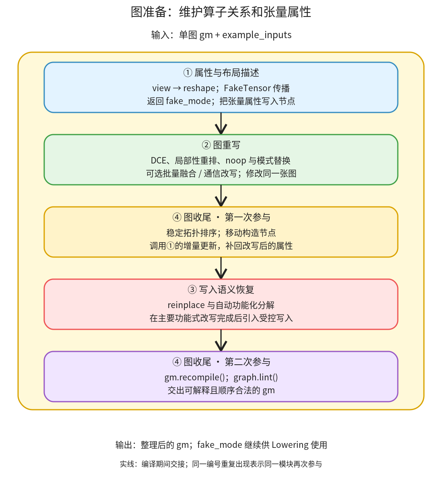

# 图准备：改写 FX 图，同时维持布局和写入语义

```text
Inductor  本层完成
    └── 图准备 ← 当前篇  本层完成
        ├── 属性与布局描述  本层完成
        ├── 图重写  本层完成
        ├── 写入语义恢复  本层完成
        └── 图收尾  本层完成
```

<!-- child-links:start -->
直接子篇：[属性与布局描述](01-properties/README.md)、[图重写](02-rewrites/README.md)、[写入语义恢复](03-mutation/README.md)、[图收尾](04-finalization/README.md)。
<!-- child-links:end -->

[返回 Inductor](../README.md)。本模块收到一张单独的 FX 图及其示例输入，在算子层整理图，再把这张图和 FakeTensor 环境交给 Lowering。它不生成 kernel，也不决定所有最终缓冲区。这里的“属性”包括每个节点代表的张量尺寸、步长、类型、设备及可追踪的存储关系；这些信息决定改写能否保留原语义。

## 1. 一次准备请求怎样流过内部



图中四个编号是四个职责模块，④出现两次表示收尾工作在引入写入前后参与，不是额外增加一个子模块。主线对应 [fx_codegen_and_compile 中的准备](/work/pytorch/torch/_inductor/compile_fx.py:760) 和 [post_grad_passes](/work/pytorch/torch/_inductor/fx_passes/post_grad.py:72)。

入口先把 `aten.view.default` 改成 `aten.reshape.default`，再传播 FakeTensor 属性；只有完成这一步，后面的改写才能查看节点的 shape、stride 和存储关系。随后 post-grad passes 按配置删无用计算、调整局部顺序、消除无效操作并应用模式。图收尾恢复稳定拓扑顺序，更新改写影响的属性；写入语义恢复再处理可原地化的操作和自动功能化包装。最后重新生成 `gm.forward` 并检查图，进入 Lowering。

顺序不是可以随意交换的优化列表。例如新生成节点可能缺少 `meta['val']`，需要在后面的写入分析读取它之前补齐；把写入恢复提前，则前面针对功能式算子的图改写需要面对更多读写约束。源码明确把会引入 mutation 的几个处理放在后面。

存在嵌套子图时，[_recursive_post_grad_passes](/work/pytorch/torch/_inductor/compile_fx.py:284) 先递归子图，再处理当前图。这里的节点顺序不是“只处理顶层 GraphModule 一次”。子图具体控制流语义归入 Lowering 的专用算子路径。

## 2. 四个模块怎样交接对象和状态

### 2.1 属性与布局描述

收到 `gm` 和 `example_inputs` 后，[view_to_reshape](/work/pytorch/torch/_inductor/fx_passes/post_grad.py:974) 直接修改相关节点的 target。节点名字可能还叫 `view`，所以判断语义应看 target，不能只看打印名。

例如逻辑 shape `(2,3)`、连续 stride `(3,1)` 的输入可以展平为 `(6,)`。后续若布局优化改变了物理布局，原来能用 view 的变换未必仍可无拷贝完成。这里先改为 reshape，让后续处理保有选择合法实现的空间；不能仅凭这次 target 替换就认定最后一定复制，是否共享存储要看实际布局及后续实现。

[fake_tensor_prop](/work/pytorch/torch/_inductor/compile_fx.py:392) 检测输入是否携带已有 FakeTensor mode。没有时新建 mode 并把实际输入转入属性执行；有时复用该 mode，按条件临时允许非 FakeTensor 输入。它返回的是 **mode**，节点属性则是传播过程对 `gm` 的副作用，不是返回一份独立属性表。

例如 `relu(x)` 的 `node.meta['val']` 是 FakeTensor，表示 `(2,3)`、float32、CPU 等属性，而不是实际的 `[[0,0,0],[1,2,3]]`。对有数据依赖形状或缺少 FakeTensor 支持的算子，传播可能失败，不能保证所有图都可以仅靠尺寸推导。

同一职责还包含 [FakeTensorUpdater](/work/pytorch/torch/_inductor/fx_utils.py:55)。它在改写前记下节点、target 和参数容器的身份；改写后只重新处理变化节点及受影响使用者。更新是否继续传播，不只看 shape，还比较布局、stride、offset、设备与存储关系。它是共享的属性维护工具，④在收尾时调用它，不在另一个目录复制实现。

### 2.2 图重写

收到已经带有属性的图，按配置执行重写，仍修改同一个 `gm.graph`。其返回结果通常体现在节点被删除、输入边被重接或新节点被插入，不是返回一个计算结果 Tensor。

最小例子是内部 `clone`：`relu(x.clone()) + y` 可以在满足接口存储约束时变成 `relu(x) + y`。但 `return x.clone()` 不能直接改成 `return x`，否则用户会得到共享输入存储的输出。负责这个区别的 [remove_noop_ops](/work/pytorch/torch/_inductor/fx_passes/post_grad.py:739) 先收集输入/输出的存储，再检查候选节点、源节点、元数据和具体条件。

这里的 noop 不是“数值看起来相等”这么简单。比如两个张量的 dtype 不同，即使某组输入数值转型后相同，也不能删类型转换。[same_meta](/work/pytorch/torch/_inductor/fx_passes/post_grad.py:636) 会要求尺寸、布局、dtype、device 以及适用时的 stride 匹配。

模式改写使用注册表和 matcher，依次应用三个 pass_patterns 及配置的其他 pass。某些匹配生成普通 ATen 子图，某些匹配登记直接 lowering 处理；下游不能只接受固定的一小组 target。批量融合、B2B GEMM、通信流水和 DDP 融合有各自开关，不是每次必经。内部匹配、替换、图维护会放在同一个子篇内解释，不按每条 pattern 建一个目录。

### 2.3 写入语义恢复

这个模块收到已经完成主要图重写并补齐属性的图。它处理 `reinplace_inplaceable_ops`、`decompose_auto_functionalized` 和通信相关的受控写入，使本来为了分析而分离出的操作重新成为可执行的写入或显式操作序列。

例如某个操作原先用“计算新值，再将新值 copy 回原输入”表达输入修改。只有分析确认旧值不再需要、别名使用者不会观察到错误版本等条件后，才能直接利用目标存储。这里不能用“节省一次分配”代替合法性证明，也不能随意把 `x + 1` 变成 `x.add_(1)`。

它交出的仍是 FX 图，但图中可能已有明确写入；Lowering 与 Scheduler 必须继续跟踪这些副作用。因此“post-grad 入口图经过功能化”不意味着图准备出口保证无 mutation。主要实现入口见 [reinplace_inplaceable_ops](/work/pytorch/torch/_inductor/fx_passes/reinplace.py:685)，内部存储分析与写入重建留给子篇。

### 2.4 图收尾

收到被修改过的节点关系后，先 `stable_topological_sort`，确保生产者位于读取者之前，并尽量保留已有相对顺序；随后按条件移动构造节点，调用①的增量属性更新。再把图交给③恢复写入，回来后调用 `gm.recompile()` 与 `gm.graph.lint()`。

`recompile` 更新 GraphModule 的可调用代码，不是把图编译成 CPU/GPU kernel。`lint` 检查图结构不变式，也不能代替数值、共享存储和输入修改的测试。

例如把 `relu` 的输入从 `clone` 接到 `x`，只改节点边还不够：旧的 `gm.forward` 源码可能仍对应改写前结构。重编译使图和 Python 入口一致，结构检查确认删除节点后没有悬空引用。若自定义 pass 引入环或引用已删除节点，收尾会暴露错误，而不是把不合法图交给 Lowering。

## 3. 主案例：为什么能删掉内部 clone

实验输入如下，shape `(2,3)`、stride `(3,1)`，dtype float32、device CPU：

```text
x = [[-2,-1,0],[1,2,3]]
y = [[ 1, 1,1],[1,1,1]]
return (relu(x.clone()) + y,)
```

**进入属性模块。** 真实输入与 FX 图交给属性传播。`clone`、`relu` 和 `add` 节点获得 FakeTensor，shape/stride 均为 `(2,3)/(3,1)`。这只是属性执行；这里还没生成最终输出。

**进入重写模块。** [准备前采集](../experiments/stages/clone_internal_before_post.txt) 为：

```text
x_1 → clone → relu → add → output
                    y_1 ↗
```

输入是 `x_1`、`y_1`，图输出是 `add`。`clone` 的独立存储不是图的直接输出，因此删除它不会把图输出变成输入别名。元数据和 clone 的 noop 条件满足时，重接 `relu.args` 到 `x_1` 并移除 `clone`。

**进入收尾与写入恢复。** 改写后的图经排序、属性更新、写入处理、recompile 和 lint。这个案例没有观察到输入写入，出口图是：

```text
x_1 → relu → add → output
             y_1 ↗
```

[准备后采集](../experiments/stages/clone_internal_after_post.txt) 中已没有 clone，relu 直接读取 x_1，图输出仍是 add。两个输入节点仍保留，不把“没有使用某个参数”自动等同为改变编译入口签名。

**交给 Lowering 并执行。** 下游生成一个 CPU kernel，运行结果为 `[[1,1,1],[2,3,4]]`，输入值保持不变，输出不共享 `x` 的存储。这个运行验证同时支撑数值和接口存储语义，不能仅凭图节点减少宣布改写正确。

## 4. 两个条件分支

### 4.1 clone 成为图输出

把图改为 `return (x.clone(),)`，属性传播仍得到同样 shape/stride，但重写模块发现 clone 的存储属于图输出，源存储属于图输入。若替换，就会新增输入输出别名，因此跳过删除。

[出口图](../experiments/stages/clone_output_after_post.txt) 保留 `aten.clone.default`；下游生成一个复制计算 kernel。执行后的数值等于输入，输出不共享输入存储。主线在“是否允许重接”处分岔，随后同样经收尾进入 Lowering。

### 4.2 view target 被改为 reshape

`return (x.view(6),)` 在 [进入图准备前](../experiments/stages/view_input.txt) 的 target 为 `aten.view.default`；[进入 post-grad 时](../experiments/stages/view_before_post.txt) 已是 `aten.reshape.default`，节点名仍为 `view`。这证明布局兼容处理发生在 post-grad 之前。

属性传播给出输出 shape `(6,)`、stride `(1,)`。最后生成零个计算 kernel，输出仍共享 x 的存储。因此 view→reshape 是提供后续实现余地，不是宣告必须复制。

## 5. 本层留下的下一层问题

这里的四个职责按“属性建立 → 改写 → 修复不变式 → 恢复写入 → 交出图”协作。它们解决的是 FX 图是否适合解释，并没有决定最终 GPU block、CPU 向量宽度或 buffer 复用方案。

后续子篇将分别展开 FakeTensor 属性维护、候选操作与模式改写、存储可写性分析、排序与生成入口维护。三个案例均来自 [stages.py](../experiments/stages.py)，结果见 [results.json](../experiments/stages/results.json)。这些 CPU 实验没有覆盖通信改写、嵌套子图、动态形状或训练写入恢复；这些分支保留在源码覆盖队列中。
