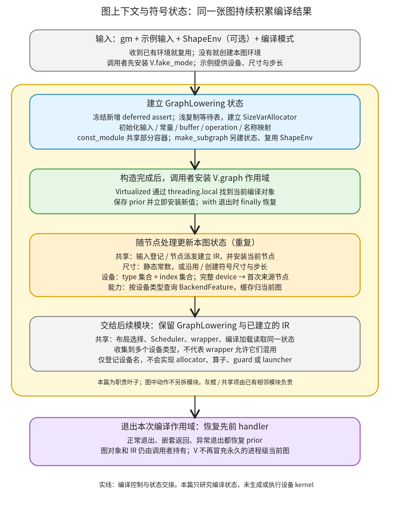

# 图上下文与符号状态：让一张图的设备、布局和名称使用同一份编译状态

```text
Inductor  本层完成
    └── Lowering  本层完成
        └── 解释图与登记输入  本层完成
            └── 图上下文与符号状态 ← 当前篇  叶子·逐行完成
```

<!-- child-links:start -->

<!-- child-links:end -->

[返回解释图与登记输入](../README.md)。GraphLowering 接收 FX GraphModule、示例输入、可选 ShapeEnv 和编译模式，建立设备集合、符号环境、输入/常量映射及 IR 登记容器。之后每个 lowering 通过当前图读取、修改这些状态；最终调度和 wrapper 使用同一对象继续编译。

设备支持从这里贯穿到后端：登记 `torch.device` 的类型与编号，保存首个来源节点，按设备类型查询后端能力。登记设备信息不会分配设备内存，也不会自动建立新设备的 allocator、算子或 stream 实现。

## 1. 整体流程与覆盖范围



本篇是完整职责叶子，不再拆子目录。图中分成建立状态、安装作用域、随节点更新、交给后续模块四个动作，都是同一份 GraphLowering 状态的使用过程。输入/常量登记、节点派发、存储布局选择和代码生成是共享协作模块。

实际编译器在 [compile_fx.py](/work/pytorch/torch/_inductor/compile_fx.py:812) 先安装 fake_mode，再构造 GraphLowering，并用 `with V.set_graph_handler(graph)` 包住 Lowering 与后续处理。**构造 GraphLowering 不会自行安装 V.graph。** 因此不能刚构造完对象，就假定所有通过 V.graph 取值的 helper 已指向它。

本篇完整逐行覆盖 graph.py 的两种尺寸转换、构造器与 has_feature、名称与子图构造、设备信息登记与 fake_mode 属性、当前节点作用域；virtualized.py 的通用作用域实现、handler 绑定和 V 门面；另补齐两个很短的转换接口。每段源码都保留原顺序、原注释和原实现。ShapeEnv 是输入的共享符号设施，SizeVarAllocator 的代数化简、布局选择和输入/节点解释的完整算法归其他模块，本篇讲清相应接口，不把调用 helper 当作已覆盖 helper 全部实现。

## 2. graph.py：先定义尺寸接口，再建立本图状态

### 2.1 symbolic_sizes_strides 与 static_sizes_strides

源码：[第 261 行](/work/pytorch/torch/_inductor/graph.py:261) 至第 306 行。

```python
    def symbolic_sizes_strides(
        self, ex: torch.Tensor
    ) -> Tuple[Union[List[int], List[Expr]], Union[List[int], List[Expr]]]:
        """
        Support dynamic shapes and dynamic strides by assigning variables
        to each dimension.  We duck-shape tensors, so if two tensors
        have the same size they get assigned the same symbolic variable.
        """
        if self.reuse_shape_env:
            return convert_shape_to_inductor(ex.size()), convert_shape_to_inductor(
                ex.stride()
            )
        else:
            from torch._dynamo.source import ConstantSource

            # TODO: this should not be needed once #93059 lands
            # https://github.com/pytorch/pytorch/pull/94031#discussion_r1096044816
            # TODO: make a dedicated UnknownSource for this?
            # NB: This is using the legacy default behavior from
            # create_symbolic_sizes_strides_storage_offset but we hope we can
            # just delete this entirely
            source = ConstantSource(
                f"__inductor_unknown_tensor_{len(self._shape_env.var_to_val)}"
            )
            (
                size,
                stride,
                _,
            ) = self._shape_env.create_symbolic_sizes_strides_storage_offset(
                ex,
                source,
            )

        size = [i.node.expr if isinstance(i, torch.SymInt) else i for i in size]
        stride = [i.node.expr if isinstance(i, torch.SymInt) else i for i in stride]
        return size, stride

    def static_sizes_strides(
        self, ex: torch.Tensor
    ) -> Tuple[List[sympy.Expr], List[sympy.Expr]]:
        """
        Primarily used to weights
        """
        size = [sympy.Integer(i) for i in ex.size()]
        stride = [sympy.Integer(i) for i in ex.stride()]
        return size, stride
```
这里的 ex 是提供 shape/stride 的 Tensor 或 FakeTensor，不读取其中的元素。

| 源码行 | 数据、分支和结果 |
| --- | --- |
| 261–268 | 定义符号尺寸接口与返回的 size/stride 两组列表。注释中的 duck-shape 指相同具体尺寸可能获得同一符号，不表示所有相等表达式永远使用同一 Python 对象。 |
| 269–272 | 若构造时收到了 ShapeEnv，直接把 ex 已有的尺寸、步长转换为 Inductor 使用的 SymPy 表达式，并立即返回；不会再创建一套符号。 |
| 273–284 | 没有复用环境时，导入 ConstantSource，并按当前 var_to_val 数量生成临时来源名。注释记录兼容路径的来源，不是设备名称或 Tensor 数据。 |
| 285–293 | 让本图 ShapeEnv 根据 ex 创建符号 size、stride、storage_offset。`_` 接住第三项但此接口不返回它；不能据此认为整个 IR 的 storage_offset 都消失了。 |
| 294–295 | 分别遍历 size 与 stride。SymInt 提取 `node.expr`，其余元素原样保留。 |
| 296 | 返回两份列表，供 FixedLayout 等调用者使用。 |
| 298–303 | 静态接口的注释提示主要用于权重；函数本身并没有检查“是不是权重”。 |
| 304–306 | 把 ex 的每个 size、stride 转为 sympy.Integer，返回静态常数列表，不引入新符号。 |

真实受控实验给新建环境先传 shape `[2,3]`、再传 `[2,5]`，尺寸分别变成 `[s0,s1]` 和 `[s0,s2]`；相同的 2 共享 s0，3 与 5 分开。连续 `[2,3]` 的 stride 是 `[s1,1]`，保留了行距与第二维的关系。静态非连续 `[2,3]`、stride `[1,2]` 则得到 SymPy 常数 `[2,3]` 与 `[1,2]`。

复用环境的实验把已有 FakeTensor 的 `[s1,s2]`、stride `[s2,1]` 交进来，返回原表达式，ShapeEnv.var_to_val 未增加。这个例子的 x 是 reshape 视图，环境还含基 Tensor 的符号，因此不能把符号总数误当作视图 rank。

### 2.2 构造器与后端能力查询

源码：[第 308 行](/work/pytorch/torch/_inductor/graph.py:308) 至第 465 行。

```python
    def __init__(
        self,
        gm: torch.fx.GraphModule,
        example_inputs: Optional[List[torch.Tensor]] = None,
        shape_env: Optional[ShapeEnv] = None,
        graph_id: Optional[int] = None,
        cpp_wrapper: bool = False,
        aot_mode: bool = False,
        user_visible_outputs: Optional[Dict[str, None]] = None,
        layout_opt: Optional[bool] = None,
        extern_node_serializer: Optional[
            Callable[[List[ir.ExternKernelNode]], Any]
        ] = None,
        is_inference: bool = False,
        is_const_graph: bool = False,
        const_output_index: Optional[Dict[str, int]] = None,
        const_code: Optional[str] = None,
        const_module: Optional["GraphLowering"] = None,
        name: Optional[str] = None,
    ) -> None:
        super().__init__(gm)
        self.example_inputs = example_inputs
        self.layout_opt = (
            layout_opt
            if layout_opt is not None
            else self.decide_layout_opt(gm, is_inference=is_inference)
        )
        self.num_channels_last_conv = 0
        self.is_inference = is_inference
        self.is_const_graph = is_const_graph
        self.const_code = const_code
        self.const_module = const_module

        self.extra_traceback = False  # we do our own error wrapping
        if shape_env is None:
            shape_env = ShapeEnv()
            self.reuse_shape_env = False
        else:
            self._shape_env = shape_env
            self.reuse_shape_env = True
        self._shape_env = shape_env
        # We are going to start code generating runtime asserts, so make sure
        # you don't start adding new ones in the lowering process
        shape_env.freeze_runtime_asserts()
        # We're going to mutate ras_by_symbol as we finish generating them
        self.ras_by_symbol: Dict[
            sympy.Symbol, List[RuntimeAssert]
        ] = shape_env.deferred_runtime_asserts.copy()
        self.bound_unbacked_symbols: OrderedSet[sympy.Symbol] = OrderedSet()
        self.sizevars = SizeVarAllocator(shape_env)
        self.graph_input_names: List[str] = []
        self.graph_inputs: Dict[str, TensorBox] = {}
        self.graph_inputs_original: Dict[str, InputBuffer] = {}
        self.zero_dim_cpu_tensor_list: OrderedSet[str] = OrderedSet()
        self.device_types: OrderedSet[str] = (
            const_module.device_types if const_module else OrderedSet()
        )
        self.device_idxs: OrderedSet[int] = (
            const_module.device_idxs if const_module else OrderedSet()
        )
        self.cuda = False
        self.buffers: List[ir.Buffer] = []
        self.operations: List[ir.Operation] = []
        self.const_output_index: Dict[str, int] = (
            const_output_index if const_output_index else {}
        )
        self.folded_constants: OrderedSet[str] = (
            OrderedSet(const_output_index.keys())
            if const_output_index
            else OrderedSet()
        )
        self.constants: Dict[str, torch.Tensor] = (
            const_module.constants if const_module else {}
        )
        self.torchbind_constants: Dict[str, torch._C.ScriptObject] = {}
        self.constant_reprs: Dict[str, str] = {}
        self.removed_operations: OrderedSet[str] = OrderedSet()
        self.removed_buffers: OrderedSet[str] = OrderedSet()
        self.removed_inplace_buffers: OrderedSet[str] = OrderedSet()
        self.mutated_buffers: OrderedSet[str] = OrderedSet()
        self.never_reuse_buffers: OrderedSet[str] = OrderedSet()
        self.inplaced_to_remove: OrderedSet[str] = OrderedSet()
        self.device_ops: DeviceOpOverrides = None  # type: ignore[assignment]
        self.wrapper_code: WrapperCodeGen = None  # type: ignore[assignment]
        # See `ProxyExecutor Design Note` in ir.py for more details
        self.extern_kernel_nodes: List[ir.ExternKernelNode] = []

        from torch._inductor.extern_node_serializer import extern_node_json_serializer

        self.extern_node_serializer: Callable[[List[ir.ExternKernelNode]], Any] = (
            extern_node_serializer
            if config.is_fbcode() and extern_node_serializer
            else extern_node_json_serializer
        )

        self.current_node: torch.fx.Node = None  # type: ignore[assignment]
        self.lists: Dict[str, List[str]] = {}
        self.mutated_inputs: OrderedSet[str] = OrderedSet()
        self.mutated_input_idxs: List[int] = []
        self.name_to_buffer: Dict[str, ir.Buffer] = {}
        self.name_to_users: DefaultDict[str, List[ir.IRNode]] = defaultdict(list)
        self.name_to_op: Dict[str, ir.Operation] = {}
        self.creation_time = time.time()
        self.name = name  # type: ignore[assignment]
        self.cpp_wrapper = cpp_wrapper

        # record multi_kernel choice for cpp_wrapper so the second pass knows
        # which sub-kernel is picked. Copy cpp_wrapper to another variable
        # since cpp_wrapper flag is OrderedSet to false for the first pass of codegen.
        self.record_multi_kernel_choice = cpp_wrapper
        self.multi_kernel_to_choice: Dict[str, int] = {}

        self.aot_mode = aot_mode
        self.graph_id = graph_id
        self.post_grad_graph_id = next(_post_grad_graph_counter)
        self.scheduler: torch._inductor.scheduler.Scheduler = None  # type: ignore[assignment]
        self.nodes_prefer_channels_last = (
            self.find_nodes_prefer_channels_last() if self.layout_opt else OrderedSet()
        )
        self._warned_fallback = {"aten.convolution_backward"}
        self.user_visible_outputs = (
            user_visible_outputs if user_visible_outputs is not None else {}
        )
        mark_nodes_dislike_padding(gm.graph, user_visible_outputs)
        self.cache_key: str = ""  # This is the cache key for the compiled artifact
        self.cache_path: str = ""  # This is the path in the filesystem where the compiled artifact is stored
        self.cache_linemap: List[
            Tuple[int, str]
        ] = (
            []
        )  # This is the linemap used by the profiler to mark custom compiled kernels getting run
        # Used if lowering encounters cases where cudagraphs are not supported
        self.disable_cudagraphs_reason: Optional[str] = None

        # only keeping one node per device for stack trace purposes
        self.device_node_mapping: Dict[torch.device, torch.fx.Node] = {}
        self.orig_gm: torch.fx.GraphModule = gm.__copy__()
        self.dynamo_flat_name_to_original_fqn = self.module.meta.get(
            "dynamo_flat_name_to_original_fqn", {}
        )
        self.allocated_constant_name: Dict[str, str] = (
            const_module.allocated_constant_name if const_module is not None else {}
        )
        init_backend_registration()
        self.get_backend_features = functools.lru_cache(None)(get_backend_features)

        self.effectful_ops: Dict[_EffectType, ir.Buffer] = {}
        self.aligned_inputs: OrderedSet[str] = OrderedSet()
        self.no_fuse_buffer_names: OrderedSet[str] = OrderedSet()

        # Below field is related to printing debug intermediate tensor values info for debugging
        self.all_codegen_kernel_names: OrderedSet[str] = OrderedSet()

    def has_feature(
        self, device: Union[torch._inductor.ir.IRNode, device], feature: BackendFeature
    ) -> bool:
        assert isinstance(feature, BackendFeature), feature
        return feature in self.get_backend_features(get_device_type(device))
```
构造器返回 None，主要交付是对象上已经建立的状态。以下按源码顺序解释全部初始化块；多个空容器放在一起，是因为它们共同表示同一份待建立的编译结果。

| 源码行 | 本次请求和状态怎样变化 |
| --- | --- |
| 308–327 | gm 指定解释的 FX 图；example_inputs 保存示例；shape_env 可由调用者提供；graph_id/name 标识图；cpp_wrapper、aot_mode、is_inference 控制后续生成模式。user_visible_outputs 记录用户可见输出；layout_opt 可覆盖布局选择。serializer、常量图标志、常量输出映射、已有常量代码及 const_module 支持专用编译路径。这里只接收这些条件，不执行 kernel。 |
| 328–334 | 初始化 FX Interpreter 的 module/env 等基础状态，保存示例输入引用。显式 layout_opt 优先，否则调用 decide_layout_opt；本篇实验传 False，布局启发式完整实现归输出布局模块。 |
| 335–339 | 将 channels-last 卷积计数置零，保存推理、常量图、已有代码和常量模块信息，供后续处理查询。 |
| 341 | 关闭 Interpreter 的额外 traceback 包装，因为此类自己处理错误信息；不代表关闭所有异常。 |
| 342–348 | 无 ShapeEnv 时新建并标记 reuse=False；有则保存同一对象并标记 True。348 行统一再保存一次，所以两个分支最终都有 `_shape_env`。 |
| 349–351 | 冻结新增 deferred runtime assert，避免 Lowering 一边生成已有断言、一边又增加无法交接的新断言。这不等于冻结所有符号替换、guard 或 SizeVarAllocator 的状态。 |
| 352–355 | 浅复制 deferred_runtime_asserts 的字典，得到本图要消费的 ras_by_symbol。字典是新的，里面原有列表仍共享；删除键不会删除 ShapeEnv 的键，修改列表内容则不能依靠这次 copy 获得隔离。 |
| 356–357 | bound_unbacked_symbols 初始为空，记录后续已经绑定的数据相关符号；SizeVarAllocator 绑定当前 ShapeEnv，供索引化简、约束查询与 size hint 使用。 |
| 358–361 | 输入名列表保留顺序；graph_inputs 保存当前输入 IR；graph_inputs_original 保留原始 InputBuffer，供写入与输出修复使用。zero_dim_cpu_tensor_list 单独记录零维 CPU Tensor 名称。 |
| 362–367 | 有 const_module 就直接引用它的 device_types 和 device_idxs；否则各建 OrderedSet。这里没有 copy，向主图集合添加元素也会改变共享常量图所见的集合。 |
| 368–370 | cuda 初始 False，不从示例输入抢先推断；buffers 与 operations 独立置空。设备登记后还要等 wrapper 初始化等消费者处理，不能把 cuda 当作所有加速设备的通用字段。 |
| 371–378 | 非空 const_output_index 保留传入映射，否则新建空字典；folded_constants 按映射的键另建 OrderedSet，记录被折叠的常量名。它不是同一字典的别名。 |
| 379–383 | constants 与 const_module 共享，否则新建；TorchBind 常量和常量表示字符串各建独立字典，分别保存专用对象与代码表示。 |
| 384–389 | 六个集合依次记录删除的 operation、buffer、原地 buffer，发生写入的 buffer，禁止复用的 buffer，以及原地化后待移除的名称。初始都为空；它们留给后续合法性、生命周期和生成过程使用，不是在构造器中完成了这些分析。 |
| 390–393 | device_ops、wrapper_code 暂为 None，外部 kernel 节点列表为空。wrapper 的选择与创建是后续动作，不能在此时启动设备调用。 |
| 395–401 | 导入默认 JSON serializer。只有 fbcode 环境且确实传入 serializer 时用自定义值，其他情况使用默认；传入一个 callable 不代表任意构建都会选它。 |
| 403–406 | 当前节点初始 None；lists 记录列表名称关系，mutated_inputs 与 mutated_input_idxs 为后续输入写入分析保留名称及位置。 |
| 407–409 | name_to_buffer/name_to_op 提供名称查找；name_to_users 是 defaultdict(list)，首次读取缺失名称时可建立空用户列表。 |
| 410–412 | 记录构造时刻、可选图名前缀和 C++ wrapper 标志。没有图名时后续 qualify_name 原样返回局部名。 |
| 414–418 | record_multi_kernel_choice 保存初始 cpp_wrapper 条件，multi_kernel_to_choice 记录多 kernel 选择结果，供多轮 C++ wrapper 生成使用。原注释中的 “OrderedSet to false” 措辞不改变实际赋值逻辑。 |
| 420–423 | 保存 AOT 模式和外部 graph_id，另取自增的 post_grad_graph_id；scheduler 仍为 None，稍后基于已 Lowering 的 IR 创建。 |
| 424–427 | 仅 layout_opt 开启时分析偏好 channels-last 的节点，否则空集合。预置一个 convolution_backward fallback 告警名，使相应提示不会按普通首次 fallback 重复记录。 |
| 428–431 | user_visible_outputs 为 None 才改成空字典；非 None 保留原引用。随后把原始参数交给 mark_nodes_dislike_padding，按配置和图关系标记不适合 padding 的节点，细节归输出布局职责。 |
| 432–438 | 编译产物 key/path 先是空串；源码到节点的 linemap 先为空。它们尚未指向任何已编译的文件。 |
| 439–443 | CUDA Graph 禁用原因初始 None；device_node_mapping 保存每个完整设备的首个节点，用于定位来源/栈信息，不代替数据依赖。 |
| 444–447 | 用 gm.__copy__() 保存一份 GraphModule 副本；从 module.meta 取扁平名称到原始 FQN 的映射，不存在时使用空字典。这不是对所有参数存储的深复制承诺。 |
| 448–450 | 常量分配名映射也可与 const_module 共享；否则独立。这里用 is not None 明确判断是否提供了常量模块。 |
| 451–452 | 初始化默认/自定义后端注册，再给 get_backend_features 建立**本图拥有的** lru_cache 包装器。共享的是被查询的注册机制，每张图的缓存对象分别建立。 |
| 454–456 | effectful_ops 保存有副作用类别对应的 IR buffer；aligned_inputs 与 no_fuse_buffer_names 分别为对齐输入和禁止融合名称保留集合。初始不含任何条目。 |
| 458–459 | 建立生成 kernel 名称集合，服务中间值调试等生成过程；此时尚未生成 kernel。 |
| 461–465 | has_feature 要求 feature 真是 BackendFeature 枚举；把 device 或能提供 get_device 的 IR 对象转成设备类型，再查询缓存的特性集合并检查成员关系。这里是编译能力查询，不是“设备是否能分配 Tensor”的探测。 |

[后端与循环组织](../../../04-codegen-runtime/01-kernels/01-backends-loops/README.md) 已说明注册表及 Scheduling(None) 的能力查询接口。本图包装缓存后，同类型多次查询通常复用结果；若在图构造后改后端能力提供者，不能假定已有缓存自动失效。

### 2.3 qualify_name 与 make_subgraph：复用什么，独立什么

源码：[第 631 行](/work/pytorch/torch/_inductor/graph.py:631) 至第 660 行。

```python
    def qualify_name(self, name: str) -> str:
        """Prepend the given name with the graph name if any."""
        if self.name is not None:
            return f"{self.name}_{name}"
        return name

    def make_subgraph(
        self,
        gm: torch.fx.GraphModule,
        example_inputs: List[torch.Tensor],
        subgraph_name: str,
    ) -> "GraphLowering":
        """
        Make a subgraph of the current graph with all inherited
        parts, except the graph module (`gm`) and `example_inputs`.
        The subgraphs are lowered separately, but intended to be
        inlined in the parent graph's codegening. Hence the need
        for maintaining the same `shape_env` and other properties.
        The subgraph name is qualified by the parent graph's name.
        """
        return GraphLowering(
            gm=gm,
            example_inputs=example_inputs,
            shape_env=self._shape_env,
            cpp_wrapper=self.cpp_wrapper,
            aot_mode=self.aot_mode,
            extern_node_serializer=self.extern_node_serializer,
            is_inference=self.is_inference,
            name=self.qualify_name(subgraph_name),
        )
```
631–635 行先定义名称规则：有图名时加 `图名_`，没有则原样返回。name 是 None 和空字符串不同；空字符串仍会得到一个下划线前缀。

637–650 行接收子图 gm、示例输入和子图名称。原 docstring 使用 “all inherited parts”，实际哪些属性传递必须以 651–660 行的调用为准：传新的 gm/inputs，复用 `_shape_env`，传 cpp_wrapper、aot_mode、serializer、is_inference，并用父图 qualify_name 得到子图名；返回新 GraphLowering。

这次调用**没有传 const_module**，因此不会走上面的 constants/device 集合共享分支；也没有直接传 graph_id、layout_opt、user_visible_outputs、is_const_graph 等参数。这些继续走构造器默认值/选择逻辑。不能把共享 ShapeEnv 推广成所有状态共享。

实验中父图 name=outer，建立 branch 后得到 outer_branch，局部 buf0 的全名是 outer_branch_buf0；子图与父图 ShapeEnv 是同一对象，但 constants 和 device_types 是不同容器。后续条件/循环 IR 如何把子图接到主图，归[专用算子路径](../../04-special-ops/README.md)。

### 2.4 add_device_info 与 fake_mode：设备元信息登记

源码：[第 717 行](/work/pytorch/torch/_inductor/graph.py:717) 至第 726 行。

```python
    def add_device_info(self, device: torch.device) -> None:
        self.device_types.add(device.type)
        if device.index is not None:
            self.device_idxs.add(device.index)
        if V.graph.current_node and device not in self.device_node_mapping:
            self.device_node_mapping[device] = V.graph.current_node

    @property
    def fake_mode(self) -> torch._subclasses.fake_tensor.FakeTensorMode:
        return V.fake_mode
```
717–718 行接收 torch.device，把 type 放入有序去重集合；重复登记 cuda:0 不会让类型列表多一个 cuda。719–720 行只在 index 不是 None 时登记编号，所以 CPU 无 index 不会凭空登记 0。

721–722 行查询 `V.graph.current_node`：有当前节点、且完整 torch.device 尚未在本对象映射中出现，才保存首次节点。注意类型集合和编号集合是两个独立集合；cuda:0 与 xpu:0 共用编号 0，并不等于同一个设备。真正保留 `(type,index)` 及来源的对象是 device_node_mapping。

这个方法写 self 的容器，却从 V.graph 取当前节点。因此调用者必须安装正确的图作用域；若 self 与 V.graph 指向不同图，不能期望它自动修复上下文。

724–726 行的 fake_mode 属性直接返回 V.fake_mode；它没有在 GraphLowering 内另存一份 mode。这也是调用者需要安装 fake_mode 作用域的原因。

真实设备元信息实验依次登记 cpu、cuda:0、cuda:1、再次 cuda:0、xpu:0。得到 types=`[cpu,cuda,xpu]`、indices=`[0,1]`，而来源映射分别是 cuda:0→x_1、cuda:1→x_1、xpu:0→add。重复 cuda:0 未覆盖原节点；在没有当前节点时登记的 CPU 只进入类型集合。这些对象只是 torch.device 描述，没有触发 CUDA/XPU 分配或运行。

### 2.5 set_current_node：异常也恢复本图节点

源码：[第 1157 行](/work/pytorch/torch/_inductor/graph.py:1157) 至第 1164 行。

```python
    @contextmanager
    def set_current_node(self, node: torch.fx.Node):  # type: ignore[no-untyped-def]
        old = self.current_node
        try:
            self.current_node = node
            yield
        finally:
            self.current_node = old
```
1157 行用 contextmanager 把生成器变成上下文管理器。1158–1159 行取得新节点并保存 old；1160–1162 行在进入 with 时写 self.current_node、让 with 的主体执行；1163–1164 行无论正常退出还是异常都恢复 old。嵌套时每层各保留自己的 old，退出内层不会丢掉外层节点。

这是**图对象上的字段**。它和 `V.current_node` 是两条不同的存取路径，不能因为通常由 run_node 一起设置，就把它们看成同一字段。节点派发处分别安装它们；本篇受控实验故意给两者不同节点，观察到互不覆盖，异常后都恢复。

## 3. virtualized.py：让 helper 读取当前编译对象

GraphLowering 的状态需要显式放在对象上；V 提供的是寻找“当前那个对象”的作用域，不是另一张 IR 图，也不是设备运行时上下文。

### 3.1 通用 Virtualized 实现

源码：[第 82 行](/work/pytorch/torch/_inductor/virtualized.py:82) 至第 135 行。

```python
threadlocal = local()

T = TypeVar("T")


class NullHandler:
    """
    Sentinel indicating that a global variable is unset ala None.  Typically,
    attempting to access the global variable before it's set is an error, but with
    NullHandler it won't fail until you try to access an attribute on it.
    """


class Virtualized(Generic[T]):
    """
    Implements a global variable that redirects via thread local variable
    (NB: construct this class to create the global variable; this is not
    a singleton class!)

    This allows us to swap in different op implementations in codegen.

    NB: Despite the fact that we typically call these "handlers" (e.g., NullHandler is
    the default value of the variable), we sometimes use these variables to
    store other things, like booleans.
    """

    def __init__(self, vname: str, default: Union[Callable[[], T], Type[NullHandler]]):
        self._key: str = f"__torchinductor_{vname}"
        self._default = default

    def _set_handler(self, value: T) -> AbstractContextManager[None]:
        prior = self._get_handler()
        setattr(threadlocal, self._key, value)

        @contextmanager
        def ctx():
            try:
                yield
            finally:
                self._set_handler(prior)

        return ctx()

    def _get_handler(self) -> T:
        try:
            return getattr(threadlocal, self._key)
        except AttributeError:
            # TODO: To be honest, I feel we probably should just error in this
            # case, instead of making a null handler that will probably error
            # when you getattr on it
            return self._default()  # type: ignore[return-value]

    def __getattr__(self, name: str) -> Any:
        return getattr(self._get_handler(), name)
```
| 源码行 | 操作与作用域 |
| --- | --- |
| 82 | 建立 threading.local。不同线程在这个对象上读写同名属性时，各看各自的值。 |
| 84 | 泛型 T 描述 handler 类型，不在运行时创建图或检查 Tensor。 |
| 87–92 | NullHandler 是缺省哨兵类，没有业务属性；读 V.graph 本身可能只得到它，随后访问它没有的属性才失败。 |
| 95–106 | Virtualized 每个实例表示一个可替换的槽位。类注释明确它不是单例，handler 也可存布尔值等普通对象。 |
| 108–110 | 用 vname 构造线程局部属性键，并保存默认对象的工厂/类；这是 getter 兜底来源。 |
| 112–114 | 调用 setter 就先读取 prior、立即 setattr 安装新值，**不是等返回的管理器进入 with 才安装**。 |
| 116–119 | 内部生成器 ctx 的 yield 让 with 主体运行；它没有再次安装 value。 |
| 120–123 | finally 调用 setter(prior) 恢复原值，返回 ctx() 给调用者控制退出。恢复调用又产生一个未进入的管理器，但 setattr 已发生，所以恢复有效。 |
| 125–127 | getter 从当前线程取这个键对应的 handler。 |
| 128–132 | 键不存在时调用默认工厂，返回缺省值；这条分支没有把它写回线程局部，因此初始连续读取可能得到不同 NullHandler 实例。 |
| 134–135 | 对 Virtualized 实例的未知属性访问，转发给当前 handler，比如 `_graph.sizevars` 转到当前图的 sizevars。 |

通常写 `with V.set_graph_handler(g):`，能同时获得即时安装和 finally 恢复。单独调用 setter 却不进入/退出返回管理器会把新值留在那里；不要把它当作只创建一个尚无副作用的配置对象。

实验直接调用自建 Virtualized 槽位 setter，进入 with 前 getter 已返回新对象，退出后恢复 NullHandler。另一实验给两个线程分别安装不同真实 GraphLowering，主线程安装第三个；同步屏障内三者均读到各自对象。它证明线程局部隔离，不证明同线程 asyncio task 之间另有 task-local 隔离。

### 3.2 handler 槽位与 V 门面

kernel 槽位使用的默认对象也很短，完整实现如下：

源码：[第 138 行](/work/pytorch/torch/_inductor/virtualized.py:138) 至第 151 行。

```python
class NullKernelHandler(NullHandler):
    """
    We need access `V.kernel.removed_buffers` in DeferredLine class when there
    is no kernel in the context. This happens when codegening the wrapper.
    Initialize `removed_buffers` and `inplaced_to_remove` explicitly so we don't
    need call 'getattr' with default value which is error prone to typo in
    attribute name.
    """

    def __init__(self):
        super().__init__()
        self.removed_buffers = set()
        self.inplaced_to_remove = set()
        self.index_dtype = "tl.int64"
```

138–145 行定义 NullKernelHandler 并说明用途：生成 wrapper 的 DeferredLine 有时仍要查询当前 kernel 的删除集合。147–151 行先调用父类初始化，再各建 removed_buffers、inplaced_to_remove 空集合，并把缺省 index_dtype 设为字符串 tl.int64。它只是允许无实际 kernel 时安全读取这些字段，不会导入 Triton、建立真实 kernel 或执行 int64 计算。

源码：[第 154 行](/work/pytorch/torch/_inductor/virtualized.py:154) 至第 167 行。

```python
_ops: Virtualized[OpsHandler[Any]] = Virtualized("ops", MockHandler)
_graph: Virtualized[GraphLowering] = Virtualized("graph", NullHandler)
_real_inputs: Virtualized[List[torch.Tensor]] = Virtualized("real_inputs", NullHandler)
_fake_mode: Virtualized[FakeTensorMode] = Virtualized("fake_mode", NullHandler)
_kernel: Virtualized[NullKernelHandler] = Virtualized(
    "kernel", NullKernelHandler
)  # TODO: improve type
_debug: Virtualized[DebugContext] = Virtualized("debug", NullHandler)
_interpreter: Virtualized[InterpreterShim] = Virtualized("interpreter", NullHandler)
_aot_compilation: Virtualized[bool] = Virtualized("aot_compilation", NullHandler)
_current_node: Virtualized[torch.fx.Node] = Virtualized("current_node", NullHandler)
_local_buffer_context: Virtualized[LocalBufferContext] = Virtualized(
    "local_buffer_context", NullHandler
)
```
154–157 行分别建立 ops、graph、real_inputs、fake_mode 槽位；ops 默认 MockHandler，其余默认 NullHandler。158–160 行的 kernel 使用 NullKernelHandler，它提供生成 wrapper 时需要的少量空集合/缺省索引类型；具体 kernel handler 归目标代码生成模块。161–167 行继续为 debug、interpreter、aot_compilation、current_node、local_buffer_context 建立独立槽位。每个 vname 不同，因而不会用 graph 覆盖 current_node。

源码：[第 293 行](/work/pytorch/torch/_inductor/virtualized.py:293) 至第 361 行。

```python
class _V:
    MockHandler = MockHandler
    KernelFormatterHandler = KernelFormatterHandler
    WrapperHandler = WrapperHandler

    set_ops_handler: Callable[[Any], Any] = _ops._set_handler
    get_ops_handler: Callable[[], Any] = _ops._get_handler
    set_graph_handler: Callable[[GraphLowering], Any] = _graph._set_handler
    set_real_inputs: Callable[[Any], Any] = _real_inputs._set_handler
    get_real_inputs: Callable[[], Any] = _real_inputs._get_handler
    set_fake_mode: Callable[[Any], Any] = _fake_mode._set_handler
    get_fake_mode: Callable[[], Any] = _fake_mode._get_handler
    set_kernel_handler: Callable[[Any], Any] = _kernel._set_handler
    set_debug_handler: Callable[[Any], Any] = _debug._set_handler
    set_interpreter_handler: Callable[[Any], Any] = _interpreter._set_handler
    set_aot_compilation: Callable[[bool], Any] = _aot_compilation._set_handler
    get_aot_compilation: Callable[[], Any] = _aot_compilation._get_handler
    set_current_node: Callable[[Any], Any] = _current_node._set_handler
    get_current_node: Callable[[], Any] = _current_node._get_handler
    set_local_buffer_context: Callable[[Any], Any] = _local_buffer_context._set_handler
    get_local_buffer_context: Callable[[], Any] = _local_buffer_context._get_handler

    @property
    def ops(self) -> OpsHandler[Any]:
        """The operator handler specific to the current codegen task"""
        return _ops._get_handler()

    @property
    def graph(self) -> GraphLowering:
        """The graph currently being generated"""
        return _graph._get_handler()

    @property
    def real_inputs(self):
        """non-fake example inputs"""
        return _real_inputs._get_handler()

    @property
    def fake_mode(self):
        """The graph currently being generated"""
        return _fake_mode._get_handler()

    @property
    def kernel(self):
        """The kernel currently being generated"""
        return _kernel._get_handler()

    @property
    def debug(self):
        return _debug._get_handler()

    @property
    def interpreter(self):
        return _interpreter._get_handler()

    @property
    def aot_compilation(self):
        return _aot_compilation._get_handler()

    @property
    def current_node(self):
        return _current_node._get_handler()

    @property
    def local_buffer_context(self):
        return _local_buffer_context._get_handler()


V = _V()
```
293–296 行定义门面类并暴露三个已有 handler 类型，方便其他模块使用。298–313 行把各槽位已绑定的 setter/getter 放成门面属性；它们仍操作对应槽位，而不是给 V 本身写业务字段。ops、real_inputs、fake_mode、aot_compilation、current_node、local_buffer_context 提供显式 getter；graph 等也可经下方属性读。

315–358 行每个 @property 都调用相应槽位的 `_get_handler()`，依次返回 ops、graph、real_inputs、fake_mode、kernel、debug、interpreter、aot_compilation、current_node、local_buffer_context。这里重复的模式是有意的：取不同槽位，取得的对象没有复制，也没有切换真实设备。property 上注释文字不影响返回目标，例如 fake_mode 最终确实调用 `_fake_mode`。

361 行创建 V 门面实例，供项目导入。`ops = OpsWrapper()` 及 OpsValue 的算术包装在别处把元素操作转给 ops handler，完整实现归[元素表达式与目标代码](../../../04-codegen-runtime/01-kernels/README.md)，不包含在以上逐行范围中。

## 4. 两个短依赖：SymPy 转换与设备类型查询

下面补齐本篇直接用到的两个接口，避免把名称当成实现。它们不调用设备 runtime。

源码：[第 295 行](/work/pytorch/torch/_inductor/utils.py:295) 至第 304 行。

```python
def convert_shape_to_inductor(
    lst: Iterable[Union[int, torch.SymInt]]
) -> List[sympy.Expr]:
    """
    Gets the shape and stride of a tensor. For non-symbolic tensors, this is
    trivial. But for symbolic tensors, we need to map from SymIntNode into
    sympy.Expr.
    """
    return [sympy.sympify(i) for i in lst]

```
295–297 行规定输入是 int/SymInt 的可迭代对象，返回 SymPy 表达式列表；298–302 行说明元信息转换目的；303 行逐项 sympy.sympify，将静态整数或已有 SymInt 的符号表达式交给后续 IR 使用，不计算 Tensor 元素。

源码：[第 309 行](/work/pytorch/torch/_inductor/ir.py:309) 至第 314 行。

```python
def get_device_type(x: object) -> Optional[str]:
    if get_device := getattr(x, "get_device", None):
        return get_device_type(get_device())
    if isinstance(x, torch.device):
        return x.type
    return None
```
309 行接收对象；310–311 行若对象提供可用的 get_device，先调用并递归处理其结果；312–313 行处理 torch.device，返回其 type；314 行其他对象返回 None。它没有把任意字符串当作合法 device，所以 has_feature 应传设备对象或能返回设备的 IR，而不是凭字符串“猜后端”。

## 5. 典型请求怎样穿过这些状态

### 5.1 实际 CPU Lowering：两个输入，只有一个参与计算

实验建立 `return (x+1,)` 的 FX 图，但保留第二个未使用输入 y。x 为 CPU float32、shape `[2,3]`、stride `[3,1]`，y 为 CPU float32、shape `[4]`。流程如下：

1. 调用者先传播 FakeTensor 元信息，安装 V.fake_mode，创建 GraphLowering；此时 buffers/operations、设备集合为空，scheduler/wrapper 都是 None。
2. 调用者安装 V.graph 后开始 run。输入登记模块为 x_1、y_1 各建 InputBuffer，并把布局留在 graph_inputs；设备登记方法只在 placeholder 有 users 时调用，所以未使用 y 不负责引入设备信息。
3. run_node 处理 x_1 时安装当前节点，add_device_info(cpu) 把 cpu 加入 device_types、把 x_1 留作首个来源。CPU 没有 index，device_idxs 不需要出现一个伪造的编号。
4. add 的 lowering 构造点表达式，结果维护处理输出需求，留下一个 ComputedBuffer operation。输出登记后，graph_inputs 有两个名称、operations 有一个、设备类型只有 cpu，来源节点是 x_1。
5. 退出作用域后，V.graph 恢复先前值；GraphLowering 对象及其已构造的 IR 仍在，交给后续 Scheduler/代码生成。这个实验止于真实 IR Lowering，没有生成/执行后端 kernel。

这条路径说明设备信息来自实际参与图处理的输入/缓冲区登记，而不是构造时无条件扫描 example_inputs 全部设备。更完整的 placeholder、register_buffer 和 run_node 交接在相邻职责继续解释。

### 5.2 断言等待表：复制键表，复用符号环境

实验先用真实 ShapeEnv 创建 unbacked 符号 u0、u1，并登记 `u0+u1 == 7` 的 deferred assert；之后交给 GraphLowering。

构造器冻结新增断言并浅复制等待表。实验从本图 ras_by_symbol 删除对应 u1 键，原 ShapeEnv 的键仍在；原列表和副本中相同键的列表是同一对象。随后尝试新增尚不能静态证明的 `u0*u1 == 3`，真实 ShapeEnv 抛 AssertionError。已知 sympy.true 则可以直接返回，不必进入新增断言分支。

这里的“冻结”针对新增 deferred assert，不是任何布尔查询都一律报错。数据相关符号何时绑定、已有断言何时发射，由 run_node 的结果维护负责；本篇建立的是它要消费的初始状态。

### 5.3 常量图共享与普通子图继承不是同一机制

将 const_module 传给主图构造器时，实验验证四个引用直接共享：device_types、device_idxs、constants、allocated_constant_name。operations 仍独立；传入 const_output_index={'folded':0} 会生成单独的 folded_constants 集合。

用 make_subgraph 则另建对象、复用 ShapeEnv、继承有限模式并限定名称；constants 与 device 集合独立。这使设备信息登记、常量复用、子图命名有各自明确边界，不能用一句“子图继承父图全部状态”带过。

### 5.4 登记多个设备不等于后端允许混用

设备登记实验能把 cpu、cuda、xpu 都放进集合，因为 add_device_info 负责收集，不做最终 wrapper 合法性判断。把这样的真实 GraphLowering 交给 init_wrapper_code，会在去掉 cpu/meta 后剩余两种设备类型的位置抛 `Does not support mixing ...`。

这条元信息实验未申请 GPU/XPU Tensor，拒绝发生在 wrapper 选择阶段。支持新设备时，需要分别检查“信息被登记”和“消费者接受这种设备组合”。具体 guard、stream 和启动协议见[入口与设备调用](../../../04-codegen-runtime/02-wrapper/01-entry-device-calls/README.md)。

## 6. 设备支持的接口约束与实验边界

本篇最关键的约束是作用域一致：设备、IR 和符号 helper 读到的 V.graph 必须是当前处理的图，V.fake_mode 必须对应这次编译；异常时依赖 finally 恢复。新后端不应另外放一个进程级“当前设备图”覆盖这套状态。

能力查询则按设备类型，经本图缓存取得 BackendFeature。受控 provider 实验显示，同一图对 cpu 两次查询只调用一次 provider，另一张图再次调用；传字符串 feature 而非枚举会断言失败。这个实验替换的是能力提供者以观察缓存，未据此声称任意新设备实现了 FOREACH。真实默认/PrivateUse1 后端注册的证据在后端篇中独立保留。

复现入口：[graph_context.py](../../../experiments/graph_context.py)，完整记录：[results.json](../../../experiments/graph-context/results.json)。命令：

```bash
cd /work/pytorch
PYTHONPATH=/work/pytorch python3 /work/learning/gpt6-1sol/torch/compile/inductor/experiments/graph_context.py
```

覆盖真实构造与状态引用、符号转换、断言冻结、设备信息登记、子图创建、异常恢复、线程隔离和 CPU IR Lowering。预期失败的未知断言会让 ShapeEnv 记录一条错误日志，脚本捕获并验证 AssertionError 后继续。GPU/XPU 部分仅为设备元信息，没有硬件编译或执行；fbcode 自定义 serializer、布局启发式和完整运行断言发射算法不由这些实验验证，分别留在对应职责的源码覆盖边界内。
