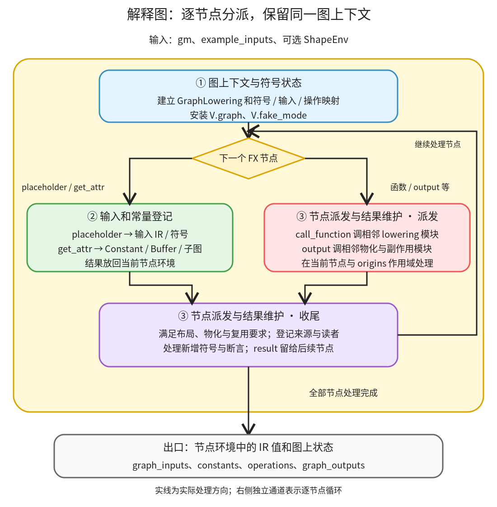

# 解释图与登记输入：在图上下文中，把 FX 节点的值换成 IR 对象

```text
Inductor  本层完成
    └── Lowering  本层完成
        └── 解释图与登记输入 ← 当前篇  本层完成
            ├── 图上下文与符号状态  叶子·逐行完成
            ├── 输入和常量登记  待展开
            └── 节点派发与结果维护  待展开
```

<!-- child-links:start -->
直接子篇：[图上下文与符号状态](01-context-symbols/README.md)。
<!-- child-links:end -->

[返回 Lowering](../README.md)。本模块接收 gm、示例输入和可选 ShapeEnv，建立一次 Lowering 的状态，依次解释 FX 节点。placeholder、get_attr、call_function 的结果存入节点环境，供后续节点引用；张量结果通常是 IR 句柄，不能当成已经算出的真实 Tensor。

## 1. 同一个节点怎样从 FX 走到 IR 环境



先由①建立 GraphLowering 及符号、输入、缓冲区等状态，并在调用范围内安装 `V.graph` 和 `V.fake_mode`。随后 FX Interpreter 按图节点顺序重复派发：遇到 placeholder/get_attr 调②；遇到函数调用，由③取得前驱的 IR 值并调用相应 lowering；每个结果经过③补充布局、物化需求、来源和符号绑定，再留给后续节点。

③会调用相邻模块的普通表达式或专用算子处理；图中把它们画为外部协作，避免在本目录重新拆一份 lowering.py 和 kernel 模板教程。最后 output 的主要图状态交接归属物化与副作用模块。

主线依据：[GraphLowering 构造](/work/pytorch/torch/_inductor/graph.py:308)、[run](/work/pytorch/torch/_inductor/graph.py:778)、[run_node](/work/pytorch/torch/_inductor/graph.py:1268)。

## 2. 三个模块分别保留什么

### 2.1 图上下文与符号状态

收到 gm 和示例输入后，GraphLowering 初始化 `graph_inputs`、`graph_inputs_original`、buffers、operations、constants、输出接口和一系列名称映射。布局优化、推理/AOT/C++ wrapper 等模式也在对象上保留，使后续同一张图使用一致的编译条件。

提供已有 ShapeEnv 时复用它；没有时建立新的。这个环境保存符号尺寸及约束，而不是保存每个 Tensor 的实际元素。构造阶段冻结后续新增 deferred runtime assert 的行为，并复制按符号归类的断言等待状态；运行到符号定义节点时才能决定哪些约束可以发出。

例如输入尺寸是 `(s0,3)`，表达式访问偏移会引用 s0 或由它推导的范围。若简单把本次 s0 的提示值写死为 2，就无法表达同一符号程序对其他合法尺寸的处理。实际静态或符号路径由输入属性及 ShapeEnv 决定，不是看到 Python 整数就自行猜动态。

`V.graph`、`V.fake_mode`、`V.current_node` 通过 [Virtualized](/work/pytorch/torch/_inductor/virtualized.py:95) 使用线程局部状态和作用域恢复。它们让深层 helper 能读取当前图，不需要每层显式传参；不是整个进程所有编译永远共用同一个 GraphLowering。离开相关上下文后恢复先前对象。

①交给②/③的是已安装的图上下文和节点遍历请求。大小变量分配与符号转换、运行断言的具体算法继续在子篇展开，本层只说明为什么这些状态必须贯穿同一次 Lowering。

### 2.2 输入和常量登记

[placeholder](/work/pytorch/torch/_inductor/graph.py:922) 按图输入顺序取得示例参数。真实张量或 FakeTensor 都提供布局属性；Tensor 输入通常变为 `TensorBox(StorageBox(InputBuffer(FixedLayout(...))))`，登记输入名字及原始输入缓冲区。这里登记的是将来从参数读取的位置，不复制实际数据。

例如非连续 x shape `(2,3)`、stride `(1,2)`：位置 `[0,0]` 读偏移 0，`[0,1]` 读偏移 2，`[1,0]` 读偏移 1。输入不是按默认 `(3,1)` 重新解释，否则计算会读错值。静态输入将 sizes/strides 转成 SymPy 整数；符号输入走复用或创建符号的路径。

符号数值参数变成符号表达式；普通 int/bool/float 有独立处理，None 和 BackwardState 也不包装成 Tensor。接口上保留的类型不能仅用“所有 placeholder 都是张量”概括。

[get_attr](/work/pytorch/torch/_inductor/graph.py:1035) 从 GraphModule 取得对象：子图包装为 ir.Subgraph，TorchBind 对象登记专用常量；Tensor 常量按模式、维数和大小选择内联或 ConstantBuffer。标量 Tensor 可变成 ir.Constant，小的一维 Tensor 有内联条件，其余通常登记为图常量。也有配置强制保留常量，所以不能把内联视为无条件规则。

②把 IR 值交回节点环境，同时修改 graph_inputs、constants 等映射。常量被登记不意味着它成为调用者显式传入的新 placeholder；它可能由生成模块保存并传给 kernel。

### 2.3 节点派发与结果维护

每次 [run_node](/work/pytorch/torch/_inductor/graph.py:1268) 收到一个 FX 节点，先记录新增 buffer/operation 的起点，取该节点和输入 IR 的 origins，然后临时设为当前节点。函数调用参数通过环境替换成前驱的结果，不再是原始 FX Node。

普通 call_function 进入 [lowerings 分派](/work/pytorch/torch/_inductor/graph.py:981)；模式产生的专用 lowering handler 可直接调用，容器 getitem 可以沿用解释器行为。特殊布局约束、unsupported type 的 fallback、符号 magic method 各有条件分支。call_module/call_method 在该实现中断言失败，因此入口应是已准备好的函数式图，而不是任意 nn.Module 调用图。

lowering 返回 IR 后，这层还要满足使用者的要求：图输出、as_strided 类操作或固定布局算子可能要求实现结果并约束步长；多次使用的复杂表达式可能触发 reuse/realize hint；表达式过大也可能提前物化。这里是主动查询“后面谁需要这个值”，不能等到所有节点处理完再统一决定。

随后补来源、登记读取者，检查本次新增操作定义了哪些 unbacked 符号，按可用绑定发出必要运行断言，并核对 FX 元数据期待的绑定没有丢失。`origins` 是来源追踪，不能拿它代替数据依赖；它会尽力覆盖多个原算子，也不承诺任意复杂 view 都有完美归属。

③交回的 result 进入 Interpreter 的节点环境，同时保留 operations 等对象状态。用户函数的 output 最终由输出处理器登记；`run_node(output)` 可以返回 None，而整张图仍已有有效 graph_outputs。

## 3. 主案例：非连续输入，加二维常量，再乘标量常量

真实 Lowering 实验的图为：

```text
x = arange(6).reshape(3,2).t()
  值 [[0,2,4],[1,3,5]]
  shape=(2,3)，stride=(1,2)，float32，CPU
k = ones(2,3)         # 二维图常量，stride=(3,1)
s = tensor(2.)        # 零维图常量
return ((x+k)*s,)
```

这个实验运行真实 GraphLowering，但不生成或执行后端 kernel。记录证明对象和状态转换，不声称下面的数值已由 Inductor kernel 求出。

### 3.1 建立上下文、登记 placeholder

①建立 graph，初始 operations/constants 为空。②处理 x_1，返回 TensorBox→StorageBox→InputBuffer，其 FixedLayout 是 CPU float32、size `[2,3]`、stride `[1,2]`。此时没有新增计算 operation。

真实对象链见 [interpretation.json](../../experiments/interpretation.json)，不是根据类名想象出的示意。

### 3.2 取得二维常量，构造 add 表达式

get_attr `_tensor_constant0` 取得 k。②登记 constants 中的该名字，返回 TensorBox→StorageBox→ConstantBuffer；常量保留自己的 `(3,1)` 步长，不沿用 x 的 `(1,2)`。

③处理 add 时，参数环境已经是 x 的输入 IR 和 k 的常量 IR。普通表达式模块建立 Pointwise，它在逻辑 `[i0,i1]` 处需要：

```text
load x_1              的元素偏移 i0 + 2*i1
load _tensor_constant0 的元素偏移 3*i0 + i1
相加
```

x 和 k 的逻辑 shape 相同，但各自使用自己的物理步长。此时采集的 add 结果仍是 TensorBox→StorageBox→Pointwise，operations 仍为 0。

### 3.3 内联标量，并在 mul 节点处理期间实现输出需求

②处理 `_tensor_constant1`，零维 s 被转换为 Constant(2.0)，没有再向 constants 增加第二个持久 Tensor 条目。

③调用 mul lowering，把 add 的 loader 和标量组合为 Pointwise。然后发现 mul 直接被 output 使用，根据图输出和布局要求将其物化。因此 **mul 的 run_node 返回时**，对象链已是 TensorBox→StorageBox→ComputedBuffer，operations 已为 1；不是一定等到后面 output 节点才开始物化。

记录中的 ComputedBuffer 内部仍保留 Pointwise，包含 x/k 的两种索引、加法和 `ops.constant(2.0)` 后乘法。最终布局为 size `[2,3]`、stride `[1,2]`；origins 包含 add 和 mul，表明这个计算从两个原节点组合而来。

### 3.4 处理 output，交给后续调度

output 处理器登记一个 graph_output，保留输入与常量映射。实验中 `run_node(output)` 返回 None，但出口仍有：

```text
graph_inputs = [x_1]
constants = [_tensor_constant0]
operations = [一个 ComputedBuffer]
graph_outputs = [一个输出 IR]
```

这组状态才是 Scheduler 和 codegen 所需的主要交接。上层若只保存 `graph.run(x)` 的返回值，会漏掉已经构造的整张 IR 图。

## 4. 两个会改变路径的条件

**输入变为连续。** shape 仍为 `(2,3)`，但 stride 改为 `(3,1)` 时，placeholder 应登记新的 FixedLayout，读取 x 的偏移改为 `3*i0+i1`。这一条是根据 placeholder 和 loader 源码推演，当前专门采集的是非连续版本；总篇 CPU 案例另外验证了连续输入程序。

**常量被强制保留。** 配置或 AOT runtime constant folding 等条件要求保留 Tensor 常量时，get_attr 会优先走 add_tensor_constant，而不按当前标量案例内联。这个分支的接口在源码中明确，当前没有单独运行对应 AOT 配置，不能从只剩一个 constants 条目的案例推出所有模式都如此。

缺少布局支持、算子 lowering 或符号绑定不一致，则可以在节点派发或结果核对处失败。是否能 fallback 取决于具体类型、注册与配置，不是 Interpreter 有一个无条件成功的解释出口。

## 5. 下一层的完整实现边界

图上下文与符号状态覆盖构造、符号尺寸及作用域；输入和常量登记覆盖 placeholder/get_attr 及所用登记工具；节点派发与结果维护完整解释 run_node 的分支、布局需求、复用、来源和符号核对。表达式如何生成与物化如何登记继续链接相邻模块，不在本层复制成另一套叶子。

复现：[interpretation.py](../../experiments/interpretation.py)。它临时包装 run_node 采集结果，finally 恢复；打印 IR 也在同一图上下文内完成，因为常量 loader 仍会读取当前图的常量名称信息。
