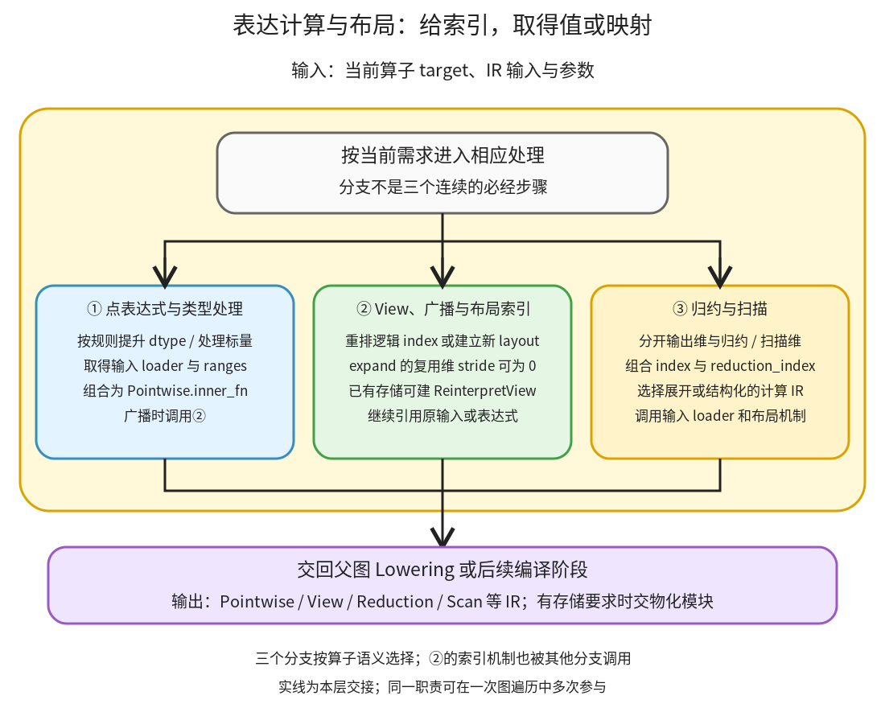

# 表达计算与布局：让一个逻辑索引产生一个值，或沿归约维组合多个值

```text
Inductor  本层完成
    └── Lowering  本层完成
        └── 表达计算与布局 ← 当前篇  本层完成
            ├── 点表达式与类型处理  待展开
            ├── View、广播与布局索引  待展开
            └── 归约与扫描  待展开
```

<!-- child-links:start -->

<!-- child-links:end -->

[返回 Lowering](../README.md)。本模块收到节点派发交来的 IR 值和算子参数，将普通计算表达为元素 loader、索引转换、循环范围与组合规则。交出的通常是 TensorBox 包着的计算或视图；需要保存结果时再调用物化职责。它没有在构造 inner_fn 时立即求出整个 Tensor。

## 1. 三类算子怎样共享索引与元素表达式



按算子语义分别进入点运算、view 或归约路径。点运算建立“给定输出 index，取输入元素并算出一个值”的函数；view 改写 index 如何落到原输入；归约把输出 index 和归约 index 合回原输入 index，再组合多个值。点运算的广播会调用 view/索引处理，因此②也服务①，并非只处理用户显式写出的 view。

例如 `x+y` 中 x 是 `(2,3)`、y 是 `(1,3)`，输出 `[1,2]` 应读取 x[1,2] 和 y[0,2]。广播无需在构造 IR 时复制出两行 y，只需让对应 loader 忽略第一维输出索引。接着如果 sum 掉列维，归约模块还可继续调用这个 loader，把逐列加法合进被归约的表达式。

[注册 wrapper](/work/pytorch/torch/_inductor/lowering.py:321)、[make_pointwise](/work/pytorch/torch/_inductor/lowering.py:458)、[BaseView loader](/work/pytorch/torch/_inductor/ir.py:2186)、[归约输入组织](/work/pytorch/torch/_inductor/lowering.py:5050) 是三个模块的实际接点。

## 2. 三个职责分别交出什么

### 2.1 点表达式与类型处理

收到 TensorBox、标量和算子参数后，注册 wrapper 按规则处理类型提升、逻辑算子的 bool 转换和广播，再调用具体 lowering。不是每个算子都用相同策略：注册时可关闭类型处理，或指定整数到浮点等规则；fallback 对 Tensor kwargs 等也有不同接口约束。

make_pointwise 取得输入 loader、输出 ranges 和 dtype，创建 inner_fn。若输入仍是 Pointwise，loader 可以直接取它的 inner_fn，于是后续点运算会嵌入前面的计算；若输入已有 buffer，loader 发出按布局的 ops.load。二者在外层都是“给我 index，交回元素表达式”，因此可以组合。

例如 add 的未物化结果接 relu，relu 的 inner_fn 可以包含“加载 x/y→相加→relu”，无需先有 buf_add。如果 add 已经物化，relu 就读取 buf_add，这个存储边界不会因为都是点运算而自动消失。

`ops` 是可替换处理器上的表达式接口：分析时可记录依赖，打印时可生成文本，后端生成时可写临时变量。运行 inner_fn 不等于在本机 Python 中计算真实六个 Tensor 元素。部分低精度节点还有显式精度边界，生成更高精度计算时要模拟原先中间舍入，不能把所有类型转换当作无用节点删除。

交出 TensorBox(StorageBox(Pointwise(...))) 或某些专门结果，并保留 inner_fn 中引用的输入 loader。来源、布局需求和是否提前实现由节点维护与物化模块继续处理。

### 2.2 View、广播与布局索引

收到输入 IR、目标 size 或维度排列后，本模块建立逻辑到物理位置的映射。[BaseView.make_loader](/work/pytorch/torch/_inductor/ir.py:2186) 的方式是先 reindex，再调用原 loader；已有稳定存储与布局时，ExpandView/PermuteView 可以直接构建 ReinterpretView 和新的 FixedLayout。

例如原 x shape `(2,3)`、stride `(3,1)`，转为 `(3,2)` 后 stride 可为 `(1,3)`。输出位置 `[2,1]` 读取原 x[1,2]，元素偏移为 `2*1+1*3=5`；不是把原数据在 Lowering 时重新搬成三行。

广播 `(1,3)→(2,3)` 则把被扩展维 stride 设为 0。输出 `[0,2]` 和 `[1,2]` 都读取同一个输入位置 2。这种共享关系影响写入合法性：能读取广播视图，不代表允许逐位置独立写它。

[FixedLayout.make_indexer](/work/pytorch/torch/_inductor/ir.py:3102) 用 offset 和各维 stride 累加元素偏移；stride 与 offset 以元素为单位，不是字节。本篇所有数值偏移都按这个单位说明。FlexibleLayout 仍保留选择余地，不能脱离要求任意把它当连续布局索引。

交出视图 IR 或重新索引的 loader。若某个 reshape 无法只保留原存储完成，可能需要物化或复制；必须看进入该层的图和实际产物，不能一概把 reshape 当零成本别名。

### 2.3 归约与扫描

收到输入 IR、axis、keepdims 和 dtype 后，[make_reduction](/work/pytorch/torch/_inductor/lowering.py:5099) 将保留维和归约维分开，构造 `inner_fn(index,reduction_index)`。保留维决定输出位置，归约维决定同一输出要累计哪些输入。

例如 `(2,64).sum(1)` 的 ranges 是 `[2]`、reduction_ranges 是 `[64]`。输出 index=1、归约 index=2 对应原输入 `[1,2]`，不是原输入 `[2,1]`。keepdims=True 会把输出被消去维保留为 size 1，但输入 loader 仍要恢复所有原维位置。

Reduction.create 对空归约、只有一个元素、小静态归约、正常归约及可能拆分的情形分别处理。小归约可能返回 Pointwise；保留为 Reduction 时，make_reduction 会将它物化，供后续调度识别其计算与存储边界。整数/bool sum 在未指定 dtype 时还会选择 int64 等对应语义。

扫描不把 axis 消掉，而为每个位置保留累计结果；本地 cumsum 经 Scan.create，无法采用该实现时还有 fallback。关联扫描、排序和索引相关普通计算也要遵守各自的状态与布局，不用“所有算子都是 Pointwise”概括。本层交出的是包含这些结构的 IR，具体分块和硬件执行仍由调度及后端完成。

## 3. 主案例：广播是怎样进入点表达式的

CPU float32 输入均连续：

```text
x shape=(2,3), stride=(3,1): [[0,1,2],[3,4,5]]
y shape=(1,3), stride=(3,1): [[10,20,30]]
return (x+y,)
```

**①收到 add 请求。** wrapper 根据两个 TensorBox 形成共同输出尺寸 `(2,3)`，调用②为 y 表达广播。

**②交回索引映射。** x 的 `[i0,i1]` 仍对应偏移 `3*i0+i1`；y 的第一维输出索引被忽略，偏移只是 i1。不生成一块复制后的 `(2,3)` y。

**①建立元素计算。** [实际 Lowering 产物](../../experiments/expressions-storage/broadcast_lowered.txt) 的核心为：

```text
tmp0 = ops.load(x_1, i1 + 3*i0)
tmp1 = ops.load(y_1, i1)
return tmp0 + tmp1
ranges = [2,3]
```

这是采集表达式的关键部分，完整 repr 在链接文件。比如输出 `[1,2]`：读 x 偏移 5 得到 5，读 y 偏移 2 得到 30，所以结果为 35。

**交给物化与后续程序。** add 直接被 output 使用，节点维护将其登记为一个 ComputedBuffer。调度和 C++ 后端生成一个计算循环，实际结果为 `[[10,21,32],[13,24,35]]`，stride `(3,1)`；输入保持不变，输出不共享输入存储。

## 4. 改变索引关系后的两条路径

### 4.1 转置后再广播相加

把图改为 `x.permute(1,0)+[10,20]`。②先返回 ReinterpretView，shape `(3,2)`、stride `(1,3)`；此时 operations 仍为 0。随后①创建 add 表达式：

```text
load x_1 的偏移 i0 + 3*i1
load y_1 的偏移 i1
```

输出 `[2,1]` 读原 x[1,2]=5，再加 y[1]=20，得到 25。[真实结果](../../experiments/expressions-storage/results.json) 是 `[[10,23],[11,24],[12,25]]`，输出 stride `(1,3)`，不是默认 `(2,1)`。这说明逻辑 shape 与物理步长必须分开看。

### 4.2 只返回 expand

输入 x=`[[10,20,30]]`，返回 `x.expand(2,3)`。只经过②的视图处理，没有新 Pointwise operation；最后输出两行相同值，stride `(0,1)`，与输入共享存储，自生成计算 kernel 数为 0。

如果改成非连续转置结果的 flatten，不能照搬这个结论。本轮 `permute(1,0).reshape(6)` 进入 Lowering 前的 FX 图已经含 clone 和 `_unsafe_view`，最终生成复制计算，输出 `[0,3,1,4,2,5]` 且不共享原输入；并不是在本篇 View.create 才第一次决定插入 clone。见 [输入图](../../experiments/expressions-storage/reshape_copy_input.txt) 和 [Lowering 结果](../../experiments/expressions-storage/reshape_copy_lowered.txt)。

## 5. 归约沿同一表达式继续读输入

已有 `(x+y).sum(1)` 案例中，宽度 3 的输出被展开为 Pointwise；宽度 64 时为 Reduction。后者的 loader 同时接受行 i0 和列 r0，读取 `x_1[64*i0+r0]`、`y_1[64*i0+r0]` 并相加；归约再沿 r0 组合 64 项。

对 arange(128).reshape(2,64) 加全 1，结果为 `[2080,6176]`。[真实 IR](../../experiments/stages/reduction_large_lowered.txt) 保留 ranges `[2]`、reduction_ranges `[64]` 和 reduction_type=sum。这里无须先生成完整 x+y 中间张量，再由独立 sum 读它。

当归约被展开成 Pointwise 时，后续看到的是“每个输出元素的一段展开表达式”；保留 Reduction 时，调度还能看到独立归约维。两者语义相同，后端组织不同；没有测过计时，不把某个分支自动称为本机更快。

## 6. 当前边界与下一层

复现脚本为 [expressions_storage.py](../../experiments/expressions_storage.py)，另有已采集的归约案例。当前验证 CPU float32 的广播、转置索引、expand、非连续 reshape 与两种归约规模；低精度舍入、复杂 dtype、扫描、间接索引、动态 reshape 和 GPU 归约仍需后续源码展开。

直接调用单图入口需要已适合 lowering 的算子集合。本版本 raw make_fx 的 `aten.t.default` 有 decomposition 而没有对应直接 lowering，直接输入触发 fallback/decomposition 冲突断言；转置案例使用已有 lowering 的 permute。这个边界不能被“接受 GraphModule”这句话省掉。
