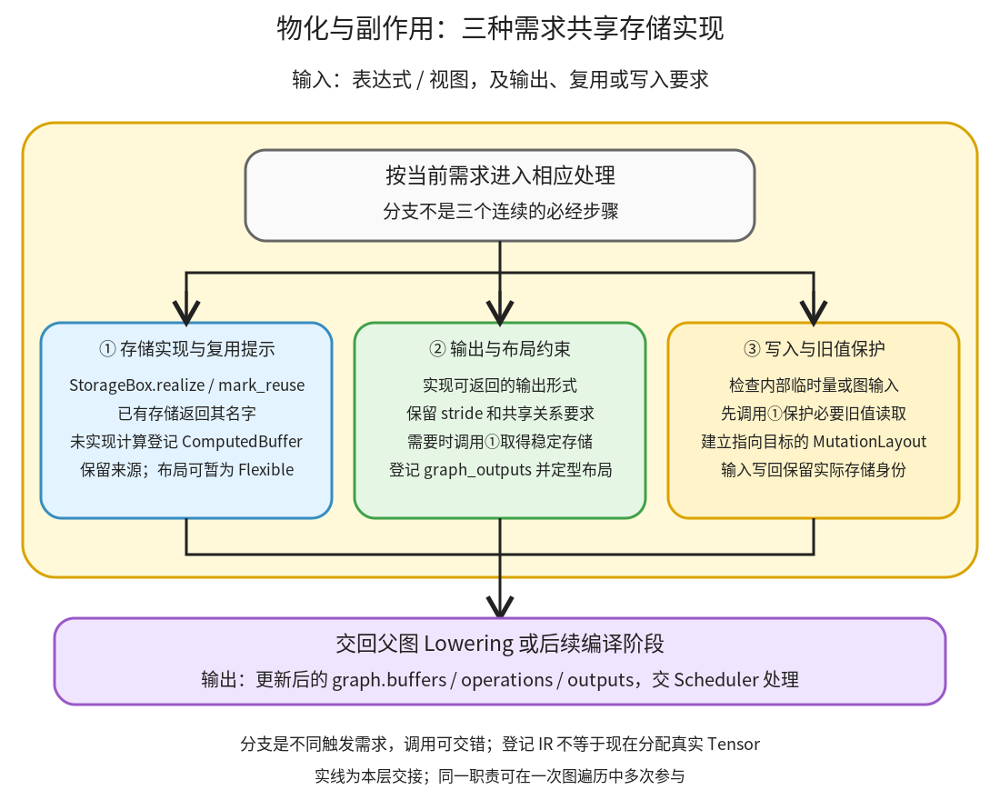

# 物化与副作用：登记稳定存储，并保住输出别名和写入前的旧值

```text
Inductor  本层完成
    └── Lowering  本层完成
        └── 物化与副作用 ← 当前篇  本层完成
            ├── 存储实现与复用提示  待展开
            ├── 输出与布局约束  待展开
            └── 写入与旧值保护  待展开
```

<!-- child-links:start -->

<!-- child-links:end -->

[返回 Lowering](../README.md)。本模块收到计算表达式或 view，当输出、外部算子、复杂度或副作用要求有稳定存储时，登记缓冲区和 operation，并维护输入写回和输出别名。这里“物化”是构造未来程序的存储需求；真正 Tensor 分配由运行时 wrapper 执行。

## 1. 什么时候会从表达式走进本模块



节点维护、外部算子输入要求、图输出、复用启发式和写入处理都可触发本模块。①把未实现计算登记为 ComputedBuffer；②保证图输出有可交付形式和所需布局；③在发生写入时保护旧值，建立对实际目标存储的修改。③也会调用①，因此不是三个各执行一次的纯线性阶段。

对象交接的核心可由 [StorageBox.realize](/work/pytorch/torch/_inductor/ir.py:6348)、[GraphLowering.output](/work/pytorch/torch/_inductor/graph.py:1075)、[mutate_to](/work/pytorch/torch/_inductor/lowering.py:5346)、[MutationLayout.realize_into](/work/pytorch/torch/_inductor/ir.py:3342) 核对。名字中保留 SHOULDREMOVE 是本地源码的实际类名，不代表本轮删掉它或换成别的实现。

## 2. 三个职责怎样交接状态

### 2.1 存储实现与复用提示

收到 StorageBox 后，如果内部已经是 InputBuffer、ComputedBuffer、ReinterpretView、模板等可引用对象，realize 可以返回已有名字。若内部仍是 Pointwise、Reduction、Scan 或 Sort，则构造 ComputedBuffer 和 FlexibleLayout，注册 buffer/operation，再把 StorageBox.data 替换为这个新对象。

例如原先 `box.data=Pointwise(exp(x))`，实现后变成 `box.data=ComputedBuffer(name='buf0',data=Pointwise(exp(x)))`。已有使用者继续通过同一个 box 引用新对象；它们之后的 loader 可以读取 buf0，而不再各自内联 exp。

这个“有名字”不等于编译时已分配真实内存，也不保证最终 wrapper 一定为 buf0 分配 Tensor。后续若把生产者和所有使用者融合到一个 kernel，buf0 可能只作为临时变量存在，外部存储可被消除。

`realize_hint`、`mark_reuse` 等是有条件的实现请求。CPU 上被多次使用的 exp/sigmoid 有专门启发式，其他情况还考虑读取次数和表达式规模。它们用于避免重复重算或过大的表达式，不是证明某个固定阈值在所有设备上最优。

①交回可稳定引用的名字和 IR 对象，并修改 graph.buffers、graph.operations、来源等状态；布局可能先为 FlexibleLayout，在后续约束和 finalize 中定型。

### 2.2 输出与布局约束

收到图的返回 IR 序列后，output 处理器先实现可返回形式，登记 graph_outputs，处理一些对语义不重要但接口需要一致的 stride，并最终调用 finalize 决定缓冲区布局。直接被 output 使用的计算也可能早在 run_node 中就已实现，不能把 output 当作唯一入口。

view 输出要求保留合理共享关系；clone 输出要求独立存储；标量和符号输出也有允许类型。`ExternKernel.realize_input` 将这些值转换为外部接口能表示的形式：对普通 StorageBox 实现，对视图尝试转为带稳定布局的 ReinterpretView，必要时复制。

例如 `return x.expand(2,3)` 可以是对输入的零步长视图；`return x.clone()` 必须有独立存储，即使两者数值都与输入相同。布局不仅影响性能，还影响下游 view/as_strided 是否合法，因此不能一律把所有输出改成默认连续。

②还检查图输入当前 StorageBox 是否已代表一个新值；若需要把新值写回原输入缓冲区，会调用③建立写回需求，并适当用原输入替换相应输出引用。这是保持调用者状态的工作，不是恢复用户原始嵌套返回结构的上层包装。

### 2.3 写入与旧值保护

[copy_ lowering](/work/pytorch/torch/_inductor/lowering.py:5387) 先处理设备、dtype 和广播，再调用 mutate_to。内部临时存储有时可通过替换 box 内部对象完成更新；图输入、模块常量和其他受限制存储不能都套用这个快捷路径。

需要真实写入时，MutationLayout.realize_into 先确保目标可引用，并调用 [mark_buffer_mutated](/work/pytorch/torch/_inductor/graph.py:823) 实现读取目标旧值的用户，再实现写入本身。顺序很重要：如果先登记修改，后把旧值表达式当作读取原输入重算，可能读到新值。

随后写入计算使用指向目标的 MutationLayout，使 Scheduler 知道这个 operation 的新名字实际上修改了哪个原存储。通常还要保留对 src 值的正确观察，不能把 src 和 dst 随意变成永久别名。`unsafe_alias` 是带前提的内部选项，不是普通 copy_ 一律使用的语义。

③交给 Scheduler 的是修改目标、计算来源及读写需求。后续依赖模块再建立旧读者→写入者、新版本→后续读者的顺序，二者共同保证正确；Lowering 一次提前 realize 不能替代整个调度依赖分析。

## 3. 主案例：多次使用的 exp 被登记，但最后不分配 exp Tensor

CPU float32 连续输入 x shape `(2,3)`，值 `[[0,1,2],[3,4,5]]`：

```python
a = x.exp()
return (a+1, a*2)
```

**①收到复用提示。** x 的输入无需新实现。exp 是 Pointwise，但有两个使用者；本地 CPU heavy-op 规则决定提前 realize。采集的 exp 节点返回链已经是 TensorBox→StorageBox→ComputedBuffer，operations=1。

**后续表达式读取实现结果。** add 和 mul 的 loader 读取 buf0，而不是各自重新展开 exp；因为它们分别为图输出，也被登记，最终 Lowering 有：

```text
op0：buf0 = exp(x)
op1：buf1 = buf0 + 1
op2：buf2 = buf0 * 2
graph_outputs = buf1、buf2
```

[真实 IR](../../experiments/expressions-storage/reuse_exp_lowered.txt) 含三个 ComputedBuffer，[节点事件](../../experiments/expressions-storage/results.json) 记录 operations 从 1 增至 2、3。

**②维持两个输出接口。** 两个结果都要返回，所以不能只保留其中一个。x 没有写入，不需要③的输入修改路径。

**交给调度与生成。** 三个操作在本例中融合为一个 FusedSchedulerNode。最终 [C++/wrapper 程序](../../experiments/expressions-storage/reuse_exp_output.py) 只分配 buf1、buf2；循环内一次计算 `std::exp` 的结果供两个输出使用，没有为 buf0 分配独立 Tensor。

这说明“在 Lowering 登记缓冲区”和“最终运行时分配该缓冲区”不是同一承诺。语义所需的两项结果保留，内部 exp 存储在融合后消去；这也是不能用 Lowering operation 数直接推算 kernel 数或分配次数的原因。

数值与 eager 一致，输入未修改，两个结果不共享 x。这里只验证了该配置下的程序，没有据此测出特定加速比。

## 4. 写入案例：返回旧值计算，也修改原输入

输入 x=`[0,1,2,3]`、y=`[9,9,9,9]`，均为 CPU float32、shape `(4,)`、stride `(1,)`：

```python
old = x + 1
x.copy_(y)
return (old, x)
```

**②输出要求促使旧值计算实现。** old 直接被 output 使用，在处理 add 时已得到 buf0。它读取旧 x，结果应该是 `[1,2,3,4]`。

**③处理 copy。** 输入 x 不能只替换成 y 的句柄而忘记原存储。Lowering 登记 buf1 的写入操作，layout 指向 x；元素计算读取 y。图输出仍应有 old 和修改后的 x。

[出口 IR](../../experiments/expressions-storage/copy_old_lowered.txt) 为一个普通 ComputedBuffer 和一个 MutationLayout 的 ComputedBuffer。Scheduler 看到 buf1 修改 x_1，登记 old 的读取先于写入，元数据 mutated_input_idxs=[0]。

**真实执行。** 返回 `([1,2,3,4],[9,9,9,9])`；调用后的 x 全为 9，old 不共享 x，第二项输出共享 x。生成程序先运行旧值计算循环，再运行 copy 循环，wrapper 返回 `(buf0,x_1)`。

统计 generated_kernel_count 是 2，而该 CPU wrapper 只有一次 cpp_fused_0 调用，函数体含两个顺序循环。因此这个统计不能不加解释地当作 wrapper 里的外部函数调用数量。

## 5. 两个补充条件

**写入但不返回 x。** `x.copy_(y); return y+1` 的图输出只有加法结果，但调用者仍应看到 x 改为 9。实际生成程序保留写入，mutated_input_idxs=[0]，返回全 10。这项副作用不能按“没有普通数据用户”被删掉。

**旧读取后来无用。** `unused=x+1; x.copy_(y); return x` 中，add 初次返回时仍是 Pointwise、operations=0。copy 处理触发旧值保护，将旧读与写入登记为两个操作；但 Scheduler 随后发现旧读只被一条顺序性 WeakDep 观察，没有真实结果用户，可以删掉旧读及这条顺序约束。最后只保留正确的输入写入。

前者说明副作用是活跃需求；后者说明为安全分析登记的操作不必永久保留。详细依赖交接见“依赖与合法顺序”篇；两者由 [expressions_storage.py](../../experiments/expressions_storage.py) 实测。

## 6. 下一层打开什么

三个子篇分别完整解释 StorageBox 的实现和启发式、输出及步长处理、mutate_to/MutationLayout 的旧值与写回规则。scan/sort、模块参数修改、复杂视图写入、动态布局等仍需继续覆盖，当前案例没有证明这些所有分支。
