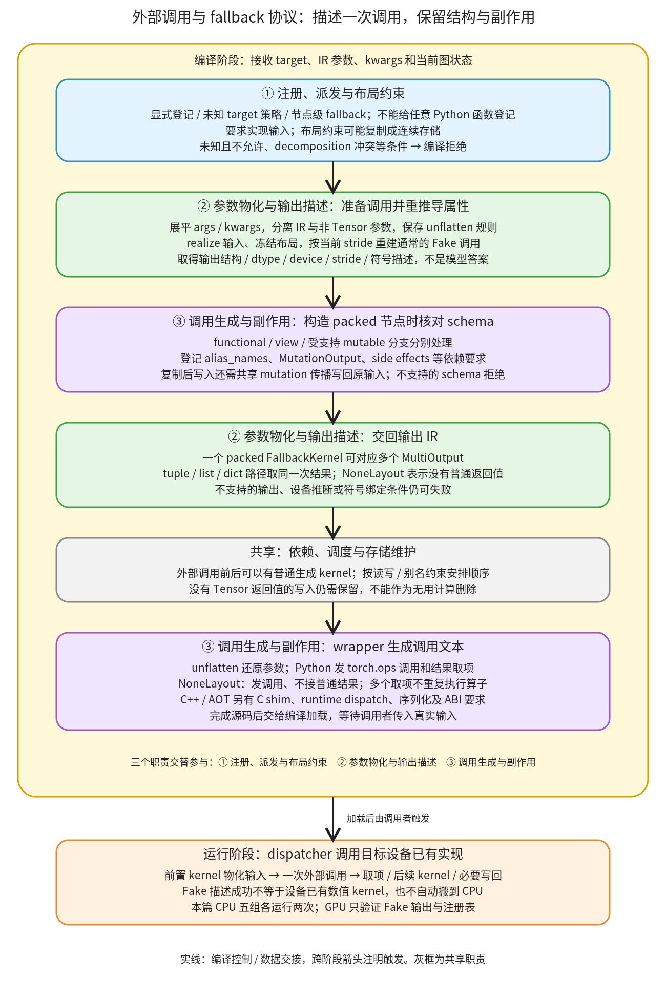

# 外部调用与 fallback 协议：把已有算子接入 IR，保留参数、布局和副作用

```text
Inductor  本层完成
    └── Lowering  本层完成
        └── 专用算子路径  本层完成
            └── 外部调用与 fallback 协议 ← 当前篇  本层完成
                ├── 注册、派发与布局约束  待展开
                ├── 参数物化与输出描述  待展开
                └── 调用生成与副作用  待展开
```

<!-- child-links:start -->

<!-- child-links:end -->

[返回专用算子路径](../README.md)。本模块接收算子 overload、IR 参数和调用条件，把需要调用已有实现的计算表示成外部调用节点。它物化输入、重建结构参数、推导输出布局，为结果建立 IR 引用，并把真实算子身份、别名和写入要求交给调度及 wrapper。

对于新设备，fallback 是连接已有算子实现的路径。它本身不提供设备 allocator、dispatcher kernel，也不自动把任意设备的 Tensor 搬到 CPU 执行。Fake 输出能描述新设备上的 shape，不代表那台设备已经有数值实现。

## 1. 整体交接：先描述调用，运行时才执行已有实现



本层三个直接子模块是：注册、派发与布局约束；参数物化与输出描述；调用生成与副作用。物化、依赖、wrapper 和编译加载仍使用各自共享实现。

①决定当前 target 走什么 handler、输入有何约束；②把 IR 参数变成可调用外部实现的稳定对象，并在通常的 Fake 模式下推导输出；③根据 schema 记录副作用，再生成后续调用所需的信息。调度/代码生成阶段才让 wrapper 写出实际调用语句；模型运行时通过该语句进入已注册实现。

因此外部调用不是整张图停止编译。普通生成 kernel 可以先算出输入，再调用外部算子，随后把其某个输出继续交给普通 kernel。多个结果引用也不代表多次调用同一个外部算子。

外部调用 IR 不只有 FallbackKernel。[ExternKernelOut](/work/pytorch/torch/_inductor/ir.py:5060) 使用预先分配的 out 参数，[ExternKernelAlloc](/work/pytorch/torch/_inductor/ir.py:5137) 让外部调用返回结果。FallbackKernel 继承 Alloc，并补上通用参数结构、schema 与多输出协议；专用库调用可以直接使用其他 ExternKernel 子类，不必先伪装成“缺少 lowering”。

## 2. 三个子模块接收和交出什么

### 2.1 注册、派发与布局约束

输入是算子 target、注册/配置状态，以及当前 FX 节点的参数。输出是选中的 lowering/fallback handler 与受约束的 IR 参数；注册阶段还修改 lowerings、fallbacks、needs_realized_inputs 等表。

[make_fallback](/work/pytorch/torch/_inductor/lowering.py:1778) 为 overload 登记 fallback_handler，将其加入需要实现输入的集合；可选 layout_constraint 另外登记。给 OpOverloadPacket 时遍历 overload；传入普通 Python lambda 则拒绝。已存在相关 decomposition 的算子还可能在登记时触发冲突，不能用 fallback 任意绕过入口要求。

[GraphLowering.call_function](/work/pytorch/torch/_inductor/graph.py:981) 遇到未注册 target 时，再检查允许名单、implicit_fallbacks 或 decomposition，决定登记 fallback 还是报告 MissingOperatorWithDecomp/WithoutDecomp。已明确登记的 fallback 不依赖“允许隐式登记”才能调用：本篇五个真实 CPU 案例都先 make_fallback，再在 implicit_fallbacks=False 下编译成功。

还有按节点类型属性直接选择 fallback 的路径，见 [run_node](/work/pytorch/torch/_inductor/graph.py:1287)：它可调用 fallback_handler(add_to_fallback_set=False)，不等于把这个 target 对所有调用永久改成 fallback。该派发实现主要归“节点派发与结果维护”，这里说明消费接口。

布局约束也在调用 handler 前执行。比如注册 require_contiguous 后，非连续输入可能先生成一个连续副本，再交给外部算子。若算子会写输入，约束复制不能悄悄丢掉写入；[run_node 的 mutation 传播](/work/pytorch/torch/_inductor/graph.py:1300) 会把新值写回原输入，具体写入机制归 Lowering 的物化与副作用职责。

①交给②的仍是 IR 对象及常量，不是模型结果。约束可能增加 copy/ComputedBuffer，登记 fallback 本身不表示零复制或一定更快。

### 2.2 参数物化与输出描述

输入是 overload 和可能带 list/tuple/dict 的 args/kwargs。输出是一个 packed FallbackKernel 和按原返回结构组织的输出 IR；同时登记 buffers/operations、实际输入布局及符号绑定。

[ExternKernel.process_kernel](/work/pytorch/torch/_inductor/ir.py:4536) 将 args/kwargs 展平，分出 IR 参数与非 Tensor 参数，并保存 unflatten_args。IR 输入先 realize，能取得存储布局的对象冻结布局；随后按当前布局重建 Fake 示例，再调用原算子的 Fake/Meta 路径。需要重跑属性推导的原因是 Lowering 可能已改过输入 stride，不能总沿用最早 FX 元数据中的输出布局。

unflatten_args 保留的是参数结构规则。例如 `[两个 Tensor], dim, alpha=..., reverse=...` 展平后，IR 参数可能变成 `[buf0,buf1]`，非 Tensor 参数是 `[0,3.0,True]`；后面要重新组合成列表、位置参数和关键字参数，不能把这两份数组直接串联后调用原算子。

[FallbackKernel.create](/work/pytorch/torch/_inductor/ir.py:6108) 通常在图的 FakeTensorMode 下运行上述过程；源码对一项特殊算子 `_fused_moving_avg_obs_fq_helper_functional` 另有例外。本篇自定义算子的编译计数均是 Fake 调用，真实 CPU 实现编译期零次，不能把这个实验结论推广成所有特殊外部路径永不执行数值代码。

create 找到代表设备后，None 输出使用 NoneLayout；有输出则创建 MultiOutputLayout 的 packed 调用对象。递归遍历结果时，每个 Tensor 变成 [MultiOutput](/work/pytorch/torch/_inductor/ir.py:6218)，保存 tuple/list/dict 的取项路径；int、SymInt、None 有独立分支，其他类型可能被拒绝。SymInt 转成符号表达式，不是固定为一次运行的实际数据值。

MultiOutput 表示“从同一次 packed 结果中取这一项”，不是再次调用算子，也不自行分配新 Tensor。输出是 Tensor 的最简单情况，其 indices 可以为空；嵌套 `(Tensor, Tensor[])` 则可以保存 `[(tuple,1),(list,0)]` 这样的路径。

结构递归不等于所有 schema、设备推断和 wrapper 都接受任意结构。[find_device](/work/pytorch/torch/_inductor/ir.py:5936) 有输入时优先取第一个可用输入设备，没有输入时只处理部分输出形状。本篇真实 helper 对照中，无输入 dict 输出返回 None、无 Tensor 的序列触发 IndexError。这些边界不能被“支持嵌套输出”一句话掩盖；完整合法返回类型由下一层逐行展开。

### 2.3 调用生成与副作用

输入是 packed 调用、输出取项路径、schema 的参数/返回说明和目标 wrapper 模式。输出是调用/取项语句，以及保持写入、别名、未绑定符号所需的依赖信息。

[FallbackKernel 构造器](/work/pytorch/torch/_inductor/ir.py:5717) 不是只保存函数名。它检查 functional、view、特殊 inplace ATen、可自动功能化的 mutable schema 等条件，按参数的 alias/write 标注登记 alias_names 和 MutationOutput。has_side_effects 还会查询可变 schema，防止把没有普通 Tensor 返回值的写入当无用节点删掉。

自定义可变算子与 inplace ATen 的规则不同。`mutates_and_returns_first_arg` 先要求 aten namespace；自定义 `Tensor(a!)→Tensor(a!)` 不会仅因 schema 长得相同就命中特例，若又不满足可自动功能化条件，将以 NotImplementedError 拒绝。本篇实际编译对此得到带原始原因的 LoweringException。

自定义 `Tensor(a!)→()` 的成功案例则有：mutation_names 为空，但 mutation_outputs 非空，mutated_buffers 登记输入，has_side_effects=True。这不是漏记写入；这个分支通过 MutationOutput 连接写入依赖，而不是只靠 get_mutation_names 的列表。alias_names 在这里是 schema 推导的保守信息，也不能不分情况当成“真的返回了一个与输入别名的 Tensor”。

生成时，[FallbackKernel.codegen_args](/work/pytorch/torch/_inductor/ir.py:5912) 用 unflatten_args 还原参数结构并转换引用，MultiOutput 再生成取项。Python wrapper 通常发出 `torch.ops.namespace.op.default(...)`；NoneLayout 则不需要把调用赋给普通结果变量。

[FallbackKernel.codegen](/work/pytorch/torch/_inductor/ir.py:6040) 对 C++ wrapper 另作选择：ATen 的 C shim、缺少覆盖时的运行时派发、自定义算子的 runtime dispatch，以及 ABI-compatible 路径的输出/参数处理都不能直接套用 Python 字符串协议。AOT 时还可能经 export_extern_kernel_node 和[序列化器](/work/pytorch/torch/_inductor/extern_node_serializer.py:19) 输出调用描述。源码中存在导出接口不代表本篇已验证相应 C++/AOT proxy executor 可在新设备上运行；本篇实际执行的是 CPU Python wrapper。

③把带副作用要求的 IR 交给调度，把调用语句交给 wrapper。真正能否执行还需要 dispatcher 中有目标设备的实现；这里不自动安装设备 kernel。

## 3. 主案例：两个物化输入，一次调用，三个取项

独立实验注册如下 CPU/Fake 算子，不改 PyTorch 文件：

```text
pack(Tensor[] xs, int dim, *, float alpha=2., bool reverse=False)
    -> (Tensor, Tensor[])
CPU：返回 xs[0] + alpha*xs[1]，以及按条件反序后 clone 的输入列表
Fake：返回相应 shape/dtype/device 的三个新 FakeTensor
```

调用图：

```python
a, parts = pack([x + 1, y * 2], 0, alpha=3.0, reverse=True)
return (a.relu(), parts[0], parts[1])
```

x=`[[-2,0,3],[1,-1,2]]`，y 全 1；二者 CPU float32、shape `[2,3]`、stride `[3,1]`。

**①登记并约束。** 显式 fallback 登记要求实现输入。x+1 和 y*2 不再只作为外部算子无法读取的内联表达式，而是先形成 buf0、buf1 的实际计算节点。

**②打包。** 记录中的 tensor_inputs 是 `[buf0,buf1]`、布局均 `[2,3]/[3,1]`；constant_args 是 `[0,3.0,True]`。保存的结构规则可写为：

```text
unflatten([T0,T1], [C0,C1,C2])
  -> args = ([T0,T1], C0)
     kwargs = {alpha:C1, reverse:C2}
```

Fake 推导给出 packed buf2，再建立 buf3、buf4、buf5：

| 输出引用 | 取项路径 | 后续去向 |
| --- | --- | --- |
| buf3 | `(tuple,0)` | relu 的普通计算输入 |
| buf4 | `(tuple,1),(list,0)` | 第二个图输出 |
| buf5 | `(tuple,1),(list,1)` | 第三个图输出 |

**③交给 wrapper。** 实际生成文本只有一次 pack：

```python
buf2 = torch.ops.inductor_external_lesson.pack.default([buf0, buf1], 0, alpha=3.0, reverse=True)
buf3 = buf2[0]
buf4 = buf2[1][0]
buf5 = buf2[1][1]
```

随后 relu 进入生成的 C++ kernel；本例 wrapper 可复用其内部输出存储，复用决定不属于 MultiOutput 的取项动作。

**运行验证。** 编译期记录 pack_fake=2、pack_cpu=0；两次正式调用各记录 pack_cpu 一次，stride `[3,1]`，均返回：

```text
第一项 [[5,7,10],[8,6,9]]
第二项 [[2,2,2],[2,2,2]]
第三项 [[-1,1,4],[2,0,3]]
```

输入不变、三个输出均不与输入存储别名。Fake 次数反映本实验的属性传播/重推导，不是所有图永远恰好两次的 API 承诺。完整程序见 [packed_output.py](../../../experiments/external-fallback/packed_output.py)。

## 4. 布局复制后写入：副本更新还要回到原输入

纯布局案例传 x shape `[2,3]`、stride `[1,2]`，注册 require_contiguous 后，外部调用实际收到 stride `[3,1]` 的 buf0，输入 x 本身保持原布局和值。额外 copy 是真实生成的计算节点，不是更改 stride 标签就实现了连续化。

再看可变算子：

```text
bump_copy(Tensor(a!) x, float delta) -> ()
CPU：x.add_(delta)，不返回 Tensor
Fake：返回 None
注册布局约束：require_contiguous
调用图：bump_copy(x,3.0); return (x*2,)
```

原输入 x=`[[0,2,4],[1,3,5]]`，stride `[1,2]`。①先把 x 复制到连续 buf0；②把 buf0、3.0 打包，None 返回对应 NoneLayout；③创建对 buf0 的 MutationOutput，同时 GraphLowering 的 mutation 传播把写回原 x 的要求加入图。

实际入口主线为：

```python
cpp_fused_0(x_1, buf0)                     # 原非连续输入 → 连续副本
torch.ops.inductor_external_lesson.bump_copy.default(buf0, 3.0)
cpp_fused_1(buf0, x_1, buf4)               # 写回原输入，并计算输出
```

以上来自实际程序并添加行尾教学注释；分配等语句省略。运行后原输入内容是 `[[3,5,7],[4,6,8]]`、stride 仍 `[1,2]`，输出 `[[6,10,14],[8,12,16]]`。两次运行都与 eager 对照，输入 mutation、布局和存储关系正确。只检查返回输出数值，会漏掉“副本算对了、原输入没更新”的错误。

未加布局约束的 bump 案例直接调用原输入，仍以 NoneLayout + MutationOutput 保留写入；源码见 [mutation_output.py](../../../experiments/external-fallback/mutation_output.py)。有复制/写回的完整程序见 [mutation_copy_output.py](../../../experiments/external-fallback/mutation_copy_output.py)。

## 5. view 输出：没有分配不等于没有结果

另一个自定义算子 schema 是 `view(Tensor(a) x) -> Tensor(a)`，CPU 返回 x.view_as(x)，Fake 保留同样别名关系。输入仍是非连续 `[2,3]/[1,2]`。

packed 调用有一个 MultiOutput，indices 为空，生成：

```python
buf0 = torch.ops.inductor_external_lesson.view.default(x_1)
buf1 = buf0
```

真实输出与输入共享存储，shape/stride 不变；编译记录 alias_names 包含 x_1，但无 MutationOutput、has_side_effects=False。它与上面的可变 None 返回案例分别证明别名、写入、返回值是三个需要单独追踪的概念。

FallbackKernel 和 MultiOutput 的 should_allocate=False 表示不由普通 wrapper 再为这个结果分配一份输出 Tensor；外部实现可能自己分配，也可能像 view 一样返回别名。不能从 False 推断“结果不存在”或“输出一定是独立存储”。

## 6. 新设备边界：Fake 成功、IR 成功与运行成功是不同证据

本篇为 pack 只注册 CPU 实现和 Fake 实现。实际 dispatcher 查询结果是：

| Dispatch key | 是否登记了该实现 |
| --- | --- |
| CPU | True |
| Meta | True |
| CUDA | False |

使用没有真实 CUDA 存储的 FakeTensor，仍成功得到 cuda:0 的 Fake 输出。这证明元信息路径可描述 CUDA，并不证明存在 CUDA 数值 kernel。本篇没有实际 GPU 分配/调用，也没有把输入隐式搬到 CPU。

find_device 只是给 packed 节点选择代表设备：受控 helper 实验用设备描述 fixture 将第一个输入标 CPU、输出标 Fake CUDA，返回 CPU；只看输出序列时才得到 cuda:0。这不是设备迁移或运行分派算法，新设备应让输入/输出协议与实际 dispatcher 实现一致，而不是依靠这个 helper 自动修复设备混用。

编译失败也有明确边界。当前版本的自定义可变 alias 返回算子报 `NYI: Can't generate FallbackKernel`；普通 callable 登记报 RuntimeError；与 aten.t 的 decomposition 冲突报 AssertionError。没有 lowering 时的隐式允许/拒绝对照沿用[专用算子路径](../README.md)的实验证据，不用本篇显式登记案例替代它。

新设备最先可以检查以下交接：已有算子的 schema 与 Fake/Meta 输出是否准确；输入物化与布局是否满足设备实现；mutation/alias 是否保留；wrapper 所选调用 ABI 是否可用；最后用该设备真实数值实现验证。前四项的源码存在或元信息通过，都不能替代最后一项。

复现脚本：[external_fallback.py](../../../experiments/external_fallback.py)，证据：[results.json](../../../experiments/external-fallback/results.json)。命令：

```bash
cd /work/pytorch
PYTHONPATH=/work/pytorch python3 /work/learning/gpt6-1sol/torch/compile/inductor/experiments/external_fallback.py
```

本篇五组 CPU 程序各运行两次，比较数值、输入写入、stride 与存储别名，并统计编译期 Fake/真实实现和运行时调用。另有五组登记、schema、设备元信息边界；未执行 GPU、C++ wrapper 或 AOT runtime dispatch。三个子篇继续分别覆盖注册/约束、参数/输出 IR、调用/副作用的完整实现。
