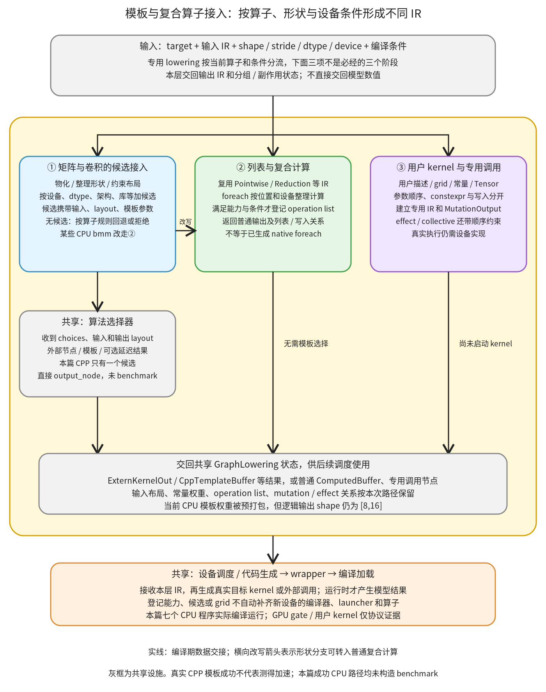

# 模板与复合算子接入：把专用算子接到候选、普通计算或专用调用 IR

```text
Inductor  本层完成
    └── Lowering  本层完成
        └── 专用算子路径  本层完成
            └── 模板与复合算子接入 ← 当前篇  本层完成
                ├── 矩阵与卷积的候选接入  待展开
                ├── 列表与复合计算  待展开
                └── 用户 kernel 与专用调用  待展开
```

<!-- child-links:start -->

<!-- child-links:end -->

[返回专用算子路径](../README.md)。本模块收到专用 target 与输入 IR，整理形状、布局和参数，再选择相应的接入方式：构造实现候选交给选择器，将复合/列表计算展开成已有 IR，或登记用户 kernel、effect、通信等专用调用。交回的是可继续调度的输出 IR 和状态，不是一个已经执行完毕的算子结果。

新设备需要检查这些具体消费路径。登记后端类、报告某项能力，只会满足部分条件；模板候选通常还有设备类型、dtype、形状、架构和依赖库条件。候选没有被构造出来，后面的选择器就无从选到它。

## 1. 整体流程：按算子和条件分流，不是所有算子都要调优



本层分成三个直接子模块：矩阵与卷积的候选接入、列表与复合计算、用户 kernel 与专用调用。三个分支共享普通表达式、物化、算法选择和设备 codegen，不复制这些模块的完整实现。

①以 GEMM/卷积等为代表，准备可生成或可调用的 choices，把候选、输入节点和输出 layout 交给[模板候选与方案选择](../../../04-codegen-runtime/01-kernels/README.md)中的选择器。②把一个高级调用展开成已有表达式，必要时登记列表分组。③建立带参数、grid、写入或顺序要求的专用 IR。一个算子也能因形状改走另一分支，例如 CPU 特定 bmm 直接分解。

选择器的调用名含 autotune，不代表本次实际 benchmark。下面的真实 CPU packed GEMM 只有一个候选，选择器直接取得 output_node，仍然生成并执行了 C++ 模板；另一组 CPU bmm 则连选择器都没有进入。

## 2. 三个子模块交接什么

### 2.1 矩阵与卷积的候选接入

输入是矩阵/卷积参数、IR 布局和编译配置。输出是候选实现对应的 TensorBox/模板/外部调用 IR，或明确的失败。它会物化输入、约束布局、登记后续模板所需常量和参数，但不在这里把候选名当成已测出的最快方案。

[mm_args](/work/pytorch/torch/_inductor/kernel/mm_common.py:416) 实现公共形状整理：先 realize 两个矩阵，取出 batch/m/n/k，约束两边 k 相等；无指定输出 layout 时建立包含 batch/m/n 的 FixedLayout，其他如 bias 的输入可以扩展到输出形状。特定变体还能处理转置权重和压缩尺寸，不是简单读取两个 Python shape 然后忽略 stride。

[tuned_mm](/work/pytorch/torch/_inductor/kernel/mm.py:159) 据此构造 ATen 外部调用、Triton、CUTLASS、CK、C++ packed GEMM 等候选。每类候选都带输入节点、输出 layout 与目标特有参数；模板构造器可能增加零个或多个合法候选。它们不是只换一个 backend 名字的同一份实现。

| 条件层 | 决定的事情 |
| --- | --- |
| 算子/形状 | 是否为非空、静态问题，是否可分解或需要特殊转置、bias、epilogue |
| 配置 | 是否启用相应调优/后端，是否允许无候选时回到 ATen |
| 设备/dtype/架构 | 该模板是否认识目标类型、数据类型与具体硬件条件 |
| 输入布局和常量 | 是否支持 stride，是否能预打包权重，动态维度能否表达 |
| 构造器本身 | 实际产出哪些 Caller，是否还有 workspace/预处理/后处理要求 |

例如 [use_triton_template](/work/pytorch/torch/_inductor/utils.py:1081) 当前不只是查询 TRITON_TEMPLATES 能力，还经过 `_use_template_for_cuda` 的 cuda 类型、dtype、调优和硬件条件。受控实验将硬件大小与能力查询都固定 True 后，实际 predicate 对 cuda:0 为 True，对 cpu、xpu:0、privateuseone:0 仍为 False；int64 也不符合本次 dtype 条件。这只验证现有 gate，未查询真实 GPU、未生成 GPU 模板。

[use_cpp_packed_gemm_template](/work/pytorch/torch/_inductor/utils.py:1215) 则检查 CPU、CPP 后端、weight_prepack、n/k 的静态条件、可用 micro GEMM、输入步长和权重是否为 module buffer 等。CPU 的成功不能推广成其他设备也能复用该类；改设备名也不会自动获得权重预处理和相应代码生成。

卷积还先规范化 stride/padding/dilation/groups，决定 channels-last 等布局；[convolution](/work/pytorch/torch/_inductor/kernel/conv.py:445) 的某些 1×1 情况可以改写到 mm，其余构造卷积候选。bmm/addmm/int_mm 等也有各自条件及 fallback 策略，不能把 tuned_mm 的所有规则一字不变套给其他家族。

①向选择器交出 `name + choices + input_nodes + output_layout`。选择器可直接返回外部实现 IR、模板 buffer，特定延迟选择路径也可返回 MultiTemplateBuffer；真正候选计时和选择缓存仍归选择器模块。

### 2.2 列表与复合计算

输入是复合 target 或 Tensor 列表，输出是已有 Pointwise/Reduction/Mutation 等 IR 组成的结果；必要时修改 GraphLowering.lists 和输出物化状态。

[tuned_bmm](/work/pytorch/torch/_inductor/kernel/bmm.py:107) 在两个输入均为 CPU，且 m=1 或 n=1 等条件下，将 bmm 变成广播乘法和 sum，而不是先造一个 GEMM 模板再强迫它执行。这是 lowering 的结构选择；之后普通元素/归约后端仍要支持新生成的动作。

[make_foreach_pointwise](/work/pytorch/torch/_inductor/lowering.py:548) 找到列表输入，将标量参数复制到相应列表长度，再按设备和动态形状条件分组，对每个位置调用已有 pointwise lowering。返回列表保留原输出顺序；某些使用者要求或 inplace 形式会使输出需要 realize。

只有当后端报告 FOREACH、当前组符合条件且本次要求物化输出时，才收集 operation 名称并调用 register_operation_list。这个登记不是已经生成或运行了一个 foreach kernel。正常 CPU 案例 GraphLowering.lists 为空，两个输出分别为 ComputedBuffer，仍能完整生成执行。

受控 Lowering 实验只把 FOREACH 的能力提供者改成 True，实际得到 `{'list_op0_op1':['op0','op1']}`，随后停止，没有让 CPU Scheduler 或 codegen 消费它。这证明能力标志的消费与列表登记，不证明当前 CPU 后端因此实现了 native foreach。后端对分组的具体融合/生成继续归调度与设备 kernel 模块。

[register_foreach_inplace](/work/pytorch/torch/_inductor/lowering.py:5960) 进一步调用 outplace 路径，逐项 mutate_to，交回 mutation IR 结果列表；它与 eager 某些 inplace 接口返回 None 的约定不同。已有[自动功能化包装分解](../../../01-graph-preparation/03-mutation/03-functional-wrappers/README.md)保留了完整 CPU 运行和输入更新证据，这里不重复归属同一段包装实现。

②的重点是复用已有语义并保留列表/写入关系。把算子拆成已有操作能否在新设备工作，仍取决于那个设备支持这些操作与分组协议，不能把“有分解”当作所有后端都可执行。

### 2.3 用户 kernel 与专用调用

输入可以是 kernel 注册表编号、grid、Tensor/常量参数，也可以是带 effect 或 collective 语义的 target。输出是相应专用 IR、原有 TensorBox 的引用和副作用约束，不一定新建一个独立输出 Tensor。

[triton_kernel_wrap_](/work/pytorch/torch/_inductor/lowering.py:6181) 从 side table 取常量参数，与 kwargs 合并，创建 UserDefinedTritonKernel，再返回 kwargs 中 TensorBox 项的映射。返回这些对象不表示所有参数都被写了；实际写入名单另由 identify_mutated_tensors 等分析提供，并建立 MutationOutput。

[UserDefinedTritonKernel](/work/pytorch/torch/_inductor/ir.py:5201) 物化 Tensor 输入、保存 device/grid/常量，按真实 kernel.arg_names 确定传参顺序。Autotuner 的配置参数可能没有显式出现在 raw_args 中，因此 codegen 要重算 constexpr 在实际参数列表中的位置，再交给 wrapper 定义/调用。源码直接依赖 Triton 描述、分析和 launcher 协议，不能换个设备注册类就视为任意用户 kernel 的通用接入。

其他专用调用还需要独立的顺序语义。[with_effects](/work/pytorch/torch/_inductor/lowering.py:6252) 通过 EffectfulKernel 和当前图 effectful_ops 保留相同 effect key 的前后关系；[collective lowering](/work/pytorch/torch/_inductor/lowering.py:6277) 则使用 _CollectiveKernel/WaitKernel，将启动到完成之间的读写约束带入 IR，某些路径还标记禁融 buffer。它们不是普通无副作用点函数，也不能只用“返回值看起来一样”判断可删除或可重排。

本篇用户 kernel 验证仅为显式替身描述下的真实 lowering/IR 协议；未运行 Triton、effectful 程序或通信。③的完整实现和这些特殊调用约束继续由子篇展开，与[外部调用与 fallback 协议](../01-external-fallback/README.md)共享通用参数、schema 和调用机制。

## 3. 主案例：CPU mm 怎样从外部实现换成真实 C++ 模板

### 3.1 普通 mm：一个 ATen 候选，输出 ExternKernelOut

A float32、shape `[2,3]`、stride `[3,1]`，值 `[[0,1,2],[3,4,5]]`；B 为 arange(12).reshape(3,4)/8，stride `[4,1]`，计算 relu(A@B)。

①得到 m=2、n=4、k=3，输出布局 `[2,4]/[4,1]`。本次只有一个 ExternKernelCaller(mm) 交给选择器，直接得到 ExternKernelOut，随后 relu 是普通 ComputedBuffer。实际结果为 `[[2.5,2.875,3.25,3.625],[7,8.5,10,11.5]]`。

候选名字是 mm，不等于本轮运行了多种 GEMM 计时。记录中的 make_benchmark_fn 调用数为零，外部实现和后续 C++ relu 仍真实执行。

### 3.2 常量权重与 CPP 后端：输出 CppTemplateBuffer

第二组输入 X 为 arange(128).reshape(8,16)/128，权重 W 为 arange(256).reshape(16,16)/256；二者 CPU float32、连续。W 被捕获为图常量，输入只有 X。配置开启 max_autotune_gemm，只允许 CPP，禁用 autotune_fallback_to_aten；本实验还将 cpp.threads 设为 1，使环境明确。

①看到符合条件的常量权重，加入一个 DataProcessorChoiceCallerWrapper，内部是 CppTemplateCaller，候选名 cpp_packed_gemm_0。这里的适配器不只转发名字，还把预打包权重与原算子的参数/输出接口接起来。

选择器接收 m=8、n=16、k=16 和输出 `[8,16]`，由于只有一个非 CUDA 模板候选，直接调用 output_node。IR 结果确实是 CppTemplateBuffer；随后代码生成得到真实 C++ GEMM 模板程序，完整编译运行，与预先计算的 eager 结果比较通过。

本机实际打包后的常量布局为 shape `[1,16,48]`、stride `[768,48,1]`，替代模板内部使用的普通 W 布局。48 来自这次 micro GEMM 的块/填充选择，不是所有 CPU、矩阵或新设备的固定值；逻辑输出仍为 `[8,16]`，原 W 数值保持不变。

这里有两个不同边界：本篇解释怎样把常量、候选与输出节点接上；实际权重打包、模板源码和 micro-kernel 内部完整实现归[设备 kernel 与方案选择](../../../04-codegen-runtime/01-kernels/README.md)。

该次 make_benchmark_fn 仍为零，不能把 max_autotune_gemm=True 写成“已测出此模板比 ATen 快”。证据仅证明单 CPP 候选被构造、变成模板 IR、生成并实际运行。完整源码：[mm_cpp_output.py](../../../experiments/template-integration/mm_cpp_output.py)。

## 4. 没有候选：拒绝与 fallback 都要看当前算子规则

在 CPU 上只配置 TRITON、开启 max_autotune_gemm 时，当前 gate 不会加入 Triton GPU 候选，也没有 ATen/CPP 候选：

| 算子与配置 | 实际交接与结果 |
| --- | --- |
| mm，autotune_fallback_to_aten=False | 空 choices 进入选择器，抛 NoValidChoicesError，经 GraphLowering 包装为 LoweringException |
| mm，autotune_fallback_to_aten=True | tuned_mm 在选择器前直接返回 ATen 外部输出节点，未调用选择器，完整执行通过 |
| bmm，autotune_fallback_to_aten=False，原始候选为空 | 当前 tuned_bmm 自己追加 ATen 候选，再交选择器，完整执行通过 |

这不是三种情况下都由选择器做同一条通用 fallback。专用 lowering 本身可以有不同策略；为新设备接候选时，也要确认空集、候选生成失败与选择器拒绝各由谁处理。

选择器还可以收到 return_multi_template 请求，但当前实现对 CPU 强制关闭延迟 MultiTemplate 路径。上面的 CPU 模板返回 CppTemplateBuffer，不是仅因请求字段为 True 就推断产生了 MultiTemplateBuffer。

## 5. 同一个 bmm，形状改变便跳过候选选择

CPU A shape `[2,1,3]`，B shape `[2,3,4]`，分别为 arange(6) 和 arange(24)/8 组成的连续 Tensor。①在 CPU 特定形状分支转入②：扩展维度、逐元素相乘，再沿 k 维 sum。

本次选择器调用记录为空，IR 只有 ComputedBuffer，真实结果为 `[[[2.5,2.875,3.25,3.625]],[[25,26.5,28,29.5]]]`。这不是“GEMM 模板的一个名字”，而是不同的 IR 计算结构。

把 m 从 1 改成 2，另一组 A shape `[2,2,3]` 则进入普通 bmm 候选路径，选择器接收一个 ExternKernelCaller(bmm)，返回 ExternKernelOut。两条路径都真实编译执行，输入保持、输出不与输入存储别名。

## 6. foreach：普通展开与能力分组的差别

真实 CPU 调用 `torch._foreach_add([x,y],2.0)`，x=`[[0,1,2],[3,4,5]]`、y=x+1，都是连续 float32。②对两个位置建立计算，返回两个输出：x+2 与 y+2，实际数值比较通过。

当前 CPU 后端没有报告 FOREACH，本次 GraphLowering.lists 为空、操作类型是两个 ComputedBuffer；列表形式的调用依然被编译了。这与“生成一个原生 foreach kernel”是不同结论。

对同一图，受控 Lowering-only 实验仅替换 FOREACH 能力提供者，登记 `list_op0_op1` 后立即停止。它给出新设备实现该能力时会消费的分组接口，但没有借此让一个尚不支持它的后端宣称支持。完整的组融合与启动要求继续由相应后端证明。

## 7. 用户 kernel 协议：参数顺序、constexpr 与写入分别确定

协议实验使用真实 triton_kernel_wrap_、UserDefinedTritonKernel 构造和 codegen，但明确替换 kernel 描述、identify_mutated_tensors 和 wrapper；输入是 CPU IR，未导入/编译/启动 Triton。替身 kernel 形式为：

```text
arg_names = [inp, out, BLOCK, scale]
constexprs = [2,3]
配置提供 BLOCK=64；显式 kwargs 提供 inp、out、scale=1
常量 side table 提供 scale=2
mutation 分析替身返回 [out]
```

③合并后 scale 为 2，因为当前实现把常量表展开在 kwargs 后。原函数中的 BLOCK 没有作为 raw_args 显式传入，实际有序参数是 `[inp,out,scale]`，所以 scale 的 constexpr index 从原签名的 3 改为实际调用列表的 2。

lowering 返回 inp/out 两个原 TensorBox 的映射，未为它们分配新结果；MutationOutput 则只对应 out。wrapper 接到的调用参数是 `['x_1','y_1',2.0]`、grid `[(1,1,1)]`、constexpr_indices `[2]`。没有任何 Tensor 参数时，真实构造器断言失败。

这验证 IR 接入层怎样传递描述，**不验证实际 Triton mutation 分析或 kernel 数值执行**；本机没有 Triton 包。新设备若复用或替换此类协议，仍要提供真正的编译、参数、grid 与运行实现，不能把替身事件当成设备已经接通。

with_effects 和 collective 的说明本篇以源码接口为依据：EffectfulKernel 对相同 effect type 增加前序依赖，collective/wait 保留完成前的 buffer 安全要求。没有运行 effect、分布式通信或 GPU 程序，不报告重叠率、加速或通信完成时间。

## 8. 证据与后续实现边界

完整实验：[template_integration.py](../../../experiments/template_integration.py)，结果：[results.json](../../../experiments/template-integration/results.json)；用户 kernel 协议：[user_kernel_protocol.py](../../../experiments/user_kernel_protocol.py)、[记录](../../../experiments/template-integration/user-kernel-protocol.json)。复现：

```bash
cd /work/pytorch
PYTHONPATH=/work/pytorch python3 /work/learning/gpt6-1sol/torch/compile/inductor/experiments/template_integration.py
PYTHONPATH=/work/pytorch python3 /work/learning/gpt6-1sol/torch/compile/inductor/experiments/user_kernel_protocol.py
```

七个完整 CPU 编译运行覆盖外部 mm、真实 CPP 模板、mm 无候选回退、bmm 两种结构及其空候选策略、foreach 普通展开；另有 mm 空候选拒绝、元信息设备 gate、能力登记和用户调用协议。没有虚构测时；所有完整 CPU 成功案例的 benchmark 构造次数为零。选择器内部、模板生成和编译工具链仍按已有归属继续展开，本篇不把接口打通当成这些实现已完整覆盖。
