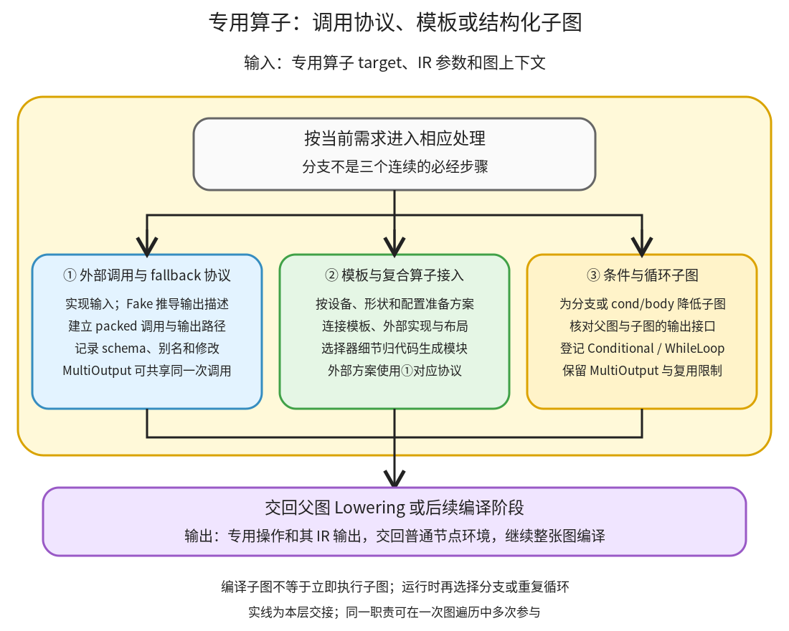

# 专用算子路径：用调用协议、模板和子图表达不能只当作点运算的计算

```text
Inductor  本层完成
    └── Lowering  本层完成
        └── 专用算子路径 ← 当前篇  本层完成
            ├── 外部调用与 fallback 协议  本层完成
            ├── 模板与复合算子接入  本层完成
            └── 条件与循环子图  待展开
```

<!-- child-links:start -->
直接子篇：[外部调用与 fallback 协议](01-external-fallback/README.md)、[模板与复合算子接入](02-template-integration/README.md)。
<!-- child-links:end -->

[返回 Lowering](../README.md)。本模块收到专用 target 和 IR 参数，构造外部调用、模板结果或控制流 IR，再将输出交回普通节点环境。它们都能与 Pointwise 配合，但不能都解释成一个可任意内联的元素 loader。

## 1. 三类交接分别解决什么问题



算子派发根据 target 进入相应路径：①保留一个外部实现的调用协议；②连接有专门生成方式的模板和复合算子；③把条件/循环的子图各自降低，并建立父图的运行时控制节点。它们的结果通过 IR 缓冲区或 MultiOutput 回到父图，随后可以继续参与普通计算。

三个分支不是三个必经阶段。模板选择也可能直接选外部实现；子图内部仍重复使用普通 Lowering、调度和生成，而不是把整个子图当作一条神秘指令。共享的物化、布局与符号状态仍通过当前 GraphLowering 访问。

入口见 [fallback_handler](/work/pytorch/torch/_inductor/lowering.py:1696)、[tuned_mm](/work/pytorch/torch/_inductor/kernel/mm.py:159)、[cond/while_loop lowering](/work/pytorch/torch/_inductor/lowering.py:6195)。

## 2. 三个模块接收与交出的对象

### 2.1 外部调用与 fallback 协议

已有专门外部调用的算子可以直接建立 ExternKernelOut/Alloc 等 IR。没有通用 lowering 的 target 还可能按注册和 config 走 FallbackKernel；FallbackKernel 是其中一套协议，不是所有外部计算的唯一表示。

它先将输入转换成可传给外部实现的稳定参数形式，再通过 FakeTensor 执行相关接口来推导输出结构、dtype、设备、布局和符号绑定。真正数值计算留到生成程序运行时完成，不是在 fake 阶段算出答案。

[FallbackKernel.create](/work/pytorch/torch/_inductor/ir.py:6108) 用 packed 调用对象代表底层算子，再为 Tensor 输出建立 MultiOutput，保留 tuple/list/dict 等索引路径；非 Tensor 允许类型有单独分支。两个 Tensor 输出可以对应一次库调用，不能按 MultiOutput 节点数认定调用了两次算子。

mutation、view 和可自动功能化的算子有各自 schema 约束，不能假定任何 Python 函数都可以直接 fallback。缺少合法输出描述、别名/写入协议或 FakeTensor 支持，编译可以失败。

调用缺少 lowering 且不允许隐式 fallback 时，会抛 MissingOperatorWithoutDecomp 等错误。允许 fallback 也不是无条件成功：已要求 decomposition 的算子可能触发注册冲突断言。①交出可调度的调用及输出 IR，并保留真实算子身份、参数结构和副作用需求。

### 2.2 模板与复合算子接入

矩阵乘、卷积等算子不仅需要“算什么”，还需要某种实现方案和布局要求。对应 lowering 构造候选并把输入、输出 layout、参数及约束交给选择器；结果可能是模板缓冲区、延迟选择对象或外部算子输出。

例如本地普通 CPU mm 可以选择 `extern_kernels.mm`，输出 ExternKernelOut，再被 relu 的 Pointwise 读取。GPU 的 mm 还可能准备 Triton/CUTLASS/CK 等候选，是否加入取决于设备、配置、形状与可用依赖，不在没有硬件证据时假定都存在。

模板调用会规定哪些输入要先实现、输出怎样索引，部分后处理还可参与 epilogue 融合。选择工作可能在 Lowering 阶段发生，或借助后面的调度判断完成；不能强行画成 Scheduler 之后才开始的一次固定调用。

②拥有专用算子如何接上 IR 的接口；选择器内部、模板源码和编译工具链归属[代码生成与运行封装](../../04-codegen-runtime/README.md)，子篇按这个共享边界链接。没有重复建立另一份同一算法选择实现。

### 2.3 条件与循环子图

收到 predicate、子图引用和操作数后，[Conditional.create](/work/pytorch/torch/_inductor/ir.py:6475) 先实现输入，再为尚未降低的 true/false 子图建立各自 GraphLowering，读取其输出接口并检查相应结构条件。父图登记 Conditional 和按位置取得结果的 MultiOutput。

编译时两个分支都可能被降低，不等于一次正式调用会把两个分支都执行。生成 wrapper 的条件结构在运行时根据 predicate 选择一个分支。

[WhileLoop.create](/work/pytorch/torch/_inductor/ir.py:6591) 则区分 carried_inputs 与 additional_inputs：前者每轮由 body 输出更新，后者作为不变参数传给 cond/body。条件子图必须返回一个 bool 标量 Tensor；body 输出要与 carried_inputs 在尺寸、stride、device、dtype、offset 等方面满足实现约束。

零次循环时，结果可能就是原 carried 输入，因此父图还登记 never_reuse_buffers，防止后续把可能别名输入的输出缓冲区当成可任意覆盖的独立临时量。③交出的包括控制节点、子图、输出引用和复用限制，不只是“while 的最后一个数值”。

当前实现对控制流有别名和结构限制，不能把它当作任意 Python 分支/循环的通用解释器。GPU 控制流还会影响 CUDA Graph 可用性；本篇只实际运行 CPU。

## 3. 主案例：没有 lowering 的双输出算子怎样进入同一张图

实验在独立进程注册一个教学算子，不修改 PyTorch 文件：

```text
pair(Tensor x) -> (Tensor, Tensor)
CPU 实现：return (x+1, x*2)
Fake 实现：返回两个 shape/dtype/device 与 x 相同的新 FakeTensor
调用图：a,b=pair(x); return (relu(a),b)
x = [-2,0,3]，CPU float32，shape=(3,)，stride=(1,)
```

**派发时禁止 fallback。** 这个算子没有 lowering 或 decomposition，`implicit_fallbacks=False` 下真实编译抛出 MissingOperatorWithoutDecomp。没有进入正常程序返回路径。

**允许 fallback 后进入①。** 重新编译时，系统为 target 登记 fallback handler，处理输入并用 Fake 实现推导两个输出。这里不会在假属性推导时真正计算 `[-1,1,4]` 和 `[-4,0,6]`。

真实 [Lowering 产物](../../experiments/special-ops/fallback_root_lowered.txt) 的操作类型为：

```text
FallbackKernel
MultiOutput（pair 的第 0 项）
MultiOutput（pair 的第 1 项）
ComputedBuffer（relu(pair 第 0 项)）
```

两个 MultiOutput 指向同一次 packed 调用，不是两个 pair。第一项结果交给普通 relu loader，第二项直接进入图输出；物化与调度继续维护它们的顺序和接口。

**生成并运行。** [生成程序](../../experiments/special-ops/fallback_output.py) 调用已注册的 pair，再运行 C++ relu。实际返回 `([0,1,4],[-4,0,6])`，输入不变，两项输出不共享输入存储。这个例子说明 fallback 可以是编译图的一部分，不等于整张图自动退出 Inductor。

## 4. 条件案例：编译两个子图，运行时只选一条

CPU predicate 是 bool 标量 Tensor；x 为同样的 float32 三元素输入：

```text
true 分支：return (x+1,)
false 分支：return (x*2,)
父图：return cond(predicate, true_fn, false_fn, [x])
```

**③收到父图。** get_attr 取得的两个 Subgraph 与输入 IR 一起交给 Conditional.create。两张子图分别降低为一个 ComputedBuffer，父图只有 Conditional 与相应 MultiOutput，不把两条表达式无条件合成一个加乘结果。

**③交出结构。** 两条分支的输出都为 shape `(3,)`、stride `(1,)`、CPU float32。父图保存子图引用与输出接口；两份计算源码进入程序。

**执行时分支。** [真实 wrapper](../../experiments/special-ops/cond_output.py) 有 `if p_1.item(): ... else: ...`。同一个编译结果在 predicate=True 时返回 `[-1,1,4]`，False 时返回 `[-4,0,6]`；两次输入均不变。

这验证两条 CPU 运行路径和同一编译程序的复用，不证明任意子图别名都被正确接受或拒绝。本版 Conditional.create 的别名检查具体引用 true_outputs，不能从存在检查这一点推定 false 分支的所有别名情况也已覆盖；完整条件将在子篇逐行核对。

## 5. 循环案例：三次与零次的输出身份不同

carried 输入 i 为 CPU int64 标量，x 为 CPU float32 `(3,)`；没有 additional_inputs：

```text
cond(i,x): i < 3
body(i,x): return (i+1, x+1)
```

**③建立接口。** 条件子图产生 bool 标量；body 产生新的 i/x，结构与 carried 输入一致。父图登记 WhileLoop、两个 MultiOutput；记录中对应的两个输出名字进入 never_reuse_buffers。

**运行三次。** 初始 i=0，条件依次对 0、1、2 为真，3 为假，输出 i=3、x=`[1,3,6]`。输出不与原 i/x 共享存储，原输入保持不变。

**运行零次。** 初始 i=3，第一次条件即假，输出值为 i=3、x=`[-2,0,3]`；两项输出分别与原 i/x 共享存储。不是仅仅数值相同，而是生成程序保留了零次循环可返回输入本身的身份关系。

[真实 wrapper](../../experiments/special-ops/while_output.py) 先将输入放入 carried 列表，在 while True 内执行条件子图，假时 break，真时执行 body 并替换列表；最后按位置取得输出。编译阶段构造一次 body 程序，运行阶段按实际条件反复使用，没有为三次迭代复制三套静态节点。

这些输出、别名与输入保持都与原高阶算子执行对照通过。脚本 [special_ops.py](../../experiments/special_ops.py) 直接使用高阶算子构造单图，没有拿上游捕获流程充当 Inductor 内部说明；证据见 [results.json](../../experiments/special-ops/results.json)。

## 6. 下一层问题

外部协议子篇继续解释参数展平、输出索引、schema 与写入；模板接入子篇解释具体算子如何准备候选和 IR 结果；控制流子篇完整解释子图作用域、接口检查、父图登记和零次循环复用限制。GPU 模板调优、通信与专用高阶算子仍在后续覆盖范围，当前 CPU 案例不代表这些路径已验证。
