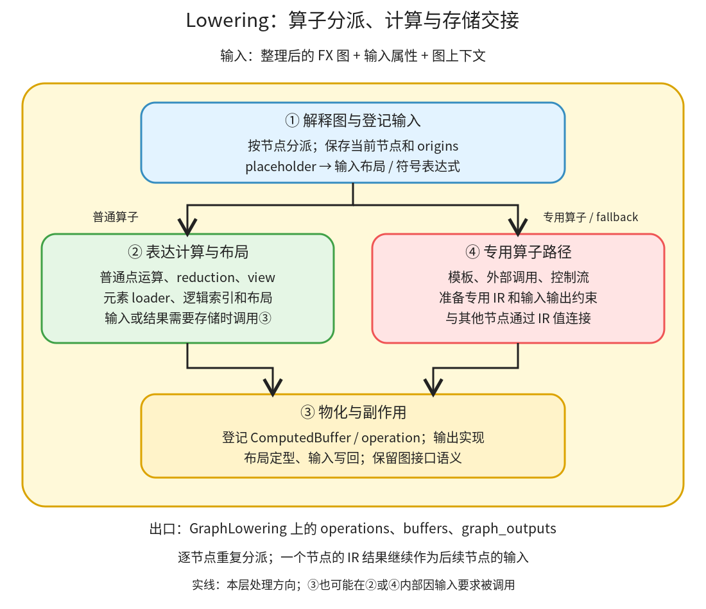

# Lowering：用元素表达式和布局建立计算、存储与副作用

```text
Inductor  本层完成
    └── Lowering ← 当前篇  本层完成
        ├── 解释图与登记输入  本层完成
        ├── 表达计算与布局  本层完成
        ├── 物化与副作用  本层完成
        └── 专用算子路径  本层完成
```

<!-- child-links:start -->
直接子篇：[解释图与登记输入](01-interpretation/README.md)、[表达计算与布局](02-expressions/README.md)、[物化与副作用](03-materialization/README.md)、[专用算子路径](04-special-ops/README.md)。
<!-- child-links:end -->

[返回 Inductor](../README.md)。Lowering 接收经过图准备的 FX 图，逐节点构造 Inductor IR，把“调用 add、relu、mm”等关系变成输入缓冲区、元素表达式、布局、外部计算和输出需求。最重要的出口是 `GraphLowering` 对象上的状态，而不是 `run()` 的 Python 返回值。

## 1. 内部主线和分支



普通算子沿①→②→③流动；模板、外部调用和子图算子按 target 分派到④，与其他节点通过 IR 输入输出连接。④是条件路径，不是每个普通点运算之后都必须执行的阶段。

[GraphLowering.run](/work/pytorch/torch/_inductor/graph.py:778) 调用 FX Interpreter 逐节点处理。[run_node](/work/pytorch/torch/_inductor/graph.py:1268) 包围每次派发，保存当前节点和来源信息，处理特定布局或 fallback 条件。placeholder 登记输入；call_function 调用 lowering 表或模式生成的 lowering 函数；get_attr 取得常量；output 完成结果实现和输入修改处理。

遍历过程中的中间值放在 Interpreter 的节点环境里。对普通张量，它可能是包着计算表达式的 `TensorBox`，并不意味着已经有一块真实 Tensor 内存。遇到必须保存、供外部算子读取或返回的值，才由③将计算登记为有名字的存储和操作；最后 Scheduler 收到 `graph.operations`，继续访问图上的布局、输入和输出。

## 2. 四个模块的接口

### 2.1 解释图与登记输入

这个模块收到 FX 节点和示例参数，依次分派。张量输入变为 `TensorBox(StorageBox(InputBuffer(...)))`；InputBuffer 的 FixedLayout 保存 device、dtype、shape 和 stride。比如 `(2,3)`、stride `(3,1)` 的位置 `[1,2]` 对应元素偏移 5。

`TensorBox` 提供张量式的句柄，`StorageBox` 持有当前计算或存储对象；内层对象可在物化时更换，而使用这个 box 的地方仍能指向更新后的对象。这是源码结构带来的效果，不要将 box 与实际 GPU/CPU 内存等同。

符号数值输入则转换为 SymPy 表达式，登记到 `graph_inputs`；`None` 和某些专用状态参数有各自分支。`get_attr` 对小常量可能内联为标量或元素计算，对其他常量登记图常量。此时保留的状态包括输入顺序、原始输入缓冲区映射、符号与常量。

交出的结果是后续节点可引用的 IR 值。入口职责还记录当前 FX 节点及 origins，使后续一个合成表达式仍能追溯到多个原算子。依据：[placeholder](/work/pytorch/torch/_inductor/graph.py:922)、[常量](/work/pytorch/torch/_inductor/graph.py:1035)、[TensorBox](/work/pytorch/torch/_inductor/ir.py:6330)。

普通 Inductor 单图期望已降低为函数调用形式；`call_module` 与 `call_method` 在此实现中直接断言失败。不能把任意未经准备的 FX 图送进来，并期待该层自行处理整个 Python Module。

### 2.2 表达计算与布局

普通算子通过 [lowerings 注册](/work/pytorch/torch/_inductor/lowering.py:372) 找到对应函数。点运算常由 [make_pointwise](/work/pytorch/torch/_inductor/lowering.py:458) 创建：先取得输入的 loader，再定义“给定逻辑 index，读取这些输入并计算一个结果”的 `inner_fn`。

例如 `b=x+y; c=relu(b)`：如果 b 仍是未物化的 Pointwise，读取 b 就可调用它的元素计算，而不是发出从 `buf_b` 加载的操作。于是 c 的元素表达式可以直接包含 x、y 的加载和加法。这解释了总篇案例为什么在 Scheduler 之前就只有一个 ComputedBuffer。

view 用不同逻辑索引解释同一份存储；reduction 则额外描述被消去的维度与组合运算。它们和 pointwise 都需要布局和索引，但不必使用同一 IR 类。不能把“FX 中出现 sum”直接推定为出口一定是 `Reduction`：小静态归约可能在这里展开成点表达式。

本模块交给③的是计算描述和逻辑布局需求；必要时也会先触发输入的物化，再生成读取缓冲区的表达式。布局可能仍有待选择的自由度，最终输出约束、外部算子要求和调度会逐步确定它。依据：[Pointwise loader](/work/pytorch/torch/_inductor/ir.py:626)、[Reduction](/work/pytorch/torch/_inductor/ir.py:769)、[FixedLayout](/work/pytorch/torch/_inductor/ir.py:3081)、[FlexibleLayout](/work/pytorch/torch/_inductor/ir.py:3117)。

### 2.3 物化与副作用

这个模块收到一个需要有稳定存储身份的表达式或布局视图，建立可调度的操作。在 [StorageBox.realize](/work/pytorch/torch/_inductor/ir.py:6348) 中，尚未物化的 Pointwise/Reduction 等被包为 `ComputedBuffer`，注册缓冲区名字与 operation，替换 StorageBox 内部对象。已经是 InputBuffer、ComputedBuffer、模板缓冲区等则返回已有名字。

例如要把 `x+y` 交给矩阵乘，矩阵乘接口需要实际张量参数，不能接收一个任意 Python 元素回调。Lowering 先登记 `x+y` 的存储需求，再把其缓冲区引用交给外部计算。这里“物化”仍是**构造未来程序的存储和计算节点**；真正分配输出 Tensor 的代码在 wrapper 执行时运行。

[output](/work/pytorch/torch/_inductor/graph.py:1075) 将所有返回值变为可交付的 IR 输出，处理输出 stride 匹配，登记 `graph_outputs`；同时检查输入的 StorageBox 是否已经指向新值，必要时建立写回原始输入缓冲区的操作。这些是可观察语义，不能只保留最终数值。

如果返回 view，可能只需要布局重解释；如果返回 clone，则要保留独立存储；如果修改输入，即使新值不作为普通输出返回，也需要副作用。模块交给调度的不只是结果表达式，还包括这些存储和读写需求。

### 2.4 专用算子路径

矩阵乘、模板、外部算子和控制流不是都拆成通用 Pointwise。相应 lowering 接收 IR 输入和布局需求，可能建立外部调用，也可能准备模板候选；它们的输出再被普通节点引用。

例如本地 CPU `x@y` 返回 `ExternKernelOut`，含输入缓冲区、输出布局和 `extern_kernels.mm` 调用身份；后接的 relu 是读取 mm 输出的 Pointwise。上层图仍是一张图，生成时却要先运行库调用，再运行自生成 kernel。

缺少直接 lowering 时，[call_function](/work/pytorch/torch/_inductor/graph.py:981) 按允许列表与配置建立 fallback；若禁止或无法处理，则抛出相应异常。专用路径不是兜底保证所有算子成功。矩阵乘的典型入口见 [tuned_mm](/work/pytorch/torch/_inductor/kernel/mm.py:159)；方案构造在本模块解释其 IR 接口，具体生成和编译机制归属代码生成模块，避免重复覆盖。

## 3. 主案例：mm 输出怎样成为 relu 的输入

输入均为 CPU float32：

```text
x shape=(2,3)，stride=(3,1)
  [[-2,-1,0], [1,2,3]]
y shape=(3,2)，stride=(2,1)
  [[1,2], [3,4], [5,6]]
return (relu(x@y),)
```

**① 收到图。** placeholder x_1/y_1 登记各自 FixedLayout。节点环境中有两个输入 TensorBox；真实数据仍由调用者持有。

**④ 处理 mm。** 矩阵乘 lowering 收到这两个 IR 输入，构建形状 `(2,2)`、stride `(2,1)` 的外部输出 buf0。实际采集的 [IR](../experiments/stages/mm_lowered.txt) 包含：

```text
ExternKernelOut(
  name='buf0',
  inputs=[InputBuffer('x_1'), InputBuffer('y_1')],
  layout=FixedLayout(cpu, float32, size=[2,2], stride=[2,1]),
  python_kernel_name='extern_kernels.mm',
  cpp_kernel_name='at::mm_out'
)
```

上面是保留关键字段的化简，完整表示在链接文件中。这时登记的是未来的 mm 调用，没有在 Lowering 阶段算出 `[[-5,-8],[22,28]]`。

**② 处理 relu。** relu 收到 buf0 的 IR 引用。其元素计算为读取 buf0 偏移 `2*i0+i1`，返回 relu 值。它不能把外部 mm 直接当成任意可内联的元素 loader。

**③ 处理 output。** 图输出要求 relu 结果可交付，因而登记 buf1 的 ComputedBuffer。Lowering 出口可概括为：

```text
graph_inputs: x_1、y_1
operations:
  op0: 外部 mm → buf0
  op1: 读取 buf0，relu → buf1
graph_outputs: buf1
```

**交给 Scheduler。** 调度保留 op1 对 buf0 的依赖；最后程序分配 buf0，调用 `extern_kernels.mm`，再处理 relu。CPU 实际输出 `[[0,0],[22,28]]`，输入保持不变。生成 kernel 数为 1，仅统计自生成的 relu，不包含已存在的矩阵乘库实现。

这条链展示了图内部普通表达式和专用算子如何汇合：输入 IR → 专用输出 buffer → 普通 loader → 最终输出 operation；不存在“只要进入 Inductor 就全部改写成一个 kernel”的保证。

## 4. 对照：小 sum 与大 sum 的出口不同

同样计算 `(x+y).sum(1)`。当输入是 `(2,3)`，本地采集的 [IR](../experiments/stages/reduction_lowered.txt) 是一个 Pointwise，而不是 Reduction。它对每一行展开三组输入加载与加法：

```text
row0 = (-2+1) + (-1+1) + (0+1) = 0
row1 = ( 1+1) + ( 2+1) + (3+1) = 9
```

[Reduction.create 的小归约分支](/work/pytorch/torch/_inductor/ir.py:1161) 判断静态归约元素数小于阈值时，调用展开函数并返回 Pointwise。因此“sum 是归约语义”成立，但“出口总要有归约循环”不成立。

改变为 CPU float32 `(2,64)` 连续输入，`x=arange(128).reshape(2,64)`、`y=ones(2,64)`，需要分别累计 64 项。其 [Lowering 产物](../experiments/stages/reduction_large_lowered.txt) 保留 `Reduction`，输出尺寸 `[2]`，归约尺寸 `[64]`，运算类型为 sum。实际结果为 `[2080,6176]`。

这两个分支都先在①登记相同类型的输入，②按归约规模选择表达形式，③登记输出，最后交给同一 Scheduler；区别不需要改动图的外部接口。这里的展开是否更快没有做计时，正文只报告源码选择与真实产物。

## 5. 状态如何保留、下一层打开什么

Lowering 的每次派发既产生节点环境中的值，也可能修改 `graph_inputs`、`buffers`、`operations`、`constants`、`graph_outputs` 和输入写回状态。只保存一个“最后的 TensorBox”会丢掉整张图的执行需求；只保存 operations 也缺少完整的运行接口。

四个子篇将依次解释派发及符号、普通计算和布局、物化与副作用、专用算子和控制流。当前的证据覆盖 CPU 点运算、view、clone、两种归约规模、矩阵乘和多个输出；动态符号、输入写回、子图和 GPU 模板仍待进一步源码和实验展开。完整复现脚本为 [stages.py](../experiments/stages.py)。
