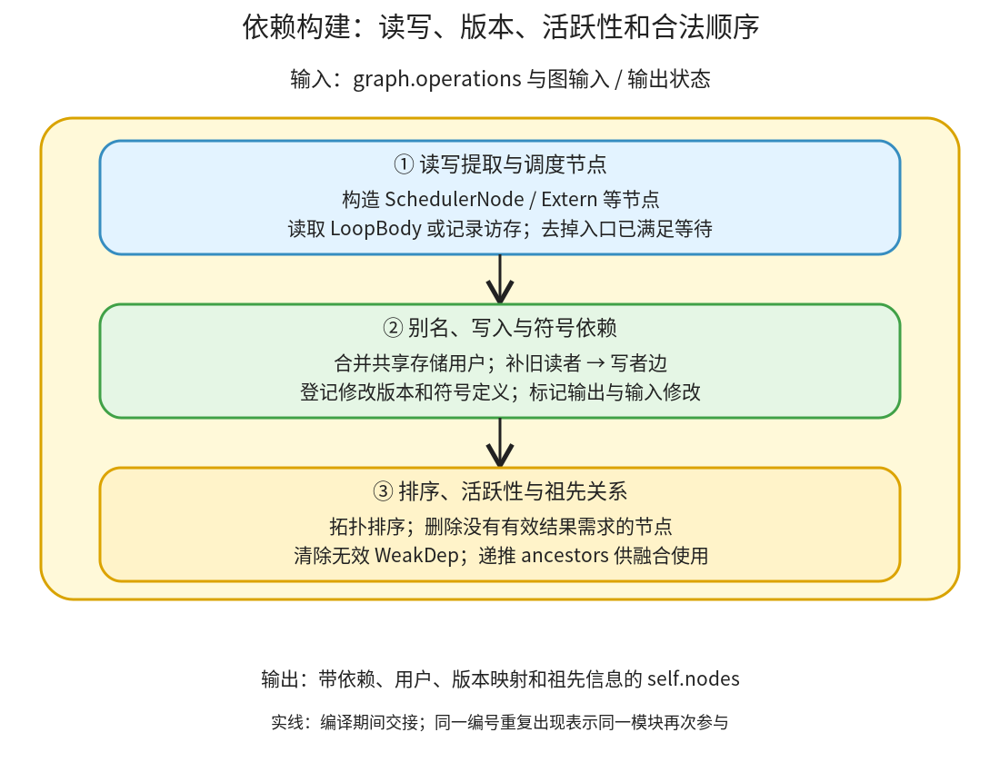

# 依赖与合法顺序：从访存表达式建立数据边，再补齐写入、别名和符号约束

```text
Inductor  本层完成
    └── 调度与融合  本层完成
        └── 依赖与合法顺序 ← 当前篇  本层完成
            ├── 读写提取与调度节点  待展开
            ├── 别名、写入与符号依赖  待展开
            └── 排序、活跃性与祖先关系  待展开
```

<!-- child-links:start -->

<!-- child-links:end -->

[返回调度与融合](../README.md)。本模块收到 Lowering 登记的 operations，把每项操作的读写、输出和使用者连接起来，补上普通数据流没有表达的写入顺序及符号依赖，再交出合法且仍有用的调度节点集合。图输入在入口已可用，内部缓冲区则必须等待定义它的操作。

## 1. 三个模块怎样建立可调度的图



①先按 IR 类型建节点，提取读写信息，建立名称索引并删除入口已满足的等待项。②将输出缓冲区和使用者关联起来，对别名共享使用者关系，对修改引入版本名和顺序边，对运行时产生的符号补定义到使用的边。③按依赖排序、删去无用操作、移除已无意义的 WeakDep，再计算祖先和顺序区间。

具体调用在 [Scheduler._init](/work/pytorch/torch/_inductor/scheduler.py:1733) 和 [compute_dependencies](/work/pytorch/torch/_inductor/scheduler.py:1898)。输出、输入修改和有副作用的操作必须活跃，不能仅按普通返回值的数据边删节点。

结果保留在 self.nodes、read_writes、unmet_dependencies、buffer.users、name_to_node/name_to_buf、mutation 映射和 ancestors 上。不是返回一个只有边列表、没有原 IR 与布局的孤立图。

## 2. 三个模块分别接收与交出什么

### 2.1 读写提取与调度节点

收到 ComputedBuffer、模板、外部调用等 IR 后，创建相应 SchedulerNode。普通节点的循环体经 simplify_and_reorder 取得逻辑范围与 LoopBody，再用 [extract_read_writes](/work/pytorch/torch/_inductor/dependencies.py:561) 记录加载、写出与索引表达式；外部节点保留其调用协议可提供的依赖。

依赖类型不能互换：

| 表示 | 表达的关系 | 例子 |
| --- | --- | --- |
| MemoryDep | 带循环索引和范围的缓冲区访问 | 读取 x[c0]，c0 范围 0～3 |
| StarDep | 对整个缓冲区/对象的依赖，不给出元素索引 | 外部 mm 读取输入张量 |
| WeakDep | 为写入顺序插入的约束，不表示读取其结果数据 | copy 写 x 必须等先前 x 的读者 |

例如 Pointwise 的 loader 读 x 偏移 `3*i0+i1`，会形成相应 MemoryDep。提取阶段让表达式在记录 handler 下运行，或直接读取 LoopBody 的访存记录；不执行真实 Tensor 数值，也不逐个硬件元素跑一遍循环。

`read_writes.reads` 是完整读取/约束集合；`unmet_dependencies` 去掉入口已可用的数据。x 在 graph_inputs 时不需要等待另一个内部节点，所以它仍在 reads，却不在 unmet 中。空 unmet 不代表算子没有输入。

①将节点、输出缓冲区索引和这些集合交给②。循环归一化可能改变索引变量表达形式，因此日志中的 c0 不必与 Lowering 的 i0/i1 一一对应；访存位置与范围的含义仍需保持。

### 2.2 别名、写入与符号依赖

②先为共享存储的输出名字合并使用者列表。不能因为名字不同就假定底层存储独立，也不能只看 FX 原始 args 边来判断所有读写冲突。

处理某个修改 operation 时，它需要等待之前的写者，还需要等待所有此前读取旧版本的节点。后者通过 WeakDep 表达；再给修改后的存储分配依赖图中的新版本名，后续读者连接到新版本，避免把修改前后混成同一个环。

`mutation_renames` 表达“当前版本叫什么”，`mutation_real_name` 保留“生成程序最终写哪个真实缓冲区”。例如修改原输入 x_1 的 operation 产生 buf1，那么新版本映射可为 x_1→buf1，实际存储映射为 buf1→x_1。编译图里有新名字不代表运行时凭空多分配一份被修改输入。

运行时产生的 unbacked 符号另有定义/使用映射。例如某项数据依赖操作产生 n，后续分配用到 n，即使两者没有普通 Tensor 数据边，也需要等待 n 的定义节点；来自图输入的符号不需要为内部生产者建立同样等待。

图输出和符号输出会加上相应输出使用者，输入修改也被登记为应保留的需求。②交给③的是补齐后的节点/用户关系，同时把 mutated_inputs 和输入索引写回 GraphLowering，供 CompiledFxGraph 与运行适配使用。

### 2.3 排序、活跃性与祖先关系

[topological_sort_schedule](/work/pytorch/torch/_inductor/scheduler.py:2141) 根据内部未满足依赖，将定义节点放到使用节点前面；只考虑传入节点集合内部的边，不把图输入当成另一个待排节点。

[dead_node_elimination](/work/pytorch/torch/_inductor/scheduler.py:2104) 从后往前看输出缓冲区的使用者。只有 WeakDep 或已移除使用者的结果，不能单靠这些顺序关系强行保留死计算；但有有效用户或副作用的操作需要保留。删掉节点后，剩余节点还要 prune_weak_deps。

例如一个旧值读取后来根本不返回，也没有参与任何活跃结果，它只被写者等待。这项读取可以删，写者不必继续等待它。WeakDep 的“弱”是这种活跃性上的意义，不是调度运行时可以任意忽略它。

随后 [compute_ancestors](/work/pytorch/torch/_inductor/scheduler.py:2214) 根据已排好的依赖递推祖先集合，给融合判断和顺序约束使用。融合若使间接先后关系被破坏，即便两个局部循环形式相同也不能合并。

这里的排序、另一种分层排序、以及图准备的 stable_topological_sort 是不同函数，不能把某个函数的断言或行为直接套给所有拓扑处理。本篇关注实际调用主线，不宣称每个排序 helper 都独自检测所有非法输入。

## 3. 主案例：为什么 copy 要等待一项它并不读取的 buf0

CPU float32，shape `(4,)`、stride `(1,)`：x=`[0,1,2,3]`，y=`[9,9,9,9]`。

```python
old = x + 1
x.copy_(y)
return (old, x)
```

**①提取访存。** Lowering 提供两个 ComputedBuffer：buf0 计算旧 x+1；buf1 带 MutationLayout，内容来自 y，写入目标是 x。仅看元素计算，buf1 并不加载 buf0。

**②补入顺序。** 当 buf1 的修改被处理时，x 已有旧读者 op0。真实 [依赖记录](../../experiments/expressions-storage/copy_old_dependencies.txt) 的关键内容是：

```text
op0:
  reads  = MemoryDep(x_1, c0, {c0:4})
  writes = MemoryDep(buf0, c0, {c0:4})
  users(buf0) 包含 OUTPUT 和写者的 weak user
op1:
  reads  = MemoryDep(y_1, c0, {c0:4})
           StarDep(x_1)
           WeakDep(name=buf0, mutating_buf=buf1)
  writes = MemoryDep(buf1, c0, {c0:4})
  mutation target = x_1
```

图输入 x/y 已可用，所以 op0 的 unmet 为空；op1 的 unmet 则包含对 buf0 的 WeakDep。含义是：即使 op1 不读 buf0 的数值，也必须先让 op0 读取旧 x，才可覆盖 x。

同时记录：

```text
mutation_renames   = {x_1: buf1}
mutation_real_name = {buf1: x_1}
mutated_inputs    = [x_1]
mutated_input_idxs = [0]
```

**③保留两个活跃操作。** buf0 是返回值，有真实输出用户；修改后的 x 也是接口需求。两者都不能删除，顺序必须先旧读后写入。再计算 ancestors，把这个先后关系交给融合与生成。

**实际程序。** C++ 函数先完整运行 x+1 循环写 buf0，再运行 y→x 的 copy 循环；wrapper 返回 `(buf0,x)`。结果 `([1,2,3,4],[9,9,9,9])`，输入 x 修改正确，第一项不别名 x，第二项别名 x。若把 WeakDep 当作可随意忽略，old 就可能读到新值。

## 4. 删除旧值观察，WeakDep 也应随之删除

改为：

```python
unused = x + 1
x.copy_(y)
return (x,)
```

Lowering 为写入保护登记了旧读计算，②最初仍建立 op0→op1 的 WeakDep。[依赖建立后的采集](../../experiments/expressions-storage/dead_old_dependencies.txt) 显示，buf0 的唯一用户是 op1 的 weak user，没有 OUTPUT。

③反向活跃性检查发现 op0 没有真正结果用户、也无自身副作用，删除它。随后清除 op1 的 WeakDep；[进入融合前](../../experiments/expressions-storage/dead_old_before_fusion.txt) 只剩写入节点，unmet 已为空。

实际输出和调用后的 x 均为全 9；旧 x+1 不在最终程序中。弱边既保证活跃旧读不会越过写入，又避免死读仅因为写者曾等待它就永久保留。

## 5. 不返回被修改输入，也不能删掉修改

再改成 `x.copy_(y); return (y+1,)`。普通 graph_outputs 不含 x，但②仍把输入修改当作需要观察的接口效果，写入节点有保留需求。生成程序同时完成修改和全 10 的返回结果；metadata 的 mutated_input_idxs 仍是 `[0]`。

这个分支说明活跃性的根不只有普通输出。相反，仅有 WeakDep 的死旧读不构成保留理由；二者在③的判断中区别明确，不能用“都没有普通输出”混为一谈。

## 6. 当前证据与下一层

CPU 实验证据包含真实读写集合、WeakDep、修改版本、DCE 前后节点及生成代码；复现 [expressions_storage.py](../../experiments/expressions_storage.py)。其他已有 mm 案例展示 StarDep，普通点运算展示 MemoryDep。

符号定义边和复杂别名合并目前依据源码说明，尚未用专门 unbacked/外部 view 运行案例验证；不能把当前写入案例说成覆盖所有符号与别名情况。三个子篇将完整打开记录 handler、使用者和版本规则、活跃性及祖先算法。WeakDep 的大小提示也只是排序/估算接口值，不应当作实际加载了一个元素或一个字节的带宽证据。
