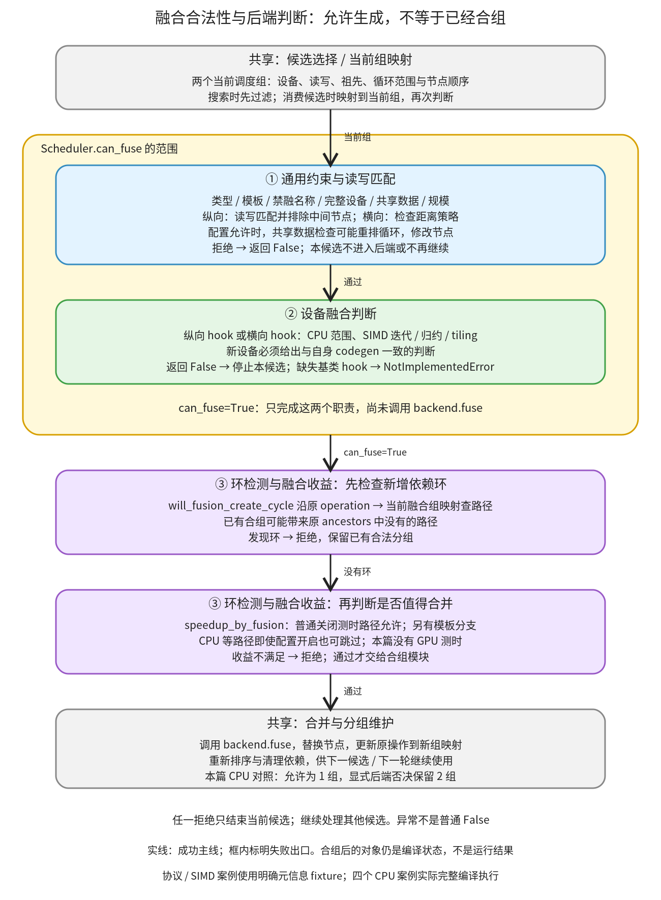

# 合法性与后端判断：确认两个调度组能否共同生成，再决定是否合并

```text
Inductor  本层完成
    └── 调度与融合  本层完成
        └── 融合与分组  本层完成
            └── 合法性与后端判断 ← 当前篇  本层完成
                ├── 通用约束与读写匹配  待展开
                ├── 设备融合判断  待展开
                └── 环检测与融合收益  待展开
```

<!-- child-links:start -->

<!-- child-links:end -->

[返回融合与分组](../README.md)。本模块收到候选的两个调度组，读取它们的设备、读写、未满足依赖、祖先和循环范围，依次检查通用限制、设备后端能力、合组后的环和可选收益。它交回允许或拒绝；真正创建融合组、更新名称映射和重新排序由“合并与分组维护”负责。

支持新设备时，需要提供的不是一个笼统的“支持 fusion”标志。调度器分别调用后端的纵向、横向判断，后端必须确认自己的循环、归约、模板及 launcher 能生成该组合；通用层不会替新后端证明这些事情。反过来，后端返回 True 也不能绕过通用的设备、依赖和环约束。

## 1. 整体流程：通过 can_fuse，还没有真正合组



本层三个直接子模块是：通用约束与读写匹配、设备融合判断、环检测与融合收益。灰框中的候选选择和合组维护已有独立归属。

[候选搜索](../README.md) 会先调用 can_fuse 过滤候选；实际消费候选的 [fuse_nodes_once](/work/pytorch/torch/_inductor/scheduler.py:2535) 又把旧节点映射到当前组，重新调用 can_fuse。组可能在先前候选处理期间改变，所以第二次判断不能省略。

can_fuse 内先经过①；纵向分支还要求读写合法，再调用②；横向分支经过存储策略限制，再调用②。can_fuse 返回 True 后，外层才运行③的环检测和收益检查。全部通过后，另一个模块调用 backend.fuse 并更新组映射。

这些接口处理的是编译器对象和布尔判断，不是 kernel 的数值输出。还有一项状态变化容易忽略：开启相应配置时，①寻找共享数据的过程可能重排节点循环。因此 can_fuse 并非在所有配置下都只是读取状态的纯谓词。

## 2. 三个子模块的输入、输出与状态

### 2.1 通用约束与读写匹配

输入来自候选生成/当前组映射：node1、node2 都可能已含多个原节点。主要数据包括：

| 数据 | 用来判断什么 |
| --- | --- |
| device | 完整 torch.device 是否相同，包括 index |
| operation names 与 ancestors | 顺序方向、纵向关系和中间节点 |
| read_writes、unmet_dependencies | 消费者读的位置是否由组内生产者提供 |
| buffer names 与 no_fuse_buffer_names | 显式禁融要求是否命中 |
| 原始节点数与 min/max_order | 规模和距离策略是否允许 |

[Scheduler.can_fuse](/work/pytorch/torch/_inductor/scheduler.py:2880) 按源码顺序拒绝同一对象、Grouped 节点、非模板 extern/nop、方向颠倒的依赖、模板作为消费者、不满足 epilogue 条件的模板生产者、显式禁融 buffer、不同设备等。随后检查共享数据与规模，再分纵向/横向。

“两个节点都读 x”只是候选入口。共享数据 score 使用实际依赖，不是只比较 buffer 字符串；没有匹配共享数据时，默认策略拒绝。aggressive_fusion 可以放宽部分普通点操作的限制，归约仍受限制。max_fusion_size 限制普通组合规模；foreach 有专门路径，不能套用同一计数判断。

若初始共享 score 为零，[has_shared_data_after_reordering_loop](/work/pytorch/torch/_inductor/scheduler.py:2808) 在配置开启且非 CPU 等条件下，按共享 buffer 的规范化访问选引导依赖，可能调用节点的 reorder_loops_by_dep_pair，然后重新计算 score。它优先选大 buffer；两边均归约时不重排。这里可能修改循环，即使随后别的限制拒绝本次候选；不能把“返回 False”理解成所有输入对象从未变化。

纵向分支进入 [can_fuse_vertical](/work/pytorch/torch/_inductor/scheduler.py:2996)。例如生产者写 `buf[i]`，消费者读 `buf[i]`，这项 unmet dependency 可以由组内满足；消费者读 `buf[i+1]` 则不能沿用“同一位置先写后读”的证明。未匹配依赖若仍指向生产者输出，直接拒绝。若依赖一个中间节点，而那个节点又依赖生产者，也不能把它凭空安排在融合组内部。

[fusable_read_and_write](/work/pytorch/torch/_inductor/scheduler.py:3077) 除普通索引匹配，还处理 mutation 名称重映射、广播尺寸前缀、间接索引与特殊 mode。普通路径中 index 相同、读的 size 至少覆盖写的 size 前缀才匹配；StarDep 只表示整缓冲区依赖，不能无条件当成某个 MemoryDep。

当前实现有需要单独保留的 mode 分支：MemoryDep 读与写的 mode 相同且非 None 时，helper 会在比较名称/索引之前直接返回 True；StarDep 的 mode 分支还要求重命名后的名称相同。本篇真实 helper 实验保留了这两个行为，不能把普通精确索引规则冒充所有分支的完整定义，也不能据 helper 独立返回值声称任意跨 buffer 的原子操作一定可安全合组。

[fusable_weak_dep](/work/pytorch/torch/_inductor/scheduler.py:3040) 处理为写入顺序插入的弱依赖：对应生产者输出必须在组内，消费者对被写 buffer 只有一个相应 MemoryDep 写，且生产者对真实旧 buffer 的相关读要与写的 index、size 一致、没有 TMP 间接索引。本篇对相同/不同索引分别得到 True/False；完整依赖提取仍归[依赖与合法顺序](../../01-dependencies/README.md)。

①交给②的是已经满足通用限制、可按对应方向解释的候选；失败时返回 False，并可能通过 WhyNoFuse 记录原因。该日志对象不会自己强制返回 False，控制流仍由调用处决定。

### 2.2 设备融合判断

输入是同设备的两个当前调度组及后端理解的循环分组，输出是后端允许与否。它不创建融合组。公共接口为 [BaseScheduling.can_fuse_vertical / can_fuse_horizontal](/work/pytorch/torch/_inductor/scheduler.py:3598)：

```python
backend.can_fuse_vertical(producer, consumer)
backend.can_fuse_horizontal(left, right)
```

基类两者都抛 NotImplementedError，新后端不能依靠继承获得一个自动成功或自动拒绝的默认实现。需要登记哪些类、怎样取得每个设备的实例，见[后端与循环组织](../../../04-codegen-runtime/01-kernels/01-backends-loops/README.md)。

**C++ CPU。** [CppScheduling](/work/pytorch/torch/_inductor/codegen/cpp.py:3990) 比较实际 vars/reduce 范围，允许相同范围、兼容的点操作到归约，以及有条件的兼容展开；横向另受 cpp.max_horizontal_fusion_size 限制，拒绝模板组合。纵向可以走普通匹配，也可以在合适条件下走 outer-loop fusion。比如生产者与消费者的内循环不同但具有可融合外循环时，后端不能只用总元素数判断。

**SIMD/Triton。** [SIMDScheduling.can_fuse](/work/pytorch/torch/_inductor/codegen/simd.py:951) 为横向和纵向共用入口。group 中的 numel/rnumel 表示点迭代与归约规模；两个归约要匹配二者，两个点操作还检查各自及组合 tiling，点操作与归约则有范围拆分兼容条件。把 CPU 的 vars/reduce 元组照搬成另一后端的 group，不能证明这个入口理解它。

模板、foreach 与 scan 有额外分支。例如普通点操作模板必须是相应 TritonTemplateBuffer 才走此处的模板路径；foreach 可递归检查匹配子节点。本篇仅说明接口和关键分岔，完整后端谓词、辅助范围算法在“设备融合判断”子篇逐行展开。

当前源码还有一个值得按实控流阅读的 scan 条件：对某些 split-scan 与归约组合先写 WhyNoFuse 日志，却没有在该位置 return False。本篇元信息案例随后匹配了归约 group，实际最终返回 True。这只证明谓词此分支的行为，不证明这样的 GPU kernel 已被成功生成和执行。

**CUDACombined。** [融合委托](/work/pytorch/torch/_inductor/codegen/cuda_combined_scheduling.py:43) 纵向先问 CUDA C++ 实现，未通过再问 Triton；横向发现 CUDA C++ 模板则委托 CUDA C++，否则问 Triton。当前版本 CUDA C++ 的纵向返回 False，但没有实现横向 override；直接接口实验实际落到 BaseScheduling 并抛 NotImplementedError，不能按旁边的 “always False” 注释写成已实现的 False。实验用的是只带类型信息的模板对象，未验证完整模板候选链是否会把这组对象交进来，也未生成 CUDA 代码。

②允许只表示“当前后端接受这个候选的生成条件”，接下来仍须通过③。若不支持某种融合，后端可以明确拒绝，保留分开的可生成节点；这与省略整个必需 hook 让调用抛异常不同。

### 2.3 环检测与融合收益

输入是 can_fuse 已通过的两个当前组，以及原 operation 到当前组的映射。输出是是否会因既有融合引入环、是否值得合并；通过后才由兄弟模块更改 self.nodes 等状态。

[will_fusion_create_cycle](/work/pytorch/torch/_inductor/scheduler.py:2676) 不只是重查原始祖先集合。先前融合会把一个原 operation 映射到含其他 operation 的组，带来新的祖先关系。算法沿 name_to_fused_node 查当前融合组，递归检查新增路径，用 visited 防止重复探索；只需返回布尔结果，不改变这次候选的组映射。

[speedup_by_fusion](/work/pytorch/torch/_inductor/scheduler.py:2389) 是另一个独立门槛。普通候选关闭 benchmark_fusion 时直接允许；MultiTemplateBuffer 有额外处理，不能仅凭配置关闭便断言所有候选都跳过选择逻辑。开启测时后仍有明确跳过条件：CPU、部分非 Triton 模板、foreach、原子加等路径不执行普通比较。

普通可测分支比较两个独立方案与融合方案的耗时，处理 spilling/编译失败等条件；MultiTemplate 分支还要在允许的模板候选间选择并可能 finalize。其耗时来自真实后端编译与 benchmark，不能用 score_fusion_memory 或猜测的时长替代。本篇没有 GPU 环境下的这些测时结果。

本篇实际开启 benchmark_fusion=True 调用 CPU 分支，并设置“若访问 benchmark 方法就失败”的探针，确认该分支返回 True 而未调用测时方法。所以“配置开启”本身也不是“这个候选已经测过速度”的证据。

## 3. 主案例：真实 CPU 纵向融合，由后端接受或否决

输入 x 为 CPU float32，shape `[2,3]`、stride `[3,1]`，数值为 `[[0,1,2],[3,4,5]]`：

```python
a = torch.exp(x)
return (a, a + 1)
```

Lowering 保留 a 的图输出，并产生依赖 a 的消费者。①拿到两个真实 SchedulerNode op0/op1，确认同一设备、方向和相应读写合法；它识别的是纵向关系，不因两个输出都最终返回就把它误判成横向。

②调用实际 CppScheduling.can_fuse_vertical。默认路径允许，③通过后，合组模块形成一个 FusedSchedulerNode(op0_op1)，实际 generated_kernel_count 为 1。真实运行的第一个输出约为 `[[1,2.71828,7.38906],[20.08554,54.59815,148.41316]]`，第二个输出在各元素上加 1。

对照实验仅把 C++ 后端纵向/横向 hook 的实验策略改成返回 False，保留其余编译流程。此时该纵向候选在②被拒绝，后面保留两个 SchedulerNode，generated_kernel_count 为 2；仍完整编译并执行，数值相同、输入 Tensor 内容不变、输出不与输入共享存储。

这次否决是明确注入的实验策略，用来证明真实调度器消费后端判断，不是宣称发现了原后端不支持这个图。它也没有在注册表里新增一个物理设备。

## 4. 横向对照与调用次数：判断不等于执行

保持同样的输入，改为：

```python
return (x + 1, x * 2)
```

两个节点共同读 x，却不依赖彼此输出。①按横向处理，②调用 CppScheduling.can_fuse_horizontal，默认合成一个组；注入否决后保留两个组。

| 实际 CPU 配置 | 后端 hook 方向 | 最终组数 | generated_kernel_count |
| --- | --- | --- | --- |
| 横向默认 | horizontal | 1 | 1 |
| 横向否决 | horizontal | 2 | 2 |
| 纵向默认 | vertical | 1 | 1 |
| 纵向否决 | vertical | 2 | 2 |

四次均数值、输入保存和输出/输入存储检查通过。横向输出为 `[[1,2,3],[4,5,6]]` 与 `[[0,2,4],[6,8,10]]`。

默认允许的两个案例，记录到各自 hook 被调用两次；否决案例一次。这与候选过滤、实际消费时再次判定相符。两次判定不是两次 kernel 执行；generated_kernel_count 也不能直接当成 wrapper 中函数调用数，C++ KernelGroup 可以积累多个逻辑循环，具体生成与 flush 归后端循环篇。

## 5. 补充案例：依赖拒绝、策略边界与新引入的环

### 5.1 同一个 buffer，不同位置，不能只按名称融合

受控协议案例使用真实 Scheduler.can_fuse/can_fuse_vertical 与真实 MemoryDep，但调度节点元信息、共享 score 和后端允许值由显式 fixture 提供。生产者写 `MemoryDep('buf', c0, [6])`，消费者读同一描述时，通用检查通过后才到后端 vertical；把读 index 改成 c0+1，则以 memory deps did not match 拒绝，后端调用记录为空。

把读换成没有对应特殊 mode 的 StarDep('buf')，也被拒绝。另一个案例给消费者增加 midbuf 依赖，而 midbuf 的定义节点又以生产者为祖先，得到 intermediate nodes between node1 & node2；这说明“组内有一项读写匹配”并不足以把其他未满足依赖全部忽略。

### 5.2 距离 64 与 65：是策略，没有实测峰值

横向分支的 [can_fusion_increase_peak_memory](/work/pytorch/torch/_inductor/scheduler.py:2722) 比较原始 min/max_order 的距离，以大于 64 为拒绝条件。协议案例仅改变两个节点的 order：距离 64 到达后端并允许，65 在通用层拒绝，后端不被调用。

这个名字不能理解成已经构造执行时间线并精确计算峰值内存。源码明示它是近似启发式，本篇没有测量两组程序的峰值。max_fusion_size、无共享数据默认拒绝同样包含策略，不能把这些 False 一律讲成数学上不合法。

### 5.3 原图无环，合组后仍可能造环

考虑原始依赖：A→B，C→D。先前已把 B 与 C 合成 BC；现在候选要合并 A 与 D。实际关系变成 A→BC→D，若将 A/D 合成 AD，就会得到 AD→BC→AD。

受控案例使用真实 will_fusion_create_cycle 与 FusedSchedulerNode 类型的元信息组：D 原 ancestors 含 C，映射 C→BC，BC 的 ancestors 含 A。算法经映射发现新增路径，返回 True。去掉 BC 的新增祖先 A 后，对照返回 False。

这验证当前融合组映射参与 DFS；它不是实际执行一个有环 kernel，也不等于完整跑了一遍候选选择。③拒绝后不调用 backend.fuse，避免把临时不合法组写进图状态。

## 6. 新设备需要兑现的融合接口

| 接口或状态 | 新设备接入时应满足的约定 |
| --- | --- |
| get_device / 设备注册 | 候选的完整设备对象一致，backend 实例按正确设备取得；不能只让 type 字符串看起来相同 |
| group 与循环范围 | 与自己的后端谓词、范围拆分和 codegen 一致；总 numel 相同不自动等于每个访问兼容 |
| can_fuse_vertical / horizontal | 明确支持或拒绝具体组合；基类缺省是未实现异常 |
| fuse / codegen | 被接受的节点组确实能合成并生成；判断返回 True 不是实现合并与 codegen 的替代品 |
| 模板、归约、foreach、scan | 按实际支持逐项约束，不能把普通点操作的成功推广到全部组合 |
| benchmark_fused_nodes 等可选路径 | 若启用相应收益验证，需要可用编译/运行与真实结果；跳过测时就按跳过说明 |

[图上下文与符号状态](../../../02-lowering/01-interpretation/01-context-symbols/README.md) 解释后端能力缓存；BackendFeature 和上述融合 hook 并非同一个接口。一个后端报告某项能力，并不使 BaseScheduling 的两个未实现方法自动有了判断逻辑。

复现脚本：[fusion_legality.py](../../../experiments/fusion_legality.py)，证据：[results.json](../../../experiments/fusion-legality/results.json)。四份完整 CPU 生成源码与日志保存在同一实验目录。运行：

```bash
cd /work/pytorch
PYTHONPATH=/work/pytorch python3 /work/learning/gpt6-1sol/torch/compile/inductor/experiments/fusion_legality.py
```

证据分为四个完整 CPU 编译执行、十八个通用判定协议、九个依赖 helper 对照、五个 SIMD 谓词案例、环检测的两个条件，以及基类/CUDA C++ hook 和 CPU 测时跳过的边界。协议中的节点、共享 score、后端策略与 tiling provider 都明确为受控输入；GPU kernel、真实 tiling 选择和 GPU 收益测时未执行。本层三个子篇继续分别覆盖通用约束与匹配、设备谓词、环及收益实现的完整源码。
