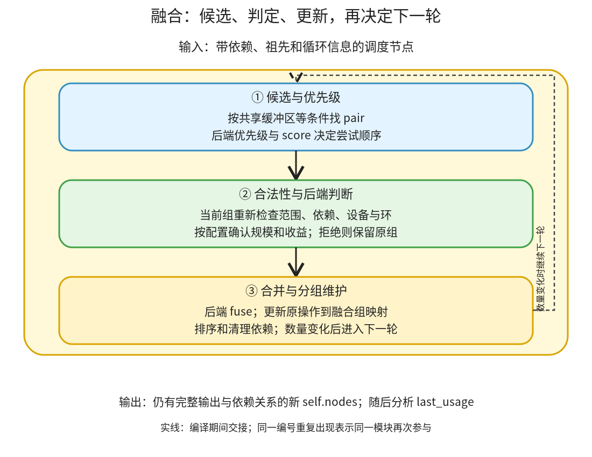

# 融合与分组：按依赖和后端能力选择组合，再维护新的调度节点

```text
Inductor  本层完成
    └── 调度与融合  本层完成
        └── 融合与分组 ← 当前篇  本层完成
            ├── 候选与优先级  待展开
            ├── 合法性与后端判断  本层完成
            └── 合并与分组维护  待展开
```

<!-- child-links:start -->
直接子篇：[合法性与后端判断](02-legality-backends/README.md)。
<!-- child-links:end -->

[返回调度与融合](../README.md)。本模块收到已经有依赖、祖先和循环信息的节点集合，找出值得尝试的组合，确认可以共同生成，再由设备后端合成融合节点。交出的仍是编译期的节点分组，不是已经执行的 kernel。

## 1. 候选、判定和合并是一个反馈过程



[get_possible_fusions](/work/pytorch/torch/_inductor/scheduler.py:2628) 按共享缓冲区等条件找候选，再按后端优先级和 score 排序。fuse_nodes_once 依次取候选时，要先把原节点映射到当前融合组，重新判断合法性、环和可选收益条件；成功才调用后端 fuse。最后排序、清理冗余依赖，下一轮再从新集合找候选。

因此不是先一次性算出所有 pair 后无条件全部合并。早先合并可以改变后面候选所引用的组、依赖与大小。外层 fuse_nodes 最多做限定轮数，没有数量变化或只剩一个节点时提前停止。

特殊 foreach、combo、模板和 grouped 节点也在这个职责内处理，不能仅把它们看成两个 Pointwise 的普通拼接。它们仍必须遵守依赖和设备约束。

## 2. 三个模块怎样交接

### 2.1 候选与优先级

收到节点列表后，按 used_buffer_names 分组，避免无差别尝试所有节点对；aggressive_fusion 等配置可扩大候选。相同缓冲区名只是搜索入口，不能证明元素访问对应或融合合法。

[score_fusion](/work/pytorch/torch/_inductor/scheduler.py:3113) 考虑模板/归约等偏好、共享依赖对应的估算数据量，以及原顺序距离。后端还提供候选 pair 的优先级；优先级筛选后再按 score 处理。

例如两个节点都读同一 x/y，可能通过共享读取减少重复加载，优先考虑一起生成。但如果一个按位置 i 读取、另一个按 i+1 读取，不能只凭名字相同就假定有同样的复用。读取量估算也不是实测带宽或耗时。

①交给②的是有顺序的候选对和当前组映射；没有返回任何 Tensor 数值。当前 CPU 对照关闭 benchmark_fusion，因此排序和选择不是由本次测时得出。

### 2.2 合法性与后端判断

[can_fuse](/work/pytorch/torch/_inductor/scheduler.py:2880) 先检查节点类型、依赖方向、模板限制、禁融缓冲区、设备、共享数据、组合规模等，再区分纵向与横向融合，询问具体后端。

纵向意味着消费者读取生产者结果，要匹配相应读写，并保证剩余依赖不会要求一个中间节点夹在组内不能安排的位置。横向意味着两个节点可并列生成，可能共享输入；还会考虑峰值存储等启发式。

正确性条件和代价策略要分开。例如读写版本或设备不符不能强行融合；max_fusion_size 则是控制规模的策略，拒绝并不意味着这项组合在数学上一定非法。普通非模板 extern 节点也不会被当成任意可内联循环。

候选还要通过 will_fusion_create_cycle。配置开启收益验证时，speedup_by_fusion 可以编译/测试相应方案并拒绝收益不足者；不能把这个可选分支套到本轮关闭测时的实验。

②交回是否允许、后端能力相关判定及拒绝理由。通过后才进入③；失败则保留原组，继续下一候选。

### 2.3 合并与分组维护

[fuse_nodes_once](/work/pytorch/torch/_inductor/scheduler.py:2535) 通过后端 fuse 创建新节点，替换集合中的旧组，把每个原操作名映射到新组。融合节点仍保存原 snodes、输出和依赖，供后续循环与代码生成访问。

例如 op0、op1 合成 op0_op1，两个输出仍可分别对应 buf0、buf1。把计算合到一起不等于自动删掉一个输出，也不等于把原操作名全部丢掉。

本模块还维护拓扑顺序、冗余依赖和 min/max order；foreach/combo 形成特定分组；模板最终选择要同步图中的 buffer/operation 名称，避免调度对象与 GraphLowering 映射不一致。共享的算法选择器实现归属 kernel 方案选择，调度这里解释它怎样影响最终分组。

③交出新的 self.nodes、组映射和依赖关系，供最后使用分析与 codegen 遍历。下一轮若继续尝试，①基于这些新节点再次找候选。

## 3. 主案例：相同图，改变融合大小限制

CPU float32，x=`[[0,1,2],[3,4,5]]`、y 为全 1，shape `(2,3)`、stride `(3,1)`：

```python
return (x+y, (x+y)*2)
```

Lowering 交来两个实际 SchedulerNode，各自写一个图输出，都读取 x/y。它们之间不是本例中必须有的 buf0→buf1 数据边，而是共享输入的横向候选。

**默认允许。** max_fusion_size=64 时，①把这对候选交给②；相同设备、兼容范围与共享读条件满足。③得到一个 FusedSchedulerNode，保留原 op0/op1。最后一次使用 x/y 标记在这个组上。

**限制规模。** 相同图将 max_fusion_size 改成 1，任何两个普通节点合并都超过大小限制。②拒绝该组合，③出口仍是两个 SchedulerNode，没有捏造新的融合组。x/y 的最后使用在第二个节点。

[真实采集](../../experiments/fusion-lifetime/results.json) 对照为：

| 条件 | 融合前节点 | 融合后节点 | generated_kernel_count |
| --- | --- | --- | --- |
| max_fusion_size=64 | 两个 SchedulerNode | 一个 FusedSchedulerNode | 1 |
| max_fusion_size=1 | 两个 SchedulerNode | 两个 SchedulerNode | 2 |

两次实际返回均为 `([[1,2,3],[4,5,6]], [[2,4,6],[8,10,12]])`。这证明限制改变了本次组装方式，不能据此报告速度差，因为没有测时。

两个 C++ 逻辑循环也可能被后端 KernelGroup 收进一个导出函数；generated_kernel_count 不直接等于 wrapper 函数调用数。具体生成源码见 [允许版本](../../experiments/fusion-lifetime/fusion_allowed_output.py) 与 [限制版本](../../experiments/fusion-lifetime/fusion_limited_output.py)。

## 4. 分组没有融合，内部存储仍可复用

对 relu(x@y)，普通外部 mm 节点与 relu 的 SchedulerNode 没有合为一个融合节点；输出依赖保证先 mm 后 relu。允许与禁用存储复用时，两个版本的融合结果仍完全相同。

但允许复用的 wrapper 可以让 relu 覆盖内部 mm 结果，禁用时单独分配 relu 输出。这个对照说明融合模块交出的是计算分组；存储复用还要由最后使用、后端和 wrapper 计划协作完成，不能拿“没有融合”推断一定多分配或多复制。

## 5. 后续覆盖与证据边界

[实验脚本](../../experiments/fusion_lifetime.py) 真实编译并执行四种配置，采集节点类型、last_usage 和生成后的状态；关闭 FX 图缓存和 benchmark_fusion，没有 GPU 或模板测时。

三个子篇将完整展开候选/score、合法性与环及后端判断、合并和特殊分组维护。当前案例验证横向融合和规模拒绝，已有 exp 案例验证生产者与多个消费者合组；GPU reduction、模板 epilogue、foreach/combo 和收益测试分支仍待逐层展开。
