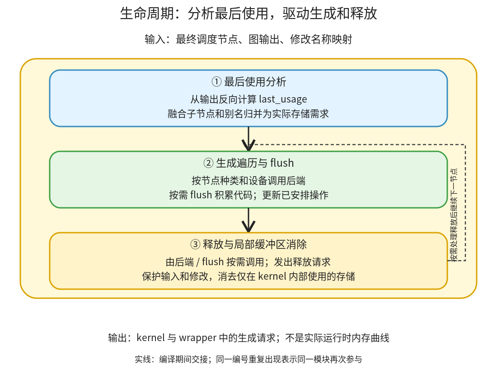

# 生命周期与生成驱动：标记最后使用，再按节点发出调用和释放代码

```text
Inductor  本层完成
    └── 调度与融合  本层完成
        └── 生命周期与生成驱动 ← 当前篇  本层完成
            ├── 最后使用分析  待展开
            ├── 生成遍历与 flush  待展开
            └── 释放与局部缓冲区消除  待展开
```

<!-- child-links:start -->

<!-- child-links:end -->

[返回调度与融合](../README.md)。本模块收到最终调度节点，找出每份存储何时不再需要，并在 codegen 期间驱动后端，把分配、调用、释放请求写入生成器。这里的“已完成操作”表示生成已安排，不表示真正设备计算已执行。

## 1. 先分析，再按顺序生成，flush 时落实后端积累



[compute_last_usage](/work/pytorch/torch/_inductor/scheduler.py:3223) 从输出开始反向处理节点；[Scheduler._codegen](/work/pytorch/torch/_inductor/scheduler.py:3385) 则正向遍历。每个节点处理前积累可释放名字，选择普通计算、模板、外部调用等生成路径；设备切换或外部边界等条件下 flush 后端积累，再调用释放处理。

输出引用在初始未来需求中，因此不能像一般临时量那样返回前被释放。相反，只在一个融合 kernel 内部使用的缓冲区可能不需要实际外部分配，这又与“最后一次使用后 del 它”不同。

最终 wrapper 还会规划复用，所以这里交出的是生命周期与生成请求，不独自决定所有 Tensor 分配。共享 wrapper 实现属于代码生成模块。

## 2. 三个职责怎样传递状态

### 2.1 最后使用分析

收到 self.nodes、graph_outputs 和 mutation_real_name 后，先把图输出作为未来仍需要的名字，从后向前调用各节点 set_last_usage。节点读取/写入以及相关别名折回真实存储名称后，尚未在未来需求集合出现的名字就是该节点的 last_usage。

例如 mm 写 buf0，relu 读 buf0 再写返回值 buf1：x/y 最后由 mm 使用，buf0 最后由 relu 使用，buf1 仍需返回。若某输入被修改，不能把其内部版本名当成额外独立存储；映射用于归并实际生命周期。

融合组还会递归维护内部节点的相关信息。①把 last_usage 留在节点上，交给正向生成过程，不在分析时真的释放任何 Tensor。

### 2.2 生成遍历与 flush

②收到最终节点顺序和 last_usage。遍历到节点时设置上下文、根据设备和节点种类决定是否 flush；普通计算交给后端 codegen_node，模板交模板生成，extern 交库调用生成，空节点只标记相关安排状态。

同一后端可能先积累多个逻辑循环或 kernel 内容，直到 flush 才定义导出函数并把调用写入 wrapper。以 CPU 为例，CppScheduling 持有 KernelGroup；flush 生成组源码、定义 kernel、发出调用，再重置组。于是“Scheduler 处理了两个节点”和“wrapper 有两次独立函数调用”没有必然一一对应关系。

设备 guard、可选 debug sync 等也是生成代码的内容，不能将 codegen 遍历当作实际设备队列运行。完成一个节点的生成后，更新 available_buffer_names 和 completed_operations，再继续安排后续节点。

这些集合描述依赖与已生成安排，不是最终存活 Tensor 的精确清单。比如输入名字可以仍在 available 集合里，而 wrapper 已生成 del 输入局部引用；不能据此计算当前真实占用内存。

### 2.3 释放与局部缓冲区消除

[free_buffers](/work/pytorch/torch/_inductor/scheduler.py:3234) 收到待释放集合，排除已经移除或处理的名字，对允许释放的缓冲区发出 wrapper 代码。图输入的局部引用释放与输入底层存储任意复用不是同一权限；调用者仍可能持有输入。

[remove_kernel_local_buffers](/work/pytorch/torch/_inductor/scheduler.py:3253) 另检查 kernel 写出的临时量：若所有有效用户都在同一生成范围内，且没有 must_keep、输入、修改版本等保护，可以消掉该外部存储。值仍在 kernel 内流动，不是删除必需计算。

释放请求之后还可能被 wrapper 改成复用，因此 wrapper.freed 或 allocated 的记录不等于最终程序逐条执行了多少次真实分配/释放。③将请求和局部消除状态交给后端与 wrapper 收尾；其完成后清空本批待释放集合。

## 3. 主案例：mm→relu 的最后使用与生成边界

CPU float32：x=`[[0,1,2],[3,4,5]]`、shape `(2,3)`、stride `(3,1)`；y=`[[1,2],[3,4],[5,6]]`、shape `(3,2)`、stride `(2,1)`。

```python
return (torch.relu(x@y),)
```

融合后仍有两个节点：op0 为外部 mm，op1 为 relu 普通计算。

**①反向分析。** 从输出 buf1 开始，relu 最后使用 buf0，mm 最后使用 x_1/y_1：

```text
op0.last_usage = [x_1, y_1]  # 名字次序不构成语义
op1.last_usage = [buf0]
```

**②安排外部调用。** mm 需要在当前后端积累的普通计算之后按边界安排，发出 buf0 分配与 extern_kernels.mm 调用，之后不再需要输入 x/y 的 wrapper 局部引用。

**②安排 relu。** 后端取得 buf0→buf1 的点运算，生成 relu 内容。③知道 buf0 在这里最后使用，向 wrapper 提供其可结束的生命周期。

**flush 与 wrapper 收尾。** 允许复用时，[真实程序](../../experiments/fusion-lifetime/reuse_allowed_output.py) 生成：

```python
extern_kernels.mm(x_1, y_1, out=buf0)
del x_1
del y_1
buf1 = buf0; del buf0  # reuse
cpp_fused_0(buf1)
return (buf1, )
```

buf1 继续持有这块存储，del buf0 只是删除旧 Python 名字，不是先释放底层存储再使用悬空指针。实际返回 `[[13,16],[40,52]]`，调用者输入不变。

## 4. 关闭复用，生命周期分析仍可相同

将 inplace_buffers 和 allow_buffer_reuse 都设为 False，节点仍是 op0/op1，last_usage 也相同。[禁止复用程序](../../experiments/fusion-lifetime/reuse_disabled_output.py) 另行分配 relu 输出，把 buf0 作为只读输入，输出 buf1，之后释放 buf0 引用。

两次采集的 wrapper.allocated 都登记 buf0/buf1，wrapper.freed 也包含 buf0；但允许版本最后只需那份被复用的内部存储。这进一步证明生成器的登记状态和最终分配代码不能混为一谈。

生命周期回答“旧存储何时可以结束”，复用还要回答“它是否满足新值的布局、类型、别名等要求”。相同 last_usage 可以产生不同存储方案，数值仍应一致。

## 5. 融合组内部的临时量可以更早消去

已有 `a=exp(x); return a+1,a*2` 案例在 Lowering 有 buf0/buf1/buf2。调度融合后，buf0 的有效用户都在同一 kernel，且它不是图输出；最终 C++ 用一个局部 tmp 保存 exp，wrapper 只分配 buf1/buf2。

这个条件不同于上例：mm 与 relu 分离，mm 的输出必须能被后一个计算读取，所以 buf0 有实际存储；融合内 exp 则无需先写出完整 Tensor。两者都由使用者范围和存储约束决定，不能只按某个名字是否出现在 IR 中判断。

## 6. 证据与下一层

[实验脚本](../../experiments/fusion_lifetime.py) 记录 codegen 后 completed_operations、available_buffers、wrapper 分配/释放登记和真实源码；没有把这些状态当作运行时显存曲线。数值验证通过，未做 CPU/GPU 内存峰值或性能计时。

三个子篇继续完整解释 last_usage 的递归与别名归并、生成分派和 flush、释放与局部缓冲区保护条件。多设备、通信、GPU 后端积累和模板的特殊路径尚待源码展开。
