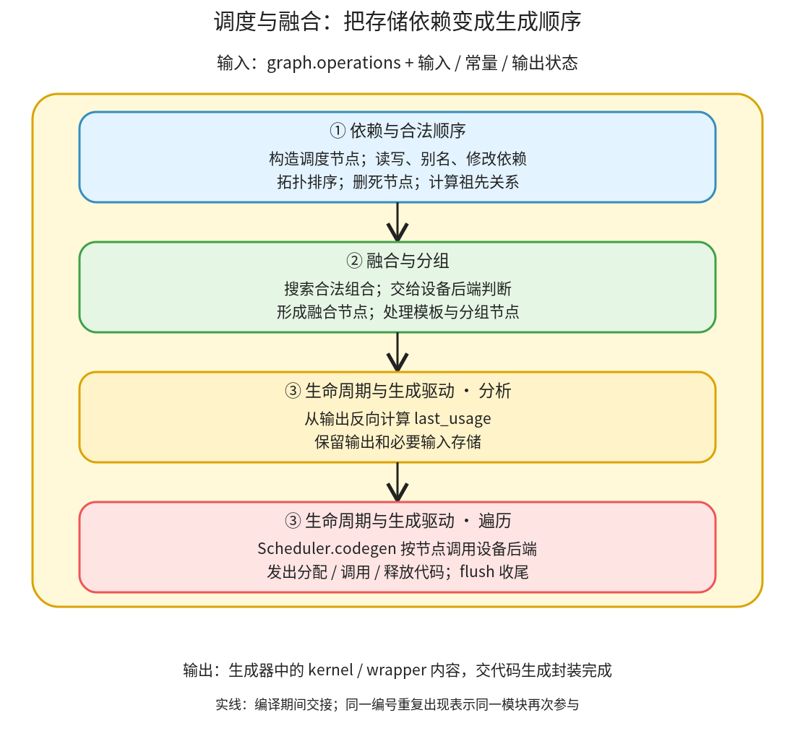

# 调度与融合：按读写约束组织 kernel，并确定缓冲区最后使用位置

```text
Inductor  本层完成
    └── 调度与融合 ← 当前篇  本层完成
        ├── 依赖与合法顺序  本层完成
        ├── 融合与分组  本层完成
        └── 生命周期与生成驱动  本层完成
```

<!-- child-links:start -->
直接子篇：[依赖与合法顺序](01-dependencies/README.md)、[融合与分组](02-fusion/README.md)、[生命周期与生成驱动](03-lifetime/README.md)。
<!-- child-links:end -->

[返回 Inductor](../README.md)。Scheduler 接收 `graph.operations`，把计算、模板和外部调用转换成调度节点，建立读写依赖与合法顺序，再融合能够共同生成的节点。它还标记最后使用位置，遍历调度结果驱动设备代码生成。它组织未来执行，不是在构造期间按 Python 顺序运行这些 Tensor 计算。

## 1. 内部怎样从操作到生成调用



主线来自 [Scheduler._init](/work/pytorch/torch/_inductor/scheduler.py:1733)：建立节点和映射，删去已可用输入依赖，计算完整依赖，拓扑排序，删除死节点，计算祖先关系，按条件做通信顺序调整，然后分组、融合、合并循环、处理模板并计算最后使用位置。随后 [Scheduler.codegen](/work/pytorch/torch/_inductor/scheduler.py:3381) 遍历节点，调用具体设备后端。

这里把这些内部动作归为三个完整职责，避免每个 helper 都成为新目录。依赖模块交出的不是单一返回值，而是各节点上的读写集合、使用者、祖先关系及图级索引；融合模块修改节点列表和融合映射；生命周期模块读最终分组，生成 last_usage，再利用这些结果发出代码。

共享的后端接口参与“能否融合”和“怎样生成”。融合阶段询问后端，并不意味着已经执行了 kernel；生成阶段的完成集合也表示代码已安排，不表示 GPU 工作已完成。

## 2. 三个模块的输入、输出和保留状态

### 2.1 依赖与合法顺序

收到 IR operation 后，[create_scheduler_node](/work/pytorch/torch/_inductor/scheduler.py:1849) 按类型创建普通计算、外部调用或空操作的调度节点。节点保存输出缓冲区、读写集合和未满足依赖；图级映射把操作名字、缓冲区名字与定义节点连接起来。

例如 `op0` 生成 `buf0`，`op1` 读取 `buf0`，那么 op1 不能先于 op0。读取图输入 x 不需要等待另一个内部节点，因为 x 在入口已经可用；所以节点的 `read_writes.reads` 可以包含 x，但 `unmet_dependencies` 不包含 x。不能把 unmet 为空理解为该节点没有输入。

[compute_dependencies](/work/pytorch/torch/_inductor/scheduler.py:1898) 还处理别名、修改版本和动态符号。两个不同名字若指向同一存储，使用者关系需要合并；修改前旧值的读取不能越过写入；某些运行时产生的符号也会建立定义到使用的顺序。这些超出了普通 FX 数据边，不能只照抄“某个节点 args 引用了谁”。

[拓扑排序](/work/pytorch/torch/_inductor/scheduler.py:2141) 与 [死节点删除](/work/pytorch/torch/_inductor/scheduler.py:2104) 把这些需求转为合法节点集合；图输出和副作用必须保留。交给融合模块的是经过整理的节点、依赖和祖先信息。

### 2.2 融合与分组

收到依赖图后，[fuse_nodes](/work/pytorch/torch/_inductor/scheduler.py:2266) 反复尝试合并候选节点，停止于没有数量变化、只剩一个节点或达到限定轮数。每次实际选择和判断在 fuse_nodes_once、候选评分与后端规则里完成。

两种常见关系是：生产者写 buf0、消费者读 buf0 的纵向融合；两个节点都读取 x/y、彼此不依赖的横向融合。本地 `return (x+y, (x+y)*2)` 的两个实际操作就属于后者，不要因为 Python 表达式中出现同一个加法，便假定生成 IR 必然有 buf0→buf1 这条边。

[can_fuse](/work/pytorch/torch/_inductor/scheduler.py:2880) 检查自合并、节点类型、依赖方向、模板限制、设备一致性、共享数据、融合大小及后端能力。部分条件是正确性约束，部分是代价启发式。拒绝“没有共享数据”的组合，不意味着组合在语义上一定非法；源码会明确区别某些 heuristic。

融合结果是 `FusedSchedulerNode` 等分组对象，内部仍保留原节点及输出。融合不等于所有内部缓冲区都可以删除：若 buf0 是图输出，就仍需要写出来；若某缓冲区只供同一个 kernel 内部使用，后端才可能消除外部存储。最后将实际节点集合交给生命周期分析。

### 2.3 生命周期与生成驱动

[compute_last_usage](/work/pytorch/torch/_inductor/scheduler.py:3223) 从图输出开始，反向遍历最终节点，把某个缓冲区的最后使用位置写在节点上。输出预先视为未来仍被需要，所以不能像普通临时量一样在返回前释放。修改名称映射也参与这个计算。

生成时按最终顺序遍历节点。切换设备、遇到外部调用或模板等情形会先 flush 已积累的后端工作；普通点运算调用后端 codegen_node，模板调用模板生成，外部节点生成库调用。完成后更新可用缓冲区和已安排操作集合；节点的 last_usage 被积累到可释放集合。

[free_buffers](/work/pytorch/torch/_inductor/scheduler.py:3234) 发出 wrapper 层的释放代码；[remove_kernel_local_buffers](/work/pytorch/torch/_inductor/scheduler.py:3253) 配合 kernel 信息清理局部存储。wrapper 还可能复用满足条件的分配。因此 last_usage 提供使用关系，不独自决定所有存储方案。

这个模块交给代码生成封装的是生成器已积累的 kernel、wrapper 行和相关状态；没有一个必须先序列化的调度计划文件。对于 GPU，发出一次启动语句也不意味着运行时在这里同步等待；执行时序由生成的设备调用、流和同步规则共同保证。

## 3. 主案例：两个输出怎样横向融合，且仍返回两块存储

输入 x/y 是 CPU float32，shape `(2,3)`、stride `(3,1)`，值与总篇相同：

```python
return (x + y, (x + y) * 2)
```

**依赖模块收到 Lowering 操作。** [融合前采集](../experiments/stages/multiple_outputs_before_fusion.txt) 的关键信息可概括为：

```text
op0:
  reads  = x_1[0:6], y_1[0:6]
  writes = buf0[0:6]
  users(buf0) = OUTPUT
op1:
  reads  = x_1[0:6], y_1[0:6]
  writes = buf1[0:6]
  users(buf1) = OUTPUT
```

实际 `MemoryDep` 使用符号索引 c0 和范围 `{c0:6}`；上面的切片是便于阅读的化简。两个节点都没有内部未满足依赖，说明可分别从图输入开始，而不是无需读输入。

**融合模块收到两个节点。** 它们读取同样的 x/y，迭代范围相容，由本地 CPU 后端允许组合。实际 [融合后采集](../experiments/stages/multiple_outputs_after_fusion.txt) 出现：

```text
op0_op1: FusedSchedulerNode(SchedulerNode, SchedulerNode)
writes = buf0 和 buf1
outputs = buf0、buf1；两者使用者都仍是 OUTPUT
```

这证明融合真实发生在 Scheduler，不是把最终“一个 kernel”倒推成调度融合。与总篇的单输出点表达式组合不同，这里采集到了明确的两个操作到一个融合节点。

**生命周期模块收到融合结果。** buf0、buf1 都是输出，必须保留到返回；x/y 在本次融合节点后不再使用，可以释放 wrapper 对输入的局部引用。生成阶段把两个输出放进同一个循环，但不会把其中一个丢掉。

**程序运行。** [生成文件](../experiments/stages/multiple_outputs_output.py) 中一个 `cpp_fused_0` 写两个输出指针，wrapper 分配两个 Tensor 并返回。实际结果：

```text
buf0 = [[-1,0,1],[2,3,4]]
buf1 = [[-2,0,2],[4,6,8]]
两者 shape=(2,3)、stride=(3,1)
自生成 kernel 数=1，输入保持不变
```

融合减少了本例程序中的独立 kernel 数；这里没有计时，不报告性能提升百分比。两项输出仍各有实际存储，不能将“融合成功”解释为“所有中间或结果缓冲区合成一块”。

## 4. 补充案例：mm 的边界不能随意融合，但存储可以复用

对 `relu(x@y)`，Lowering 建立 `ExternKernelOut buf0` 与 `ComputedBuffer buf1`。在 [融合前记录](../experiments/stages/mm_before_fusion.txt) 中：

```text
op0: ExternKernelSchedulerNode
  reads = x_1、y_1 的 StarDep
  writes = buf0 的 StarDep
op1: SchedulerNode
  reads = buf0 的 MemoryDep
  writes = buf1 的 MemoryDep
  unmet_dependencies = buf0
```

MemoryDep 描述带索引的读写，StarDep 用于整体对象依赖；不把外部算子内部每个元素的访存方式硬猜出来。依赖模块将 mm 排在 relu 前，融合模块拒绝把这个非模板 extern 节点当作普通可融合计算。最终顺序仍是 op0、op1。

[最后使用记录](../experiments/stages/mm_last_usage.txt) 为：

```text
op0: 最后使用 y_1、x_1
op1: 最后使用 buf0
```

但 [生成 wrapper](../experiments/stages/mm_output.py) 并未简单地先释放 buf0 再为 relu 分配另一块内存：

```python
buf0 = empty_strided_cpu((2, 2), (2, 1), torch.float32)
extern_kernels.mm(x_1, y_1, out=buf0)
del x_1
del y_1
buf1 = buf0; del buf0  # reuse
cpp_fused_0(buf1)
return (buf1, )
```

两个操作没融合，仍可以在本例中复用存储，让 relu 原地覆盖已经不需要的 mm 值。复用的是内部临时量，不修改调用者的 x/y。实际输出 `[[0,0],[22,28]]` 与 eager 相同，输入值保持不变。

所以“融合”和“复用”是两项不同决策：前者决定哪些计算共同生成，后者决定哪些存储可以共享生命周期。它们协作，但其中一个失败不代表另一个也不能做。

## 5. 下一层问题

依赖与合法顺序子篇将解释别名/写入及符号边；融合与分组子篇将解释候选、评分、后端约束及模板分组；生命周期与生成驱动子篇将按源码说明最后使用、flush 和释放协作。CPU 实验已覆盖横向融合、外部节点阻断、内部存储复用；纵向归约融合、通信重排、多设备、动态符号和模板融合尚未实测，不能用这些案例替代相应分支的证据。
