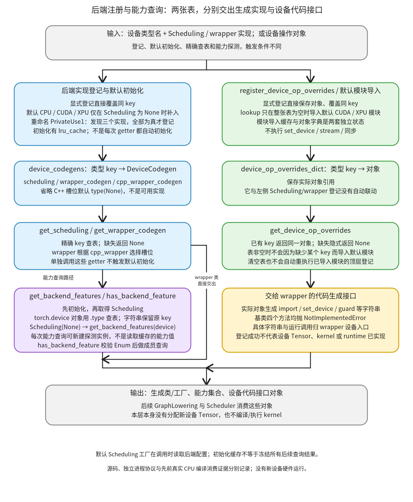

# 后端注册与能力查询：逐行看设备类型怎样关联代码生成实现

```text
Inductor  本层完成
    └── 代码生成与运行封装  本层完成
        └── 设备 kernel 与方案选择  本层完成
            └── 后端与循环组织  本层完成
                └── 后端注册与能力查询 ← 当前篇  叶子·逐行完成
```

<!-- child-links:start -->

<!-- child-links:end -->

[返回后端与循环组织](../README.md)。这个叶子实现把设备类型关联到 Scheduling、Python/C++ wrapper，把设备操作对象放入另一张表，再让调用者查询实现或能力。登记的结果是编译器实现和代码接口，不是新设备 Tensor 或已运行的 kernel。

本篇完整覆盖 common.py 的 DeviceCodegen、两张表、DeviceOpOverrides 基类、后端显式登记、BackendFeature、能力与实现查询、默认/PrivateUse1 初始化、设备操作登记和查询。源码范围为 87–91、96–113、116–246、256–268，逐段保留原始顺序和完整实现。中间的 KernelArgType 与 index_prevent_reordering 不属于注册职责，分别归参数与索引相关模块；具体 Scheduling、wrapper 和设备操作实现链接其主要归属，不在这里冒充已完整覆盖。

## 1. 先看两张表怎样参与一次查询



扩展可以显式 register，也可以在初始化时被自动发现。显式登记直接写表；默认初始化只在相应 Scheduling 槽为 None 时补入 CPU/CUDA/XPU，PrivateUse1 则要求已重命名、尚未登记，并能取得三个为真的实现。

随后，get_scheduling/get_wrapper_codegen 精确查表；它们不会自己初始化。get_backend_features 则先调用带缓存的初始化，再实际执行 Scheduling(None) 和该对象的能力方法。初始化完成不表示以后不再执行扩展代码：每次能力查询仍可能构造探测实例，默认工厂还会读取当时的配置。

设备操作对象由另一张表提供。它通常返回要写入生成程序的 import/set_device/guard 等文本。查对象与生成文本，不等于已经执行这些设备动作；但扩展构造和能力方法本身是实际 Python 调用，接口没有强制它们纯读或无副作用。

下面按源码顺序讲完这组实现，再沿具体输入演示初始化、覆盖、能力探测和失败路径。

## 2. 定义记录与独立的设备操作接口

原始源码：[common.py 第 87 行](/work/pytorch/torch/_inductor/codegen/common.py:87)至第 91 行。

```python
@dataclasses.dataclass
class DeviceCodegen:
    scheduling: Any
    wrapper_codegen: type
    cpp_wrapper_codegen: type = type(None)
```

| 行 | 数据与动作 |
| --- | --- |
| 87 | dataclass 为这个字段记录生成常规初始化等方法；它不检查实现是否可工作。 |
| 88 | 定义一项设备代码生成记录，后面的表保存其实例。 |
| 89 | scheduling 保存类或其他可调用工厂，类型标为 Any，不要求在登记时构造。 |
| 90 | wrapper_codegen 保存 Python wrapper 类，供后续图生成阶段实例化。 |
| 91 | C++ wrapper 的默认槽位为 `type(None)`，即 NoneType 类；这与 None 值不同，也不是一个可工作的 wrapper 实现。 |

例如登记 `(cpu, LessonScheduling, LessonWrapper)` 时，记录的第三槽是 NoneType。后续查询 C++ 槽位会原样取得它，不在这里自动补成 CppWrapperCpu。

原始源码：[common.py 第 96 行](/work/pytorch/torch/_inductor/codegen/common.py:96)至第 113 行。

```python
device_codegens: Dict[str, DeviceCodegen] = {}


class DeviceOpOverrides:
    def import_get_raw_stream_as(self, name):
        raise NotImplementedError

    def set_device(self, device_idx):
        raise NotImplementedError

    def synchronize(self):
        raise NotImplementedError

    def device_guard(self, device_idx):
        raise NotImplementedError


device_op_overrides_dict: Dict[str, DeviceOpOverrides] = {}
```

| 行 | 数据与动作 |
| --- | --- |
| 96 | 建立模块级 device_codegens 空字典；key 是设备类型使用的字符串，value 是上述记录。状态在进程中保留。 |
| 99 | 定义设备操作代码接口基类，和 Scheduling/wrapper 三槽记录分开。 |
| 100–101 | raw-stream 导入接口接收生成程序中的别名 name；基类立即抛 NotImplementedError，没有默认导入文本。 |
| 103–104 | set_device 接收设备编号；基类抛异常，不执行设备切换。 |
| 106–107 | synchronize 基类同样抛异常，没有默认同步策略。 |
| 109–110 | device_guard 接收编号；基类不提供默认上下文文本。 |
| 113 | 建立另一张模块级表，保存 DeviceOpOverrides 对象引用；给第一张表登记 Scheduling 不会同时写入这里。 |

调用 `DeviceOpOverrides().set_device(0)` 会立即失败。具体 CUDA/XPU 对象如何生成字符串由[wrapper 设备入口](../../../02-wrapper/01-entry-device-calls/README.md)解释；本篇完整覆盖它们共享的基类和表协议。

## 3. 显式登记、能力定义和精确查询

原始源码：[common.py 第 116 行](/work/pytorch/torch/_inductor/codegen/common.py:116)至第 192 行。

```python
# The code generated by Inductor consists of two main parts: kernel code and wrapper code.
# For any new backend looking to integrate with Inductor, customization of these two main
# parts are necessary to generate its specific code.
#
# Kernel code generation is determined by different Scheduling. Consequently, a new
# backend needs to provide a custom Scheduling for its unique kernel code generation. Currently,
# CppScheduling and TritonScheduling serve the C++/OpenMP and Triton backends, respectively.
#
# For the Wrapper, Inductor provides a WrapperCodeGen class to generate the Python wrapper code
# that bridges kernels. This allows out-of-tree backends to inherit from WrapperCodeGen,
# and override specific member functions to create backend-specific Python wrapper code.
#
# Other classes, such as CppKernel and TritonKernel, used for code generation, typically form part
# of the logic for either Scheduling or WrapperCodeGen. So the Scheduling and WrapperCodeGen interfaces
# provide flexibility to the backend. A backend can choose to implement these classes from scratch,
# or reuse them by extending and overriding as necessary. And Inductor provides the registration API,
# register_backend_for_device, to equip a new backend at runtime.
#
# Intel has developed a new backend on top of Triton to support Intel GPUs, leveraging these interfaces.
# This backend can be used as a reference:
# https://github.com/intel/intel-extension-for-pytorch/blob/5dcc9d57e5422cf295e1a1ee97896d6b6a554a85/intel_extension_for_pytorch/_inductor/__init__.py#L9
def register_backend_for_device(
    device: str,
    device_scheduling: Any,
    device_wrapper_codegen: type,
    device_cpp_wrapper_codegen: type = type(None),
):
    device_codegens[device] = DeviceCodegen(
        device_scheduling, device_wrapper_codegen, device_cpp_wrapper_codegen
    )


class BackendFeature(Enum):
    FOREACH = auto()
    BUCKETIZE = auto()
    INPLACE_BUFFERS = auto()
    MASKED_SCATTER_WITH_INDEX = auto()
    SCAN = auto()
    SORT = auto()
    TUPLE_REDUCTION = auto()
    PREFER_STORE_LOOP_ORDER = auto()
    TRITON_TEMPLATES = auto()
    REDUCE_TO_SINGLE_ELEMENT = auto()


def get_backend_features(device: Union[torch.device, str]):
    init_backend_registration()
    if isinstance(device, torch.device):
        device_type = device.type
    else:
        assert isinstance(device, str)
        device_type = device
        device = torch.device(device_type)
    scheduling = get_scheduling_for_device(device_type)
    return scheduling(None).get_backend_features(device)


def has_backend_feature(device, feature):
    """See also V.graph.has_feature"""
    assert isinstance(feature, BackendFeature)
    return feature in get_backend_features(device)


def get_scheduling_for_device(device: str):
    return device_codegens[device].scheduling if device in device_codegens else None


def get_wrapper_codegen_for_device(device: str, cpp_wrapper: bool = False):
    if device in device_codegens:
        wrapper_codegen_obj: DeviceCodegen = device_codegens[device]
        return (
            wrapper_codegen_obj.cpp_wrapper_codegen
            if cpp_wrapper
            else wrapper_codegen_obj.wrapper_codegen
        )
    else:
        return None
```

116–136 的原注释说明 kernel 与 wrapper 是两部分：Scheduling 决定 kernel 代码生成，WrapperCodeGen 可派生以组织图级程序，底层 kernel 类可以复用或替换。这些注释帮助确定登记接口的边界；外部参考链接未作为本篇依据，事实来自当前本地实现。

### 3.1 显式写入没有验证或自动补齐

| 行 | 数据与动作 |
| --- | --- |
| 137 | 定义显式后端登记入口。 |
| 138 | device 是用作字典 key 的参数；类型标注 str 不等于运行时校验。 |
| 139 | 接收 Scheduling 类或工厂，暂不调用。 |
| 140 | 接收 Python wrapper 类，暂不构造。 |
| 141 | 省略 C++ 参数时使用 NoneType；显式传 None 则保存真正的 None。 |
| 142 | 参数列表结束，进入函数体。 |
| 143–145 | 构造 DeviceCodegen 并赋给 device_codegens[device]。同 key 直接覆盖旧记录，不合并旧槽位，没有返回值、设备创建或实现检查。 |

例如第二次只登记 Scheduling 和 Python wrapper，原来第三槽里的 C++ 类也会被新记录的默认 NoneType 替换；它不是“只更新传入的两个字段”。登记一个 torch.device 不认识的字符串也能写表，但后续设备解析可能失败。

### 3.2 BackendFeature 是能力名字，值本身不实现操作

148 定义 Enum，149–158 每行通过 auto 创建不同成员。成员用于 `feature in collection` 判断；不是按数值大小表达能力等级。

| 行 | 成员 | 实际选择所涉及的问题 |
| --- | --- | --- |
| 149 | FOREACH | 多个列表元素计算能否进入对应的 foreach 分组/生成路径。 |
| 150 | BUCKETIZE | lowering 能否采用对应 bucketize 实现。 |
| 151 | INPLACE_BUFFERS | 调度器是否考虑对应 buffer 原地复用；不是“任意输入修改都受支持”。 |
| 152 | MASKED_SCATTER_WITH_INDEX | masked_scatter 分解能否选用带索引的路径。 |
| 153 | SCAN | IR 能否建立对应扫描计算。 |
| 154 | SORT | IR 能否采用排序路径。 |
| 155 | TUPLE_REDUCTION | 多值归约/相关扫描路径是否有对应支持。 |
| 156 | PREFER_STORE_LOOP_ORDER | 布局与循环顺序是否优先遵从该 store 策略。 |
| 157 | TRITON_TEMPLATES | 相应改写和模板路径是否能使用 Triton 模板。 |
| 158 | REDUCE_TO_SINGLE_ELEMENT | 归约启发式是否可按该后端的单元素归约能力选择路径。 |

这些名字的消费者已在本地 lowering.py、ir.py、scheduler.py、decomposition.py 和 post_grad.py 核对。这里定义枚举和查询协议；具体算法仍归相应算子、调度和生成模块。新设备把成员放进集合，是向消费者声明契约，不会自动生成缺少的实现。

### 3.3 能力查询会构造对象，设备字符串有精确 key 语义

| 行 | 数据与动作 |
| --- | --- |
| 161 | 接收 torch.device 或字符串。 |
| 162 | 先执行默认初始化；其结果是否来自缓存在下一段解释。 |
| 163–164 | 若传入 torch.device，从 `.type` 取注册类型；设备对象本身保留，编号仍可交给能力方法。 |
| 165–166 | 其他分支断言参数是 str；不接受整数等任意对象。 |
| 167 | 原字符串直接保存为 device_type，不先解析并提取 `.type`。 |
| 168 | 构造 torch.device，供能力方法使用；设备字符串非法会在这里失败。 |
| 169 | 用上面的 device_type 精确取 Scheduling；没有自动回退到别的类型。 |
| 170 | 以 None 构造 Scheduling，再调用其 get_backend_features(device)，原样返回结果。这里没有缓存能力集合，也没有补做缺失实现检查。 |
| 173 | 定义成员查询的便捷入口。 |
| 174 | 文档字符串指向 V.graph.has_feature；它的图上下文实现见已有[上下文叶子](../../../../02-lowering/01-interpretation/01-context-symbols/README.md)。 |
| 175 | 断言 feature 是本 Enum 的成员；字符串同名不满足。 |
| 176 | 再次调用能力查询，然后做成员判断，返回布尔值。 |

None 代表“能力探测时没有具体 Scheduler”。实现构造函数仍会真实运行，因此新后端必须能处理这一调用。如果查不到 Scheduling，170 会尝试调用 None 并抛 TypeError；这里没有将它统一包装为 Unsupported device type。

返回值只要满足消费者的成员查询契约即可。实际 CPU 实现返回字典，成员查询查的是键；本层不把结果强制转成 set，也不复制后端返回的对象。

传入 `torch.device('cpu:0')` 时以 cpu 查表；传入字符串 `'cpu:0'` 时却以 cpu:0 查表。这是 164 与 167 的具体差别，不应凭类型标注推断它们等价。

### 3.4 实现 getter 只查表

| 行 | 数据与动作 |
| --- | --- |
| 179–180 | get_scheduling_for_device 精确命中则返回 scheduling 槽；缺 key 返回 None。不初始化，不构造，不将 cuda:1 缩成 cuda。 |
| 183 | wrapper getter 接收设备 key 与 cpp_wrapper 标志。 |
| 184–185 | 命中后取出整条 DeviceCodegen 记录。 |
| 186–190 | cpp_wrapper 为真选第三槽，否则选 Python wrapper 槽，原样返回；没有构造 wrapper。 |
| 191–192 | 缺 key 显式返回 None。 |

因此 None 可以表示缺 key，也可以是扩展显式登记的某个槽位。需要分清这两种状态时，不能仅凭一个 getter 结果判断整个设备记录是否存在。

## 4. 一次性初始化默认后端与 PrivateUse1

原始源码：[common.py 第 195 行](/work/pytorch/torch/_inductor/codegen/common.py:195)至第 246 行。

```python
@functools.lru_cache(None)
def init_backend_registration():
    from .cpp import CppScheduling
    from .cpp_wrapper_cpu import CppWrapperCpu
    from .cpp_wrapper_cuda import CppWrapperCuda
    from .cuda_combined_scheduling import CUDACombinedScheduling
    from .halide import HalideScheduling
    from .triton import TritonScheduling
    from .wrapper import WrapperCodeGen

    if get_scheduling_for_device("cpu") is None:
        cpu_backends = {"cpp": CppScheduling, "halide": HalideScheduling}
        register_backend_for_device(
            "cpu",
            lambda *args, **kwargs: cpu_backends[config.cpu_backend](*args, **kwargs),
            WrapperCodeGen,
            CppWrapperCpu,
        )

    if get_scheduling_for_device("cuda") is None:
        # CUDACombinedScheduling combines Triton and CUDA C++ scheduling for CUDA devices via delegation
        cuda_backends = {"triton": CUDACombinedScheduling, "halide": HalideScheduling}
        register_backend_for_device(
            "cuda",
            lambda *args, **kwargs: cuda_backends[config.cuda_backend](*args, **kwargs),
            WrapperCodeGen,
            CppWrapperCuda,
        )

    if get_scheduling_for_device("xpu") is None:
        register_backend_for_device("xpu", TritonScheduling, WrapperCodeGen)

    private_backend = torch._C._get_privateuse1_backend_name()
    if (
        private_backend != "privateuseone"
        and get_scheduling_for_device(private_backend) is None
    ):
        from torch.utils.backend_registration import _get_custom_mod_func

        try:
            device_scheduling = _get_custom_mod_func("Scheduling")
            wrapper_codegen = _get_custom_mod_func("WrapperCodeGen")
            cpp_wrapper_codegen = _get_custom_mod_func("CppWrapperCodeGen")
            if device_scheduling and wrapper_codegen and cpp_wrapper_codegen:
                register_backend_for_device(
                    private_backend,
                    device_scheduling,
                    wrapper_codegen,
                    cpp_wrapper_codegen,
                )
        except RuntimeError:
            pass
```

### 4.1 初始化缓存与导入顺序

195 的 lru_cache(None) 修饰一个无参数函数。一次正常返回后，后续调用命中同一个缓存项，不再执行函数体；没有“按设备类型各初始化一次”的参数维度。异常抛出则不会缓存这次返回。

196 定义函数。197–203 在任何默认表条件判断之前导入实现：

| 行 | 导入对象 | 在本函数中的用途 |
| --- | --- | --- |
| 197 | CppScheduling | CPU 的 cpp 工厂候选。 |
| 198 | CppWrapperCpu | CPU 默认 C++ wrapper 槽。 |
| 199 | CppWrapperCuda | CUDA 默认 C++ wrapper 槽。 |
| 200 | CUDACombinedScheduling | CUDA 的 triton 候选，内部可以委托多种生成器。 |
| 201 | HalideScheduling | CPU/CUDA 配置可选候选。 |
| 202 | TritonScheduling | XPU 默认 Scheduling。 |
| 203 | WrapperCodeGen | 默认 Python wrapper。 |

这些类的完整实现由兄弟模块和 wrapper 模块负责。导入发生不表示已经为某图建立它们，也不表示实际设备 kernel 已编译。导入中的异常还不在后面的 PrivateUse1 try 内，不会被那段 except 统一吞掉。

### 4.2 默认登记保存的是可延迟选实现的工厂

| 行 | 数据与动作 |
| --- | --- |
| 205 | CPU Scheduling getter 为 None 才补默认；不只是检查 cpu key 是否存在。 |
| 206 | 局部映射将 cpp/halide 对应到具体类。 |
| 207–208 | 调登记入口，key 为 cpu。 |
| 209 | 保存 lambda 工厂；以后调用时读取 config.cpu_backend，再把收到的 args/kwargs 交给被选类。 |
| 210–212 | 同条记录保存 WrapperCodeGen 与 CppWrapperCpu，结束调用。 |
| 214 | CUDA 也只在 Scheduling 槽为 None 时补入。 |
| 215–216 | 注释交代组合委托，映射 triton 到 CUDACombinedScheduling、halide 到 HalideScheduling。 |
| 217–219 | 以 cuda 登记工厂，调用时读取 config.cuda_backend 并转交构造参数。 |
| 220–222 | 同条记录保存默认 Python wrapper 和 CppWrapperCuda。 |
| 224–225 | XPU 缺 Scheduling 时直接保存 TritonScheduling，而非配置选择 lambda；只传三个参数，所以 C++ 槽使用 NoneType 默认值。 |

工厂闭包保留局部候选映射，但并未在初始化时把 config.cpu_backend 的值冻结进去。同一个工厂在配置改为 halide 后可以构造 HalideScheduling；配置值不在映射中则在调用时抛 KeyError。

显式登记的有效 Scheduling 会让默认初始化保留整条记录，包括扩展省略的 C++ 槽。若扩展把 Scheduling 显式设为 None，205 的判断又会用默认整条记录替换它。两个行为都由 `is None` 决定，不是笼统的“所有预登记都会保留”。

### 4.3 PrivateUse1 自动发现与错误缓存

| 行 | 数据与动作 |
| --- | --- |
| 227 | 从 native 接口取得当前 PrivateUse1 名称。 |
| 228–231 | 只有名称已不同于 privateuseone，且当前 Scheduling 为 None，才进入发现。已有显式 Scheduling 则跳过。 |
| 232 | 导入共享的设备模块属性查询 helper；导入本身在 try 之外。 |
| 234 | 开始保护下面的发现与登记过程。 |
| 235 | 查询已登记设备模块的 Scheduling 属性。 |
| 236 | 再查 WrapperCodeGen。 |
| 237 | 最后查 CppWrapperCodeGen；前面若已抛异常，不会继续查后面的属性。 |
| 238 | 三个结果都必须为真；这是真值判断，不验证继承关系、可调用性或方法是否完整。 |
| 239–244 | 用当前 PrivateUse1 名称及上述三个对象调用同一个显式登记函数，写入 device_codegens。 |
| 245–246 | 只捕获 RuntimeError 并忽略；ValueError 等其他异常仍向外抛。正常退出函数，即使没发现私有后端，也会被初始化缓存记住。 |

边界外 helper [_get_custom_mod_func](/work/pytorch/torch/utils/backend_registration.py:345) 从 torch 上当前已登记设备模块取属性，模块或属性缺失时抛 RuntimeError，返回值没有在 helper 中按接口完整性验证。这里解释它的契约，不扩展整个 PrivateUse1 设备注册设施。

这带来两个不同失败状态。缺属性的 RuntimeError 被吞掉，初始化正常结束；修好模块后再调用 init 可能仍命中缓存而不重查。非 RuntimeError 则使本次 init 失败、不产生缓存项；但前面已写入的 CPU/CUDA/XPU 表项不会回滚，下一次重试在这个部分状态上继续。

## 5. 第二张表：保存对象，按整表是否为空触发默认导入

原始源码：[common.py 第 256 行](/work/pytorch/torch/_inductor/codegen/common.py:256)至第 268 行。

```python
def register_device_op_overrides(device: str, device_op_overrides: DeviceOpOverrides):
    device_op_overrides_dict[device] = device_op_overrides


def get_device_op_overrides(device: str):
    assert isinstance(device, str)

    if not device_op_overrides_dict.keys():
        from .cuda import device_op_overrides  # noqa: F401
        from .xpu import device_op_overrides as xpu_op_overrides  # noqa: F401

    if device in device_op_overrides_dict.keys():
        return device_op_overrides_dict[device]
```

| 行 | 数据与动作 |
| --- | --- |
| 256–257 | 登记接口把传入对象直接写入 device_op_overrides_dict[device]。重复 key 覆盖，不复制、不实例化，也没有运行时基类校验。 |
| 260–261 | 查询入口断言 device 是字符串；没有设备对象转类型的分支。 |
| 263 | 只有整张表没有任何 key，才进入默认导入。它不检查“cuda 这个 key 是否缺失”。 |
| 264 | 导入 CUDA overrides 模块，依赖该模块顶层登记的副作用填表。 |
| 265 | 同样导入 XPU 模块，别名仅使两个局部模块名不混在一起。 |
| 267–268 | 命中 key 交回保存的同一对象；否则走到函数末尾，隐式返回 None。 |

例如表中先有 lesson_device，自此表非空；查询缺失 cuda 不会执行 264–265。还有一层独立状态：Python 已导入模块时，普通 import 不会再次执行其顶层登记。实验先让默认导入填表，再清空对象表，重新查询 cuda；导入命中模块缓存，表仍为空，结果为 None。

这不是建议扩展在生产中反复清表。它用于说明“模块已加载”“表中有对象”“本次查询成功”是三件事，加载顺序必须由接入方明确。具体 CUDA/XPU 文本生成及 wrapper 如何使用它们，仍链接已有 wrapper 职责。


## 6. 沿三个具体请求走完登记与查询

### 6.1 显式 CPU 登记怎样进入真实图编译

先前的完整 CPU 实验登记：

```text
device_codegens['cpu'] = DeviceCodegen(
    LessonScheduling, LessonWrapper, CppWrapperCpu
)
```

Lesson 类派生现有 CPU 实现，仅增加事件记录。后续初始化的 205 行看见 Scheduling 不为 None，保留这条扩展记录。GraphLowering 取得 LessonWrapper；能力查询通过 170 行建立 LessonScheduling(None)；真实 Scheduler 再创建带当前图状态的实例。两次构造承担不同工作。

对连续 float32 x/y `[2,3]`，实际图计算 `relu(x+y)*2`。x 为 `[[-3,-2,-1],[0,1,2]]`，y 全 1，生成并编译 CPU kernel 后得到 `[[0,0,0],[2,4,6]]`，输入保持、输出不别名输入。事件包括 wrapper 构造、None 能力探测、真实 Scheduler 实例、范围分组、codegen 与最终 kernel call 登记。

这项证据见 [backend-registration/results.json](../../../../experiments/backend-registration/results.json) 中 cpu_compile；完整来源及交接在[父篇](../README.md)。它证明真实消费者用了登记实现；没有把 CPU 委托称为新物理设备实现。

### 6.2 初始化后，同一个默认工厂仍按配置选实现

补充实验的全新进程先清空本进程表并调用裸 getter，结果为 None，表仍为空，验证 getter 不负责初始化。调用 init 后保留 CPU Scheduling 工厂 factory，改变配置后分别执行 factory(None)：

| 当前配置 | 同一个 factory 的构造结果 | 能力集合中的键 |
| --- | --- | --- |
| cpu_backend=cpp | CppScheduling | INPLACE_BUFFERS、REDUCE_TO_SINGLE_ELEMENT |
| cpu_backend=halide，scan_kernels=False | HalideScheduling | TUPLE_REDUCTION、PREFER_STORE_LOOP_ORDER、REDUCE_TO_SINGLE_ELEMENT |
| cpu_backend=not-a-backend | 抛 KeyError | 没有交出能力结果 |

实验验证 factory 身份保持。前两行构造与能力查询是真实类调用，没有执行 Halide kernel 或调用 Halide 编译器。这里看到的是 config 的读取时点，不是两种实现的正确性或性能比较。

### 6.3 同 key 能力探测与不同形式的设备输入

显式以 cpu 登记一个 Probe，构造函数记录 scheduler 是否为 None，能力方法返回字典 `{BackendFeature.INPLACE_BUFFERS: None}`。

依次调用 get_backend_features、has_backend_feature(INPLACE_BUFFERS)、has_backend_feature(SCAN)，得到原能力字典、True、False；记录三个探测实例，全部收到 None。get_backend_features 原样交回后端字典，没有因初始化缓存而省掉后两次实例构造，也没有复制能力对象。

再把参数换成 torch.device('cpu:0')，169 行查 cpu，能力方法收到带编号的对象。只换成字符串 'cpu:0' 则查不到该精确 key，170 行抛 TypeError。

最后显式添加另一条记录 cpu:0，声明 SCAN。此后：

```text
get_backend_features('cpu:0')：
  精确 key = 'cpu:0' → Indexed(None) → {SCAN}
get_backend_features(torch.device('cpu:0'))：
  类型 key = 'cpu'   → Probe(None)   → {INPLACE_BUFFERS}
```

两者都可以成功，但选到不同记录。对新设备的常规接入，按类型名登记，并在需要编号时传 torch.device 对象，才能沿本实现的对应分支传递类型和编号；不要假定任意索引字符串都被统一处理。

## 7. 自动发现与失败路径怎样改变状态

已有 PrivateUse1 独立进程实验覆盖未重命名、没有模块、缺部分属性、完整模块、先显式登记、初始化后才加载模块等路径。这里结合完整源码细化状态：

| 输入条件 | 实际交接或失败位置 | init 正常返回后是否缓存 |
| --- | --- | --- |
| 名称仍为 privateuseone | 229 行直接跳过自动发现 | 是 |
| 已重命名，但模块/属性缺失 | helper 抛 RuntimeError，245 行吞掉 | 是 |
| CppWrapperCodeGen=None | helper 把 None 视为缺失，先抛 RuntimeError | 是 |
| CppWrapperCodeGen=False | helper 正常返回 False，238 行拒绝登记 | 是 |
| 三个实现完整且为真 | 239–244 写入设备记录 | 是 |
| 先显式登记 Scheduling/Python wrapper，省略 C++ | 230 行不再自动发现；第三槽仍为 NoneType | 是 |
| getter 抛 ValueError | 不属于 245 行捕获类型，初始化向外失败 | 否 |

False 与 None 两行用真实 helper 加事件采集验证：False 分支最后事件是 CppWrapperCodeGen 的 truth=False；None 分支最后事件为该属性查询的 RuntimeError。两边最终都未登记，原因位置不同。

ValueError 分支则明确注入 getter fixture，在实际 init 中验证异常传播。失败后缓存项数为 0，但表已有 cpu/cuda/xpu；恢复真实 getter 后重试，成功登记 leaf_device。这展示“失败没有缓存返回值”和“前面写表没有回滚”可以同时成立，没有启动设备。

另一项先前实验在正常 init 返回后才安装设备模块，再调用 init 仍无登记；清掉初始化函数缓存后才重查成功。清缓存用于隔离实验与解释加载时机，不是本篇建议扩展每次编译都重做初始化。

## 8. 对象表和无效输入的补充边界

设备操作表的独立进程先让真实默认模块导入，得到 cuda/xpu 两项；随后只清对象表，再查询 cuda，返回 None。默认模块还留在 Python 导入缓存中，顶层登记没有重跑。显式登记并再次覆盖 cuda 时，getter 原样交回最后对象引用。

基类四个方法逐一调用都抛 NotImplementedError，验证其没有隐藏默认设备实现；整个实验只处理表、对象和生成接口，没有执行设备切换或同步。

原样保存槽位也用局部实验核对：把 Scheduling 设为 None 的 cpu 被默认整条替换；显式传入无效 Scheduling 对象、None wrapper 槽仍可登记；省略 C++ 参数与显式传 None 的结果确实不同。登记本身没有替调用者验证实现。

能力查询失败还要按位置区分：未知设备字符串先在 torch.device 构造时报 RuntimeError；合法但未登记的 meta 在尝试调用缺失 Scheduling 时抛 TypeError；把能力名字当字符串传给 has_backend_feature，则先在 175 行抛 AssertionError。它们不能统称为“后端不支持，返回 False”。

## 9. 复现、共享依赖与覆盖边界

补充脚本 [backend_registry_leaf.py](../../../../experiments/backend_registry_leaf.py) 启动六个隔离进程，结果见 [backend-registry-leaf/results.json](../../../../experiments/backend-registry-leaf/results.json)：

```bash
PYTHONPATH=/work/pytorch python3 /work/learning/gpt6-1sol/torch/compile/inductor/experiments/backend_registry_leaf.py
```

本篇还复用 [backend_registration.py](../../../../experiments/backend_registration.py) 已采集的十个进程证据，其中 cpu_compile 是真实完整 CPU 编译执行；PrivateUse1 和补充六进程均是表、构造/查询、模块发现或显式异常 fixture，没有新设备分配/算子/kernel/runtime 验证。

这里的叶子完成范围是开头声明的注册实现，不包括整个 common.py。Scheduling 的具体构造、委托与能力提供算法由兄弟篇调度实例解释；CUDA/XPU DeviceOpOverrides 的具体文本与 wrapper 消费由 wrapper 设备入口拥有；torch.device/PrivateUse1 模块登记为边界外共享设施。相邻索引 helper 不因出现在同一文件就被本篇虚报覆盖。

接入新设备时，可以据此明确登记时机、三槽实现、None 探测构造、精确类型 key 与独立操作对象表。但还需要后续调度、kernel、wrapper、编译器和 runtime 配合；本篇的登记成功不会自动补齐这些能力。
