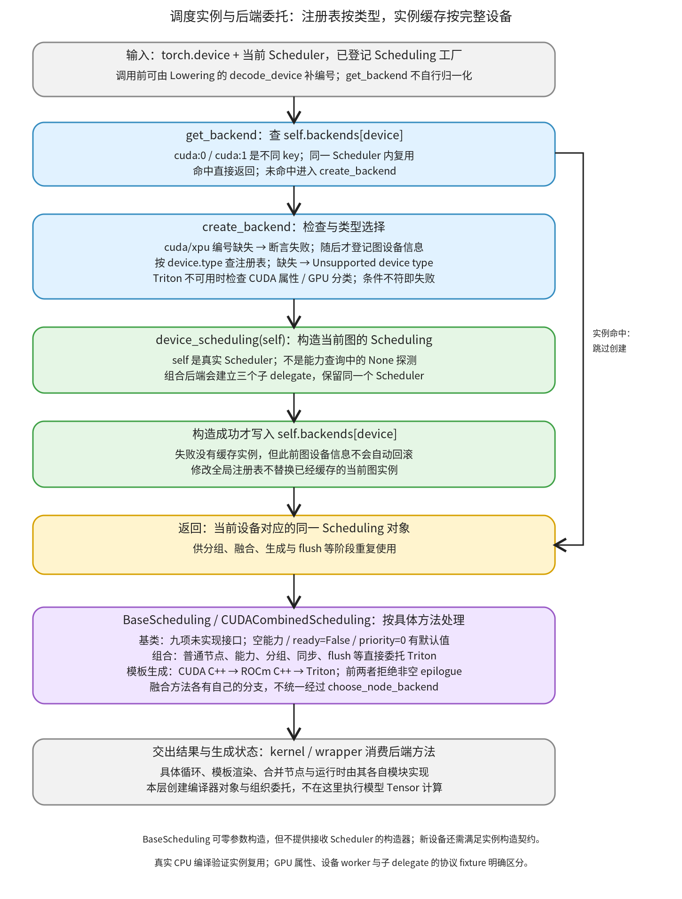

# 调度实例与后端委托：逐行看设备怎样取得本图 Scheduling

```text
Inductor  本层完成
    └── 代码生成与运行封装  本层完成
        └── 设备 kernel 与方案选择  本层完成
            └── 后端与循环组织  本层完成
                └── 调度实例与后端委托 ← 当前篇  叶子·逐行完成
```

<!-- child-links:start -->

<!-- child-links:end -->

[返回后端与循环组织](../README.md)。注册表保存的是类或工厂，本模块为当前 Scheduler、当前完整设备创建并复用 Scheduling 实例，再通过实例上的具体方法把工作交给目标生成器。设备类型 key、带编号的实例 key、能力探测对象与本图后端对象分别承担不同角色。

本篇完整逐行覆盖 utils.py 的 decode_device（222–230）与 is_gpu（1799–1801），Scheduler.create_backend/get_backend（3333–3361），BaseScheduling 整类（3592–3696），以及 cuda_combined_scheduling.py 全部 100 行。具体 CPU/Triton/CUDA C++/ROCm C++ 循环或模板算法仍归后续生成职责；节点实际合并归融合维护模块，不能因本篇调用了它们就视为已完整展开。

## 1. 先查本图实例，再决定是否创建



调用者传入 torch.device。get_backend 先查当前 Scheduler.backends，以完整设备区分 cuda:0 与 cuda:1；已有实例就直接返回。只有 miss 才调用 create_backend：检查 GPU 编号、记录图设备信息、按类型取注册工厂、检查相应 Triton 条件，然后执行工厂(self)。成功得到对象后才写实例缓存。

设备编号通常应在进入本接口前准备好。decode_device 是 Lowering 等调用处使用的归一 helper；get_backend/create_backend 不会自己补调它。本文把 helper 也完整讲完，是为了说明这个前置条件如何形成，而不是在图上虚构一次隐式归一化调用。

取得实例后，分组、融合、节点生成和 flush 等阶段会重复使用它。BaseScheduling 提供部分默认值和未实现接口；CUDACombinedScheduling 则为不同方法分别决定委托。它不是把所有调用统一交给 choose_node_backend。

## 2. 设备准备：编号归一与 GPU 分类是两条规则

原始源码：[utils.py 第 222 行](/work/pytorch/torch/_inductor/utils.py:222)至第 230 行。

```python
def decode_device(device: Union[Optional[torch.device], str]) -> torch.device:
    if device is None:
        return torch.tensor(0.0).device  # default device
    if isinstance(device, str):
        device = torch.device(device)
    if device.type not in ("cpu", "meta") and device.index is None:
        device_interface = get_interface_for_device(device.type)
        return torch.device(device.type, index=device_interface.Worker.current_device())
    return device
```

| 行 | 当前数据与动作 |
| --- | --- |
| 222 | 接收 None、设备字符串或 torch.device，返回设备对象。 |
| 223–224 | None 时创建标量 Tensor 并取其 device，遵从当前默认设备；这一步并非纯字符串转换。 |
| 225–226 | 字符串先经 torch.device 解析；非法字符串会在这里失败。 |
| 227 | 对不是 cpu/meta 且编号缺失的类型补编号，判断不局限于 cuda/xpu。 |
| 228 | 按类型取得共享 DeviceInterface。 |
| 229 | 通过接口 Worker.current_device 取编号，建立新的带编号设备对象。 |
| 230 | 不需要补编号时原样交回 device；原输入已是对象且编号明确时保持对象身份。 |

例如 worker 接口给出编号 2，cuda 字符串变成 cuda:2，privateuseone 也能走相同补编号分支；cuda:1 保留编号 1。这里的“能解析和补编号”不表示相应设备分配器或 kernel 已实现。DeviceInterface 的具体设备操作归 wrapper/设备接口职责。

原始源码：[utils.py 第 1799 行](/work/pytorch/torch/_inductor/utils.py:1799)至第 1801 行。

```python
def is_gpu(device: str):
    assert isinstance(device, str) or device is None, device
    return device in ["cuda", "xpu"]
```

1799 定义共享 GPU 分类函数；1800 断言参数是字符串或 None；1801 只把 cuda/xpu 判为 GPU。None 与其他字符串返回 False。

它与 decode_device 的条件不同：PrivateUse1 可以通过接口补编号，但在这个 is_gpu 集合中仍是 False。下面的 create_backend 正是使用这个分类，所以不能把“未触发某个 GPU 检查”解释成新设备已经完整可用。

## 3. create_backend/get_backend：成功后才缓存实例

原始源码：[scheduler.py 第 3333 行](/work/pytorch/torch/_inductor/scheduler.py:3333)至第 3361 行。

```python
    def create_backend(self, device: torch.device) -> BaseScheduling:
        assert (
            not is_gpu(device.type) or device.index is not None
        ), f"{device} should have been normalized in lowering"
        V.graph.add_device_info(device)

        device_scheduling = get_scheduling_for_device(device.type)
        if device_scheduling is None:
            raise RuntimeError(f"Unsupported device type: {device.type}")

        if not has_triton():
            if (
                device.type == "cuda"
                and (device_props := torch.cuda.get_device_properties(device)).major < 7
            ):
                raise RuntimeError(
                    f"Found {device_props.name} which is too old to be supported by the triton GPU compiler, which is used as the backend. Triton only supports devices of CUDA Capability >= 7.0, but your device is of CUDA capability {device_props.major}.{device_props.minor}"  # noqa: B950
                )
            elif is_gpu(device.type):
                raise RuntimeError(
                    "Cannot find a working triton installation. Either the package is not installed or it is too old. More information on installing Triton can be found at https://github.com/openai/triton"  # noqa: B950
                )

        return device_scheduling(self)

    def get_backend(self, device: torch.device) -> BaseScheduling:
        if device not in self.backends:
            self.backends[device] = self.create_backend(device)
        return self.backends[device]
```

### 3.1 创建过程中的状态变化

| 行 | 当前数据与动作 |
| --- | --- |
| 3333 | 接收当前 Scheduler 与一个 torch.device，声明返回 BaseScheduling 协议对象。 |
| 3334–3336 | cuda/xpu 必须已有编号；否则在任何 add_device_info 之前抛 AssertionError。这个函数不自行归一化。 |
| 3337 | 将设备交给 V.graph.add_device_info，更新当前图的设备状态；不是在这里创建 runtime stream。 |
| 3339 | 用 device.type 查询注册的 Scheduling 类/工厂，完整设备编号不作为注册表 key。 |
| 3340–3341 | 槽位为 None 时抛 Unsupported device type；没有自动注册或切到 CPU。 |
| 3343 | 查询 has_triton。即使登记的是自定义 Scheduling，也按这里的条件继续检查。 |
| 3344–3347 | Triton 不可用时，若类型为 cuda，则实际调用属性查询；用赋值表达式保存 device_props，并检查 major 是否小于 7。 |
| 3348–3350 | 旧 CUDA 能力分支抛带设备名称与 major/minor 的专门错误。 |
| 3351–3354 | 其余 is_gpu 类型仍因无可用 Triton 抛错误；CPU 和当前集合外的类型不进入这一错误。 |
| 3356 | 调用所查工厂，并把当前 Scheduler 本体 self 传入，返回构造结果。不是上一叶子的 Scheduling(None) 能力探测。 |

这里的检查依设备类型与 has_triton，而不检查所登记类是否实际需要 Triton。所以仅在 cuda 槽登记一个自定义非 Triton 工厂，并不会绕开本版本的这道前置条件。

add_device_info 已在后面多数失败之前执行；注册缺失、属性查询失败或构造异常不自动回滚图设备记录。该方法完整实现已在[图上下文叶子](../../../../02-lowering/01-interpretation/01-context-symbols/README.md)覆盖，这里使用其接口。

### 3.2 实例缓存属于当前 Scheduler

| 行 | 当前数据与动作 |
| --- | --- |
| 3358 | 定义带缓存的设备后端获取入口。 |
| 3359 | 检查完整 torch.device 是否在 self.backends。 |
| 3360 | miss 时先执行 create_backend；只有右侧构造成功返回，才把对象赋给该 device。异常不写入一个半成品后端。 |
| 3361 | 返回对应对象。hit 不再执行创建、设备记录和前置检查。 |

因此同一图 cuda:0 连续查询取得同一实例，cuda:1 可以得到另一实例。全局注册表在中途改成新类，也不替换已经缓存的 cuda:0 对象；另一个 Scheduler 才会按新登记创建自己的实例。直接调用 create_backend 本身则没有这层缓存保证。

## 4. BaseScheduling：默认行为、转交与未实现接口

原始源码：[scheduler.py 第 3592 行](/work/pytorch/torch/_inductor/scheduler.py:3592)至第 3696 行。

```python
class BaseScheduling:
    @classmethod
    def get_backend_features(cls, device: torch.device) -> Sequence[BackendFeature]:
        """Return a set of .codegen.common.BackendFeature()"""
        return ()

    def can_fuse_vertical(
        self, node1: BaseSchedulerNode, node2: BaseSchedulerNode
    ) -> bool:
        """
        Check whether node1 and node2 can be vertically fused or not.
        """
        raise NotImplementedError

    def can_fuse_horizontal(
        self, node1: BaseSchedulerNode, node2: BaseSchedulerNode
    ) -> bool:
        """
        Check whether node1 and node2 can be horizontally fused or not.
        """
        raise NotImplementedError

    def fuse(
        self, node1: BaseSchedulerNode, node2: BaseSchedulerNode
    ) -> FusedSchedulerNode:
        """
        Fuse two nodes
        """
        if node1.is_foreach() or node2.is_foreach():
            return ForeachKernelSchedulerNode.fuse(node1, node2)
        else:
            return FusedSchedulerNode.fuse(node1, node2)

    def group_fn(
        self, sizes: Sequence[Sequence[sympy.Expr]]
    ) -> Tuple[Tuple[sympy.Expr, ...], ...]:
        """
        Process the iteration sizes in case a transformation needs to be applied.
        """
        raise NotImplementedError

    def codegen_template(
        self,
        template_node: BaseSchedulerNode,
        epilogue_nodes: Sequence[BaseSchedulerNode],
    ) -> Optional[str]:
        """
        Given a template node, generate a kernel.

        This function is only available for triton now. If the third-party backend behaves as a sub-class
        of TritonScheduling, it can override it or reuse it.
        """
        raise NotImplementedError

    def codegen_node(self, node: Union[FusedSchedulerNode, SchedulerNode]) -> None:
        """
        Generate a kernel given a list of pre-fused nodes.
        """
        raise NotImplementedError

    def codegen_sync(self) -> None:
        """
        Generate synchronization code for the kernel. This method depends on the hardware characteristics.
        """
        raise NotImplementedError

    def ready_to_flush(self) -> bool:
        """
        Check whether the backend is requesting the scheduler to flush the generated kernel.
        If not supported, please return False.
        """
        return False

    def flush(self) -> None:
        """
        Flush the generated kernel and python wrapper code to the source code file.
        """
        raise NotImplementedError

    def benchmark_fused_nodes(
        self, nodes: Sequence[BaseSchedulerNode]
    ) -> Tuple[float, str]:
        """
        Benchmark fused list of nodes and return the execution time
        in milliseconds on randomly generated inputs.
        """
        raise NotImplementedError

    def get_fusion_pair_priority(
        self, node1: BaseSchedulerNode, node2: BaseSchedulerNode
    ) -> int:
        """
        Return an unsigned integer which represents the priority of this fusion pair.
        The smaller is with higher priority.
        """
        return 0

    def benchmark_combo_kernel(
        self, node_list: Sequence[BaseSchedulerNode]
    ) -> Tuple[float, float, str]:
        """
        Benchmark the list of nodes to combine and return the execution time
        and memory copy time in milliseconds on randomly generated inputs.
        """
        raise NotImplementedError
```

### 4.1 类本身没有强制抽象化，也没有 Scheduler 构造器

3592 定义普通 Python 基类，没有 ABC/abstractmethod。可以零参数实例化 BaseScheduling，但它没有提供 `__init__(scheduler)`；直接 BaseScheduling(None) 实测抛 TypeError。扩展若继承它，仍需满足“工厂接收当前 Scheduler、能力查询时接收 None”的构造契约。

3593–3596 定义类方法 get_backend_features：接收类与设备，注释说返回能力集合，实际默认交回空 tuple。它没有默认宣告任何能力，也不查询设备硬件。

### 4.2 融合判断与节点合并分开

| 行 | 当前数据与动作 |
| --- | --- |
| 3598–3600 | 定义纵向融合判定，接收两个调度节点，声明返回 bool。 |
| 3601–3604 | 文档交代用途，实际默认抛 NotImplementedError；不是默认返回 False。 |
| 3606–3608 | 定义横向融合判定，同样接收两个节点。 |
| 3609–3612 | 默认仍抛 NotImplementedError。 |
| 3614–3616 | fuse 接收待合并节点并声明交回合并后的调度节点。 |
| 3617–3619 | 文档只说明合并动作，不在此判定数学合法性。 |
| 3620 | 只要任一节点是 foreach，就选择专用合并；or 会短路第一项为真的情况。 |
| 3621 | 转交 ForeachKernelSchedulerNode.fuse，并原样返回其结果。 |
| 3622–3623 | 否则转交普通 FusedSchedulerNode.fuse。 |

can_fuse 是可否合并的后端判断，fuse 则进行节点组织；不能把 fuse 的默认存在当成所有节点对都已通过融合检查。具体依赖/合法性见融合模块，合并后的图映射和依赖更新归融合维护职责。

### 4.3 生成、同步和 flush 的每项接口

| 行 | 接收与交出什么 | 默认动作 |
| --- | --- | --- |
| 3625–3631 | group_fn 接收各迭代/归约范围序列，预期交回处理后的分组范围。 | 文档说明可作范围变换，默认抛 NotImplementedError。 |
| 3633–3644 | codegen_template 接收模板节点和 epilogue 节点序列，返回类型允许 str 或 None。 | 默认抛 NotImplementedError；3638–3643 的注释保留历史 Triton 说明，当前实际组合类已另有 CUDA/ROCm 模板分支，应以其实现为准。 |
| 3646–3650 | codegen_node 接收普通或已经融合的调度节点，为其生成 kernel。 | 默认抛 NotImplementedError。 |
| 3652–3656 | codegen_sync 接收当前对象状态，生成与设备相关的同步代码。 | 默认抛 NotImplementedError，不在此完成硬件同步。 |
| 3658–3663 | ready_to_flush 返回是否请求调度器提前 flush。 | 注释说明不支持可返回 False；实际默认 False，不表示永远不需要最终 flush。 |
| 3665–3669 | flush 消费后端已积累的生成状态，将 kernel/wrapper 文本输出。 | 默认抛 NotImplementedError。 |

group_fn 的 sizes、模板加 epilogue、普通节点 codegen 是不同输入协议。新设备不能仅实现一个打印源码的方法就认为这些接口均已具备。反过来，某些可选路径未触发时不一定调用全部方法；应按真正宣告支持的路径落实它们。

调度器还存在可选组合 kernel 等扩展调用，不都写在 BaseScheduling 中。例如 foreach 生成的特定类型检查见 [scheduler.py](/work/pytorch/torch/_inductor/scheduler.py:3452)。宣告 FOREACH 能力，不会自动改变这些消费者的类型约束。

### 4.4 benchmark 与优先级的默认值

| 行 | 当前数据与动作 |
| --- | --- |
| 3671–3673 | benchmark_fused_nodes 接收节点序列，返回协议为耗时 float 与源码 str。 |
| 3674–3678 | 文档规定随机输入上的毫秒计时，基类默认抛 NotImplementedError；没有生成一个虚构默认耗时。 |
| 3680–3682 | get_fusion_pair_priority 接收一对节点，声明返回 int。 |
| 3683–3687 | 文档规定数值越小优先级越高，实际默认 0，使基类不为不同节点对提供差异化优先级；这里不另外校验所谓 unsigned 范围。 |
| 3689–3691 | benchmark_combo_kernel 接收组合节点列表，协议返回执行耗时、复制耗时与源码。 |
| 3692–3696 | 文档同样以毫秒约定时间，基类抛 NotImplementedError。 |

缺少 benchmark 实现不会神奇地产生可用测速结果。是否触发测速由更外层策略决定；本篇协议实验只记录委托标签，不将其当毫秒数据。

## 5. CUDACombinedScheduling：不同方法各自委托

原始源码：[codegen/cuda_combined_scheduling.py 第 1 行](/work/pytorch/torch/_inductor/codegen/cuda_combined_scheduling.py:1)至第 100 行。

```python
# mypy: allow-untyped-defs
from typing import Sequence, Union

from ..scheduler import (
    BaseSchedulerNode,
    BaseScheduling,
    FusedSchedulerNode,
    Scheduler,
    SchedulerNode,
)
from .cuda.cuda_cpp_scheduling import CUDACPPScheduling
from .rocm.rocm_cpp_scheduling import ROCmCPPScheduling
from .triton import TritonScheduling


class CUDACombinedScheduling(BaseScheduling):
    """
    Scheduler for CUDA Kernels, which delegates calls as appropriate
    to the CUDA-C++ and Triton Schedulers, which both work for CUDA devices
    and use a unified-wrapper for codegen.

    If Scheduling code needs to be specialized for the case of mixed Triton / CUDA C++ code,
    this would also be the place to do it.
    """

    def __init__(self, scheduler: Scheduler) -> None:
        super().__init__()
        self._scheduler = scheduler
        self._triton_scheduling = TritonScheduling(scheduler)
        self._cuda_cpp_scheduling = CUDACPPScheduling(scheduler)
        self._rocm_cpp_scheduling = ROCmCPPScheduling(scheduler)

    def get_backend_features(self, device):
        return self._triton_scheduling.get_backend_features(device)

    def choose_node_backend(self, node: BaseSchedulerNode) -> BaseScheduling:
        if self._cuda_cpp_scheduling.is_cuda_cpp_template(node):
            return self._cuda_cpp_scheduling
        if self._rocm_cpp_scheduling.is_rocm_cpp_template(node):
            return self._rocm_cpp_scheduling
        return self._triton_scheduling

    def can_fuse_vertical(self, node1: BaseSchedulerNode, node2: BaseSchedulerNode):
        if self._cuda_cpp_scheduling.can_fuse_vertical(node1, node2):
            return True
        return self._triton_scheduling.can_fuse_vertical(node1, node2)

    def can_fuse_horizontal(self, node1: BaseSchedulerNode, node2: BaseSchedulerNode):
        for node in (node1, node2):
            if self._cuda_cpp_scheduling.is_cuda_cpp_template(node):
                return self._cuda_cpp_scheduling.can_fuse_horizontal(
                    node1, node2
                )  # always False at the moment
        return self._triton_scheduling.can_fuse_horizontal(node1, node2)

    def group_fn(self, sizes):
        return self._triton_scheduling.group_fn(sizes)

    def codegen_template(
        self,
        template_node: BaseSchedulerNode,
        epilogue_nodes: Sequence[BaseSchedulerNode],
    ):
        if self._cuda_cpp_scheduling.is_cuda_cpp_template(template_node):
            assert epilogue_nodes is None or len(epilogue_nodes) == 0
            return self._cuda_cpp_scheduling.codegen_template(
                template_node, epilogue_nodes
            )
        elif self._rocm_cpp_scheduling.is_rocm_cpp_template(template_node):
            assert epilogue_nodes is None or len(epilogue_nodes) == 0
            return self._rocm_cpp_scheduling.codegen_template(
                template_node, epilogue_nodes
            )
        else:
            return self._triton_scheduling.codegen_template(
                template_node, epilogue_nodes
            )

    def codegen_node(self, node: Union[FusedSchedulerNode, SchedulerNode]):
        return self._triton_scheduling.codegen_node(node)

    def codegen_sync(self):
        return self._triton_scheduling.codegen_sync()

    def flush(self):
        return self._triton_scheduling.flush()

    def codegen_combo_kernel(self, *args, **kwargs):
        return self._triton_scheduling.codegen_combo_kernel(*args, **kwargs)

    def benchmark_fused_nodes(self, nodes):
        return self._triton_scheduling.benchmark_fused_nodes(nodes)

    def generate_kernel_code_from_nodes(self, nodes, benchmark_kernel=False):
        return self._triton_scheduling.generate_kernel_code_from_nodes(
            nodes, benchmark_kernel
        )

    def benchmark_combo_kernel(self, node_list):
        return self._triton_scheduling.benchmark_combo_kernel(node_list)
```

### 5.1 导入、构造与能力来源

| 行 | 当前数据与动作 |
| --- | --- |
| 1–2 | mypy 设置和 Sequence/Union 类型导入，不执行后端选择。 |
| 4–10 | 导入调度节点、基类与 Scheduler 类型，供继承和签名使用。 |
| 11–13 | 导入三个具体 Scheduling 类：CUDA C++、ROCm C++ 与 Triton。 |
| 16 | 定义继承 BaseScheduling 的组合对象。 |
| 17–24 | 原注释说明多种 CUDA 代码生成共享 wrapper，并为混合生成留集中适配位置；后面的具体分支才决定实际委托。 |
| 26–28 | 接收 Scheduler，执行基类初始化，再把它保存在 _scheduler。 |
| 29 | 立即构造 TritonScheduling(scheduler)，保存在字段。 |
| 30 | 立即构造 CUDACPPScheduling(scheduler)，不是等遇到模板才懒创建。 |
| 31 | 同样立即构造 ROCmCPPScheduling(scheduler)。三个子对象接收同一个 Scheduler。 |
| 33–34 | 能力查询只转交 Triton 子对象，并原样返回；不是三个子对象能力集合的并集。 |

因此一次能力探测若经注册工厂构造该类，也要让这三个构造器处理 None。组合对象的 wrapper 并不在这里重新创建；它们使用同一图的生成上下文。

### 5.2 选择 helper 与融合方法没有统一成一次分发

| 行 | 当前数据与动作 |
| --- | --- |
| 36–38 | choose_node_backend 先问是否 CUDA C++ 模板，是则交回 CUDA 子对象。 |
| 39–40 | 再问是否 ROCm C++ 模板，是则交回 ROCm 子对象。 |
| 41 | 其余交回 Triton；两个谓词都为真时前面的 CUDA 分支先返回。 |
| 43–45 | 纵向融合先调用 CUDA C++ 谓词，若为真立即 True。 |
| 46 | 前者为假，转交 Triton 判定；并未调用 ROCm 纵向谓词。 |
| 48–50 | 横向融合依次检查两个节点，任一被 CUDA C++ 分类便进入专用分支。 |
| 51–53 | 直接返回 CUDA C++ 横向谓词结果；不再继续尝试 Triton。 |
| 54 | 无 CUDA C++ 模板时才转交 Triton，单有 ROCm 标记也沿这条路径。 |

本地 Inductor Python 源码检索只发现 choose_node_backend 的定义，没有发现调用处。本类后续方法也没有统一调用它。它表达一种选择规则，但不能由此推导普通 codegen_node 会自动为 CUDA 模板选择 CUDA C++。

53 行的注释写“目前总 False”，但当前真实 CUDACPPScheduling 没有实现 can_fuse_horizontal，沿 BaseScheduling 实际抛 NotImplementedError。元数据实验直接执行这条真实路径确认了这一点，没有把注释当作返回值；它只验证局部调用，不代表完整调度链一定会提交这类融合候选。

### 5.3 分组与模板分支

| 行 | 当前数据与动作 |
| --- | --- |
| 56–57 | group_fn 始终转交 Triton，不根据节点类型重新选择子对象。 |
| 59–63 | codegen_template 接收模板节点和 epilogue 序列。 |
| 64 | 首先检查 CUDA C++ 模板。 |
| 65 | 该分支只接受 None 或长度为零的 epilogue；非空立即 AssertionError。 |
| 66–68 | 把原模板节点与 epilogue 交给 CUDA C++ 子对象，原样返回结果。 |
| 69 | 若非 CUDA，继续检查 ROCm C++ 模板。 |
| 70 | ROCm 分支也在此拒绝非空 epilogue。 |
| 71–73 | 交给 ROCm 子对象并返回。 |
| 74–77 | 其余模板连同原 epilogue 交给 Triton，本层没有同样的空序列断言。 |

允许 None 通过本层断言，不等于保证具体子实现也支持 None；实际 Scheduler 从模板组拆出的 epilogue 是列表。具体 CUDA/ROCm 模板渲染与调用参数仍在生成职责覆盖范围。

### 5.4 其余方法全部明确转交 Triton

| 行 | 接收与转交 |
| --- | --- |
| 79–80 | codegen_node 直接把普通/融合节点交给 Triton；不调用 choose_node_backend。 |
| 82–83 | codegen_sync 直接转交 Triton。 |
| 85–86 | flush 直接转交 Triton 的积累状态。 |
| 88–89 | codegen_combo_kernel 原样传递全部 args/kwargs。 |
| 91–92 | benchmark_fused_nodes 原样传 nodes，交回子实现结果。 |
| 94–97 | generate_kernel_code_from_nodes 原样传 nodes 和 benchmark_kernel 标志，默认 False。 |
| 99–100 | benchmark_combo_kernel 原样传 node_list，交回子实现结果。 |

组合类没有覆盖 ready_to_flush、get_fusion_pair_priority 或 fuse，继承上一段的 False、0 和按 foreach 选择合并的行为。特别是 ready_to_flush 并未自动问 Triton 子对象，这与显式实现 flush 转交是两件事。


## 6. 用实际对象走完创建、复用和委托

### 6.1 真实 CPU 图：两次构造角色，一个本图缓存实例

实验登记 LessonScheduling(CppScheduling)，保留真实 CPU 生成算法，仅记录构造与 Scheduler.get_backend/create_backend 事件。图计算 `(relu(x+1)*2,)`，x 为连续 CPU float32 `[2,3]`、stride `[3,1]`：

```text
x = [[-2,-1,0], [1,2,3]]
输出 = [[0,0,2], [4,6,8]]
```

实际事件为：

```text
LessonScheduling(None)          # 能力探测
create_backend(cpu)
LessonScheduling(当前Scheduler) # 本图实例
get_backend(cpu)：miss → instance 0
get_backend(cpu)：hit  → instance 0
get_backend(cpu)：hit  → instance 0
```

构造事件有探测与本图两种角色，但实际 self.backends 中只创建一个后端。后续分组和生成重复取得它；不是每遇到一个算子就从全局注册表重新构造一套 Scheduling。

真实生成源码 [cpu_output.py](../../../../experiments/backend-dispatch/cpu_output.py) 完成编译并运行，输出与 eager 对照通过，x 保持，输出不别名 x。对象复用和数值验证各有记录，没有以单纯的工厂返回标签替代整个 CPU 编译。

### 6.2 完整设备 key 与失败后的状态

设备协议实验执行真实 Scheduler 方法，receiver 仅提供 backends，V.graph 的 add_device_info 用记录 fixture；GPU 属性与 has_triton 也明确替换，不访问真实 GPU。

同一 receiver 查询 cuda:0 两次得到同一对象，查询 cuda:1 得到另一个。把全局 cuda 登记改成 Replacement 后，原 receiver 的 cuda:0 仍是旧对象；新 receiver 得到 Replacement。每个成功构造都验证接收的是对应 receiver。

失败与保留状态如下：

| 请求条件 | 结果 | 是否已调用图设备记录 | 后端缓存 |
| --- | --- | --- | --- |
| cuda，无编号 | AssertionError | 否 | 空 |
| meta，Scheduling 缺失 | Unsupported device type RuntimeError | 是 | 空 |
| cuda:0、has_triton=False、属性 major=6 | 设备能力过旧错误 | 是 | 空 |
| cuda:0、has_triton=False、属性 major=8 | 无可用 Triton 错误 | 是 | 空 |
| xpu:0、has_triton=False | 无可用 Triton 错误，不查询 CUDA 属性 | 是 | 空 |
| cpu、has_triton=False | 构造 Backend fixture | 是 | 有一个对象 |
| privateuseone 无编号、has_triton=False | 构造 Backend fixture | 是 | 有一个对象 |

最后一行只体现当前 is_gpu 分类没有覆盖它，不能证明该设备能分配 Tensor、生成代码或运行 kernel。create_backend 也没有替这一类型补编号。

构造器 fixture 抛 ValueError 时连续重试两次，实际构造尝试为 2、backends 仍为空，而 add_device_info 记录两次 cpu。这具体展示“没有缓存失败对象”和“先前图状态不回滚”。

decode_device 则单独执行真实 helper，用 Worker.current_device=2 的接口 fixture，得到 cuda:2、xpu:2、privateuseone:2；cpu/meta 不查询 worker，cuda:1 原样保留。None 在本进程默认 CPU 下真实创建标量并得到 cpu，未分配其他设备 Tensor。

### 6.3 基类默认值与方法级组合分发

直接实例化 BaseScheduling 后，九项未实现接口分别验证抛 NotImplementedError；空能力、ready_to_flush=False、priority=0 都按原实现返回。三个 fuse 输入组合则交给普通、foreach、foreach 合并 fixture，验证转交选择，没有假称实际节点依赖已合并。

组合后端实验构造真实 CUDACombinedScheduling，只替换三个子 delegate，记录调用并返回字符串标签。模板请求的分发为：

| 元数据标记 | choose_node_backend 返回标签 | codegen_template 的实际转交 |
| --- | --- | --- |
| 普通 | triton | triton.codegen_template |
| CUDA 模板 | cuda | cuda.codegen_template |
| ROCm 模板 | rocm | rocm.codegen_template |
| 两标记都为真（受控描述） | cuda | cuda.codegen_template |

后两种 C++ 模板分支对非空 epilogue 实际断言拒绝；普通模板将同一非空序列交给 Triton fixture。双标记描述只是条件顺序对照，不代表实验创建了真实的双后端模板 IR。

再把带 CUDA 标记的描述直接交给 codegen_node，仍记录 `triton.codegen_node`。这与模板分发不矛盾：真实 Scheduler 在调用前已根据节点种类选择 codegen_template 或 codegen_node；不是 choose_node_backend 自动包办两者。

纵向融合中 CUDA fixture 判真时只调用它一次；判假时调用次序为 cuda.vertical、triton.vertical。横向融合中出现 CUDA 标记转给 CUDA；只有 ROCm 标记仍转给 Triton。实际 CUDA C++ 横向谓词另用真实对象/模板节点元数据验证，确为 NotImplementedError；没有实际执行 GPU 融合或生成 kernel。

九项直接转交方法也分别验证命中 Triton delegate。benchmark 返回的只是诸如 `triton.benchmark_fused_nodes` 的委托标签，**不是耗时、测量或性能结论**。

## 7. 接入新设备时怎样使用这些契约

注册叶子已经说明三槽与独立设备操作表；本篇进一步落实四个接入边界：

- 归一化与 GPU 分类分别有自己的条件，新设备需要在真实调用路径中得到正确编号，而不是依赖 create_backend 自动修正。
- Scheduling 要能接收 None 探测和真实 Scheduler；本图实例可保留生成状态，不能与运行时设备句柄混为一谈。
- 需要支持的方法取决于实际消费者，缺省抛异常的接口与 False/0 默认值必须分清；组合委托不能仅靠登记多个类就自动成立。
- 新设备若复用 CUDA 类型入口，还会遇到按 cuda/xpu 类型施加的前置检查；新类型未触发检查也不是运行支持的证据。

完整脚本 [backend_dispatch.py](../../../../experiments/backend_dispatch.py) 与 [results.json](../../../../experiments/backend-dispatch/results.json) 保留真实 CPU 事件、设备/基类协议和委托标签：

```bash
PYTHONPATH=/work/pytorch python3 /work/learning/gpt6-1sol/torch/compile/inductor/experiments/backend_dispatch.py
```

本篇完整覆盖开头五段原始源码，未进一步拆目录。具体融合算法、模板渲染和 CPU/Triton 循环仍由对应模块展开；DeviceInterface、wrapper 与 allocator/stream/runtime 继续按主要归属解释。GPU/Triton/ROCm 实际编译、测速和运行都未执行。
