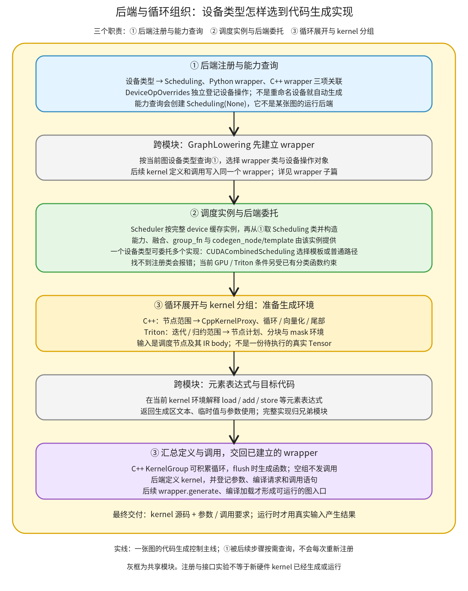

# 后端与循环组织：设备类型怎样选到 Scheduling、wrapper 和 kernel 生成路径

```text
Inductor  本层完成
    └── 代码生成与运行封装  本层完成
        └── 设备 kernel 与方案选择  本层完成
            └── 后端与循环组织 ← 当前篇  本层完成
                ├── 后端注册与能力查询  叶子·逐行完成
                ├── 调度实例与后端委托  叶子·逐行完成
                └── 循环展开与 kernel 分组  待展开
```

<!-- child-links:start -->
直接子篇：[后端注册与能力查询](01-registration/README.md)、[调度实例与后端委托](02-dispatch/README.md)。
<!-- child-links:end -->

[返回设备 kernel 与方案选择](../README.md)。本模块把图中的设备类型映射到代码生成实现，建立每个设备的 Scheduling 实例，再把调度节点的迭代/归约范围组织成目标 kernel。它交出源码、参数与调用要求，由 wrapper 和编译加载模块继续组装程序。

支持新设备时，最先需要看的是这里的注册与消费关系：设备名、Scheduling、Python/C++ wrapper、DeviceOpOverrides 是有关联但不同的对象。接入一个字符串到注册表，不会同时补齐设备分配、算子实现或运行时。

## 1. 整体交接：先登记实现，再按当前图选用



本层只有三个直接子模块：①后端注册与能力查询、②调度实例与后端委托、③循环展开与 kernel 分组。灰框是已有的 wrapper 与元素表达式模块，不复制为新的子目录。

[GraphLowering.codegen](/work/pytorch/torch/_inductor/graph.py:1775) 先建立 wrapper，再创建 Scheduler，随后驱动节点 codegen，最后让 wrapper.generate 组装图入口。①登记的表供这些阶段按需查询，不是每次生成循环都重新初始化一遍后端。

②从设备拿到的 Scheduling 是编译器对象，不是运行时 stream 或 kernel。③处理的节点含有 LoopBody、读写与范围；它们描述怎样生成程序，不是某批真实输入的计算结果。整个编译完成、调用返回程序之后，才执行最终 Tensor 运算。

## 2. 三个子模块接收和交出什么

### 2.1 后端注册与能力查询：一项设备类型关联哪些实现

输入是设备类型字符串和实现类/构造器，输出保存在 [device_codegens](/work/pytorch/torch/_inductor/codegen/common.py:96) 中。每项 [DeviceCodegen](/work/pytorch/torch/_inductor/codegen/common.py:88) 保存：

```text
设备类型 → {
  scheduling: Scheduling 类或可调用工厂,
  wrapper_codegen: Python wrapper 类,
  cpp_wrapper_codegen: C++ wrapper 类
}
```

[register_backend_for_device](/work/pytorch/torch/_inductor/codegen/common.py:137) 是直接登记入口。后续相同 key 的登记会覆盖已有项；函数没有在这里为字符串创建新的 torch.device 类型，也没有验证该类是否实现所有生成方法。查不到类型时，两个 lookup 返回 None，具体消费者再决定如何报错。

初始化还有 [init_backend_registration](/work/pytorch/torch/_inductor/codegen/common.py:196) 这条路径。CPU/CUDA/XPU 有默认实现，但只在当前类型还没登记 Scheduling 时填入，因此扩展提前登记的实现可以保留。CPU/CUDA 默认登记中使用的工厂还会依据配置选择实际实现，不能把“注册了一个 CUDA key”解释为固定只有一个 kernel 生成器。

PrivateUse1 则检查已重命名的后端及其设备模块，从模块读取 `Scheduling`、`WrapperCodeGen`、`CppWrapperCodeGen`。这版自动发现要求三项都为真才登记；相关 RuntimeError 会被捕获，初始化可以正常结束但该设备仍未接入。仅重命名 PrivateUse1 并不满足这项契约。

能力查询也消费这个表。[get_backend_features](/work/pytorch/torch/_inductor/codegen/common.py:161) 先初始化登记，再以 `Scheduling(None)` 查询指定设备的 BackendFeature。这个 None 表示此时没有一张具体图的 Scheduler；实现构造函数不能无条件要求所有图状态都已存在。返回的能力集合参与后续路径选择，不是实际跑过一次 foreach 或 reduction 的结果。

设备操作用另一张表。[DeviceOpOverrides](/work/pytorch/torch/_inductor/codegen/common.py:99) 提供 raw stream 导入、set_device、synchronize、device_guard 等代码接口；登记由 [register_device_op_overrides](/work/pytorch/torch/_inductor/codegen/common.py:256) 完成。Scheduling 注册不会自动创建这项对象。具体生成和使用归 wrapper 篇；这里负责说明它与后端选择的独立关系。

### 2.2 调度实例与后端委托：按设备复用编译器对象

输入是 `torch.device` 和当前 Scheduler，输出是该设备的 Scheduling 实例，保存到 `Scheduler.backends`。注册表按类型查找，如 `cuda`；实例缓存按完整 device 区分，如 `cuda:0` 与 `cuda:1`。

[Scheduler.create_backend](/work/pytorch/torch/_inductor/scheduler.py:3333) 记录图的设备信息，从①查实现并构造。缺少实现抛 Unsupported device type；已有 GPU 分类还涉及设备编号与 Triton 可用性检查。[get_backend](/work/pytorch/torch/_inductor/scheduler.py:3360) 则在同一张图中复用已创建实例。

Scheduling 的 [BaseScheduling 接口](/work/pytorch/torch/_inductor/scheduler.py:3592) 包括能力查询、纵横向融合判定、分组范围处理、普通/模板 codegen、同步、flush 和可选 benchmark。接口方法的调用处于不同阶段：融合判定影响调度节点的组合；group_fn 处理迭代范围；codegen_node 在已有组合上生成代码；flush 汇总缓冲内容。不能只实现一个输出源码的方法，就认为调度器的全部调用已经有实现。

设备后端可以委托多个生成器。[CUDACombinedScheduling](/work/pytorch/torch/_inductor/codegen/cuda_combined_scheduling.py:16) 根据 CUDA C++、ROCm C++ 模板条件选择专用路径，普通节点等继续委托 Triton。它把同一设备的多种生成方式接在统一 wrapper 上，并非让一个 kernel 同时执行三种实现。

这项职责交给③的不是设备名字，而是当前 Scheduling 对象、已经形成的调度节点与生成上下文。它保留的 backend 实例和图的 wrapper 会跨多个节点继续积累状态。

### 2.3 循环展开与 kernel 分组：把范围变成可写出的程序结构

输入为调度节点及其子节点、迭代/归约尺寸、LoopBody、dtype/布局与参数环境。输出为包含具体目标循环或块结构的 kernel 文本，以及写入 wrapper 的定义/调用要求。

CPU 的 [CppScheduling.codegen_node](/work/pytorch/torch/_inductor/codegen/cpp.py:4454) 从普通/融合节点取得子节点，处理循环拆分，创建 CppKernelProxy，再交 KernelGroup 汇总。proxy 会进行类型相关处理，建立每个节点的循环体函数及范围，并在当前 kernel 环境生成循环。外层循环融合和模板另有入口，不能把所有节点都走成一个普通标量 for。

[KernelGroup](/work/pytorch/torch/_inductor/codegen/cpp.py:4581) 保存参数环境、循环代码和已安排节点。flush 时生成完整函数，登记编译定义及调用，再重置分组。空组不会输出一个没有计算的函数，所以 flush 的调用次数不等于 kernel 调用次数。

Triton 的常规路径通过 [SIMDScheduling.codegen_node](/work/pytorch/torch/_inductor/codegen/simd.py:1136) 从子节点确定迭代与归约范围、生成节点计划，交给后续 kernel 上下文。最终使用程序实例、分块索引、mask 和归约组织；不是把 C++ 循环的语法直接替换为另一种字符串。具体 load/store 与元素表达式归[同层元素生成职责](../README.md)。

接入新设备时可以复用已有 Scheduling 和 kernel 类，也可以提供自己的实现；需要交付的是这些真实上下文与调用契约。已有后端代码里可能保留 cuda/xpu 等分类假设，直接复用时仍应沿实际消费者核对，不能只根据登记成功推断整条生成路径适用。

## 3. 主案例：登记的类怎样被完整 CPU 编译消费

本实验使用进程内扩展类 `LessonScheduling(CppScheduling)`、`LessonWrapper(WrapperCodeGen)`，委托现有 CPU 实现，并记录接口事件。它验证后端注册被消费，不把 CPU 委托称为已经支持新的物理设备。

输入 x/y 都是 CPU float32 `(2,3)`、stride `(3,1)`：

```text
x = [[-3,-2,-1], [0,1,2]]
y = [[ 1, 1, 1], [1,1,1]]
return (relu(x+y)*2,)
```

**登记交接。** 先以 `cpu` key 登记 LessonScheduling、LessonWrapper、现有 CppWrapperCpu。GraphLowering 随后初始化默认后端时保留这项，不会把它恢复成默认 CppScheduling 工厂。

**wrapper 交接。** 当前图只含 CPU，GraphLowering 选择 LessonWrapper 并创建对象。这个对象随后接收所有 kernel 定义与调用，不为每个点表达式重建一个 wrapper。

**能力与实例交接。** 先观察到 `LessonScheduling(None)` 的能力查询，随后观察到带真实 Scheduler 的实例构造。两者意义不同；后者进入本图的设备缓存。

**范围交接。** 普通节点的 group_fn 实际收到 `([6],[])`：六个迭代元素，没有归约范围。已有 Lowering 已把 add、relu、mul 组合到一个计算节点，此时输入是 SchedulerNode，不能把三项 Python 表达式直接数成三个调度后端调用。

**生成与 flush。** 实际事件次序为：

```text
wrapper 构造
Scheduling(None) 能力查询
Scheduling(当前 Scheduler) 构造
group_fn(([6],[]))
flush                 # 此时可为空组
codegen_node(SchedulerNode)
flush
wrapper.generate_kernel_call(cpp_fused_0)
```

两次 flush 只有一次 kernel call 登记。后端组装出的源码由 wrapper 调 async_compile.cpp_pybinding，后续编译加载完成，再调用编译后的程序。

**运行交接。** 真实结果为 `[[0,0,0],[2,4,6]]`，输入保持不变，输出不共享任何输入存储。源码见 [cpu_output.py](../../../experiments/backend-registration/cpu_output.py)，事件与运行结果见 [results.json](../../../experiments/backend-registration/results.json)。这是完整单图 CPU 编译与执行，不只是手工调用替代类的方法。

## 4. PrivateUse1 案例：自动发现在哪些条件下交付实现

每项使用独立 worker 进程，最初 PrivateUse1 名称为 privateuseone；实验内重命名为 lesson_device，生命周期不影响其他 worker 或产品环境。

| worker 条件 | 初始化后登记成功 | 交接结果 |
| --- | --- | --- |
| 名称仍为 privateuseone | 否 | 不进入重命名设备的自动发现 |
| 已重命名，设备模块未登记 | 否 | 模块查询 RuntimeError 被捕获 |
| 模块只提供 Scheduling | 否 | 需要的 wrapper 查询不完整 |
| 提供 Scheduling/Python wrapper，CppWrapperCodeGen=None | 否 | helper 将 None 视为缺失，RuntimeError 被捕获 |
| 模块三项齐全 | 是 | 可分别查到 PythonWrapper 和 CppWrapper |
| 已先显式登记 Scheduling 与 Python wrapper | 是 | 自动发现不覆盖它；省略的 C++ wrapper 仍为 NoneType |

最后一项很容易混淆。直接登记接口允许省略 C++ wrapper，并在槽位保存 `type(None)`；自动发现则要求模块的三项都可取得且为真。它们不是同一组前置条件。查到 NoneType 类也不代表已经具备可工作的 C++ wrapper，实际 C++ 生成路径仍需对应实现。

三项齐全的 worker 还运行了两个真实消费者的方法：

```text
GraphLowering.init_wrapper_code：
  设备状态 {cpu,lesson_device} → PythonWrapper 实例 + 同一 DeviceOpOverrides 对象
Scheduler.get_backend/create_backend：
  lesson_device:0 第一次 → 创建 Scheduling
  lesson_device:0 再次   → 复用同一对象
  lesson_device:1       → 创建另一对象
```

这些方法使用了最小图状态 fixture，所登记 Scheduling 仅用于接口验证，没有 kernel 生成实现，也没有 PrivateUse1 分配器。它们证明选择器和缓存消费了登记信息；新设备 Tensor、算子、kernel 或 runtime 均未执行。

另一项 worker 刻意在第一次初始化后才登记模块。再次调用初始化仍未发现新后端；清除这项初始化函数的缓存后重试，才成功登记。这说明 [lru_cache 初始化边界](/work/pytorch/torch/_inductor/codegen/common.py:195) 会影响扩展加载时机。正常接入应明确 extension 在何时加载；实验清缓存用于确认原因，不把它当成每次编译必做步骤。

## 5. 名字、能力和设备操作的三组边界

### 5.1 注册表不验证 torch.device 是否认识该名字

真实 register 接受 `not_a_torch_device` 并能原样查回 Scheduling，但 `torch.device('not_a_torch_device')` 抛 RuntimeError。同一 worker 中，预登记 CPU 实现被初始化保留；后面再次登记 cpu 又实际覆盖原项。

所以“表里有一个 key”“torch.device 能解析它”“生成器能运行它”是三个不同事实。能力查询也不只是取字典里的静态值：本版实际构造 Scheduling(None)，实验记录了这个调用。

### 5.2 DeviceOpOverrides 交付的是代码，不是在编译时切设备

CUDA 实际对象返回的字符串包括：

```python
"torch.cuda._DeviceGuard(2)"
"from torch._C import _cuda_getCurrentRawStream as stream_alias"
```

wrapper 把这些内容写入生成程序；查对象和生成字符串本身不执行 set_device、同步或发射 kernel。基类方法没有实现时实际抛 NotImplementedError。具体设备上下文进入/退出、stream 缓存和调用参数由下一篇 wrapper 设备入口继续解释。

本版 lookup 的默认导入只在整个 overrides 字典为空时触发。隔离 worker 中先登记一个其他类型的 overrides，再查 cuda，得到 None；主动导入实际 CUDA/XPU overrides 模块后，cuda 才有对象。这是当前注册顺序的真实分支，不是“缺少某个 key 就总自动导入该类”的机制。

### 5.3 GPU 分类仍要看实际调用处

本版 [is_gpu](/work/pytorch/torch/_inductor/utils.py:1799) 只列 cuda/xpu。一个重命名 PrivateUse1 类型不会仅因 Scheduling 登记成功就自动具有这些分类路径的行为；create_backend 中的编号/Triton 检查也据此分支。后续 wrapper 的 guard、stream、分配和库调用要结合设备接口解释，不能把未触发某个检查当作新设备完全可用的证据。

## 6. 接下来逐层打开哪些实现

后端注册与能力查询子篇完整展开两个注册表、默认/PrivateUse1 初始化与能力查询；调度实例与后端委托子篇展开 BaseScheduling、实例缓存和组合后端；循环展开与 kernel 分组子篇展开 CPU/Triton 范围转换及函数汇总。各职责可在一篇内覆盖紧密合作的多个函数，不按每个 getter 新建目录。

本轮十个隔离 worker 覆盖上述分支，其中一个完整 CPU 编译执行；其余为真实注册、选择器、图状态 fixture 或生成字符串验证。复现：[backend_registration.py](../../../experiments/backend_registration.py)。没有修改产品注册源码，没有运行新设备硬件、GPU/Triton 或多候选 benchmark。本篇完成本层交接；注册与能力查询、调度实例与后端委托已由子篇完整逐行展开，循环组织仍待展开。
