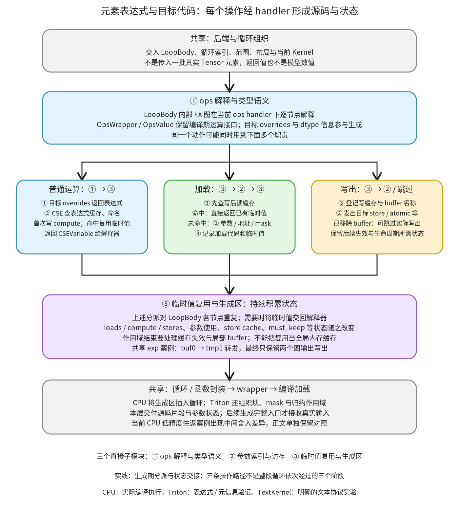

# 元素表达式与目标代码：解释循环体，生成参数、访存和临时值

```text
Inductor  本层完成
    └── 代码生成与运行封装  本层完成
        └── 设备 kernel 与方案选择  本层完成
            └── 元素表达式与目标代码 ← 当前篇  本层完成
                ├── ops 解释与类型语义  待展开
                ├── 参数索引与访存  待展开
                └── 临时值复用与生成区  待展开
```

<!-- child-links:start -->

<!-- child-links:end -->

[返回设备 kernel 与方案选择](../README.md)。本模块收到 LoopBody、当前循环索引、缓冲区布局和设备 kernel 环境，把 load、运算、类型转换、store 等操作转成目标源码。交出的是参数使用、临时值和生成区中的文本；kernel 函数封装与 wrapper 调用继续由相邻模块完成。

新设备在这里需要兑现具体的执行语义：怎样解释元素操作、怎样把逻辑索引变成正确地址、怎样表达类型与 mask、哪些临时值可以复用。注册了 Scheduling 或改掉 guard 字符串，不会自动补齐这些实现。

## 1. 整体流程：同一份循环体，在当前 handler 下生成代码



本层只有三个直接子模块：ops 解释与类型语义、参数索引与访存、临时值复用与生成区。灰框是[后端与循环组织](../01-backends-loops/README.md)以及 wrapper 等共享职责。

LoopBody 内部也可以保存 FX 图，但它描述的是 `ops.load/exp/store` 等元素动作，不是最初交给 Inductor 的 ATen GraphModule。[LoopBodyBlock.__call__](/work/pytorch/torch/_inductor/loop_body.py:569) 让 InterpreterShim 解释这个内部图，并把当前 ops handler 作为参数传进去。代码生成是在解释这些动作时发生的，没有拿模型的真实 Tensor 元素代入。

当前 handler 由 [Kernel.__enter__](/work/pytorch/torch/_inductor/codegen/common.py:1783) 安装。普通运算先经①的设备 overrides 形成表达式，再经③取得临时值；加载和写出走③的复用/状态处理与②的设备访存。三个职责在每个操作上交替参与，不是整段循环先全部执行①、再全部执行②、最后才执行③。

③积累 loads、compute、stores 等生成区，②维护参数与索引使用。后端最终把这些文本放入循环/函数，交给 wrapper、编译加载；此时返回的 CSEVariable 仍是编译期临时值描述，不是计算好的 Tensor。

## 2. 三个子模块分别接收与交出什么

### 2.1 ops 解释与类型语义

输入包括已经捕获的 LoopBody、当前索引和当前 kernel 的 ops handler。输出是目标表达式及其类型/依赖信息，继续交给③命名或复用。

[LoopBody.__call__](/work/pytorch/torch/_inductor/loop_body.py:371) 先把原索引变量替换为后端传来的循环变量，再运行 root block。InterpreterShim 临时安装 V.interpreter，逐节点解释；Kernel 的 handler 借此知道当前正在处理的操作，查询类型和范围。更基础的 V.graph/V.kernel 作用域机制见[图上下文与符号状态](../../../02-lowering/01-interpretation/01-context-symbols/README.md)。

`ops` 还有一层 OpsWrapper/OpsValue 包装，让 `a+b` 仍转回 `ops.add(a,b)`，把输入包装拆开、返回值重新包装。这是编译期运算接口重载，不能看见 Python 的加号就认为此处正在做模型数值计算。

[OpOverrides](/work/pytorch/torch/_inductor/codegen/common.py:731) 提供通用分解和向父 handler 转发；[CppOverrides](/work/pytorch/torch/_inductor/codegen/cpp.py:528) 把 exp 写成 `std::exp(...)` 等 C++ 表达式，[TritonOverrides](/work/pytorch/torch/_inductor/codegen/triton.py:610) 生成对应 Triton 表达式。缺项转发不等于自动调用一个 ATen fallback；真正是否有实现取决于 handler 链。外部算子回退另归 Lowering 的专用路径。

类型也要贯穿这条链。[DataTypePropagation](/work/pytorch/torch/_inductor/codegen/common.py:352) 将 dtype 写入内部节点的 OptimizationContext；[CppCSEVariable](/work/pytorch/torch/_inductor/codegen/cpp_utils.py:173) 除名称、数值范围，还保存 dtype、is_vec、相关迭代变量。目标 overrides 不能只吐一个看起来合法的运算字符串，却丢掉后续转换/向量化需要的类型信息。

比如 float32→float16 的显式操作，必须区分计算临时类型与落到存储的类型。CPU 还有 [legalize_lowp_fp_dtype_loopbody](/work/pytorch/torch/_inductor/codegen/cpp.py:3484) 改写低精度内部图；它会插入 load/store 转换，并对部分内部转换改写或消除。本篇后面的真实对照显示，这可能改变融合内部的舍入行为，不能笼统承诺每个逻辑中间 dtype 都对应一次实际舍入。

Triton 类型转换同样不是统一的 `.to(dtype)`：bool 使用非零判断，uint8 有经过 int8 的特殊路径，FP8 转换还可能提高 min_elem_per_thread。本篇只验证其表达式与状态生成，没有执行 Triton 程序。

### 2.2 参数索引与访存

输入是 IR 缓冲区名、元素偏移表达式、值及 store mode；输出是参数名、目标 load/store 文本和必要的索引/mask 元信息。它修改 KernelArgs 与生成区，不在这里分配模型输出 Tensor。

[KernelArgs](/work/pytorch/torch/_inductor/codegen/common.py:1194) 把外部 IR 名字变成函数内名称：例如 x_1→in_ptr0、buf1→out_ptr1、符号 s0→ks0。它同时保留反向调用关系，使 wrapper 知道该把哪个 Tensor/尺寸传给哪个形参。cpp_argdefs 和 python_argdefs 交出的列表有各自 ABI/预编译描述，不能拿某一条指针字符串当作完整调用协议。

[Kernel.rename_indexing](/work/pytorch/torch/_inductor/codegen/common.py:2029) 简化偏移，找出尺寸类符号并登记成 size 参数，再替换为函数内名字。这里的索引通常以**元素**为单位；C++ `float*` 的下标自然按元素类型寻址，不应再把偏移乘四当成同一接口输入。workspace 的 nbytes/offset 则是**字节**，与元素索引不同。

[CppKernel.load/store](/work/pytorch/torch/_inductor/codegen/cpp.py:1894) 把偏移写成指针下标；普通 store 是赋值，atomic_add 根据线程等条件选择累加或原子操作，其他 mode 可报未实现。间接加载依赖前面算出的索引，公共 Kernel 会把它放到 compute 区，不能简单把全部 load 永远提到所有计算之前。

[TritonKernel.load/store](/work/pytorch/torch/_inductor/codegen/triton.py:1721) 除地址外还处理 mask、广播、加载位置、缓存提示、block pointer、dtype 等条件。普通写、atomic_add 和 block-pointer store 有不同分支；某些原地广播写还需要额外屏障。新设备必须按自己的内存模型给出相应实现，不能把 CPU 指针下标直接改成另一种语言的 load 名称就宣称等价。

公共协议实验展示了同一套接口如何交接：old 经 mutation_real_name 归一为 x，输入名是 in_ptr0；把 x/buf0 标为原地关系后，二者引用 in_out_ptr0。最终 C++ 参数是 `float* in_out_ptr0, const int64_t ks0`，调用参数为 buf0、s0。这里只建立参数对应，没有创建 Tensor 存储。

另一个实验先申请 16 字节 workspace、再申请 32 字节，偏移分别是 0、16，总字节数 48，并合并 zero_fill 要求。Python 参数描述能携带 workspace；基础 cpp_argdefs 的 CPU 路径则明确以 `Workspace not supported on CPU` 拒绝。不同生成入口的能力不能混为一个统一成功出口。

### 2.3 临时值复用与生成区

输入是①/②给出的表达式、值和写入信息；输出是 CSEVariable 及 loads/compute/stores 等区中的代码。保留的状态包括普通表达式缓存、写后读缓存、已失效写入、必须保留的 buffer 与临时变量编号。

[Kernel.__enter__](/work/pytorch/torch/_inductor/codegen/common.py:1783) 的 CSEProxy 包住目标 overrides。普通表达式经 [CSE.generate](/work/pytorch/torch/_inductor/codegen/common.py:1509) 查缓存：首次命名并写出定义，重复表达式复用已有变量、更新 use_count 和范围；输入已经是 CSEVariable 时也可直接沿用并收紧范围。CSEVariable 还允许目标后端追加 dtype、mask 等注解。

这与**写后读转发**不同。CSEProxy.store 对普通写记录 `store_cache[buffer_name]=value`；后续 load 若命中便直接返回该临时值，不再调用设备 load。该表以 buffer 名为键，不是适用于任意不同索引读取的通用内存缓存；它依赖合法融合、循环组织和失效维护提供的上下文。索引错配等拒绝规则见[合法性与后端判断](../../../03-scheduling/02-fusion/02-legality-backends/README.md)。

缓存也有作用域。[CSE.invalidate](/work/pytorch/torch/_inductor/codegen/common.py:1491) 按保留临时值清理表达式/写后读条目，把失效 store 的名称加入 invalidated_stores；以后重新加载这样的 buffer，CSEProxy 会把它放入 must_keep_buffers，防止把仍需从内存读取的中间存储删掉。

受控实验对 f(x) 两次生成，只在第一个文本区写出 `auto tmp0 = f(x);`，第二个区不重复定义；范围从 unknown 收紧到 `[0,10]`，use_count 为 2。保留 tmp0、失效 tmp1 后，buf0 留在 store_cache，buf1 进入 invalidated_stores。clone 的非空写缓存和名称表在该案例共享，而普通表达式 cache 另起；不能将 clone 理解为所有状态的深复制。

生成区的拆分服务目标后端的调度。CPU 最后把 loads、compute、stores 等插入具体循环，[TritonKernel.codegen_body](/work/pytorch/torch/_inductor/codegen/triton.py:2360) 则按普通块或归约循环拼接，出归约作用域时还要使部分缓存失效。③交给后端的是这些片段和状态，不是一份已经完整编译好的动态库。

## 3. 主案例：两个输出共享 exp，转发的是哪个值

真实 CPU 案例：x float32、shape `[2,3]`、stride `[3,1]`，值为 `[[0,1,2],[3,4,5]]`。

```python
u = torch.exp(x)
return (u + 1, u * 2)
```

实验保留实际 LoopBody 图、每段解释后的生成区和 CSE 事件。下面的动作来自同一个 CppKernel，不是运行了三次模型。

**第一段：生成 u。** ①解释内部图中的 load x_1、exp、store buf0。②登记 in_ptr0，并写加载；①产生 `std::exp(tmp0)`，③命名 tmp1，记录 buf0→tmp1。此时生成区含：

```cpp
auto tmp0 = in_ptr0[static_cast<int64_t>(x0)];  // loads
auto tmp1 = std::exp(tmp0);                    // compute
```

以上两行取自实际生成文本，行尾是教学注释。临时的 stores 区还先登记过 out_ptr0 写出要求；最终是否保留要等局部 buffer 使用分析。

**第二段：生成 u+1。** 内部 LoopBody 请求 `ops.load('buf0', index)`，③命中 store_cache 直接交回 tmp1，②没有增加 buf0 的真实指针加载。①把常量和 add 交给③，compute 区增加 tmp2、tmp3。

**第三段：生成 u*2。** 同样读 buf0→tmp1，追加 tmp4、tmp5。注意这个具体案例只记录到一次 exp 表达式生成，后两段靠写后读转发获得 u；不能把它描述成“exp 字符串两次命中普通 CSE cache”。普通表达式重复命中由上面的独立 CSE 实验验证。

后续 [remove_kernel_local_buffers](/work/pytorch/torch/_inductor/scheduler.py:3252) 与 DeferredLine/参数维护协作，去掉本例纯内部的 buf0 存储。完整最终函数的元素主体是：

```cpp
auto tmp0 = in_ptr0[static_cast<int64_t>(x0)];
auto tmp1 = std::exp(tmp0);
auto tmp2 = static_cast<float>(1.0);
auto tmp3 = decltype(tmp1)(tmp1 + tmp2);
auto tmp4 = static_cast<float>(2.0);
auto tmp5 = decltype(tmp1)(tmp1 * tmp4);
out_ptr1[static_cast<int64_t>(x0)] = tmp3;
out_ptr2[static_cast<int64_t>(x0)] = tmp5;
```

两个图输出仍有实际写出；中间名称编号有缺口，不代表遗漏了一个模型输出。完整程序见 [shared_exp_output.py](../../../experiments/element-codegen/shared_exp_output.py)。程序真实编译执行，与 eager 数值比较通过，输入保持、输出不别名输入。实验将 cpp.simdlen 设为 1 便于观察标量代码，不据此宣称这种配置性能更好。

## 4. 非连续输入和广播：相同逻辑位置使用不同物理偏移

第二个真实案例用 x=`[[0,2,4],[1,3,5]]`，shape `[2,3]`、stride `[1,2]`；b=`[10,20,30]`，shape `[3]`、stride `[1]`，计算 x+b。

逻辑位置 `[0,0]` 读 x 偏移 0、b 偏移 0；`[1,0]` 读 x 偏移 1、b 偏移 0；`[0,1]` 读 x 偏移 2、b 偏移 1。x 沿行编号变化只走一个元素，b 则在同一列被两行重复使用。

实际后端把 x0 用作列编号、x1 用作行编号，生成两层循环：x0 范围 0..2，x1 范围 0..1。关键访问为：

```cpp
auto tmp0 = in_ptr0[static_cast<int64_t>(x1 + (2L*x0))];
auto tmp1 = in_ptr1[static_cast<int64_t>(x0)];
auto tmp2 = decltype(tmp0)(tmp0 + tmp1);
out_ptr0[static_cast<int64_t>(x1 + (2L*x0))] = tmp2;
```

结果是 `[[10,22,34],[11,23,35]]`，输出 stride `[1,2]`，没有强制变成 `[3,1]`。逻辑索引到偏移主要由 IR/布局职责提供；②接收这些偏移并用当前目标表达式打印。相关布局和 SizeVarAllocator 算法归 Lowering 的“View、广播与布局索引”，本篇不重复建立一个布局教程。

## 5. 类型对照：中间舍入与最终存储要分别验证

两组真实编译都使用 CPU float32 输入：

```python
x = [[0.1, 0.2, 0.3], [1.001, 2.002, 3.003]]
# A
return (x.to(torch.float16).to(torch.float32),)
# B
return (x.to(torch.float16),)
```

实验通过本地 decomposition 表准备包含类型转换的 FX 输入，再直接编译该图；未将未经准备的 aten._to_copy 误当作该入口的合法输入。

**A 的当前版本行为与 eager 不同。** 在本次标量 CPU 生成路径中，最终代码是从 float 指针加载、`c10::convert<float>(tmp0)`、再写 float 输出；没有保留可观察的 half 中间舍入。实际输出等于原 float32 输入；eager 先落到 float16 再转回，首元素是 0.0999755859375，最后元素是 3.00390625。本例最大绝对差为 0.0009062290191650391。

这是已实际观察并明确验证的差异，**不是 eager 等价性测试通过**。源码中的低精度 LoopBody legalization 会把部分内部 to_dtype 改为 float 并消除冗余转换；本篇不把“计算升精度”解释成一定保留所有逻辑中间舍入，也不据此推广到所有设备/配置。config 中另有 emulate_precision_casts 及相关元数据路径，本篇没有验证该路径能够修复此 CPU 案例。

**B 保留最终 half 存储。** 生成 `c10::convert<half>(tmp0)` 并写 half 输出，与 eager 比较通过。两者说明 storage dtype、compute dtype 和融合内部转换各有处理位置，新设备需要逐项核对，不能只用输出 dtype 一项判断中间数值语义。

复现源码：[A](../../../experiments/element-codegen/roundtrip_fp16_output.py)、[B](../../../experiments/element-codegen/fp16_output_output.py)。四个 CPU 案例均验证输入保持、输出不与输入存储别名；其中三例 eager 数值比较通过，A 单独保留上述差异。

## 6. 缓存失效、mask 和未实现路径的接口证据

公共 CSEProxy 实验使用明确的 TextKernel，只生成 `LOAD/ADD/STORE` 教学文本，未注册或运行一个新设备。它验证真实代理的交接：先 load x 得 tmp0，`value+value` 经 OpsWrapper 变成 ADD，再 store buf0；紧接的 load buf0 转发同一临时值。

把 dead 标记 removed 后，普通 store 仍登记 store_cache 和 store_buffer_names，但不发实际写出。全部失效后再 load buf0，出现新的 LOAD，并将 buf0 加入 must_keep_buffers。这些是实际公共代理行为，不能把已删 store 与运行时输入 mutation 混为一谈。

Triton 的生成期实验得到 bool 的 `(v != 0)`、uint8 的 `v.to(tl.int8).to(tl.uint8)`；float32→float8_e5m2 把 min_elem_per_thread 提高到 4，跨两种 FP8 格式的受限转换抛 AssertionError。TritonCSEVariable 还把已有 xmask 和 r0 引入的 rmask 传播到新变量。这里没有导入/运行 Triton kernel，也没有验证硬件上这些转换的数值或访存。

| 新设备所需接口 | 本层交付的具体约定 |
| --- | --- |
| ops / overrides 与 dtype | 普通运算、复合分解、类型传播、特殊 dtype 及错误出口与目标代码一致 |
| KernelArgs / 索引打印 | 外部 buffer/尺寸与内部形参对应，元素偏移及 workspace 字节单位清楚 |
| load/store/归约等原语 | mask、间接地址、原地写、atomic 等模式真实可生成；基类缺项不会自动实现 |
| CSEVariable / 注解 | 保留后续索引、向量化、mask 和类型转换所需的信息 |
| 缓存与生成区 | 正确界定重用和失效，满足依赖的代码不能被提到定义之前；最终只删可删中间存储 |

完整脚本：[element_codegen.py](../../../experiments/element_codegen.py)，证据：[results.json](../../../experiments/element-codegen/results.json)。复现：

```bash
cd /work/pytorch
PYTHONPATH=/work/pytorch python3 /work/learning/gpt6-1sol/torch/compile/inductor/experiments/element_codegen.py
```

本层三个子篇分别继续完整展开解释与类型、参数与访存、复用与生成区。循环拆分/向量化/归约组织归后端循环模块，最终函数与图入口封装归 wrapper、编译加载；外部算子和模板也不强行经普通元素代码生成。
