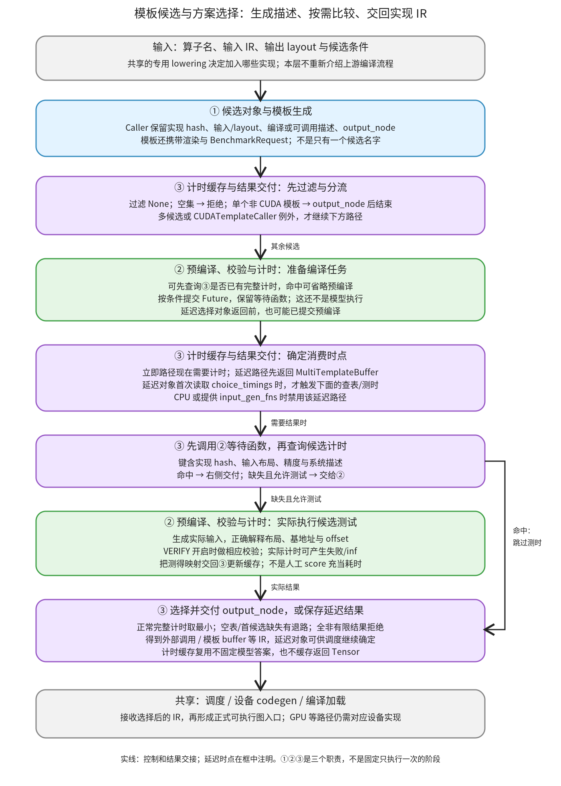

# 模板候选与方案选择：把可生成的实现变成可比较、可缓存、可交付的方案

```text
Inductor  本层完成
    └── 代码生成与运行封装  本层完成
        └── 设备 kernel 与方案选择  本层完成
            └── 模板候选与方案选择 ← 当前篇  本层完成
                ├── 候选对象与模板生成  待展开
                ├── 预编译、校验与计时  待展开
                └── 计时缓存与结果交付  待展开
```

<!-- child-links:start -->

<!-- child-links:end -->

[返回设备 kernel 与方案选择](../README.md)。本模块收到算子名、候选 Caller、输入 IR 和输出 layout，组织候选生成/编译所需的信息，查询或测得实现的耗时，再交回对应输出 IR；满足条件时也可以把选择延迟到调度阶段。返回的不是模型数值，而是后续能继续生成代码的实现描述。

对于新设备，候选需要真实提供可调用/可编译的实现、稳定的 hash、正确的输入输出布局和对应 benchmark 路径。只往 choices 列表追加一个名字，不足以完成模板支持；现有硬件信息、GPU benchmark 和输出交付路径也不自动适用于任意设备。

## 1. 整体交接：先看能否直接返回，再决定何时比较



本层三个直接子模块是：候选对象与模板生成，预编译、校验与计时，计时缓存与结果交付。专用 lowering 怎样根据算子构造候选入口，见[模板与复合算子接入](../../../02-lowering/04-special-ops/02-template-integration/README.md)；这里解释收到这些候选后发生什么。

[AlgorithmSelectorCache.__call__](/work/pytorch/torch/_inductor/select_algorithm.py:1170) 先过滤 None。空集拒绝；单个非 CUDATemplateCaller 可直接 output_node，不需要计时。多候选或 CUDA 模板例外才进入后面的预编译/缓存/比较路径。

缓存查询和预编译会交错：可先查是否已有全部计时，再决定是否提交候选编译任务；真正需要结果时等待预编译、查询计时，缺失时调用 benchmark。普通路径马上选择；延迟路径先返回 MultiTemplateBuffer，随后消费者访问 choice_timings 才触发计时查询。返回延迟对象不保证预编译也被延迟——构造该对象前已经调用了 precompile。

最终的输出 IR 继续交给调度、设备 codegen 和 wrapper。这个模块的计时缓存与 FX 图可调用程序缓存、源码/二进制缓存各有边界；命中这里不会缓存模型输出 Tensor。

## 2. 三个子模块接收与交出什么

### 2.1 候选对象与模板生成

输入是算子实现、布局、输入节点以及 tile、warp、线程、epilogue 等配置。输出是 Caller：带有 hash、预编译/计时接口和 output_node，或者一个无法生成的候选被跳过/拒绝。

[ChoiceCaller](/work/pytorch/torch/_inductor/ir.py:3993) 的关键交接并不相同：benchmark 交回耗时，hash_key 描述实现身份，output_node 才把选择结果变成 TensorBox/外部节点/模板 buffer。output_node 并不执行一次模型推理。

| 候选 | 绑定或生成时保留什么 | output_node 的典型交付 |
| --- | --- | --- |
| ExternKernelCaller | 已有 callable、输入、kwargs、out/alloc 约定及 hash | ExternKernelOut/Alloc，或指定的 fallback/kernel_creator 结果 |
| TritonTemplateCaller | 输入/layout、模板渲染函数、BenchmarkRequest、grid/配置、可变输入 | TritonTemplateBuffer |
| CppTemplateCaller | C++ 源码/BenchmarkRequest、模板与后续渲染函数 | CppTemplateBuffer |
| CUDA 专用模板 Caller | 架构与库相关源码/编译请求、workspace 等信息 | 对应专用模板 buffer，仍需处理额外资源要求 |

[ExternKernelChoice.bind](/work/pytorch/torch/_inductor/select_algorithm.py:822) 把公共 callable 绑定成本次输入/kwargs 的 Caller；[TritonTemplate.generate](/work/pytorch/torch/_inductor/select_algorithm.py:603) 生成模板代码、检查索引能力、构造测时请求，并留下可在最终 template/epilogue 条件下再次渲染的接口。[CppTemplate.generate](/work/pytorch/torch/_inductor/codegen/cpp_template.py:41) 同样收集参数、源码、额外尺寸和渲染闭包，不只是输出一段字符串。

[KernelTemplate.maybe_append_choice](/work/pytorch/torch/_inductor/codegen/common.py:2149) 只吞掉特定的 NotImplementedError；generate 也可能返回 None，后续 selector 再过滤。其他异常不因此全部变成合法候选。新设备应让“不能生成”“生成了但不能执行”“执行失败”在相应出口准确体现。

DataProcessorChoiceCallerWrapper 还可包装输入预处理和结果处理，例如上一章的 CPU 权重打包。这样各候选仍比较相同逻辑算子，但有各自的物理参数格式；wrapper 不是只改候选名。打包、模板 body、库调用和微 kernel 内部继续在此子篇展开，不在专用 lowering 篇重复覆盖。

### 2.2 预编译、校验与计时

输入是仍待比较的 Caller、IR 描述和实际 benchmark 条件。输出是候选到耗时的映射，以及必要的编译完成状态；这里会真正编译并执行测试程序，不能与单纯生成 IR 混淆。

selector 为提供 precompile 的候选建立 Future，并缓存等待函数；worker 数、超时、Python 版本条件和已有计时会影响是否提交任务。预编译阶段主要减少稍后测时时的编译等待，发生异常时会记录；它不是自动把所有失败候选从列表删掉的一次过滤。

[make_benchmark_fn](/work/pytorch/torch/_inductor/select_algorithm.py:1394) 根据 size/stride/device/dtype/offset 构造实际输入，按名称处理重复输入；外部 callable 使用带 offset 的视图，模板通常使用基地址并按自己的索引解释偏移。传入 input_gen_fns 时还要按指定方法准备数据，不能不顾稀疏/索引等算子语义随机喂数。

正确性比较受模块内 VERIFY 控制，默认是空字典，不应把“进入 benchmark”就写成一定与参考比较。本篇真实 CPU 实验显式设置 `{'atol':1e-3,'rtol':1e-3}`：先用第一个候选生成参考，再比较各候选输出。缓存命中没有重新执行这些 benchmark/VERIFY 步骤；本篇仍另外比较了正式模型输出。

某些编译/运行/未实现错误会令相应候选耗时记为 inf；错误结果的 AssertionError 可以继续抛出，不能把数值错误默认为一个可接受的慢方案。进程内与子进程路径也有差异；本篇实际运行的是 CPU、进程内计时。

[Benchmarker](/work/pytorch/torch/_inductor/runtime/benchmarking.py:79) 从 Tensor 参数推断设备，CPU 使用其 CPU 计时实现；非 CPU 默认走为 GPU 编写的路径。本机 CPU 路径按时间窗口预热、采样，以毫秒返回中位数。新设备需要核对同步、事件和设备识别，不能仅因普通函数能调用，就假定该计时实现已测到了设备真实完成时间。

②只交付本次候选测试的结果，不承诺跨尺寸、跨设备或整图的性能排序。模型推理还会受到其他 kernel、调度、内存和调用开销影响。

### 2.3 计时缓存与结果交付

输入是候选身份、算子名、输入布局键、精度条件以及按需运行 benchmark 的回调。输出为已有/新测计时，对应输出 IR，或延迟选择对象；同时可能更新本地计时文件和缓冲区状态。

[PersistentCache.lookup](/work/pytorch/torch/_inductor/codecache.py:299) 在 max_autotune 等条件下先查本地，再按条件查全局。计时是否齐全按候选 hash 逐个检查；缺失且提供 benchmark 回调时，可以重新测本次所有候选，写回本地。没有开启相关条件时，查询策略不同，不能把 lookup 描述为始终测时。

输入键包含设备 type、dtype、尺寸提示、步长提示和 offset；其外还按 op、matmul precision、choice hash 等组织。预编译函数缓存另有自己的组合键。当前 [CacheBase.get_system](/work/pytorch/torch/_inductor/codecache.py:193) 主要沿 CUDA/ROCm 与 Triton 信息建系统描述；本机 CPU 无相应设备时只剩空描述的 hash。接新设备时，应核对硬件、工具链和参数差异怎样进入缓存，而不是假定现成字段已覆盖任意后端。

普通路径中，已有完整计时可选最小者并调用 output_node；全部非有限计时会拒绝。另有容易忽略的退路：计时表为空，或第一个候选不在表中，当前 selector 会返回第一个候选的 output_node，而不是无条件在任意部分表中找最小值。本篇用明确的结构 fixture 验证了这个分支，未将 fixture 数字冒充测时。

[MultiTemplateBuffer](/work/pytorch/torch/_inductor/ir.py:4037) 则保存取计时的回调，首次读取 choice_timings 才执行，随后保存结果。它允许调度阶段结合 epilogue 再决定最终实现；[finalize_multi_template_buffers](/work/pytorch/torch/_inductor/scheduler.py:2314) 等消费者负责把最后选择接回图映射。CPU 或指定 input_gen_fns 会禁用这条延迟路径。

③交给后续的是选择结果，不是 benchmark 时用过的输出 Tensor。之后还可能重新渲染最终模板、编译或加载正式 kernel，不能把候选测试产物与图运行入口当作同一对象。

## 3. 主案例：真实 CPU 两个候选，冷进程计时、暖进程复用

算子为 X@W：X CPU float32、shape `[16,64]`、stride `[64,1]`；W 捕获为常量，shape `[64,64]`、stride `[64,1]`。两者初值由 arange 缩放构造。配置 max_autotune_gemm=True、后端 ATEN,CPP、cpp.threads=1，CPU Torch 线程也设为 1；FX 图缓存关闭，计时缓存使用本实验独有目录。

实验由两个全新的 Python 进程顺序运行。两个候选是 ExternKernelCaller(mm) 和包装 CppTemplateCaller 的候选；没有人为提供时长，实际使用原 selector 的 benchmark 函数与 CPU 实现。

**冷进程。** ①提供两个候选及各自 hash；③没有查到完整计时，②预编译 cpp_packed_gemm_0，创建一次 benchmark 函数。显式 VERIFY 下候选输出比较通过，实际测得：

| 候选 | 本次测得耗时，毫秒 |
| --- | --- |
| ATen mm | 0.008941046 |
| CPP packed GEMM | 0.001413980 |

③将两个结果写入计时缓存，选择当前最小的 CPP 候选，返回 CppTemplateBuffer；随后完整图编译执行通过。这些是本机这一次样例测量，包含各自调用路径开销，不据此报告固定加速比或其他形状的排序。

**暖进程。** 重新构造同布局和候选，但 X 的每个元素增加 1.5。候选 hash 和计时文件相同；预编译调用为空、benchmark 函数创建次数为零，读到与冷进程完全相同的两项计时，仍返回 CppTemplateBuffer。

两个进程的正式模型输出分别有首行前四项：

```text
冷：[1.3022461, 1.3027267, 1.3032074, 1.3036880]
暖：[48.5522461, 48.5761642, 48.6000824, 48.6240044]
```

两次分别与预先计算的 eager 结果比较，输入与原 W 保持、输出不别名输入。计时复用没有把输出答案固定住；暖进程跳过候选校验，但正式运行的数值比较仍实际执行了。

证据：[real-cpu.json](../../../experiments/algorithm-selection/real-cpu.json)，完整 [冷进程源码](../../../experiments/algorithm-selection/cold_output.py)、[暖进程源码](../../../experiments/algorithm-selection/warm_output.py)。每次复现会新建一个私有缓存，再让两进程共享，避免把原有缓存误当冷路径。

## 4. 一个候选、没有候选和 CUDA 模板例外

上一章的真实单 CPP 候选直接 output_node，未 benchmark。本篇另外直接调用真实 selector 控制流，使用明确的 Caller/lookup 替身验证边界；替身只返回标记，未编译设备程序。

| 输入条件 | 当前控制流 |
| --- | --- |
| `[None,a]` | 过滤后单候选，直接 output_node(a)，lookup 零次 |
| `[None]` | 空集抛 NoValidChoicesError |
| 单个 CUDATemplateCaller 类型 | 不走普通单候选快路，仍进入 lookup/比较交接 |
| 计时表 `{}` | 返回第一个候选 |
| 仅第二个候选在表中 | 因第一个缺失，仍返回第一个候选 |
| 两项表完整 | 按表中最小值交付 |
| 全部为 inf | 抛 NoValidChoicesError |

CUDA 模板的例外在源码中说明与 workspace 需求有关；本篇用该类的元信息子类验证 isinstance 分支，不声称实际分配 CUDA workspace 或运行模板。候选只有一个不能概括成“永远不需要测时/资源查询”。

上述结构实验的有限数值 1、2 只是人工排序槽位，记录不使用毫秒名义，**不是 GPU 耗时，也不与上面的真实 CPU 计时混合**。实验禁止调用 benchmark，专门证明拒绝、快路和结果交付的控制流。

## 5. 延迟对象：返回之后，谁触发计时查询

另一个元信息实验为真实 selector 提供 cuda layout 和输入 IR、两个 Caller 与明确 lookup fixture，关闭预编译等待，只验证延迟协议；没有 CUDA Tensor 存储或 kernel。

返回时是实际 MultiTemplateBuffer，lookup 调用次数为 0。随后两次读取 choice_timings，只调用 fixture lookup 一次，并复用同一字典；get_min_choice 再读取也不增加次数。它证明“保存了延迟工作”和“消费结果时执行”两个时点不同。

把 layout 改为 CPU，或传入 input_gen_fns={}，实际 selector 都转为立即路径，返回前 lookup 一次。空字典与 None 在这里不同，因为实现判断是否提供了生成器描述，不是看其真值。

该实验的预编译超时设为 0，所以没有提交任务；不能据此推断一般 MultiTemplateBuffer 返回前也不预编译。真实 GPU 的 epilogue 联合计时、模板切换和最终渲染仍待子篇，当前仅依据源码解释这些交接。

## 6. 新设备需要连起来的接口

| 接口 | 要交付的内容与边界 |
| --- | --- |
| 候选生成 / Caller | 真实输入/layout、实现 hash、可用的 output_node；不能只登记名称 |
| BenchmarkRequest / 编译 | 候选源码、参数元信息、workspace、目标工具链及预编译完成状态 |
| benchmark 与校验 | 正确的数据生成、地址/offset 语义、设备同步和可解释的返回单位；VERIFY 适用条件明确 |
| 计时缓存 | 能区分本设备/实现/精度/布局的键，以及缺失、失败、部分命中的行为 |
| 输出与延迟结果 | 正式 IR/渲染函数可被调度/codegen 消费，延迟回调有清楚的生命周期和最终确定位置 |

CPU 原生计时成功不能替代新设备上的执行验证；当前非 CPU benchmark 分派和系统信息采集有既有设备假设。模板存在、Caller 可构造和最终程序能在新设备运行需要分别举证。

复现真实 CPU：[algorithm_selection_cpu.py](../../../experiments/algorithm_selection_cpu.py)；控制流协议：[algorithm_selection_protocol.py](../../../experiments/algorithm_selection_protocol.py)，[protocol.json](../../../experiments/algorithm-selection/protocol.json)。运行：

```bash
cd /work/pytorch
PYTHONPATH=/work/pytorch python3 /work/learning/gpt6-1sol/torch/compile/inductor/experiments/algorithm_selection_cpu.py
PYTHONPATH=/work/pytorch python3 /work/learning/gpt6-1sol/torch/compile/inductor/experiments/algorithm_selection_protocol.py
```

本篇完整执行两个新进程中的 CPU 编译/模型运行，冷路径真实比较两个候选，暖路径验证计时复用；另外十项 selector 协议只验证明确替身下的分支。Triton/CUDA/ROCm 模板、GPU 子进程计时和 epilogue 联合选择未运行。三个子篇继续完整展开 Caller/模板、预编译/校验/计时、缓存/交付，通用编译任务与二进制加载归兄弟模块。
