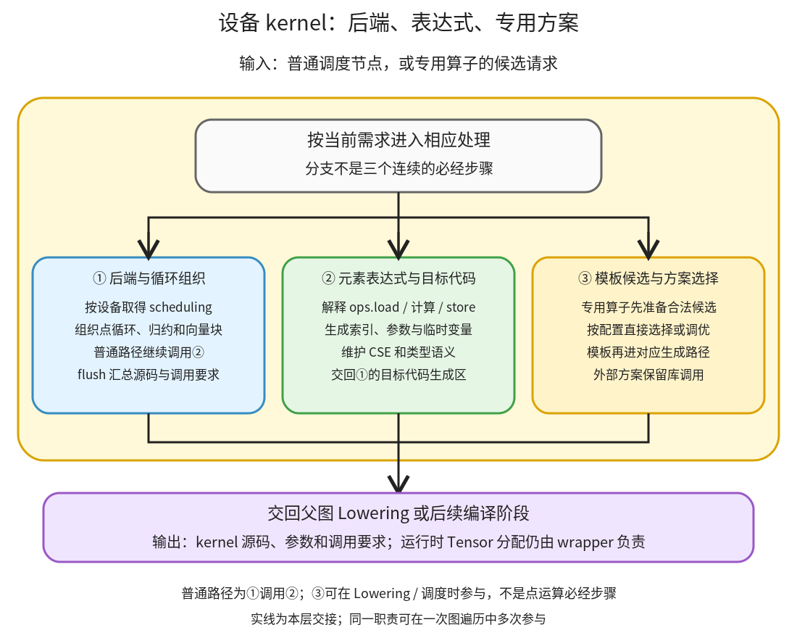

# 设备 kernel 与方案选择：把 IR 循环写成目标代码，并为专用算子选择实现

```text
Inductor  本层完成
    └── 代码生成与运行封装  本层完成
        └── 设备 kernel 与方案选择 ← 当前篇  本层完成
            ├── 后端与循环组织  本层完成
            ├── 元素表达式与目标代码  本层完成
            └── 模板候选与方案选择  本层完成
```

<!-- child-links:start -->
直接子篇：[后端与循环组织](01-backends-loops/README.md)、[元素表达式与目标代码](02-expressions-code/README.md)、[模板候选与方案选择](03-template-selection/README.md)。
<!-- child-links:end -->

[返回代码生成与运行封装](../README.md)。本模块收到调度节点、循环与布局，将元素表达式写成 C++、Triton 等目标源码；矩阵乘等专用算子还要接收或选择模板/外部实现。输出包括 kernel 源码、参数和调用要求，不是一个完整的图运行接口，也不是本次模型输出。

## 1. 普通生成路径与专用方案路径



普通计算从①进入：按设备找到 backend，组织迭代/归约范围，再在②的 ops handler 下解释循环体，生成加载、计算、写出与临时变量。后端可以积累多个循环，在 flush 时写完整函数和调用要求。

专用算子还可从③进入。其候选准备和选择可能发生在 Lowering 或调度阶段，选出的模板结果再交给相应生成路径；选外部实现时保留库调用，不强行生成一份等价通用 kernel。③不是所有点运算最后必经的调优阶段。

后端注册入口为 [init_backend_registration](/work/pytorch/torch/_inductor/codegen/common.py:196)，CPU 生成入口为 [CppScheduling.codegen_node](/work/pytorch/torch/_inductor/codegen/cpp.py:4454)，Triton 路径为 [TritonKernel](/work/pytorch/torch/_inductor/codegen/triton.py:1191)。

## 2. 三个模块怎样协作

### 2.1 后端与循环组织

收到设备和调度节点后，取得对应 scheduling 实现，访问节点的 sizes、LoopBody、融合子节点和布局。CPU CppScheduling 对普通节点创建 CppKernelProxy，组织循环、向量化与尾部处理；模板和外层循环融合等节点另有分支。

比如六个独立 float32 元素可以生成一个从 0 到 5 的循环。动态元素数则需要把尺寸作为参数传入，循环边界不能写死为第一次编译时的 6。是否采用向量化、归约如何分层等，还要看后端、范围和表达式能力。

CUDA 默认注册可以由 CUDACombinedScheduling 委托给 Triton 或 CUDA C++ 等专用路径。Triton 把迭代范围组织为程序实例、块索引、mask 和归约结构，不是简单地把 C++ 的 for 语法逐字替换。

①交给②的是当前 kernel 的参数环境、循环索引、范围和生成缓冲区。flush 时再汇总函数，交给 wrapper 定义编译请求及调用。CPU KernelGroup 还可以将多个逻辑循环放到同一导出函数，不能用 SchedulerNode 数直接数 Python 入口调用。

### 2.2 元素表达式与目标代码

收到 LoopBody 或 inner_fn 后，在当前 ops handler 下把 `ops.load/add/relu/store` 等转换为目标表达式。布局先把逻辑索引变成元素偏移；KernelArgs 将 IR 缓冲区名字映射为输入/输出指针和尺寸参数。

[CppKernel.load/store](/work/pytorch/torch/_inductor/codegen/cpp.py:1894) 把加载写为指针索引，将写出安排到相应生成区；atomic 等模式有专门处理，不能全部当普通赋值。Triton load/store 还需要边界 mask、间接索引和缓存策略等信息。

[CSE.generate](/work/pytorch/torch/_inductor/codegen/common.py:1509) 根据表达式缓存取得或新建临时变量。它是当前生成范围里的表达式复用，不是把任意两个字符串相似的跨写入加载永远视作相同；修改和失效边界仍要维护。

例如同一个 exp 结果同时用于加一与乘二，融合后可以有一份 `tmp_exp` 供两项结果使用。最终写出必须保留图输出、dtype 与必要舍入。用更高精度的临时变量不能自动取代原程序所有中间类型语义。 实际类型对照见[元素表达式与目标代码](02-expressions-code/README.md)：当前标量 CPU 路径的融合 float32→float16→float32 案例消除了中间舍入，与 eager 存在已记录差异；直接输出 float16 的对照保留最终存储转换。

②交回生成区中的文本、临时值与参数使用记录；不在这里分配返回 Tensor。运行时指针指向哪块 Tensor 存储由 wrapper 提供。

### 2.3 模板候选与方案选择

收到算子、输入布局与合法候选后，AlgorithmSelectorCache 处理候选过滤、已有选择/计时缓存，以及按条件运行的预编译和测时。一个非 CUDA 模板候选可直接交付输出节点；没有合法候选会有对应错误或配置允许的回退。

多个候选可能需要构造相同语义的输入、预编译，验证/测量后选择；延迟模板选择还可把 get_timings 等留给后续调度。不能用函数名含 autotune 就声称每次调用都实际测试多份 kernel。

这项职责的入口有 [AlgorithmSelectorCache.__call__](/work/pytorch/torch/_inductor/select_algorithm.py:1170)。某些模板还需要 workspace、架构和调用参数，选择结果要携带这些要求，不能只有一个算法名字。

③交给图和后端的是对应输出节点或模板缓冲区，以及后续生成必需的信息。具体算子怎样构造候选，链接 Lowering 的模板接入；选择器与模板生成内部在本模块继续展开，避免重复归属。

## 3. 主案例：一个点表达式怎样写成 C++

CPU float32 连续 x/y 均为 `(2,3)`，计算 `relu(x+y)*2`。Lowering 的单个 ComputedBuffer 内已包含两次加载、加法、relu 和乘法。

**①组织范围。** 节点的六个元素被组织成线性迭代范围；IR 的缓冲区引用交给 KernelArgs，形成两个输入指针和一个输出指针。

**②生成元素代码。** [真实源码](../../experiments/pointwise_output.py) 含：

```cpp
auto tmp0 = in_ptr0[static_cast<int64_t>(x0)];
auto tmp1 = in_ptr1[static_cast<int64_t>(x0)];
auto tmp2 = decltype(tmp0)(tmp0 + tmp1);
auto tmp3 = std::max(tmp2, decltype(tmp2)(0));
auto tmp4 = static_cast<float>(2.0);
auto tmp5 = decltype(tmp3)(tmp3 * tmp4);
out_ptr0[static_cast<int64_t>(x0)] = tmp5;
```

这些临时变量是一轮循环里的元素值，不各自代表一份 `(2,3)` Tensor。输入来自 wrapper 传入的 Tensor 指针，输出写到 wrapper 分配的 buf0。

**①汇总函数并交 wrapper。** CppScheduling 定义 cpp_fused_0 和对应 argtypes，wrapper 写出 async_compile.cpp_pybinding 及调用。到这一步交付的是源码和调用要求，之后编译加载才得到可执行入口。

程序真实执行的结果、输入保持和输出布局已由总篇案例验证。这里没有把源码短就直接当作测得的性能优势。

## 4. 动态尺寸需要进入参数和循环边界

缓存实验用带 ShapeEnv 的 FakeTensor 示例编译相同图，得到动态 s0/s1。其 [实际生成源码](../../experiments/cache-lifecycle/cold_output.py) 中 C++ 参数包含 ks0/ks1，循环边界使用乘积，wrapper 从真实 x.size() 取得它们。

该程序还有 `at::vec::Vectorized<float>` 的块处理与尾部加载/写出；本次生成宽度在源码中为 16，不推定所有 CPU 或所有 dtype 都固定使用此宽度。

这条程序在不同输入值及另一合法二维形状上复用时，循环边界和输出分配随运行时尺寸变化。动态代码不是把第一个 shape 的完整答案缓存起来。具体缓存适用性和运行结果见缓存篇。

## 5. 同一张图内可以有外部实现

mm→relu 案例中，mm 的实际 IR 是 ExternKernelOut，rel​​u 才进入普通 C++ 点表达式生成。最终 wrapper 调 extern_kernels.mm，再调用生成的 relu kernel。

观察到最终选了外部实现，不足以推断候选曾有多少个或实际测了多少次。本轮未采集真实 GPU 多候选调优；算法选择的单候选、缓存、失败和延迟分支都以源码为依据，后续子篇继续解释。

## 6. 下一层覆盖

后端与循环组织子篇已讲清设备注册、调度实例与 CPU/Triton 循环组织的交接，内部继续由三个职责子篇展开；元素生成子篇打开 ops、索引、参数、CSE 和类型；模板方案子篇打开 choices、编译/测试和选择缓存。当前 CPU 程序确实生成并执行，GPU 源码路径尚未运行，未报告任何虚构候选或模拟调优成绩。
