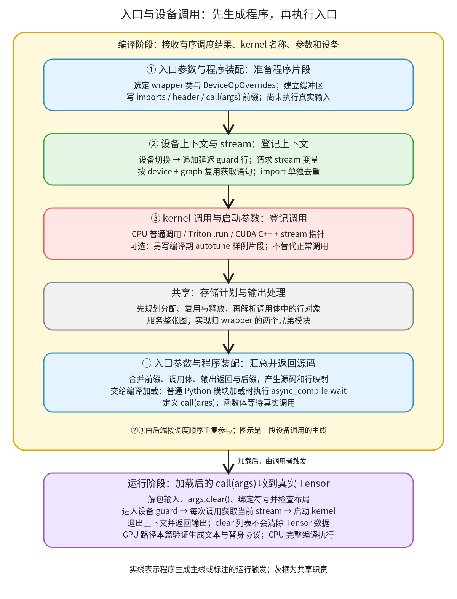

# 入口与设备调用：把调度结果装成可执行的图入口

```text
Inductor  本层完成
    └── 代码生成与运行封装  本层完成
        └── Wrapper 与存储计划  本层完成
            └── 入口与设备调用 ← 当前篇  本层完成
                ├── 入口参数与程序装配  待展开
                ├── 设备上下文与 stream  待展开
                └── kernel 调用与启动参数  待展开
```

<!-- child-links:start -->

<!-- child-links:end -->

[返回 Wrapper 与存储计划](../README.md)。本模块收到 kernel 名称、参数表达式、设备编号和有序的调度结果，生成入口函数、设备上下文和 kernel 调用语句，再把这些片段装成源码。它交出的是程序文本及行映射；运行时的 Tensor 结果由加载后的入口产生。

对于新设备，这里连接编译器与设备运行时：设备 guard 怎样写、当前 stream 怎样取、参数怎样传给 kernel，都必须与目标运行时一致。注册 wrapper 类与注册 DeviceOpOverrides 是两项接口；前者组织程序，后者提供部分设备操作的代码字符串。

## 1. 整体流程：生成语句与执行语句发生在不同时点



当前层分为三个直接子模块：入口参数与程序装配、设备上下文与 stream、kernel 调用与启动参数。图中的存储计划和输出处理由兄弟模块负责。

[GraphLowering.init_wrapper_code](/work/pytorch/torch/_inductor/graph.py:1643) 从图的设备集合中去掉 cpu、meta，要求剩余最多一种设备类型，再分别查询设备操作对象和 wrapper 类。它先创建 wrapper；后续 Scheduling 后端把定义、分配与调用写到这个对象中。这里的“写”通常是追加字符串或延迟生成的行对象，并没有执行 Tensor 运算。

[WrapperCodeGen._generate](/work/pytorch/torch/_inductor/codegen/wrapper.py:859) 在最终装配时先做存储规划，再遍历积累的行，把行对象转换成最终文本，合并 imports、header、prefix、调用体和 suffix。返回的源码需要交给[编译与加载](../../03-build-load/README.md)。普通 Python wrapper 的模块级 `async_compile.wait(globals())` 在加载生成模块时运行；`def call(args)` 的函数体在随后调用入口时运行。

## 2. 三个子模块的交接

### 2.1 入口参数与程序装配

输入包括 GraphLowering 的输入名称、符号与布局信息，以及后端陆续写入的代码片段。输出是完整的图程序。wrapper 自身保留 imports、header、prefix、suffix 和 lines 等缓冲区，因此某个 kernel 生成函数的返回值不是整张图的最终源码。

[write_prefix](/work/pytorch/torch/_inductor/codegen/wrapper.py:661) 先写等待编译任务的模块级代码，再建立 `call(args)`。例如一个 Tensor 输入 x 的入口可概括为：

```python
async_compile.wait(globals())
del async_compile

def call(args):
    x, = args
    args.clear()
    # 接着绑定符号、检查布局，执行生成的调用体，返回输出
```

这是缩写展示，不是完整生成源码。`args.clear()` 清空传入列表持有的引用；局部变量 x 仍引用该 Tensor，Tensor 的数据不会因清空列表而被清零。

[codegen_inputs](/work/pytorch/torch/_inductor/codegen/wrapper.py:1008) 先绑定显式符号输入，再从 Tensor 的 size/stride 中绑定尚未定义的直接符号。例如 x 的布局为 shape `[n,3]`、stride `[3,1]`，便生成 `x_size = x.size(); n = x_size[0]`。开启 size_asserts 后，再发出 `assert_size_stride(x, (n,3), (3,1))`。这一步把运行时 Tensor 的元信息接到后续索引和分配表达式上；它不在生成阶段读取未来那次调用的真实 Tensor。

装配时，[存储计划与复用](../README.md) 处理哪些缓冲区分配、复用和释放，[输出、别名与子图](../README.md) 提供输出引用。它们在当前树中还是待展开职责，不能把本篇入口实验当作这些实现已经全部覆盖。

### 2.2 设备上下文与 stream

输入是 Scheduler 当前切换到的设备及其 index。输出是进入/退出设备上下文的行对象和 stream 变量名；wrapper 保存最近的 guard index、已经生成的 stream 获取语句等状态。

[Scheduler.codegen](/work/pytorch/torch/_inductor/scheduler.py:3420) 在设备切换时处理 guard：先结束旧设备的上下文，再进入新设备，随后发出对应 kernel 的调用。实际是否需要 guard 由 [device_need_guard](/work/pytorch/torch/_inductor/utils.py:1805) 判断；当前版本沿用 `is_gpu` 的 cuda/xpu 分类。仅给 PrivateUse1 改名或登记 wrapper，不会自动把新设备纳入这条分支。

[codegen_device_guard_enter](/work/pytorch/torch/_inductor/codegen/wrapper.py:716) 追加 EnterDeviceContextManagerLine，而不是立即生成全部 Python 缩进。在最终遍历行时，[该行对象](/work/pytorch/torch/_inductor/codegen/wrapper.py:299) 才发出 `with ...:`、缩进和 set_device；退出行负责解除 Python 缩进。这样设备上下文与规划后的实际调用体一起落到源码中。

Python 路径调用 DeviceOpOverrides 提供的 guard、set_device 和 stream import 代码。例如 [CUDA 实现](/work/pytorch/torch/_inductor/codegen/cuda/device_op_overrides.py:1) 对接 torch.cuda 与 `_cuda_getCurrentRawStream`，[XPU 实现](/work/pytorch/torch/_inductor/codegen/xpu/device_op_overrides.py:1) 对接 torch.xpu 与相应 C 扩展入口。这里的方法返回字符串，生成时不会因此切换真实设备。

[write_get_raw_stream](/work/pytorch/torch/_inductor/codegen/wrapper.py:690) 返回如 `stream0` 的变量名，并登记 `stream0 = get_raw_stream(0)`。构造器用 lru_cache 包装该方法，键包含 device_idx 和 graph；同一 wrapper、同一图、同一设备重复请求时复用生成语句。不同图会再次生成赋值；import 则由单独的一次性方法控制。

这项缓存不保存跨运行调用的 stream 句柄。获取语句位于生成函数内部，所以每次调用入口都会重新执行 getter，然后本次调用中的多个 kernel 使用这个 stream 变量。

### 2.3 kernel 调用与启动参数

输入是 kernel 名、参数表达式、grid 和设备信息，输出是调用语句；可选地还输出独立的编译期 autotune 调用片段。参数是名称和表达式，还没有变成设备上的实际执行。

[generate_kernel_call](/work/pytorch/torch/_inductor/codegen/wrapper.py:1640) 的基础 Python 实现有三种调用形式：

| 条件 | 生成调用的形状 | 与设备运行时的约定 |
| --- | --- | --- |
| cuda=False | `compiled_kernel(x, out)` | 普通可调用对象 |
| cuda=True、triton=True | `kernel.run(x, out, grid=grid(6), stream=stream0)` | Triton launcher、grid、raw stream |
| cuda=True、triton=False | `kernel.kernel(x, out, c_void_p(stream0))` | 已加载 CUDA C++ 函数及其 stream 指针参数 |

这里历史参数名 `cuda` 的函数注释表示 GPU 路径；它不是从任意设备名自动推导出的完整兼容性承诺。传入 grid=None 时保留 grid_fn 本身，而不是构造 `grid_fn(...)`。

[prepare_triton_kernel_call](/work/pytorch/torch/_inductor/codegen/wrapper.py:1560) 把参数变成调用表达式，并在缺省时从当前调度设备获取 index。unspec 参数是否追加 `.item()` 由 [should_unwrap_unspec_arg](/work/pytorch/torch/_inductor/codegen/triton_utils.py:15) 决定，不能假定所有 Tensor 参数都这样解包。

开启 triton.autotune_at_compile_time 后，同名 kernel 第一次出现时额外生成样例参数、调优调用和清理语句，后续调用不再重复登记这份样例。正常调用体仍保留每一次调用。生成这份片段与执行调优是两个动作。开启此选项时，[_generate 调用 generate_and_run_autotune_block](/work/pytorch/torch/_inductor/codegen/wrapper.py:926)，拼接独立程序并用 exec 执行，因此调优可在生成最终图入口期间发生，不必等待用户第一次调用 call(args)。本篇实验停在片段生成，没有执行这段 GPU 调优程序。

## 3. 案例：两个 kernel 在一个设备上下文中交接

实验调用真实 WrapperCodeGen，交入两个 kernel 请求，设备设为 cuda:0，grid 为 `[6]`。x 对应一维参数，scalar 标为需要解包的 unspec 参数。为观察调用协议，guard、stream 和 kernel 使用明确的 Python 替身；没有在 GPU 上执行。

第一个请求让设备子模块追加 guard 行，随后调用子模块请求 stream0，写下 kernel_a 调用；第二个请求命中 stream 语句缓存，只写下 kernel_b 调用。最终真实行对象生成的函数体为：

```python
def generated(x, scalar):
    with device_api.guard(0):
        device_api.set_device(0)
        stream0 = get_raw_stream(0)
        kernel_a.run(x, scalar.item(), grid=grid(6), stream=stream0)
        kernel_b.run(x, scalar.item(), grid=grid(6), stream=stream0)
```

传入 CPU Tensor 与值为 4 的零维 scalar，替身记录到：进入 guard → set_device(0) → 查询 stream → a → b → 退出 guard。两次调用函数共查询 stream 两次，虽然函数源码中只有一条 getter 语句。另一个隔离案例在同一 wrapper 上换 graph 对象，再次请求设备 0，得到两条赋值、一次 import，验证两个缓存的粒度不同。

把条件改为编译期 autotune，同一个 tuned kernel 在主调用体出现两次，而独立样例片段只出现一次。参数类型数量与调用参数不一致时，生成阶段即以 AssertionError 拒绝，不会继续得到可执行的调优调用。

## 4. 真实 CPU 入口：列表释放与布局检查

真实编译案例使用 CPU float32 Tensor：shape `[2,3]`，stride `[3,1]`，值为 `[[0,1,2],[3,4,5]]`，计算 x+1。编译后直接调用生成入口，得到 `[[1,2,3],[4,5,6]]`。

交入的 args 列表从 `[x]` 变为 `[]`；另行持有的 x 内容保持不变。这验证了解包后的引用释放语义。把输入改成 shape `[3,2]`，或保持 `[2,3]` 但 stride 改为 `[1,2]`，入口都在布局断言处拒绝，因此下游 kernel 不能把任意布局当作原布局执行。

完整程序保存在 [cpu_output.py](../../../experiments/wrapper-devices/cpu_output.py)，协议函数体保存在 [protocol_body.py](../../../experiments/wrapper-devices/protocol_body.py)。实验入口是 [wrapper_devices.py](../../../experiments/wrapper_devices.py)，证据为 [results.json](../../../experiments/wrapper-devices/results.json)。复现方式：

```bash
cd /work/pytorch
PYTHONPATH=/work/pytorch python3 /work/learning/gpt6-1sol/torch/compile/inductor/experiments/wrapper_devices.py
```

## 5. 新设备应沿哪些接口继续检查

第一处是 wrapper 类选择与设备操作对象：前者必须能装配目标程序，后者必须生成目标运行时认识的 guard、set_device、synchronize 和 raw-stream import。注册关系见[后端与循环组织](../../01-kernels/01-backends-loops/README.md)。随后检查 Scheduler 的设备分类是否真的触发这些接口，避免登记了实现却没有消费路径。

第二处是 launcher 与参数协议：基础实现中的 `.run`、CUDA C++ 函数和普通 CPU 调用对参数、grid、stream 的要求不同。自定义设备可能复用其中一条，也可能需要覆盖调用生成；仅改变 stream import 不足以证明整个 launcher 可用。

第三处是 C++ wrapper。上述 EnterDeviceContextManagerLine 的 C++ 分支直接生成 CUDA guard/stream 类：JIT 首次发出 AOTICudaGuard 或 at::cuda::CUDAGuard，后续切换用 set_index；AOT 首次使用外部 stream guard，并限制后续 index 相同。实验验证了这些文本与不同 index 的 AssertionError，但没有编译或执行 GPU C++ 程序。Python DeviceOpOverrides 不会替换这部分硬编码。

此外，[CppWrapperCpu.generate_kernel_call](/work/pytorch/torch/_inductor/codegen/cpp_wrapper_cpu.py:73) 与 [CppWrapperCuda.generate_kernel_call](/work/pytorch/torch/_inductor/codegen/cpp_wrapper_cuda.py:345) 还有各自的 ABI、指针和加载约定。它们与本篇 Python 基础协议相关，但不等同。后续三个子篇分别展开入口装配、上下文与 stream、调用与参数的完整实现；存储分配、编译任务和二进制装载继续由各自模块负责。
