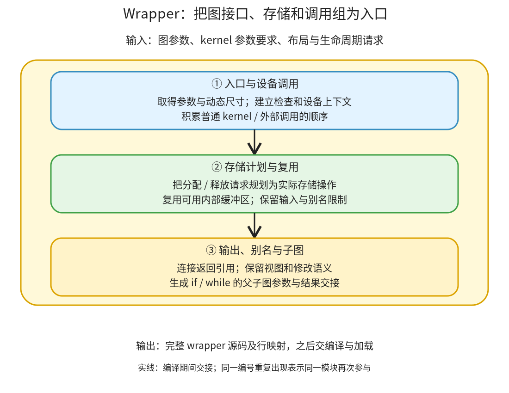

# Wrapper 与存储计划：把图参数、分配、调用和返回组织成一个程序入口

```text
Inductor  本层完成
    └── 代码生成与运行封装  本层完成
        └── Wrapper 与存储计划 ← 当前篇  本层完成
            ├── 入口与设备调用  本层完成
            ├── 存储计划与复用  待展开
            └── 输出、别名与子图  待展开
```

<!-- child-links:start -->
直接子篇：[入口与设备调用](01-entry-device-calls/README.md)。
<!-- child-links:end -->

[返回代码生成与运行封装](../README.md)。wrapper 收到图接口、kernel 参数和调用要求、布局及生命周期请求，生成一个可加载的入口。kernel 负责某段计算，wrapper 负责这次图调用中如何取得参数、准备存储、按顺序启动计算并交出正确结果。

## 1. 生成请求先积累，规划之后再写成源码



Scheduler 和后端生成期间，①积累输入检查、设备上下文与调用；②积累 AllocateLine/FreeIfNotReusedLine 等存储请求；③提供返回引用、视图和控制流结构。WrapperCodeGen._generate 最后根据推理/配置选择内存规划，把请求对象落实成实际代码，再合并头部、入口、后缀与行映射。

因此分配请求和分配语句不是同一时刻的产物。准备 buf1 的要求可以在规划后变成复用 buf0，而不是第二次分配。

主线见 [WrapperCodeGen._generate](/work/pytorch/torch/_inductor/codegen/wrapper.py:859)、[memory_plan_reuse](/work/pytorch/torch/_inductor/codegen/wrapper.py:962)、[codegen_allocation](/work/pytorch/torch/_inductor/codegen/wrapper.py:1853)。默认 JIT Python wrapper 与 C++ wrapper 的目标语法不同，本篇先沿实际 Python 产物解释接口。

## 2. 三个模块分别组织什么

### 2.1 入口与设备调用

①接收 graph_inputs、尺寸/步长需求和后端调用参数。Python 入口通常为 call(args)，按图参数顺序拆出 Tensor/标量，清空承载引用的列表，建立运行时尺寸变量并生成布局检查。

args.clear 不会清掉 Tensor 数据；del x_1 也只是释放 wrapper 持有的引用。调用者可能仍持有该输入，所以不能因此任意覆写其底层存储。

①根据设备提供 guard、stream 以及调用语法，连接普通 kernel 和外部算子。对 GPU，生成启动语句不等于每次都同步等待；debug sync、predicate.item 等特定需求另有约束。

交给②/③的是已确定参数名、调用顺序和外部引用形式；返回的完整字符串还要等待全图源码组装，不是在添加每个调用时立即执行它。

### 2.2 存储计划与复用

②接收缓冲区布局、分配与最后使用请求。AllocateLine.plan 可以从当前规划状态找已结束且复用键匹配的存储，改成 ReuseLine；FreeIfNotReusedLine 配合判断是否还需要真正删除旧引用。

图输入、常量、never_reuse_buffers 等有明确保护，不因为尺寸匹配就成为一般内部存储池。MutationLayout 不需要再按新 Tensor 分配，NonOwningLayout 要先保证其 base 可用，外部分配型算子和 MultiOutput 也不走同一份分配代码。

推理且启用 memory_planning 时可用更完整的 MemoryPlanner；否则沿一般复用规划。训练与子图作用域有相应限制，不能把所有路径都归为一个全图共享空闲栈。

②交回规划后的行对象和复用映射，再逐行写成实际分配、别名绑定或释放语句。allocated/freed 记录是编译器的登记，最终分配次数还需看生成代码。

### 2.3 输出、别名与子图

③收到 graph_outputs 的 IR 引用，生成符合其值、布局和存储关系的返回表达式。视图可以返回 reinterpret_tensor，输入修改可以返回原输入，普通结果返回新缓冲区；不能一律 clone 或一律重用输入。

条件/循环子图还要把父图参数绑定到子图局部名，再把子图输出接回父图。[codegen_subgraph](/work/pytorch/torch/_inductor/codegen/wrapper.py:1944) 在相应图上下文中生成并恢复父状态，进入/退出子图也参与存储规划作用域。

Conditional 生成 if/else，把所选分支输出写到父图容器。WhileLoop 先用 carried 输入初始化容器，每轮执行 cond，真时执行 body 并替换 carried 项；additional 参数保持原绑定。

这些是实际控制结构，不把两个分支画成每次都执行，也不把循环次数在编译时固定成样例的值。③交回返回引用和嵌套结构，供最终入口组装。

## 3. 主案例：一份 mm 存储怎样成为 relu 输出

输入为 CPU float32，x `(2,3)`、y `(3,2)`，输出 `relu(x@y)`。调度确定先外部 mm 后 relu，buf0 在 relu 后不再需要。

**①取得调用接口。** mm 接受 x/y 和 out=buf0，relu 接受内部结果并写输出。输入 shape/stride 检查生成在 call 入口，计算尚未运行。

**②登记并规划。** 有 buf0 和 buf1 两项结果需求；允许 inplace_buffers/allow_buffer_reuse 时，内部 buf0 可被 relu 复用。于是第二项请求变为 buf1=buf0，而不是第二个 empty_strided_cpu。

**③生成返回。** 返回 buf1，它继续持有内部结果存储，保持输出与输入 x/y 独立。

[真实允许版本](../../experiments/fusion-lifetime/reuse_allowed_output.py) 的关键入口为：

```python
buf0 = empty_strided_cpu((2, 2), (2, 1), torch.float32)
extern_kernels.mm(x_1, y_1, out=buf0)
del x_1
del y_1
buf1 = buf0; del buf0  # reuse
cpp_fused_0(buf1)
return (buf1, )
```

关掉两项复用开关时，[另一版](../../experiments/fusion-lifetime/reuse_disabled_output.py) 单独分配 buf1，并将 buf0/buf1 都传给 relu。输入、计算顺序和结果都相同；变化发生在存储安排及调用参数，不能归因于调度融合了 mm。

## 4. 图没有计算 kernel，wrapper 仍有语义

返回 x.expand(2,3) 时，已有实验得到零个计算 kernel、输出 stride `(0,1)` 且共享输入；返回 x.view(6) 则以新的 shape/stride 解释输入存储。wrapper 仍要取得参数、检查布局并构造返回引用。

若粗暴地为这些结果分配并复制，会改变共享存储；若把独立 clone 输出直接改成输入，又会新增别名。③必须沿 IR 的真实关系生成，不能只保证数值相等。

## 5. 循环零次时为什么不能把输出当成独立临时量

已有 CPU while 实验的 wrapper 先将输入 i/x 放入 carried 容器。若初始 i=3，条件立即为假，返回的两个对象仍分别共享原 i/x 存储；若初始 i=0，body 执行三次，返回新结果。

图的同一个输出引用因此可能在不同运行路径下别名输入。Lowering 把相应输出加入 never_reuse_buffers，②在规划时遵守该限制，③保留初始化与替换语义。不能只用三次循环的观察推断零次时也可以覆盖输出存储。

[真实条件程序](../../experiments/special-ops/cond_output.py) 和 [循环程序](../../experiments/special-ops/while_output.py) 保留精确的父子图绑定及控制结构；CPU 两条分支、三次和零次迭代都已对照数值、输入变化和别名。

## 6. 下一层边界

入口与设备调用子篇展开参数、尺寸、guard 和调用；存储子篇完整解释行对象、复用键及规划作用域；输出子篇展开视图、修改输入与控制子图连接。当前没有 GPU stream 或 C++ wrapper/AOT 的实际运行证据，相应实现继续按源码覆盖。
