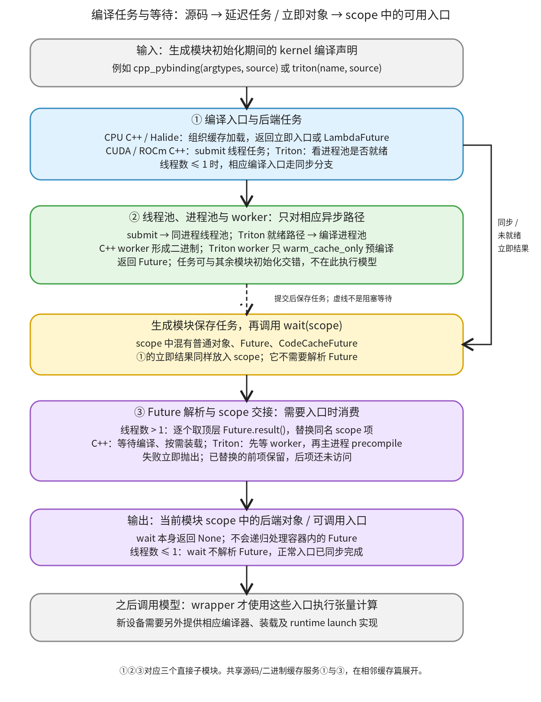

# 编译任务与等待：把后端编译请求交成当前模块能够使用的入口

```text
Inductor  本层完成
    └── 代码生成与运行封装  本层完成
        └── 编译与加载  本层完成
            └── 编译任务与等待 ← 当前篇  本层完成
                ├── 编译入口与后端任务  待展开
                ├── 线程池、进程池与 worker  待展开
                └── Future 解析与 scope 交接  待展开
```

<!-- child-links:start -->

<!-- child-links:end -->

[返回编译与加载](../README.md)。本模块收到 kernel 名称、源码和参数类型，把编译工作安排到当前线程、线程池或编译进程池，并在生成模块需要入口时解析任务结果。最终改变的是模块名字空间中的对象；模型的张量计算还没有执行。

对于新设备，这层解决两个具体问题：哪些工作能放到 worker，哪些初始化必须在当前进程完成；生成 wrapper 中的 kernel 名字怎样从“待取结果”变成可以使用的后端对象。编译器选择、二进制键和动态库装载细节由相邻的缓存与加载模块负责。

## 1. 先提交编译声明，再在模块初始化中消费结果



生成模块顶层调用①编译入口。①根据后端组织编译与加载，能够同步完成时立即返回对象，否则通过②提交任务，返回 Future 或 CodeCacheFuture。Future 表示稍后通过 `result()` 取得结果；CodeCacheFuture 是 Inductor 自己提供相同消费接口的包装基类。

例如，下面是 CPU 生成模块中交接方式的概括：

```python
async_compile = AsyncCompile()
cpp_fused_0 = async_compile.cpp_pybinding(['float*'], source)
# 此处还可以有其他 kernel 声明
async_compile.wait(globals())
# 之后 wrapper 的 call 才会使用 cpp_fused_0
```

`globals()` 是这个生成模块自己的名字空间字典。③拿到它后，将顶层待取结果的项替换为实际对象。`wait` 返回 `None`，可用入口保存在传入字典里。正常模块初始化结束后，wrapper 的 `call` 才能通过这些名字执行模型计算。

异步编译和模块初始化可以交错。图中②到保存任务的虚线表示“提交后继续”，不是等待任务完成；等待发生在③消费结果时。同步分支直接把立即结果放入同一字典，不必假造一个 Future。

## 2. 三个职责怎样传递对象

### 2.1 编译入口与后端任务

[AsyncCompile 的后端入口](/work/pytorch/torch/_inductor/async_compile.py:183) 收到生成器给出的源码，调用对应 code cache。不同后端的返回协议并不完全相同：

| 入口 | 输入示例 | 同步或立即结果 | 异步路径交给 scope 的对象 |
| --- | --- | --- | --- |
| cpp_pybinding | argtypes + C++ source | Python 可调用绑定 | LambdaFuture，取结果时取得绑定 |
| cpp | C++ source | 库的 kernel 入口 | LambdaFuture，取结果时取得库的 kernel |
| cuda / rocm | source + 文件扩展名 | 相应 code cache 返回项 `[0]` | 标准 Future，任务结果仍为该对象 |
| halide | meta + source | generate_halide 的结果 | LambdaFuture |
| triton | kernel_name + source | 已调用 precompile 的 kernel 对象 | TritonFuture，保存主进程 kernel 和 worker Future |

这些差异决定③需要接受标准 Future 和 CodeCacheFuture 两个家族。不能把每个任务的结果统一解释成 Python 函数；有些是 wrapper 后续按后端协议使用的库或 kernel 对象。

CPU C++ 的 [load_async](/work/pytorch/torch/_inductor/codecache.py:2111) 返回一个取得库的闭包。它可以先提交生成二进制的 worker；稍后调用闭包，等待已有任务、确认产物，再装载库。[load_pybinding_async](/work/pytorch/torch/_inductor/codecache.py:2334) 进一步将库模块的入口变成 Python 可调用绑定。①把取得最终结果的操作包进 LambdaFuture，所以“后台编译完成”之后仍可能有主进程装载工作。

Triton 先在主进程加载 Python kernel 描述，再决定是否提交 worker。如果进程池尚未就绪，则当前线程直接 `kernel.precompile()`，返回 kernel。池就绪时，①提交的是“重载 kernel 并只预热编译缓存”的任务，返回 TritonFuture；它没有从 worker 搬回一个主进程可以直接使用的设备函数句柄。

[triton 的 device_str 参数](/work/pytorch/torch/_inductor/async_compile.py:183) 在本版本函数体中没有被使用。新设备不能仅靠传入一个新字符串取得编译支持；kernel 描述、实际编译器与加载实现仍须能够处理目标设备。

`multi_kernel` 则立即建立 MultiKernelCall；其子 kernel 的编译已经各自提交，不在此重复包一层并行任务。

### 2.2 线程池、进程池与 worker

[submit](/work/pytorch/torch/_inductor/async_compile.py:172) 在 `compile_threads <= 1` 时直接执行传入任务，返回任务结果。大于 1 时，它使用同进程的 ThreadPoolExecutor，返回标准 Future。CUDA/ROCm C++ 的 `submit` 也遵循这个规则；调用名字里有 CUDA 并不意味着使用编译进程池。

[process_pool](/work/pytorch/torch/_inductor/async_compile.py:138) 是另一套池。本版本 Triton 异步入口使用它，并通过一个无操作任务的 `ready_future.done()` 判断是否就绪。该判断只看完成状态，没有调用 `result()` 检查准备任务是否成功；任务异常仍可能在后续提交或取结果时暴露。

当 worker_start_method 为 subprocess 时，主进程先启动独立的编译管理进程，由它创建实际的 ProcessPoolExecutor。结构是：

```text
模型所在主进程
  └─ SubprocPool 管理进程：收发任务消息、维护进程池
       └─ 实际 worker：反序列化可调用任务、执行、序列化结果
```

[SubprocPool.submit](/work/pytorch/torch/_inductor/compile_worker/subproc_pool.py:135) 把可调用对象和参数 pickle 成字节，经管道发送 job_id 与消息长度；主进程保留 job_id 对应的 Future。[接收线程](/work/pytorch/torch/_inductor/compile_worker/subproc_pool.py:150) 取回结果后完成对应 Future。设备接入时，worker 需要的加载回调、参数和结果必须适合这个跨进程边界，不能依赖主进程独有的 Python 对象身份。

[do_job](/work/pytorch/torch/_inductor/compile_worker/subproc_pool.py:266) 捕获普通任务异常，把 traceback 封装回传。主进程收到后让 Future 抛出 SubprocException。进程池崩溃还有其他处理分支；普通任务 ValueError 不等价于 worker 进程崩溃。

使用其他 worker_start_method 时，主进程直接建立相应 multiprocessing 上下文的进程池。启动前的 [pre_fork_setup](/work/pytorch/torch/_inductor/async_compile.py:53) 会缓存已登记且可用设备的属性，并尝试准备 Triton key；subprocess 模式也在独立管理进程入口调用它。新设备的 DeviceInterface.Worker 属性访问因此需要符合编译 worker 的使用方式。这里只解释调用边界，设备接口本体见后端注册相关篇。

进程池保存在缓存和集合中；[shutdown_compile_workers](/work/pytorch/torch/_inductor/async_compile.py:102) 关闭已登记进程池，再清理记录。fork 后则清记录，避免子进程沿用父进程池对象。线程池是另外的缓存对象，这个 shutdown 函数没有替它调用 shutdown。worker 的父进程存活监视由 watchdog 提供，完整机制归本职责的后续实现篇。

### 2.3 Future 解析与 scope 交接

[wait](/work/pytorch/torch/_inductor/async_compile.py:256) 接收混合字典。只有 `compile_threads > 1` 才遍历并解析顶层标准 Future 和 CodeCacheFuture；其他对象原样保留。它不会往 list、tuple 或嵌套字典中寻找任务。

[LambdaFuture.result](/work/pytorch/torch/_inductor/codecache.py:3348) 直接调用所保存的函数，自己没有“只执行一次”的状态。C++ 库闭包和 pybinding 闭包各自保留已装载结果，从而避免重复装载；不能把这种效果归因于 LambdaFuture 基类自动缓存。

[TritonFuture.result](/work/pytorch/torch/_inductor/codecache.py:3327) 有另一套明确状态：先等待 worker，要求 worker 结果为 `None`，把保存的 Future 清空，再在主进程执行 kernel.precompile()，最后交回 kernel。后续正常再次取结果直接返回同一 kernel。由于清空发生在主进程 precompile 之前，该步骤若失败，不能依赖再次调用同一对象 result 自动重试初始化。

worker 的 [_worker_compile_triton](/work/pytorch/torch/_inductor/runtime/compile_tasks.py:65) 使用 `warm_cache_only=True`，主进程的后续调用没有该限定。因此两个进程承担不同阶段。设备句柄初始化的具体行为仍由 kernel 的 precompile 实现决定；这里只能从调用协议确认主进程还需处理 kernel。

遇到异常，wait 不回滚已替换项。BrokenProcessPool 被包装成带有 `TORCHINDUCTOR_COMPILE_THREADS=1` 排查建议的 RuntimeError，保留原异常为 cause；其他异常沿原类型传播。这是模块初始化失败，不会生成一个悄悄忽略缺失 kernel 的可运行模块。

## 3. 真实 CPU 案例：同一计算怎样走同步与异步交接

实验直接调用真实 AsyncCompile 与本机 C++ 工具链。参数类型为 `['float*']`，编译源码为：

```cpp
extern "C" void kernel(float* ptr) { ptr[0] += 7.0f; }
```

输入是连续 CPU float32 Tensor `[5.0]`，只有一个元素；入口会原地改写该元素。两种配置各用带不同注释的源码键，在全新私有目录编译，避免第二条路径仅复用第一条已装载结果。

**同步配置，compile_threads=1。** ①进入 cpp_pybinding，调用 cache 同步编译和装载，直接交回 builtin_function_or_method。将它放进 `scope['kernel']` 后，③不解析 Future，字典仍保存同一可调用类型。此时 Tensor 还没传给 kernel；只有随后取得该绑定并调用 `ready(x)`，x 才从 `[5]` 变为 `[12]`。

**异步配置，compile_threads=2。** ①将一个真实 C++ 编译任务交给②的线程池，并返回 LambdaFuture。实验记录编译提交次数为 1；放入 scope 的仍是 LambdaFuture。③取 result，等待产物并取得绑定，把同名项替换成 builtin_function_or_method。随后真实调用同样把 x 原地变成 `[12]`。

```text
异步入口交出：scope = {'kernel': LambdaFuture(get_result)}
wait 返回：None
wait 修改后：scope = {'kernel': <C++ Python binding>}
运行前：x = tensor([5.])
调用 binding(x) 后：x = tensor([12.])
```

独立的 submit(identity) 对照还记录了执行位置：线程数 1 时 pid 和 thread 都与调用线程相同；线程数 2 时 pid 相同、thread 不同。这是线程交接的实测证据，没有据此推断本次模型编译获得多少加速。

## 4. 进程与失败案例：任务结果怎样回到 scope

实际创建 subprocess 模式编译池后，等待 ready_future 得到字符串 `ready`，再提交可导入的普通 Python 任务 identity。worker 返回的 pid 与模型主进程不同；把另一次 `pool.submit(identity)` 的 Future 放到 scope 后，真实 wait 将它替换为包含 pid/thread 的字典。

这个案例验证真实的独立管理进程、worker、消息与 Future 结果交接；任务没有调用任何设备编译器。任务改为抛出 `ValueError('learning compile task failed')` 时，主进程收到 SubprocException，文本含原错误。实验随后正常关闭进程池。

另外使用已经完成的标准 Future 做受控协议实验：

```text
进入 wait：
  first = Future(result=17)
  bad   = Future(exception=ValueError)
  later = Future(result=99)
离开方式：抛出 ValueError
字典状态：
  first = 17
  bad   = 原 Future
  later = 原 Future
```

这里按字典插入顺序先处理 first。bad 的 result 抛出后，赋值尚未发生，later 也未访问。另一个案例把 Future 放入 list，wait 保留这个 list 和里面的 Future。线程数 1 时手工注入的顶层 Future 同样保持原状；这是边界实验，正常同步编译入口本来已经返回可用对象。

BrokenProcessPool 用明确的异常 Future 注入，仅验证 wait 的错误包装，没有实际杀掉或破坏编译 worker。

## 5. Triton 协议案例与新设备边界

本环境没有 Triton 包，因此以下使用 kernel 描述、code cache 和池对象 fixture，执行真实 AsyncCompile.triton、worker helper 与 TritonFuture.result；源码文本不可执行，没有 GPU 分配或编译。

**池未就绪。** ①取得描述后直接调用其 precompile，无关键字参数，立即交回 kernel；没有提交 worker Future。这个分支可以发生在多线程配置下，不能将线程数大于 1 等同于所有 Triton kernel 都已跨进程编译。

**池已就绪。** ①提交 loader 和环境字典，返回 TritonFuture。受控执行真实 worker helper 时，记录 `precompile(warm_cache_only=True)`，返回 None。随后③取结果，主进程记录一次无关键字参数的 precompile，交回相同描述；再次取结果没有增加 precompile 次数。

```text
worker：重载描述 → precompile(warm_cache_only=True) → None
主进程：等待 None → 清掉 Future → kernel.precompile() → kernel
```

①主动随任务传递的环境变量只有当时存在的 TORCHINDUCTOR_CACHE_DIR 和 TRITON_CACHE_DIR。它们用于支持池启动后的缓存目录变化，并不表示 worker 只有这两个环境变量。新设备若在池启动后改变自己的编译环境，不能假定这段代码会自动把任意新变量同步过去。

从这些接口可以推导接入要求：生成声明要返回立即结果或 wait 能识别的 Future 家族；跨进程任务要能重建编译描述；后台编译产物与当前进程句柄的装载阶段要明确；失败必须通过取结果传播。究竟复用线程池还是另建 worker 协议，需要由该设备的编译器与 runtime 约束决定，当前源码没有一个 device_str 到所有编译后端的通用注册表。

## 6. 复现和下一层

脚本 [compile_tasks.py](../../../experiments/compile_tasks.py)、worker helper [compile_task_helpers.py](../../../experiments/compile_task_helpers.py) 与精确结果 [compile-tasks.json](../../../experiments/compile-tasks.json) 保留全部实验。运行方式：

```bash
PYTHONPATH=/work/pytorch python3 /work/learning/gpt6-1sol/torch/compile/inductor/experiments/compile_tasks.py
```

CPU 两种编译路径、真实普通进程任务与异常已运行；Triton 仅验证描述协议；CUDA/ROCm/Halide 编译和进程崩溃恢复没有执行。不同设备编译结果不能由普通 Python worker 成功替代证明。

下一层按三个职责分别展开编译入口与后端任务，线程池、进程池与 worker，以及 Future 解析与 scope 交接。源码和二进制缓存的键、锁、编译命令与库加载由相邻模块拥有，避免在任务模块重复建立一份缓存实现讲解。
