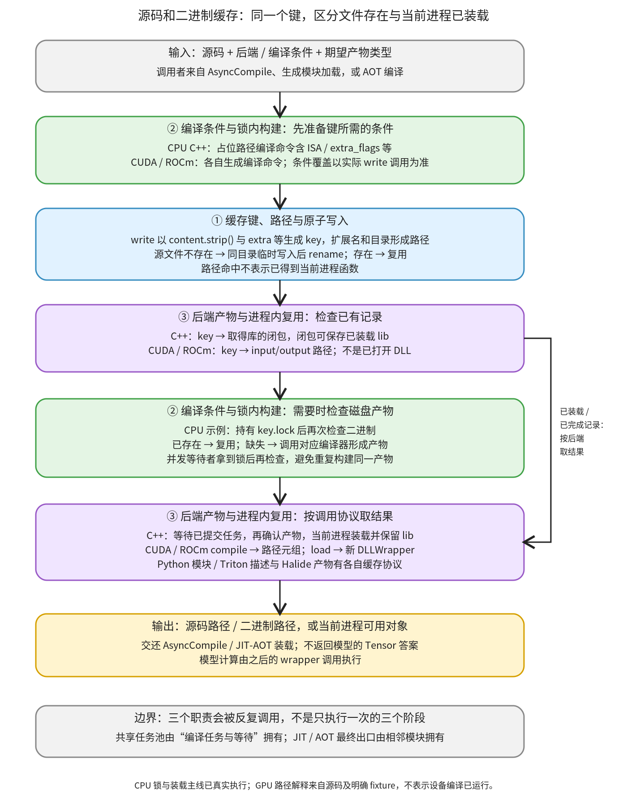

# 源码和二进制缓存：按源码与编译条件复用文件，再建立当前进程入口

```text
Inductor  本层完成
    └── 代码生成与运行封装  本层完成
        └── 编译与加载  本层完成
            └── 源码和二进制缓存 ← 当前篇  本层完成
                ├── 缓存键、路径与原子写入  待展开
                ├── 编译条件与锁内构建  待展开
                └── 后端产物与进程内复用  待展开
```

<!-- child-links:start -->

<!-- child-links:end -->

[返回编译与加载](../README.md)。本模块收到源码、编译条件和所需产物类型，决定文件放在哪里、是否需要调用编译器，以及怎样复用当前进程已有的后端对象。它交出源码路径、二进制路径或已装载对象，供编译任务和生成模块装载继续使用。

新设备在这里需要明确三件事：什么变化必须得到不同缓存键，多个编译请求怎样协调同一个产物，磁盘上的产物怎样成为当前进程的可用对象。源码中存在多个 code cache；它们共享基础设施，但没有统一成“任意后端命中后都返回同一种函数”的协议。

## 1. 条件先参与键，再检查文件与进程状态



CPU C++ 的典型请求由③后端适配入口接收：先让②准备包含编译选项的命令表示，交给①，按“源码 + extra”生成键并保存源文件。③随后查询这个键是否已经有取得库的闭包。

尚无已装载对象时，②在对应锁中检查二进制。缺少产物才调用编译器；已有产物则复用。③最终在当前进程装载库，并把库保存在闭包状态中；后续同进程请求可以返回同一个库。调用者可能先取得闭包，过一段时间才消费，因此建立闭包与真正装载库是两个时点。

这三个职责不是固定各执行一次的流水线。③组织②和①的调用，缓存文件命中仍可能继续进入装载；一个尚未消费的 C++ 闭包也仍可能需要②完成构建。图中右侧绕行只代表已经完成的相应进程记录，不能把“字典已有闭包”当作“库一定已装载”。

Python wrapper 模块也通过①写出源文件，再交给模块装载。它不会先编译成 C++ 二进制；Triton 的 Python 描述、实际设备编译产物和 Halide 的多文件产物同样有各自的交接方式。

## 2. 三个职责怎样协作

### 2.1 缓存键、路径与原子写入

[write](/work/pytorch/torch/_inductor/codecache.py:423) 接收 content、extension、extra、hash_type 和可选目录，返回 `(key, path)`。普通源码类型先对 `content.strip()` 取键；extra 非空时加入被哈希内容。key 由前缀 c 与编码后的 SHA256 构成。

例如，同一段源码与 `extra='target=A'`、`extra='target=B'` 形成不同键；普通源码只多了首尾空白时，write 的键相同。这里的 strip 仅用于算键，实际写出的仍是原始 content。因此先写带空白文本、再写去空白文本时，磁盘文件保留第一次写入的原文，不会被第二次覆盖。

[get_path](/work/pytorch/torch/_inductor/codecache.py:399) 用 key 的第 2、3 个字符分目录；默认文件形如：

```text
<TORCHINDUCTOR_CACHE_DIR>/<key[1:3]>/<key>.<extension>
```

扩展名和指定目录决定路径，不直接参与普通 write 的键。同一个 key 可以同时有 `.cpp` 和 `.so` 文件，这并不表示它们是同一类型的对象。后端也可以把期望产物类型放进 extra，从而另外影响键。

目录由 [cache_dir](/work/pytorch/torch/_inductor/runtime/runtime_utils.py:89) 取得：优先环境变量 TORCHINDUCTOR_CACHE_DIR，否则采用临时目录下按用户名区分的默认目录，并写回环境变量。它会建立目录，不会为了修改路径而清理所有后端类的进程内字典。

源文件不存在时，[write_atomic](/work/pytorch/torch/_inductor/codecache.py:448) 在目标同目录写一个带 pid/thread 标识的临时文件，再 rename 成目标名。读者能据此理解“先写完整文件再发布”的交接；二进制编译器的输出不是自动经过同一段 write_atomic。已有文件时 write 直接复用路径，没有重新读取并验证文件内容的逻辑。

普通源码的 extra 与二进制 hash_type 也不能混为一谈。[get_hash](/work/pytorch/torch/_inductor/codecache.py:413) 对 cubin/hsaco/spv 使用 content 的 repr 来算键，该分支没有使用传入 extra。新设备需要看实际调用走哪一种键协议。

### 2.2 编译条件与锁内构建

[CppCodeCache.load_async](/work/pytorch/torch/_inductor/codecache.py:2111) 把 ISA、cuda 标志、extra_flags 和类级编译选项交给 CppBuilder，先用占位输入名 i、输出名 o 生成命令文本，将它的 repr 作为①的 extra。这样真正源文件路径虽然还没有产生，键已经可以包含编译条件，不会用最终缓存路径反过来计算自身。

[CppBuilder](/work/pytorch/torch/_inductor/cpp_builder.py:1326) 将编译器、宏、优化选项、头文件目录、库目录和链接选项组织成实际命令；[build](/work/pytorch/torch/_inductor/cpp_builder.py:1495) 执行命令并返回产物位置。相应选项包含哪些条件，以当前构建器和平台实现为准；不能从“命令加入键”推断所有依赖文件内容和工具链版本都被完整指纹化。

C++ 实际 worker 使用 [key.lock](/work/pytorch/torch/_inductor/codecache.py:2198)。关键顺序是取得锁后**再次检查二进制是否存在**。两个进程同时发现缺少源请求记录时，先拿锁的构建库，后拿锁的再检查并复用它。仅在锁外检查一次不能解释这一行为。

异步路径可以先提交 worker，稍后取库闭包等待 Future；同步路径则在取库时直接调用 worker。两条路径共用相同的锁与存在性检查。任务提交和 wait 的具体协议见[编译任务与等待](../01-tasks-wait/README.md)。

CUDA/ROCm C++ 也先获得键，再持锁检查对应产物路径，缺少时调用各自编译命令。CUDA 命令含目标架构、优化等级及链接依赖等；ROCm 命令含 offload-arch、HIP 编译与链接条件。它们是不同的后端构建实现，不是 CPU CppBuilder 换一个 device 字符串。

编译失败会沿相应异常路径返回调用者。锁负责协调同时构建同一键，不负责证明某个已有文件一定是有效、兼容的目标代码；当前示例中“存在便复用”的检查必须按这个实际含义理解。

### 2.3 后端产物与进程内复用

③的输入是源请求以及①/②建立的键和文件状态，输出类型由调用入口决定。

| 路径 | 进程内记录 | 磁盘命中后仍可能做什么 | 交给调用者的对象 |
| --- | --- | --- | --- |
| CppCodeCache | key → 取得库的闭包，闭包保存 lib | 检查产物、动态库装载 | load_async 返回闭包；load 返回库 |
| CppPythonBindingsCodeCache | 独立 cache，复用基类构建协议 | 加载 Python 扩展并取得绑定 | 取得绑定的闭包或可调用绑定 |
| CUDACodeCache / ROCmCodeCache | key → input_path/output_path | load 每次建立 DLLWrapper | compile 返回路径元组；load 返回 wrapper/key/源码路径 |
| PyCodeCache / TritonCodeCache | PyCodeCache 保存模块 | 执行 Python 模块初始化、按名取 kernel 描述 | Python 模块或 kernel 对象 |
| HalideCodeCache | 复用 C++ 绑定及独立 runtime 状态 | 按多文件协议生成、链接、装载 | 取得绑定的闭包或入口 |

C++ 的 [load_fn](/work/pytorch/torch/_inductor/codecache.py:2173) 只在 lib 为 None 时等待任务、确认二进制并装载；此后返回保存的 lib。跨进程没有这个 Python 闭包状态，重新进入时虽然能够复用同一个 `.so`，仍需建立当前进程的库对象。

CUDA/ROCm 的 CacheEntry 则只保存路径。[load](/work/pytorch/torch/_inductor/codecache.py:3211) 要求产物扩展名是 so，再建立新的 DLLWrapper。不能从 compile 的字典命中推断“返回的是上次那个 DLLWrapper”。[DLLWrapper](/work/pytorch/torch/_inductor/codecache.py:3068) 管理打开/关闭状态，并把所取函数的非零返回值转为 RuntimeError；它带有自己的 ABI 使用约定，不是任意 C 函数的无差别包装。

[TritonCodeCache.load](/work/pytorch/torch/_inductor/codecache.py:2923) 通过 PyCodeCache 执行源码模块并按 kernel_name 取对象。这里没有把 CUDA/ROCm C++ 缓存类当成 Triton 设备二进制的统一管理器；实际 kernel 的 precompile 还会进入其编译和 runtime 缓存协议。

[HalideCodeCache.generate_halide_async](/work/pytorch/torch/_inductor/codecache.py:2671) 用源码、meta 与配置 hash 确定独立目录，生成脚本、静态库、头文件和完成标记，再构建 glue 绑定。它说明一种后端请求可以拥有一组有顺序关系的文件，不能只为每个后端照搬“一段源文件对应一个 so”的假设。完整 Halide 生成与 standalone runtime 逻辑仍在这个职责的后续覆盖范围，本文未运行 Halide。

PyCodeCache 的行映射、attrs、模块重载和最终 JIT/AOT 出口在相邻装载模块展开。这里仅解释它消费①的源码路径与保留进程模块的接口，不重复建立另一套模块装载章节。

## 3. 主案例：冷进程编译，暖进程复用文件，同进程复用对象

为直接观察缓存边界，实验调用真实 CppCodeCache 和本机编译器，编译一个 C ABI 整数函数。这个局部案例没有模型 Tensor，不把它冒充整图性能测试。

```cpp
#ifndef LEARNING_INCREMENT
#define LEARNING_INCREMENT 7
#endif
extern "C" int kernel(int x) { return x + LEARNING_INCREMENT; }
```

通过 ctypes 明确设置一个 C int 参数和 C int 返回值，再调用 kernel(5)。默认结果为 12。三个独立子进程依次使用同一个全新私有缓存目录：

| 请求 | 编译条件 | 目标函数实际构建次数 | 真实返回值 |
| --- | --- | --- | --- |
| 冷进程 | 无 extra_flags | 1 | 12 |
| 暖进程 | 同样源码与条件 | 0 | 12 |
| 条件变化 | extra_flags 增加 -DLEARNING_INCREMENT=9 | 1 | 14 |

首次 ISA 能力检测还可能编译探测程序。结果同时保留全部构建命令，上表只统计本案例目标二进制；没有把其他探测编译算作重复构建本函数。

**冷进程。** ③接收 SOURCE 与空 flags，②生成编译条件，①得到 key 并写出 cpp。load_async 返回一个 getter，此时普通同步调用还没有为目标函数执行构建。调用 getter 后，②锁内构建 so，③用 cdll.LoadLibrary 装载，给库对象附上 key，交回库。调用 kernel(5) 得到 12。

**同进程再次请求。** 再次 load_async 返回同一个 getter，getter 再次执行返回同一个 lib。实验分别验证 `same_getter=True` 与 `same_library=True`。这是 Python 对象身份复用；只看库文件路径相同不能证明这件事。

**暖进程。** 新进程的类字典与闭包状态为空。①得到同一个 key/源码路径，②在锁中发现 so 已存在，目标构建次数为 0；③仍在这个新进程执行动态库装载。它再调用相同函数得到 12，证明复用的是编译产物，函数仍真实执行。

**条件变化。** 源码文本保持相同，②加入宏参数，①产生不同 key，从而得到另一个源码与二进制路径。②实际构建新的 so，③装载后 kernel(5) 得到 14。这同时验证参数影响缓存身份与目标程序语义，没有仅凭两个 hash 不同就宣称新程序执行正确。

## 4. 并发案例：两进程请求同一个目标产物

另开一个全新缓存目录，两个独立子进程准备完成后，由控制器释放共同开始信号。两者用相同 SOURCE 和 flags 请求真实 CppCodeCache，再调用 getter 并执行 kernel(5)。

①得到的目标 key 相同；②围绕同一个 key.lock 协调构建。采集结果中，两进程的目标 build 次数之和为 1，两边都得到有效库并返回 12。具体哪个进程负责构建由调度决定，不固定将 race_a 当作赢家。

```text
两个请求：源码相同、flags 相同 → key 相同
先持锁者：检查缺失 → 构建目标 so → 释放锁
后持锁者：检查已存在 → 跳过目标构建
各进程：分别装载目标库 → kernel(5) = 12
```

这个真实并发结果支持本地文件锁与产物复用的交接，没有证明所有网络文件系统、跨平台锁和非合作写入都具有同样行为，也不作为编译加速倍数。

## 5. 源键的小案例与设备参数的边界

直接执行真实 write/get_hash 的六项局部对照：首尾空白不改键但首份原文保留；换扩展名只改路径；普通源码换 extra 改键；换指定目录只改路径；spv 类型的 extra 不参与该分支键。对应结果保留在 keys 小节中。

CUDA/ROCm 还需要一个具体反例说明为何不能笼统承诺“所有编译参数都在键里”。各自 [write](/work/pytorch/torch/_inductor/codecache.py:3156) 使用不带 extra_args 的占位编译命令算键；compile 却可以在真正调用编译器时另外传 extra_args。因此下面三个请求在本版本键协议中并不自动分开：

```text
同一 source，dst_file_ext='so'
第一次 compile(extra_args=['-DVALUE=1'])：缺失 → 构建
第二次 compile(extra_args=['-DVALUE=2'])：进程记录命中 → 复用
清类缓存后 compile(extra_args=['-DVALUE=3'])：磁盘产物存在 → 复用
```

实验分别运行两类的真实 compile 控制逻辑，但编译命令函数与 subprocess 被替换成明确 fixture，只写入带“NOT A BINARY”标记的文件，不调用 nvcc/hipcc、不装载产物。两类都记录一个假编译调用，三次请求返回同一组路径；改目标扩展名则因占位命令改变而产生不同键。这是键/复用协议证据，不是三个宏值下的 GPU 数值实验。

CPU 主案例的 extra_flags 则确实进入命令 extra，且已经真实验证 12→14。新设备设计应逐项核对自己的入口参数：参数是否进入键，还是只在 cache miss 的编译阶段使用；不能直接照搬一个现有类的名字就认为覆盖充分。

同样，保存和装载二进制需要约定目标架构、ABI、依赖库与句柄归属。命令字符串能够纳入其实际呈现的选项；它不自动覆盖同路径工具链被替换、隐式依赖内容变化等所有环境状态。这些是由源码键范围推导的接入要求，本文没有运行跨机器兼容性实验。

## 6. 复现、覆盖与下一层

脚本 [source_binary_cache.py](../../../experiments/source_binary_cache.py) 和精确结果 [results.json](../../../experiments/source-binary-cache/results.json) 保存五个原生 CPU 进程的 key、文件路径、全部构建命令、目标构建计数与真实函数结果，以及六项源键和两类设备 fixture 证据。运行方式：

```bash
PYTHONPATH=/work/pytorch python3 /work/learning/gpt6-1sol/torch/compile/inductor/experiments/source_binary_cache.py
```

本层的三个职责已用请求贯穿：①确定文件身份，②按条件和锁生成或复用产物，③建立并保留合适的进程对象。下一层分别完整展开缓存键、路径与原子写入，编译条件与锁内构建，以及后端产物与进程内复用。CPU 原生库路径已执行；CUDA/ROCm 此处仅协议 fixture，Triton/Halide 编译与实际设备 runtime 未执行。
