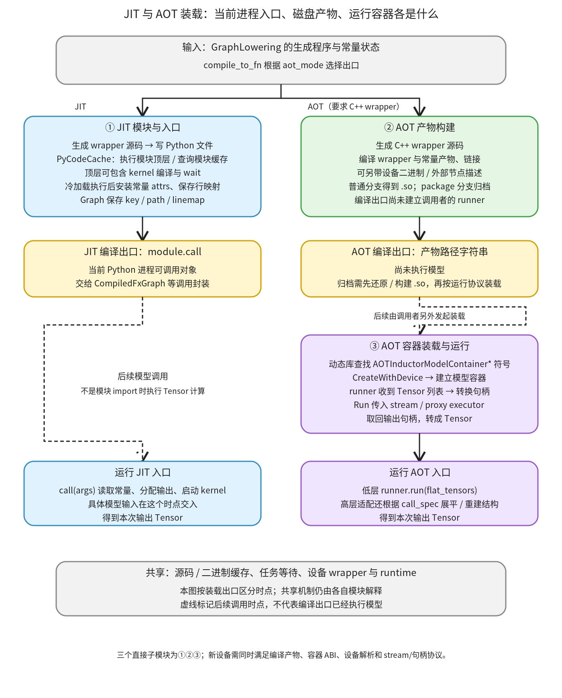

# JIT 与 AOT 装载：从生成程序交出当前入口，或交出可另行装载的产物

```text
Inductor  本层完成
    └── 代码生成与运行封装  本层完成
        └── 编译与加载  本层完成
            └── JIT 与 AOT 装载 ← 当前篇  本层完成
                ├── JIT 模块与入口  待展开
                ├── AOT 产物构建  待展开
                └── AOT 容器装载与运行  待展开
```

<!-- child-links:start -->

<!-- child-links:end -->

[返回编译与加载](../README.md)。这个模块接收 GraphLowering 生成的 wrapper、常量和来源信息，决定编译出口交回什么。JIT 将生成的 Python 模块装入当前进程，返回 `module.call`；AOT 构建独立产物，返回路径，调用者之后再建立运行容器。

对新设备，“能够生成 kernel”还不足以走完这里：JIT 需要生成模块能恢复设备入口和常量；AOT 需要产物导出相应容器接口，runtime 能识别设备、传入 stream，并正确移交输入输出句柄。

## 1. 一个编译出口，两个不同对象



[GraphLowering.compile_to_fn](/work/pytorch/torch/_inductor/graph.py:1890) 按 aot_mode 分流。JIT 进入①生成并加载模块，最后取得它的 call；AOT 要求 C++ wrapper，进入②构建产物后直接返回路径。③不是 AOT 编译出口内部偷偷完成的一步，必须由后续调用者发起装载。

```text
JIT 编译出口：
  生成 Python wrapper → 当前进程 module → module.call
AOT 编译出口：
  生成 C++ wrapper → 对象文件 / 常量 / 链接产物 → 路径字符串
后续 AOT 装载：
  路径 → 动态库与容器 → runner.run(Tensor 列表)
```

图中虚线标明后续调用时点。JIT 模块顶层可以编译 kernel、等待任务，但这与 wrapper 的 call 使用本次输入执行模型是两个阶段。AOT 获得路径后也没有计算本次模型输出；加载容器与调用 run 仍是后续操作。

三个直接子模块为 JIT 模块与入口、AOT 产物构建、AOT 容器装载与运行。源码/二进制缓存和编译任务等待属于共享支撑，不在本篇重新拆成一套实现。

## 2. 三个职责怎样接收和交出数据

### 2.1 JIT 模块与入口

[_compile_to_module](/work/pytorch/torch/_inductor/graph.py:1841) 先根据 cpp_wrapper 选择源码生成方式，收到 `(code, linemap)`。普通 JIT 的 code 是可执行的 Python wrapper；JIT 使用 C++ wrapper 时，也要经过相应包装和模块入口，不能把所有 C++ wrapper 都等同于 AOT。

linemap 初始记录生成行号与 FX Node；本层把 Node 转成其 stack_trace 字符串，再将源码交给 PyCodeCache.write，取得 key 和 path。它们表示本份生成程序的文件身份，不是模型输出。

随后调用 [load_by_key_path](/work/pytorch/torch/_inductor/codecache.py:2866)，同时交入：

```text
key / path：生成模块的身份与位置
linemap：[(生成源码行号, 原模型 stack_trace), ...]
attrs：合并后的 constants 与 torchbind_constants
```

冷加载由 [_reload_python_module](/work/pytorch/torch/_inductor/runtime/compile_tasks.py:34) 读取源码，Python compile 后在新 ModuleType 的字典中 exec。模块顶层的 import、kernel 编译声明和 wait 在这时执行。成功执行后，模块注册到 sys.modules，交回 PyCodeCache。

PyCodeCache 再保存模块与行映射，把 attrs 的对象用 setattr 安装到模块中。这是实际的状态交接：生成源码里可以有 `_tensor_constant0 = None` 占位，模块顶层执行结束时该名字已经存在，但实际 Tensor 尚未通过 attrs 安装。之后的 call 读取的是已安装 Tensor。

GraphLowering 保存 cache_key、cache_path、cache_linemap，返回模块；JIT compile_to_fn 最终取 `module.call`，供外层 CompiledFxGraph 等封装使用。行映射支持把生成代码位置对应回模型来源，常量属性则支持 call 访问没有列为显式输入的对象。它们分别解决来源与运行状态问题，不能相互替代。

同 key 命中 PyCodeCache.cache 时，函数直接返回已有模块，**不会重新安装新 attrs 或新 linemap**。这里不是任意更新模型权重的接口；调用者必须保证模块身份与状态的复用契约成立。后面的实际小模块案例会展示这一点。

无 linemap 且无 attrs 的模块还可以附上 `_reload_in_subproc` 回调，用 key/path 在 worker 中恢复模块；需要状态属性的普通生成模块不能直接假定拥有同一回调。完整重载与缓存条件在①的实现篇展开。

### 2.2 AOT 产物构建

AOT 分支接收 GraphLowering、C++ wrapper 源码、可选的外部节点序列化结果和 cuda 标志。Graph 的 constants、folded_constants、原常量值等状态参与后续常量产物生成。

[AotCodeCompiler.compile](/work/pytorch/torch/_inductor/codecache.py:1531) 用编译条件和源码确定文件键，选择输出目录，并在对应锁保护下组织 wrapper 对象文件、常量对象和最终链接。源码与二进制缓存机制见[相邻缓存篇](../02-source-binary-cache/README.md)。

常量不会以主进程 Python Tensor 对象指针直接写进可执行文件。实现从原始 Tensor 存储提取字节，按相应条件处理对齐，形成可链接的常量产物；运行端再根据生成的常量信息恢复可使用的存储。折叠常量和普通常量也有不同来源处理。

大常量还存在 mmap 分支；配置 package 时，当前实现收集构建所需文件与 flags 进入归档，返回包路径，而不是把包假装为已打开的共享库。普通非 package 路径编译并链接，返回 so 路径。平台、构建工具和运行库都需要匹配，本版本 Windows 入口直接拒绝。

AOT 与 C ABI 模式也需要区分。`abi_compatible` 控制 C++ wrapper 是否尽量经 AOTI C shim 操作 Tensor；默认值依源码配置与环境而定，不应默认为所有 AOT 都使用同一套调用文本。设备代码生成与 shim/runtime 的支持必须对齐；这里只说明产物边界，完整 wrapper 代码归设备调用模块。

②交出的结果是字符串。调用者可以把产物交给另一个进程装载；但文件路径存在本身不能证明目标机器的 ABI、依赖库、设备架构和符号接口都兼容。

### 2.3 AOT 容器装载与运行

③收到 so 路径、目标设备与容器配置。CPU runner 的构造把设备 cpu 交给共享基类；CUDA runner 交入具体设备字符串和可选 cubin 目录。

[共享 runner 构造](/work/pytorch/torch/csrc/inductor/aoti_runner/model_container_runner.cpp:34) 打开动态库，按名字解析 `AOTInductorModelContainerCreateWithDevice`、Delete、Run、GetNumOutputs、GetCallSpec 及常量相关符号。如果相邻 json 文件存在，还建立相应 proxy executor。随后调用 CreateWithDevice 创建容器，保存 container_handle。

因此，AOT 装载不能用上一篇的普通 DLLWrapper 任意取一个 kernel 符号来代替。它要求一套生成模型容器 ABI，以及与这些接口匹配的状态管理。

[runner.run](/work/pytorch/torch/csrc/inductor/aoti_runner/model_container_runner.cpp:116) 收到 Tensor 列表，把 Tensor 转成 AtenTensorHandle，查询输出数量，分配输出**句柄数组**，然后调用容器 Run。此处建立数组不等于已经分配每个输出 Tensor 的数据存储。

Run 同时收到输入/输出数量、stream_handle 和 proxy_executor_handle。[导出的容器接口](/work/pytorch/torch/_inductor/codegen/aoti_runtime/interface.cpp:94) 检查数量、转换 stream，再调用容器实现。返回后，runner 将输出句柄中的 Tensor 接管成输出列表。输入句柄和输出句柄的所有权约定由接口和转换函数配合，不能把它们视为不需要管理的裸指针。

[CUDA runner](/work/pytorch/torch/csrc/inductor/aoti_runner/model_container_runner_cuda.cpp:22) 在普通 run 中取得当前 CUDA stream，传给共享 runner；CPU 使用其默认 stream 参数。新设备必须明确对应的 stream 表示、完成状态和存储生命周期，不能仅给共享构造函数传入新字符串。

低层 runner.run 使用平坦 Tensor 列表。[aot_load](/work/pytorch/torch/_export/__init__.py:291) 是它外面的结构适配边界：根据产物 call_spec 展平用户输入，选出 Tensor，调用 runner，再重建输出结构。本文只解释这一接口，不展开已经了解的上游捕获流程。

## 3. 真实 JIT 案例：None 占位怎样变成常量 Tensor

本案例为连续 CPU float32 输入 x，shape `[2,3]`、stride `[3,1]`；常量 w 为 `[10,20,30]`，计算 `(relu(x+w),)`。实验显式设置 always_keep_tensor_constants=True，使这个小常量保留为 Tensor，展示属性安装，而不是走小常量内联分支；设置 cpp.simdlen=1 便于阅读源码。

```text
x = [[0,1,2], [3,4,5]]
w = [10,20,30]
```

**①接收生成结果。** wrapper 源码有 `_tensor_constant0 = None`，定义一个 C++ 融合 kernel，并在顶层调用 wait。call 内部才分配 buf0，调用 kernel 时传入 x、_tensor_constant0 和 buf0。

**执行模块顶层。** 实验在真实 PyCodeCache 加载路径采集事件。load_request 记录 attrs 含 `_tensor_constant0`、一项 linemap；module_executed 时这个常量名字存在，但仍是 None。此时 kernel 已完成模块初始化所需的编译/等待，Tensor 常量尚未安装。

**安装常量，交回入口。** load_return 记录模块属性与传入 attrs 的对象身份相同，module.call 可调用。GraphLowering 保存模块来源状态，后续编译封装取得 call。

```text
load 请求：attrs = {'_tensor_constant0': w}
模块顶层执行完：module._tensor_constant0 = None
安装 attrs 后：module._tensor_constant0 is w
后续调用：call([x]) → (buf0,)
buf0 = [[10,21,32], [13,24,35]]
```

精确的常量对象以 GraphLowering 传给 PyCodeCache 的 attrs 为准，实验验证安装前后的占位/身份关系。实际数值与 eager 对照通过；x 和原 w 保持，输出不与输入共享存储。传给 boxed 入口的参数列表被清空，这是列表的消费，不是 x 的 Tensor 数据被清空。

完整生成源码保存在 [jit_output.py](../../../experiments/jit-aot-loading/jit_output.py)。这些观察来自真实图编译和 CPU kernel 调用，不是用 Python 加法代替生成 kernel。

## 4. 模块状态与错误案例

为了单独验证 attrs 和模块缓存，另写一个明确的小型 Python 模块：顶层记录 globals 中是否已有 constant0，call 返回 `args[0] + constant0`。这不是生成器产物；它直接使用真实 PyCodeCache 加载机制。

第一次加载传 attrs constant0=Tensor `[10]`，第二次用同 key/path 传 `[20]`。两次返回同一模块，constant0 仍是第一次对象；调用输入 `[1]` 得到 `[11]`。第一次 linemap 也保留，生成行 2 对应到 `learning_model.py` 第 7 行 forward。模块顶层记录常量尚未安装，且带 attrs 的模块没有重载回调。

另一个不带 attrs/linemap 的纯模块有 `_reload_in_subproc` 回调。移除该 key 的进程模块缓存后，在本进程调用真实回调，得到新的模块对象、相同源码路径和值 3。它验证重载接口，不把这个本进程对照说成又启动了真实 worker。

错误也发生在不同位置：Python 源码语法错误被 `_reload_python_module` 包装为含文件位置的 RuntimeError；成功 compile 后的 exec 抛 ValueError，则以 ValueError 传播。模块顶层编译任务失败同样会阻止装载正常交付；不能仅因源码文件已落盘就认为 module.call 可用了。

## 5. 真实 AOT 案例：构建产物，再在另一个进程中装载

AOT 案例计算 `(x+w,)`，仍使用 CPU float32 x `[2,3]` 与 w `[10,20,30]`。为突出装载协议，固定 shape，不讨论上游图捕获。构建显式采用 `abi_compatible=True`、`always_keep_tensor_constants=True`、`cpp.simdlen=1`，关闭 package，输出到独立实验目录的 model.so。

**②收到源码和常量。** AOT 编译要求 C++ wrapper，生成模型实现和容器接口；保留的 Tensor 常量需要进入产物，不能依赖 JIT 中 `_tensor_constant0` 的 Python setattr。②编译 wrapper、常量对象并链接，编译出口交回 so 路径。这个路径是字符串，不能像 module.call 一样直接调用。

**③装载产物。** 构建进程先用真实 AOTIModelContainerRunnerCpu 装载该库并运行输入，数值与 eager 对照通过。随后另启一个 Python 进程，只读取已有路径，直接建立 runner 查询常量信息，再通过真实 aot_load 建立用户可调用入口；这个进程没有调用编译 API。runner 查询到的常量名称到原名映射为 `{"weight": "weight"}`，与生成模型保留的常量一致。

**③重复运行。** 两次输入使用相同 shape/布局，第二次把 x 的每个值加 1.5：

```text
第一次运行：
  x = [[0,1,2], [3,4,5]]
  输出 tuple = ([[10,21,32], [13,24,35]],)
第二次运行：
  x = [[1.5,2.5,3.5], [4.5,5.5,6.5]]
  输出 tuple = ([[11.5,22.5,33.5], [14.5,25.5,36.5]],)
```

低层 runner 接收平坦 Tensor 列表并返回列表；aot_load 根据库中 call_spec 重建一项 tuple。两次真实输入保持，输出不别名输入，且随输入变化。这个结果证明当前产物在新的本机进程能够装载并执行，不能外推为跨工具链、跨机器或其他设备兼容性保证。

生成 C++ 源码保存在 [aot_output.cpp](../../../experiments/jit-aot-loading/aot_output.cpp)，构建与低层调用结果保存在 [aot.json](../../../experiments/jit-aot-loading/aot.json)，独立装载和两次高层调用结果保存在 [aot-runtime.json](../../../experiments/jit-aot-loading/aot-runtime.json)。

## 6. 新设备还需要补齐哪些装载协议

JIT 路径首先要求生成模块的顶层编译声明、导入符号、设备入口和常量安装成立。设备 kernel 已编译，但 wrapper 仍导入一个不存在的 helper，或 call 取常量时属性没有安装，都无法交付正确程序。图中①输出的 call 需要与设备 wrapper 的参数、stream 和启动协议一致。

AOT 除了②能生成产物，还受③中明确的设备分支限制。[aot_load](/work/pytorch/torch/_export/__init__.py:301) 只选择 CPU 或 CUDA runner；给 privateuseone:0 会抛出 Unsupported device。[C++ parse_device_str](/work/pytorch/torch/csrc/inductor/aoti_runtime/model.h:63) 的正则也只接受 cpu/cuda 及可选数字编号。只改一侧不等于运行端已经支持新设备。

[runtime/device_utils.h](/work/pytorch/torch/csrc/inductor/aoti_runtime/device_utils.h:10) 还按 USE_CUDA 选择设备相关类型；模型 runtime 维护运行完成状态、常量存储及相应事件/stream 操作。这些是运行模型的职责，不由 scheduler 后端登记自动补全。已有的模型容器 ABI和Tensor句柄转换可以作为接口依据，但新设备必须实现与其一致的设备语义。

局部实验用明确 Runner fixture 调用真实 aot_load 分流：cpu 与 cuda:1 都按 fixture 返回 `[3]+2=5`，privateuseone:0 被实际 Python 入口拒绝。这里 CUDA 只是分流与输入输出结构协议，没有调用 CUDA runtime；它与前面的真实 CPU so 装载证据分别记录。

包模式、mmap 大权重、运行时常量折叠/更新、外部节点 proxy 执行和 GPU 完成事件都保留后续实现覆盖，本轮没有执行。不能从一个固定 shape 的 CPU 示例推出这些路径均已验证。

## 7. 复现与下一层

依次运行：

```bash
PYTHONPATH=/work/pytorch python3 /work/learning/gpt6-1sol/torch/compile/inductor/experiments/jit_aot_loading.py
PYTHONPATH=/work/pytorch python3 /work/learning/gpt6-1sol/torch/compile/inductor/experiments/aot_loading_runtime.py
```

第一条执行真实 JIT、模块协议、AOT 构建与原生 runner 调用；第二条在独立进程只装载已有产物并重复运行。完整脚本分别为 [jit_aot_loading.py](../../../experiments/jit_aot_loading.py) 与 [aot_loading_runtime.py](../../../experiments/aot_loading_runtime.py)，汇总记录见 [results.json](../../../experiments/jit-aot-loading/results.json)。

下一层用三个职责分别解释 JIT 模块与入口、AOT 产物构建、AOT 容器装载与运行的完整实现。本层交接已经建立，但不是这些模块的逐行覆盖完成；共享编译条件与锁、Future等待及设备wrapper继续引用各自主要归属。
