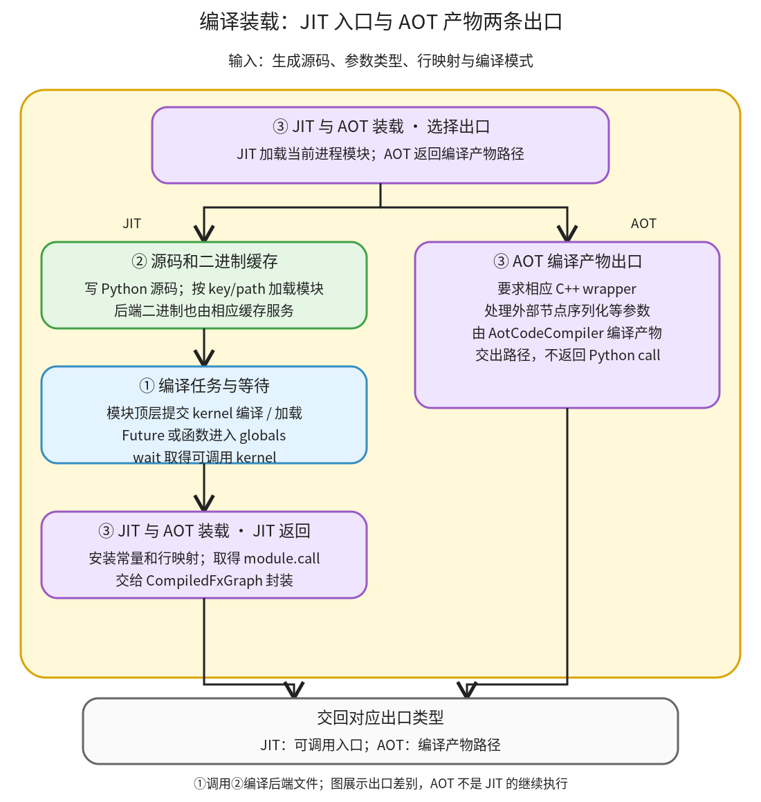

# 编译与加载：把生成源码变成当前进程能够调用的入口

```text
Inductor  本层完成
    └── 代码生成与运行封装  本层完成
        └── 编译与加载 ← 当前篇  本层完成
            ├── 编译任务与等待  本层完成
            ├── 源码和二进制缓存  本层完成
            └── JIT 与 AOT 装载  本层完成
```

<!-- child-links:start -->
直接子篇：[编译任务与等待](01-tasks-wait/README.md)、[源码和二进制缓存](02-source-binary-cache/README.md)、[JIT 与 AOT 装载](03-jit-aot-loading/README.md)。
<!-- child-links:end -->

[返回代码生成与运行封装](../README.md)。本模块收到 wrapper/kernel 源码、类型和行映射，编译后端代码、加载生成模块，交出本进程可调用函数；AOT 分支则交出编译产物路径。编译任务对象、已加载函数和执行结果是三个不同对象。

## 1. 模块加载会触发 kernel 的编译与等待



JIT 主线由 [GraphLowering._compile_to_module](/work/pytorch/torch/_inductor/graph.py:1841) 启动：拿到源码，调用②写 Python 文件，再由③加载模块。模块顶层的编译声明进入①，得到可调用入口或 Future；顶层 wait 等待必要任务，将 Future 替换为函数，随后模块的 call 才准备好。

②还服务①的 C++/Triton 等代码缓存，所以它不是只在最开始出现一次的文件写出阶段。AOT 分支从③选择不同装载/编译出口，不先绕一圈假装返回 JIT call。

本模块不负责 FX 图缓存的命中判定；缓存恢复也可以调用这里的源码模块加载，建立当前进程函数。两种缓存的职责分别保留。

## 2. 三个职责怎样交接

### 2.1 编译任务与等待

收到 kernel 源码和 argtypes 后，[AsyncCompile.cpp_pybinding](/work/pytorch/torch/_inductor/async_compile.py:220) 在线程数不大于 1 时同步加载；多线程配置则可提交编译任务，返回 LambdaFuture。Triton 可使用进程池和 TritonFuture，是否使用还依赖池是否就绪等条件。

Future 表示可取得未来编译结果的对象，不是已经完成 Tensor 计算。它进入生成模块 globals，之后 [AsyncCompile.wait](/work/pytorch/torch/_inductor/async_compile.py:256) 取 result 并将对应名称替换成实际入口。失败会在等待或加载路径抛出；BrokenProcessPool 还有明确错误转换，不会返回一个可正常执行的假 kernel。

线程数为 1 时，调用编译函数已经完成加载，wait 无须再解析同样的异步任务。不能因为生成源码总有 `async_compile.wait(globals())`，便推断本次确实并行执行了编译。

①将可调用 kernel 交给模块的名字空间，编译源码/二进制则通过②管理。之后 wrapper 在真实调用期间才能用这个名字启动计算。

### 2.2 源码和二进制缓存

收到源码、扩展名和编译相关条件后，按相应键写出或复用文件，再在需要时调用编译器和加载库。[CppCodeCache.load_async](/work/pytorch/torch/_inductor/codecache.py:2111) 将 ISA/编译命令条件加入源键，使用锁协调同一产物，安排任务后提供取得库的函数。

源码文本相同但编译条件不同，不能任意当作相同二进制。Python wrapper 缓存、C++ 二进制缓存和 Triton 缓存也有不同类型的结果；不能把任何 cache hit 都解释为“整张图没有重新降低”。

[write_atomic](/work/pytorch/torch/_inductor/codecache.py:448) 先在目标目录写临时文件，再改名为正式文件，减少并发读到半写入内容的机会。锁、路径和当前工具链仍是实际环境依赖，不能把保存了 `.py` 就当作跨机器无条件可移植程序。

[PyCodeCache.load_by_key_path](/work/pytorch/torch/_inductor/codecache.py:2866) 还保留本进程模块缓存、行映射，并按需要设置常量属性。它交给③的是模块或后端库引用，不是本次模型的输出张量。

### 2.3 JIT 与 AOT 装载

JIT 路径加载 wrapper 模块，安装 Tensor/TorchBind 常量，保存 cache_key、cache_path、linemap，返回 module。随后 compile_to_fn 取得 module.call，交给 CompiledFxGraph 封装。

行映射把生成源码位置与原 FX 来源联系起来，常量属性让运行入口能找到不在显式参数中的 Tensor；这些状态不是 kernel 本体的纯计算参数就能完全代替。

AOT 模式的 [compile_to_fn](/work/pytorch/torch/_inductor/graph.py:1890) 要求 C++ wrapper，必要时序列化外部节点，调用 AotCodeCompiler.compile，返回产物路径。它不会在这个出口返回与 JIT 相同的 Python call；最终运行产物需要对应加载协议。

③选择并交出正确类型的结果。装载子篇已实际验证 abi_compatible=True 的 CPU AOT 库生成、保留常量、原生 runner 及独立进程 aot_load 重复运行；GPU、包和大权重 mmap 路径仍未执行。

## 3. 主案例：真实 Future 怎样成为可以修改 Tensor 的 CPU 函数

局部实验直接使用真实 AsyncCompile，不先构造整张 FX 图。源码和参数为：

```cpp
extern "C" void kernel(float* ptr) { ptr[0] = ptr[0] + 7.0f; }
```

```text
argtypes = ['float*']
compile_threads = 2
输入 Tensor = [5.0]，CPU float32
```

**①收到源码。** cpp_pybinding 返回 LambdaFuture，尚未作为普通 kernel 调用。实验把它放到 scope['learning_kernel']，记录 before_is_future=True。

**①/②编译并取得入口。** 编译任务使用私有缓存。wait(scope) 获取结果，并替换字典中的同名项；scope 中的对象类型变为 builtin_function_or_method，after_is_future=False，callable=True。

**之后才执行计算。** 取得 ready=scope['learning_kernel']，调用 ready(value)，真实 Tensor 从 `[5]` 变为 `[12]`。这验证“任务→入口→计算效果”的交接，没有从 Future 存在就推断并行加速倍数。

精确脚本 [async_loading.py](../../experiments/async_loading.py)、源码 [async_loading.cpp](../../experiments/async_loading.cpp)、结果 [async_loading.json](../../experiments/async_loading.json) 均保留。编译缓存只写实验目录。

## 4. 整张图怎样利用同一机制

总篇的点运算 wrapper 顶层为 cpp_fused_0 注册 cpp_pybinding，随后 wait(globals())，再定义并加载 call(args)。③返回 module.call 后，调用者用真实 Tensor 参数执行，wrapper 分配 buf0 并调用 cpp_fused_0。

两个时机必须分清：模块初始化期间编译 kernel，不代表已经为这次调用的结果分配 buf0；buf0 的 empty_strided_cpu 在 call 体内，真正调用程序才运行。

缓存跨进程恢复时，磁盘保存的不是一个能直接跳转的 Python/C++ 函数指针；仍需加载源码模块，并通过它恢复当前进程的入口。成功恢复可避免重新 Lowering，但不等于完全没有模块初始化或任何 kernel 缓存查询。

## 5. 当前限制与下一层

CPU JIT 的完整图编译、跨进程模块恢复，以及同步/异步 Future→函数已实际验证。任务子篇还实际验证了独立编译进程池中的普通 Python 任务和异常回传；Triton 使用明确描述 fixture 验证 worker/主进程交接。装载子篇还验证了保留 weight 常量的 CPU AOT 构建、独立进程装载和重复调用。GPU 编译、实际进程崩溃、AOT 包/mmap 与跨机器工具链兼容性未运行。

后续三个子篇分别完整解释任务和等待、文件/二进制缓存及锁、JIT/AOT 出口和模块常量安装。与整图缓存相关的键、guards 和运行适配由相邻缓存篇拥有。
