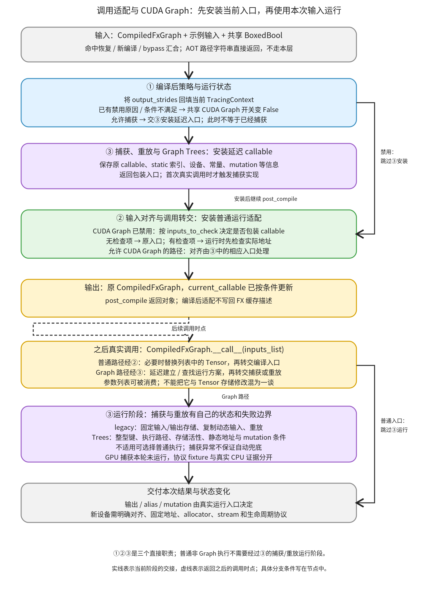

# 调用适配与 CUDA Graph：安装当前运行入口，再用本次输入执行

```text
Inductor  本层完成
    └── 代码生成与运行封装  本层完成
        └── 缓存与运行适配  本层完成
            └── 调用适配与 CUDA Graph ← 当前篇  本层完成
                ├── 编译后策略与运行状态  待展开
                ├── 输入对齐与调用转交  待展开
                └── 捕获、重放与 Graph Trees  待展开
```

<!-- child-links:start -->

<!-- child-links:end -->

[返回缓存与运行适配](../README.md)。本模块收到已经编译或从缓存恢复的 CompiledFxGraph，回填当前调用环境的输出布局信息，按条件安装 CUDA Graph 或普通输入对齐包装，最后由 current_callable 接收真实参数列表执行。

它不重新生成算子 IR，也不把缓存里的结果当作本次输出。新设备在这里要回答：哪些输入可以假设地址对齐，哪些需要运行时复制，设备是否有可用的捕获/重放协议，以及输入修改和存储生命周期怎样保持正确。

## 1. 适配入口与执行入口是两个时点



[FxGraphCache.post_compile](/work/pytorch/torch/_inductor/codecache.py:1140) 是编译成功、整图缓存命中恢复和 bypass 后的共同适配入口。AOT 的路径字符串有单独出口，不进入这里。

①先把 output_strides 回填当前 TracingContext，再根据共享 CUDA Graph 开关、已保存禁用原因和候选条件，决定是否让③安装一个延迟入口。开关最终为 False 时，②按 inputs_to_check 安装普通对齐包装；开关仍为 True 时，相关对齐由③内部的捕获入口处理。

post_compile 返回的仍是传入的 CompiledFxGraph，但 current_callable 可能已替换。之后，[CompiledFxGraph.__call__](/work/pytorch/torch/_inductor/codecache.py:1476) 只把输入列表交给 current_callable。真正的 Tensor 地址检查、可能的复制和延迟捕获，发生在使用本次输入的阶段。

```text
适配前：graph.current_callable = 原编译入口
post_compile(graph, examples, shared_flag)：
  回填当前输出 strides
  可能替换 current_callable、禁用 shared_flag
返回：同一个 graph
后续 graph(inputs_list)：
  current_callable 接收本次列表并执行，返回本次结果
```

三个直接职责是编译后策略与运行状态、输入对齐与调用转交、捕获、重放与 Graph Trees。③既参与入口安装，也参与后续运行，不能把它只画成 post_compile 中立即完成的一次捕获。

## 2. 三个职责怎样交接

### 2.1 编译后策略与运行状态

①接收图上的 output_strides、设备集合、mutation 信息、fx_kwargs、禁用原因和 cudagraph_info，同时接收本次示例输入与 BoxedBool。BoxedBool 是可共享修改的布尔对象，禁用会改变它的 value，而不是仅给局部变量另赋 False。

[set_tracing_context_output_strides](/work/pytorch/torch/_inductor/utils.py:2018) 在存在 TracingContext 且调用者准备了空 output_strides 列表时，将保存的 stride 表达式按当前环境求值并追加进去。它给上层反馈布局，不分配本次输出 Tensor。例如 `('3','1')` 得到 `(3,1)`；None 项原样保留。

编译阶段会保存或生成 CUDA Graph 条件信息。设备限制、复杂存储重叠、特定不兼容算子、非 Tensor/SymInt 参数及 mutation 等都可能影响选择。[编译入口的条件收集](/work/pytorch/torch/_inductor/compile_fx.py:576) 与 [cudagraph_post_compile](/work/pytorch/torch/_inductor/codecache.py:803) 配合，既支持冷编译，也支持缓存恢复后的入口安装。

已经有 disabled_cudagraphs_reason 时，post_compile 会禁用共享开关，不再尝试安装捕获入口。进入 cudagraph_post_compile 后若 fail_reasons 非空，也禁用开关。这里跳过的是 CUDA Graph 机制，原编译程序仍然存在；接下来②可以继续安装普通对齐包装。

如果 backward 没有进入 CUDA Graph，而相应 forward 曾由 Graph Trees 管理，代码还可能包装普通 backward，在真正运行前通知既有 manager“现在进入 backward”。因此“本次不捕获”不等于可以删掉所有 CUDA Graph 的共享生命周期状态。

①将最终开关与 current_callable 交给②，允许捕获时也将静态索引、设备编号、常量、输出来源与 mutation 索引交给③。它不是仅返回一个 yes/no 后便丢弃这些状态。

### 2.2 输入对齐与调用转交

②首先区分**编译期挑选检查索引**与**运行期检查实际地址**。

[get_input_idxs_to_check](/work/pytorch/torch/_inductor/compile_fx.py:933) 只为符合条件的 Tensor 收集索引。本版本 [is_gpu](/work/pytorch/torch/_inductor/utils.py:1799) 只认 cuda/xpu；CPU 不进入这套索引选择。静态且已满足相应对齐条件的输入可跳过；编译器不假设对齐的输入也不需要用本机制补救。

普通非 Graph 路径由 [maybe_realign_inputs](/work/pytorch/torch/_inductor/codecache.py:898) 检查最终开关。开关 False 才调用 align_inputs_from_check_idxs；检查索引为空直接保留原 model，有索引则返回一个先处理输入列表再调用 model 的包装函数。

运行时，[copy_misaligned_inputs](/work/pytorch/torch/_inductor/utils.py:1990) 对指定项执行 `data_ptr() % ALIGNMENT` 检查，本版本 ALIGNMENT 为 16。地址不满足要求时，把**列表中该项**换成 clone_preserve_strides 的结果。它没有改写外部变量原本绑定的 Tensor 对象。

[clone_preserve_strides](/work/pytorch/torch/_inductor/utils.py:1982) 按 shape/stride 需要覆盖的线性存储范围复制，再建立原 shape/stride 的 view。对于 `[4,3] / stride[1,4]`，它保留这套逻辑排布，而不是无条件变成连续 `[3,1]`。相关存储范围必须有效，不能将它当作任何任意 view 的通用修复器。

复制也会改变对象身份与存储关系。这个 helper 没有通用的“运行后把被复制输入的修改写回原输入”步骤；新设备不能在没有审查 mutation/alias 契约时任意扩大检查索引。后面的显式 helper 案例会把这一点单独展示，不冒充生成器已选择该路径。

②最后把处理后的列表交给 model。编译 wrapper 可能消费并清空该列表，但列表清空、Tensor 内容修改和输出是否共享输入存储是三个不同现象。

### 2.3 捕获、重放与 Graph Trees

③接收原 model、静态输入索引、设备编号、is_backward/is_inference、常量与 mutation 等信息。[cudagraphify](/work/pytorch/torch/_inductor/compile_fx.py:968) 先返回延迟 run，内部 compiled_fn 初始为 None。第一次用真实输入调用，才选择并建立后端运行函数；后续调用复用它。

这里有两套具体实现，不能用一句“第一次捕获、以后全部重放”覆盖所有情况。

**legacy 路径。** [cudagraphify_impl](/work/pytorch/torch/_inductor/compile_fx.py:1031) 处理对齐和静态索引，为动态输入准备固定存储，预热并记录 CUDA Graph，保留 static_outputs。后续将动态输入复制到相应固定存储，清空本次列表，调用 replay，返回捕获期间建立的输出对象。启用对应断言时，静态输入还要保持同一数据地址。这里复用输出存储，不等于得到可永久独立保留的每次新输出副本。

**Graph Trees 路径。** [树入口](/work/pytorch/torch/_inductor/cudagraph_trees.py:359) 先按运行时整型参数建立延迟函数缓存，再进入设备 manager。manager 还根据当前执行路径、先前输出存储是否存活、静态输入地址与 mutation 关系选择预热、记录、重放或普通执行；不只是以一个 shape 字符串查固定图。

[CUDAGraphTreeManager._run](/work/pytorch/torch/_inductor/cudagraph_trees.py:1980) 会检查现有节点的不变量，满足才执行已有节点。不适合 CUDA Graph 管理的输入修改、重录限制等可以转回原 model。记录、重放与 allocator checkpoint 需要保持一致的存储状态，这正是新设备捕获协议不能只复用一个函数包装器的原因。

mutation 的条件也随实现变化。[check_for_mutation](/work/pytorch/torch/_inductor/cudagraph_utils.py:123) 在 Trees 中允许把静态输入或已由 CUDA Graph 管理的 Tensor 区分出来；legacy 的预热/记录过程则有不同限制。默认条件和运行期管理判断共同作用，不应推导成“所有原地操作永远拒绝”或“开启某配置就一定捕获”。

最后，**资格拒绝与运行异常不同**。post_compile 的条件拒绝可以保留普通编译程序；延迟 cudagraphify 建立 compiled_fn 时没有包住所有异常并自动回退。一旦捕获实现抛出错误，该次调用可以失败。不能向新设备调用者承诺任何捕获异常都会透明切回原 model。

## 3. 主案例：请求 CUDA Graph 的 CPU 图仍执行普通编译入口

两个真实 CPU 图都使用 float32 输入 x，shape `[2,3]`、stride `[3,1]`，从连续底层存储偏移一个元素取得，运行时地址对 16 取模为 4。配置 cpp.simdlen=1，显式请求 CUDA Graph；没有启用 GPU。

```text
x = [[1,2,3], [4,5,6]]
纯计算图：return (x*2+1,)
修改图：x.add_(3); return (x,)
```

**①收集与处理条件。** 两图都记录 `skipping cudagraphs due to cpu device (x_1)`。共享 BoxedBool 变为 False；post_compile 仍执行，而没有因捕获请求不适用于 CPU 就让模型编译失败。

**②选择普通入口。** inputs_to_check 为空，因为正常索引选择不为 CPU 输入添加检查。post_compile 前后 current_callable 是同一个对象，没有为了看到地址余数 4 就擅自复制 CPU 输入。

**真实调用。** CompiledFxGraph 将实际列表交给原编译入口。纯计算图得到：

```text
[[3,5,7], [9,11,13]]
```

原 x 内容保持，输出不与输入共享存储。修改图则将调用者 x 改成：

```text
[[4,5,6], [7,8,9]]
```

输出与该输入共享存储。两图的 boxed 参数列表都被消费清空；这不是“两个图都清空了 Tensor”。数值、输入修改和存储别名分别检查，证明禁用 CUDA Graph 后真实普通编译语义仍然成立。

完整生成代码分别保存在 [pure_output.py](../../../experiments/call-adaptation/pure_output.py) 与 [mutation_output.py](../../../experiments/call-adaptation/mutation_output.py)。

## 4. 显式对齐案例：列表项改变，外部 Tensor 保持

这个案例单独调用真实 helper，显式指定检查索引 `[0]`，使用真实 CPU 存储观察行为。它不是 CPU 正常编译索引选择的结果，也没有 GPU 捕获。

输入原 Tensor 为 `[4,3]`，stride `[1,4]`，地址余数为 4：

```text
original = [[1,5,9], [2,6,10], [3,7,11], [4,8,12]]
args = [original]
包装：align_inputs_from_check_idxs(receive, [0])
receive 的操作：返回 args[0] + 1
```

②在运行时替换 args[0]；receive 收到不同 Tensor 对象，shape/stride 保持、地址满足 16 对齐，结果正确。外部 original 保持原值。已经对齐的输入则保留同一对象；检查索引为空时连 callable 都保留同一个。

另一个显式 helper 把 receive 改成 `args[0].add_(5)`。实测被替换 Tensor 的值增加 5，外部 original 保持，helper 没有把修改写回。这说明它的边界是“准备传入 model 的列表”，不能单独为任意输入修改/alias 语义兜底；此案例没有声称真实编译器会为该 CPU 修改图选择复制路径。

静态索引过滤也会受实际地址影响：把已对齐 Tensor、未对齐 Tensor 和整数放入输入，候选静态索引 `[0,1,2]` 被 remove_unaligned_input_idxs 过滤成 `[0]`。

设备元数据对照则使用 FakeTensor，不分配 GPU 存储：默认条件下，对齐的非静态 CUDA 描述索引被收集，未对齐且编译器不假设对齐的描述不被收集；静态已对齐描述跳过。显式开启 assume_aligned_inputs 时，两者都进入运行检查。新设备不能只照搬地址检查，而忽略编译期对齐假设如何产生。

## 5. CUDA Graph 条件与延迟时点的协议案例

以下使用真实 post_compile/cudagraphify/树延迟缓存代码，但图描述、manager 或捕获 factory 是明确 fixture；运行结果使用 CPU Tensor。没有 CUDA Graph 记录、重放或显存分配。

**①拒绝与通过。** 已保存禁用原因和 fail_reasons 两条路径都将开关置 False，不调用捕获 factory，之后安装②的显式对齐包装。允许路径调用 factory 一次，替换 current_callable，保持开关 True；这只证明入口安装，不能证明已经捕获设备图。

**①backward 通知。** 当 Trees 的 backward 被拒绝时，受控 manager 先收到 set_to_running_backward，再调用普通 model，事件顺序为 `['backward','model']`。这说明禁用捕获后仍存在训练生命周期交接。

**③延迟初始化。** 分别在 legacy 与 Trees 选择下，构造真实 cudagraphify 包装时 factory 调用数为 0。输入 `[3]` 与 `[8]` 两次调用分别得到 `[4]` 与 `[9]`，factory 总调用数为 1。Trees 模式还转交了设备、常量、placeholder、mutation 与前后向状态；legacy 不使用同一组关键字参数。

**③捕获异常。** fixture 首次抛 `ValueError('fixture capture failed')` 时，该次真实延迟包装调用向外抛出，不自动执行普通 model。第二次调用才重新尝试初始化并成功。这里验证的是异常和赋值时序，未制造真实设备故障。

**③整型键缓存。** 调用真实 Trees 延迟入口，使用显式运行参数 `[n, CPU_tensor]`，n 依次取 7、7、8。替代 manager/capture 的 factory 只收到键 7、8 两次；三次输出为 8、8、9。这说明整型值可以影响运行函数缓存，不代表本实验验证了 GPU 动态 shape 重录或 allocator 状态。

**mutation 条件。** 同一修改索引在 Trees 中被标为静态参数时通过相应早期检查；作为动态输入则拒绝；legacy 即使静态也拒绝这一修改描述。它们是实际条件函数的元数据对照，不能取代捕获后输入修改的 GPU 数值验证。

## 6. 对新设备的具体影响与复现

本版本通用对齐入口的 GPU 类型集合为 cuda/xpu，而 CUDA Graph 的设备检查、捕获、stream 与 allocator 管理仍有 CUDA 专属实现。新增设备 codegen 或 DeviceInterface，并不会自动让本模块知道新的对齐类型，也不会自动获得 Graph Trees 的存储生命周期协议。

如果设备选择保留普通编译调用，需要确认①的禁用结果、②的输入策略和 wrapper 的 mutation/alias 契约一致。如果设备要提供捕获重放，则还需要实现静态地址、动态输入复制、输出存储复用、执行完成与 allocator 状态协作。这里的接口与分支提供接入依据，源码中没有一个可为任意设备自动补齐这些功能的注册动作。

脚本 [call_adaptation.py](../../../experiments/call_adaptation.py) 与精确结果 [results.json](../../../experiments/call-adaptation/results.json) 保留两个真实 CPU 图、CPU helper、FakeTensor 描述及全部显式协议案例：

```bash
PYTHONPATH=/work/pytorch python3 /work/learning/gpt6-1sol/torch/compile/inductor/experiments/call_adaptation.py
```

当前层已建立策略→适配入口→真实调用的交接。下一层分别完整解释编译后策略与运行状态、输入对齐与调用转交、捕获、重放与 Graph Trees。GPU 捕获/重放、allocator checkpoint 和真实设备事件仍未运行，完整实现也仍待相应子篇逐行覆盖。
