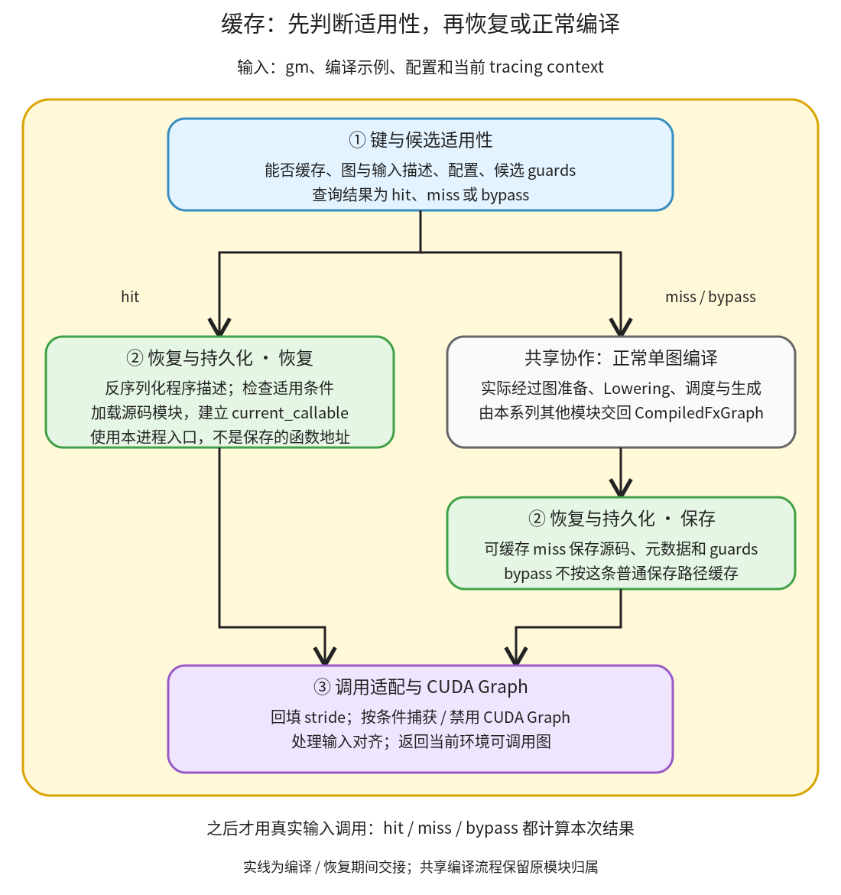

# 缓存与运行适配：恢复适用的程序，再用当前输入执行

```text
Inductor  本层完成
    └── 代码生成与运行封装  本层完成
        └── 缓存与运行适配 ← 当前篇  本层完成
            ├── 键与候选适用性  待展开
            ├── 恢复与持久化  待展开
            └── 调用适配与 CUDA Graph  本层完成
```

<!-- child-links:start -->
直接子篇：[调用适配与 CUDA Graph](03-call-adaptation/README.md)。
<!-- child-links:end -->

[返回代码生成与运行封装](../README.md)。本模块在单图入口查询可复用程序，未命中则正常编译并保存，命中则恢复当前进程入口；两条路径最后都做运行适配。缓存对象不是先前计算的答案，恢复后仍使用这次传入的真实 Tensor 求值。

## 1. miss、hit 和 bypass 如何汇合



[FxGraphCache.load](/work/pytorch/torch/_inductor/codecache.py:1278) 先由①检查能否缓存、计算 key、查找适用候选。hit 交给②恢复；miss 调用正常编译，随后②保存。若条件要求 bypass，则不从该缓存恢复，也不按普通 miss 保存，直接走正常编译。三条路径最终都进入③的 post_compile。

编译回调仍是整张图的真实转换流程，缓存不另造一份缩水 compiler。这里的 FX 图缓存不同于 PyCodeCache 和后端二进制缓存；只有观察到 Lowering 被跳过，才可据本例说整图恢复避免了相应转换。

## 2. 三个职责怎样交接

### 2.1 键与候选适用性

[_check_can_cache](/work/pytorch/torch/_inductor/codecache.py:1249) 检查 ShapeEnv、特定常量处理及高阶算子等条件。缺少 tracing context 提供的 ShapeEnv 可以绕过整图缓存；“配置开启”不保证这张图一定缓存。

[compiled_fx_graph_hash](/work/pytorch/torch/_inductor/codecache.py:784) 汇集 gm、示例输入、相关 fx_kwargs、对齐检查、确定性、后端环境和配置。部分不稳定参数如 graph_id 被排除；不能只用图中算子名字做键。

输入的表示也有区别：FakeTensor reducer 保存元数据；普通 Tensor reducer 还会保存值，用于识别嵌在图中的常量等对象。因此把真实 Tensor 当示例参数直接交给此入口，可能因为值改变而得到不同键。它仍然保存程序，不是在返回值缓存里查“这个输入的答案”。

存在符号参数时，候选还可带 guards_expr。查询先用本次提示值判断候选条件，命中后再在当前符号环境中加入相应约束。相同 key 可以有多个候选条件；某些动态尺寸合法变化也可复用同一程序，不能简单说“shape 一变就重编译”。

①交给②的是通过条件的 CompiledFxGraph 描述，或 miss/bypass 状态。无效或不适用候选不当作成功入口。

### 2.2 恢复与持久化

[_save_graph](/work/pytorch/torch/_inductor/codecache.py:1186) 复制编译结果，清掉 current_callable，保存源码、代码缓存标识、常量与布局/设备/修改元数据及 guards。函数指针不能按普通 pickle 当成跨进程可执行地址。

[_lookup_graph](/work/pytorch/torch/_inductor/codecache.py:1004) 从候选恢复描述，再通过 PyCodeCache 加载生成模块，重建 current_callable。必要时可依据保存源码补写模块文件；加载失败的特定情形会按 miss 处理，而不是把无 callable 的对象交给用户。

恢复还会应用保存的 metrics/counter deltas。因此 generated_kernel_count 等统计在命中时也可能增加，不能只用这些累计数认定真的重新生成过 kernel。本篇直接包装 GraphLowering.run 计数来区分。

保存、读取或序列化不成功可以留下日志和相应计数；普通图仍可能通过真实编译执行。②交回的是有当前进程 callable 的编译图，或需要转回编译的结果。

### 2.3 调用适配与 CUDA Graph

[post_compile](/work/pytorch/torch/_inductor/codecache.py:1140) 回填当前 tracing context 的输出 stride，处理可选 CUDA Graph、禁用原因以及输入对齐适配。它在 hit/miss 后都执行，不将这次运行环境相关状态简单当作永久缓存内容。

CUDA Graph 可用时将 callable 包装成对应捕获/重放入口；不满足 mutation、设备、动态或其他条件时可禁用这项机制继续使用编译程序。对齐处理也可能替换 current_callable。它们与“整图缓存命中”是不同决策。

CompiledFxGraph.__call__ 最后把一个参数列表交给 current_callable；wrapper 在真实运行时取参数、分配、启动 kernel 并返回结果。当前实验使用 CPU，未捕获或重放 CUDA Graph，不从 CPU 的 post_compile 调用数推断 GPU 行为。

## 3. 主案例：另一个进程恢复程序，但计算新输入

实验显式构造有 ShapeEnv 的 FakeTensor mode 和 tracing context，用 FakeTensor 作为编译示例；真实 x/y 留到执行时传入。图为 `relu(x+y)*2`，x/y 为二维连续 CPU float32。

每个 worker 都是独立 Python 进程，共享本轮私有磁盘缓存，直接记录 Lowering 与 post_compile 的调用数。

| 运行条件 | FX 缓存状态 | Lowering 次数 | post_compile 次数 |
| --- | --- | --- | --- |
| 首次 `(2,3)`，float32 | miss | 1 | 1 |
| 另一进程，同属性、x 数值加 100 | hit | 0 | 1 |
| 另一进程，合法动态形状 `(3,4)` | hit | 0 | 1 |
| 另一进程，dtype 改 float64 | miss | 1 | 1 |
| 未安装 tracing context/ShapeEnv | bypass | 1 | 1 |

**首次进入①。** 找不到候选，调用正常编译。生成的 wrapper 从 x.size() 取 s0/s1，C++ 入口接收动态尺寸，输出布局为 `(s0,s1)/(s1,1)`。②保存描述，③适配后可运行。

真实 x=`[[0,1,2],[3,4,5]]`、y 全 1 时，得到 `[[2,4,6],[8,10,12]]`。

**新进程进入①。** 相同 FakeTensor 属性与符号关系取得相同 key，②恢复源码模块和 callable，直接跳过 graph.run。③仍执行一次。

这次真实 x 改成 `[[100,101,102],[103,104,105]]`，输出为 `[[202,204,206],[208,210,212]]`，证明返回的是新输入计算结果，不是第一次的数值。

## 4. 动态 shape 命中，不等于任意 shape 或 dtype 都能复用

本例 FakeTensor mode 让两个维度成为符号。把实际输入改成 `(3,4)` 时，仍满足该程序的索引/布局关系和适用条件；恢复同一 key，运行得到三行四列结果，最后一个元素为 24。源码循环边界和分配都读取当前尺寸。

dtype 改成 float64 则键不同，重新 Lowering 并生成对应类型程序。静态模式、size=0/1 特化、stride 改变或 guards 不满足也可能走其他路径；本例不证明所有新 shape 都命中，也不把动态程序观察推广到所有配置。

普通真实 Tensor 示例的对照则得到另一项事实：不同输入值可以改变键。保留的 [real_examples_results.json](../../experiments/cache-lifecycle/real_examples_results.json) 记录这种条件；本篇主实验按 FakeTensor 属性描述验证程序恢复，两个观察并不冲突。

## 5. 缓存旁路仍能编译和执行

最后一个 worker 不安装 tracing context，虽然 fx_graph_cache=True，但①检测缺少可用于缓存条件处理的 ShapeEnv，走 bypass。真实 Lowering 执行一次，生成程序同样通过数值对照，③仍执行一次。

所以 miss 是“可缓存但没有合适候选”，bypass 是“不使用这项整图缓存条件”，编译失败则又是另一种出口。三者不能只用“没命中”混在一起解释。

## 6. 证据与下一层

[cache_lifecycle.py](../../experiments/cache_lifecycle.py) 每次创建私有缓存并顺序启动独立 worker；[results.json](../../experiments/cache-lifecycle/results.json) 保留实际计数、输入输出、dtype 和键。hash 组成、每种生成源码也在实验目录。没有用墙钟缩短或 metrics 增量代替 Lowering 调用证据。

三个子篇完整解释键与条件、序列化/恢复、对齐与 CUDA Graph 适配。当前跨进程 CPU 恢复、dtype 拒绝和 bypass 已实测。调用适配子篇还验证了 CUDA Graph 请求被 CPU 条件禁用后的真实运行、显式对齐 helper 的对象替换与无通用写回边界，以及明确的延迟捕获协议 fixture。非空符号 guards 拒绝、远端缓存、损坏候选、GPU 实际捕获/重放仍未运行；相应源码继续逐层覆盖。
