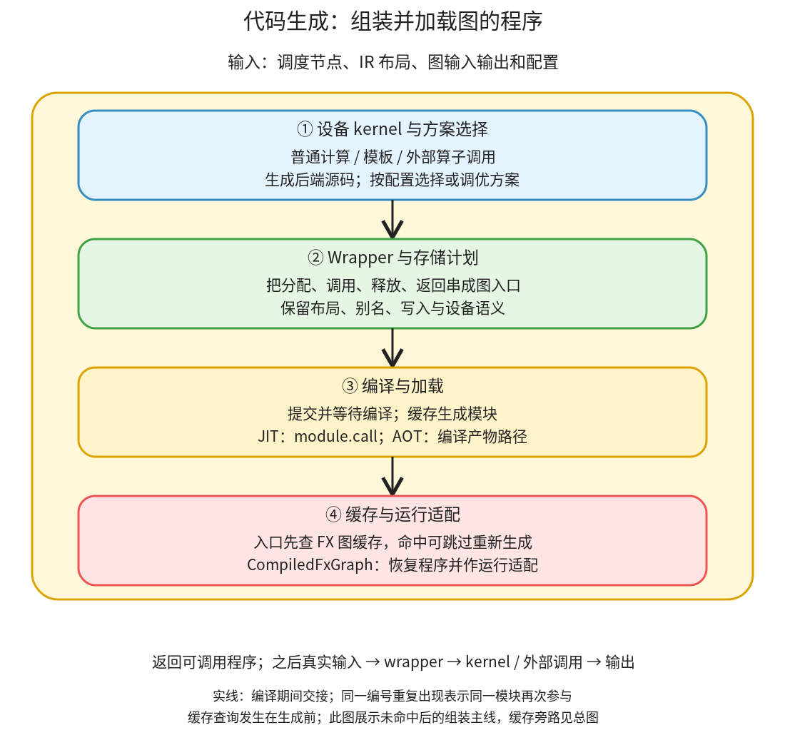

# 代码生成与运行封装：把调度结果加载成图的可调用程序

```text
Inductor  本层完成
    └── 代码生成与运行封装 ← 当前篇  本层完成
        ├── 设备 kernel 与方案选择  本层完成
        ├── Wrapper 与存储计划  本层完成
        ├── 编译与加载  本层完成
        └── 缓存与运行适配  本层完成
```

<!-- child-links:start -->
直接子篇：[设备 kernel 与方案选择](01-kernels/README.md)、[Wrapper 与存储计划](02-wrapper/README.md)、[编译与加载](03-build-load/README.md)、[缓存与运行适配](04-cache-runtime/README.md)。
<!-- child-links:end -->

[返回 Inductor](../README.md)。这一层接收调度节点、IR 布局和图的输入输出关系，生成设备计算与启动它们的 wrapper，再编译、加载为可调用对象。缓存恢复时可以跳过大量生成工作，但仍需要把程序适配到当前运行环境。

## 1. 生成、编译、执行是三件事



主线从 [GraphLowering.codegen](/work/pytorch/torch/_inductor/graph.py:1775) 开始：初始化 wrapper、创建 Scheduler、由 Scheduler 驱动后端写入 kernel 和 wrapper 内容，最后 `wrapper.generate()` 汇总完整源码。[compile_to_module](/work/pytorch/torch/_inductor/graph.py:1835) 将源码写入缓存并加载模块，`compile_to_fn()` 取出 JIT 入口 `module.call`。

图中的①不仅接收 Scheduler 的生成请求，还提供前面 Lowering/调度需要的后端能力与模板方案。特别是模板候选可能早在 lowering 时构建并选择，不能认为所有算法选择都在 Scheduler 完成以后才开始。这里按职责归属组织，不把源码调用伪装成四个绝不交错的独立函数。

编译程序包含三个时机：

```text
生成：写出 C++ / Triton / wrapper 源码
编译与加载：把源码变成可用的 kernel 入口和 module.call
执行：调用者提供真实输入，wrapper 启动 kernel 或调用外部算子
```

模板调优、AOT 的试运行、某些运行适配可能在最终返回前使用真实或构造输入；因此也不能将编译概括为“绝不会执行任何 kernel”。普通模型的一次正式输出和为选择实现进行的试运行，目的和结果都不同。本篇 CPU 案例没有做多候选调优。

## 2. 四个子模块分别保留什么

### 2.1 设备 kernel 与方案选择

这个模块收到普通或融合调度节点、循环范围、索引和布局，按设备后端生成 kernel；遇到外部算子则生成接口调用，遇到模板则处理模板的代码和启动要求。

[init_backend_registration](/work/pytorch/torch/_inductor/codegen/common.py:196) 为 CPU、CUDA、XPU 等注册 scheduling 与 wrapper 类。CPU 默认可以走 CppScheduling；CUDA 默认配置的 triton 后端由 CUDACombinedScheduling 组合处理，不应简单等同为任何 CUDA 算子都只通过一个 Triton 类。自定义后端可注册同样的接口，本篇不展开 DLC 定制实现。

普通 `relu(x+y)*2` 的 C++ 后端将元素表达式转为一个循环，给加载和计算分配临时变量，输出到指针。输出是源码和参数信息，不是最终 Tensor。向量化、循环分块、reduction 展开及特殊 dtype 的细节将放在此子篇继续拆分。

矩阵乘等算子还需要选择方案。[tuned_mm](/work/pytorch/torch/_inductor/kernel/mm.py:159) 先构造符合配置和布局的 choices，可能包括 ATen、Triton 模板、CUTLASS、CK 或 CPU 模板，再调用算法选择器。[AlgorithmSelectorCache](/work/pytorch/torch/_inductor/select_algorithm.py:1154) 处理候选、缓存和条件化的调优。

候选只有一个时可以直接返回对应输出节点，不能据函数名 `autotune_select_algorithm` 断言每次 mm 都在计时比较多份 kernel。没有合法候选时有对应异常/回退条件，不能承诺总能选择成功。

### 2.2 Wrapper 与存储计划

wrapper 收到图输入、各 kernel 的参数要求、分配和释放请求、输出引用，组织成完整图入口。在 JIT Python wrapper 中常见 `call(args)`：拆出参数，清空参数列表以释放引用，检查尺寸/stride，准备符号尺寸，分配缓冲区，调用 kernel，返回结果序列。

Scheduler 生成时积累的某些“行”尚是分配/释放请求对象。到 [WrapperCodeGen._generate](/work/pytorch/torch/_inductor/codegen/wrapper.py:859) 时，按条件进行内存规划或复用规划，再把它们写成真正源码。见 [memory_plan_reuse](/work/pytorch/torch/_inductor/codegen/wrapper.py:962)。

例如内部 mm 结果与 relu 结果可以使用同一块存储，源码就可写为 `buf1 = buf0; del buf0`，后续 relu kernel 原地读写 buf1。相反，如果 mm 原始结果也需要返回，不能为了复用而把它覆盖成 relu 后的值。

wrapper 还处理外部算子调用、别名返回、设备 guard 和 GPU 启动所需的流等信息。真正的 CUDA 启动不应被描述成同步 CPU 函数计算；返回张量时 GPU 工作可能仍在设备流中，等待语义由后续框架使用和同步约束决定。这里没有运行 GPU 实验。

模块交给③的是完整可加载源码和来源行映射。C++ wrapper 模式使用相应生成类，不要求所有情况都通过 Python `call(args)` 这一个外形。

### 2.3 编译与加载

这个模块收到源码与参数信息，生成可调用 kernel，并把它们装入图的模块。[AsyncCompile](/work/pytorch/torch/_inductor/async_compile.py:121) 根据线程数和后端选择同步执行或提交异步任务；`cpp_pybinding` 在线程数为 1 时直接加载，在多线程配置下可能返回 Future。不能看到类名就声称本次一定并行编译。

生成程序通常在模块初始化期间调用 `async_compile.wait(globals())`。该方法取得编译任务结果并把 globals 中的 Future 替换成实际入口；失败会传播异常。随后运行时的 `cpp_fused_0(...)` 才能引用可调用函数。编译等待不是 Tensor 计算流上的 GPU 同步。

[PyCodeCache](/work/pytorch/torch/_inductor/codecache.py:2845) 把 wrapper 源码写入文件，按 key/path 加载 Python 模块，并保留模块缓存与源码行映射。[GraphLowering._compile_to_module](/work/pytorch/torch/_inductor/graph.py:1841) 还将图常量装入模块属性，保存 cache_key/path/linemap。这一层会写隔离缓存，并调用相应编译工具链，不是单纯 `exec` 一个无依赖的字符串。

JIT 返回模块的 `call`；AOT 分支改用 C++ wrapper 和 AotCodeCompiler，返回产物路径。两者共用部分生成职责，但出口类型不同。AOT 包装与运行时加载机制继续在子篇展开；本轮没有生成 AOT 产物。

### 2.4 缓存与运行适配

本模块拥有跨编译入口和出口的 FX 图缓存。[FxGraphCache.load](/work/pytorch/torch/_inductor/codecache.py:1278) 先按图、输入与编译相关配置查找候选；候选还可能需要满足保存的 guards，也就是限制符号尺寸适用范围的条件。命中后恢复程序，未命中则调用真实编译，再保存可复用信息。

它与③的缓存层次不同：FX 图缓存避免重做整张图的转换和生成；Python 源码模块缓存避免重复加载同份 wrapper；kernel 代码缓存避免重复编译同份后端源码。不能只说“cache hit”就推断到底跳过了哪些阶段。

[CompiledFxGraph](/work/pytorch/torch/_inductor/codecache.py:1408) 保存 current_callable、源码、常量、设备、修改输入的索引、输出 stride 和缓存相关状态。序列化的描述恢复后仍需要加载本进程 callable，不是把一个 Python 函数指针原样从磁盘取回来。

[post_compile](/work/pytorch/torch/_inductor/codecache.py:1140) 在命中和未命中后都执行运行适配，包括回填输出 stride、可选 CUDA Graph 与输入对齐处理。CUDA Graph 不满足条件时可以禁用该机制继续使用编译图，这与“整个 Inductor 编译失败”不同。`CompiledFxGraph.__call__` 最后把参数列表转交 current_callable。

## 3. 主案例：一个 C++ 计算函数为什么还需要 wrapper

输入 x/y 为 CPU float32 `(2,3)`、stride `(3,1)`，图计算 `relu(x+y)*2`。完整生成程序保存在 [pointwise_output.py](../experiments/pointwise_output.py)。

**① 收到已组合的点表达式。** CPU 后端生成一个 `cpp_fused_0`，入口参数为两个只读 float 指针和一个输出 float 指针。它遍历六个元素，每次计算加法、relu、乘二。它不知道输出 Tensor 应由 Python 哪个对象返回，也不维护原图参数结构。

**② 收到参数和存储要求。** wrapper 生成尺寸/stride 检查与 `empty_strided_cpu`。不能直接把示例 Tensor 当输出复用，因为此图不应修改输入，也没有事先存在的输出参数。

**③ 收到生成源码。** 模块初始化中注册 C++ 编译请求，执行 `async_compile.wait(globals())`，使 `cpp_fused_0` 可调用。PyCodeCache 完成模块加载后 `compile_to_fn` 得到 `module.call`。

**④ 收到 callable 和图状态。** 编译器构造 CompiledFxGraph，保存输出 stride `[(3,1)]` 对应的描述等元数据，并完成运行适配。随后返回给单图入口调用者。

**另一次调用才正式计算。** `compiled([x,y])` 拆出两个 Tensor，分配 buf0，执行一次 C++ kernel，返回 `(buf0,)`，实际结果为 `[[0,0,2],[4,6,8]]`。参数列表被清空，输入 Tensor 数据不变。这里的分配发生在 call 体内；编译期保存的 layout 只规定它怎样分配。

## 4. 改变条件后的三条路径

### 4.1 输出只是布局视图

对 `return (x.view(6),)`，①没有生成计算 kernel；②仍生成 wrapper，返回 `reinterpret_tensor(x_1, (6,), (1,), 0)`；③仍加载模块，④仍返回可调用对象。运行得到共享 x 存储的六元素输出。没有计算 kernel，并不意味着没有可编译的图接口。

### 4.2 图包含外部库计算

`relu(x@y)` 中，①对 mm 保留外部库调用，只为 relu 生成一个 kernel。②生成 mm 输出分配、`extern_kernels.mm(..., out=buf0)` 和 relu 调用；内部存储允许复用，最终返回复用后的 buf1。③不为外部 mm 再生成一份矩阵乘源码，④仍封装同样类型的可调用图。

实际程序与结果见 [mm_output.py](../experiments/stages/mm_output.py)、[results.json](../experiments/stages/results.json)。这也解释了为什么生成 kernel 计数为 1，却实际做了 mm 与 relu 两项计算。

### 4.3 FX 图缓存已经有合适程序

在入口查询命中且适用条件满足时，跳过重新进行图准备、Lowering、调度和源码生成。④恢复源码和元数据，经③等加载机制建立本进程可调用入口，然后执行 post_compile。最后调用仍使用**本次**实际输入，返回本次结果。

这条分支已在缓存子篇通过独立进程验证：FakeTensor 示例相同属性或合法动态尺寸时命中，没有再次运行 Lowering，仍执行 post_compile 并计算新输入。前面的生成路径采集脚本主动关闭 FX 图缓存，另一个 cache_lifecycle.py 专门验证恢复，见[缓存与运行适配](04-cache-runtime/README.md)。非空 guards 拒绝分支仍未单独实测。

## 5. 下一层怎样深入

四个子篇分别打开设备代码和候选方案、wrapper 与存储、编译任务及加载、缓存和运行适配。内存复用与融合共享依赖信息，但实现覆盖各有归属：Scheduler 负责最后使用及生成驱动，wrapper 负责把分配/释放请求落实为存储计划。

CPU 案例已验证数值、输出布局、输入保持和别名；没有验证 GPU 多流、模板计时、CUDA Graph、AOT、远端缓存或编译失败恢复。完整证据和版本限制见 [维护记录](../maintenance/README.md)。
