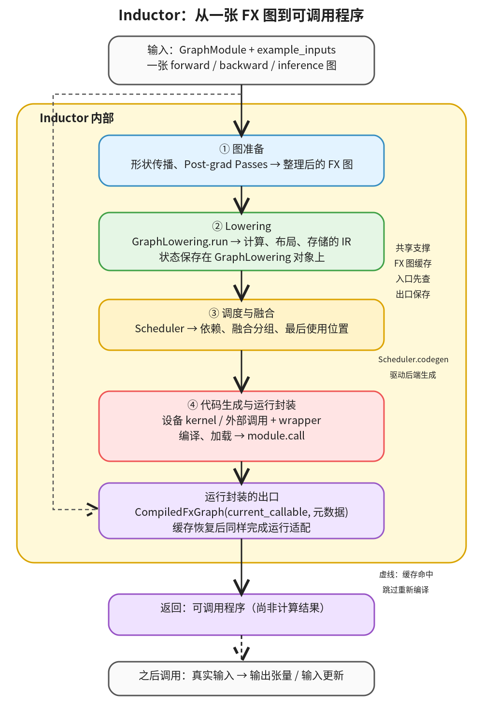

# Inductor：把一张算子图编译成可调用程序

```text
Inductor ← 当前篇  本层完成
    ├── 图准备  本层完成
    ├── Lowering  本层完成
    ├── 调度与融合  本层完成
    └── 代码生成与运行封装  本层完成
```

<!-- child-links:start -->
直接子篇：[图准备](01-graph-preparation/README.md)、[Lowering](02-lowering/README.md)、[调度与融合](03-scheduling/README.md)、[代码生成与运行封装](04-codegen-runtime/README.md)。
<!-- child-links:end -->

[完整阅读索引与当前模块树](INDEX.md)。

Inductor 接收 FX `GraphModule` 和示例输入，把“调用哪些算子”转换成“怎样访问内存、怎样组织计算、怎样启动 kernel”的程序，最后返回可调用对象。调用这个对象时，真实输入才产生输出张量。本文从这次编译请求开始，关注 Inductor 内部，不展开 Dynamo 与自动微分的实现。

本篇基于本地 `/work/pytorch`，commit `8332c5622aabd9535969e9a8d0ed60e4a90e4402`。源码链接均指向本地实现；正文中的运行结果来自本目录的 CPU 实验。GPU 路径只按源码说明，没有把 CPU 结果推广为 GPU 实测结论。本地导入的 Python 来自该工作树，但现有二进制的版本标记为 `2.5.0a0+gitc77adf6`，与 checkout HEAD 不同；以下实验不代表整套二进制重新构建自该 commit。

## 1. 先把入口、返回值和执行时机分开

本地实现有两个层次的入口，不能把它们收到的图混为一谈。

| 入口 | 收到什么 | 做到哪里 | 返回什么 |
| --- | --- | --- | --- |
| `torch._inductor.compile` → `compile_fx` | FX 图、示例输入、可选配置 | 整理外部输入输出接口，配置编译回调，并与 AOTAutograd 对接 | 对外可调用程序，接口由外层适配 |
| `compile_fx_inner` | 一张已准备好的 forward、backward 或 inference 图，及对应示例输入 | 编译这张图、处理缓存和运行适配 | 常见路径返回 `CompiledFxGraph`，按一个参数列表调用 |

依据：[公开入口](/work/pytorch/torch/_inductor/__init__.py:11)、[compile_fx](/work/pytorch/torch/_inductor/compile_fx.py:1242)、[单图编译入口](/work/pytorch/torch/_inductor/compile_fx.py:459)。`compile_fx` 自身也位于 Inductor 目录，但不能由此认为它收到的图已经是 post-grad 图。它会注册前向、反向、推理编译回调；后续每张图才交给 `inner_compile`。这里仅交代这个边界。

下面主图从**单图编译请求**开始。以推理为例，输入图可以概括为：

```python
# 图的参数是展平后的参数序列，不是原始模型的任意嵌套调用结构。
def forward(x, y):
    add = torch.ops.aten.add.Tensor(x, y)
    relu = torch.ops.aten.relu.default(add)
    mul = torch.ops.aten.mul.Tensor(relu, 2)
    return (mul,)
```

`example_inputs` 与图中的输入节点按位置对应。对张量，Inductor 需要 shape、stride、dtype、device；动态维度还可能由符号尺寸表示。示例输入可能是真实 Tensor，也可能是只描述张量属性的 FakeTensor，不能把它们一律当作需要计算的实际数据。虽然部分接口的类型标注写着 `List[Tensor]`，内部还明确处理符号整数等参数。

这个边界上的输出通常是 tuple/list；单图编译器会检查这一点。外层接口可以展平输入、恢复输出结构，所以这里的 `(mul,)` 不意味着用户原模型必须返回单元素元组。

```text
编译时：compiled = compile_fx_inner(gm, [example_x, example_y], ...)
        compiled 是可调用对象，不是结果张量。
执行时：outputs = compiled([real_x, real_y])
        outputs[0] 才是本次计算结果。
```

训练时，前向图的输出还可能带有保存给反向的中间值、用于回写输入的值；反向图的输入可能包括保存值和输出梯度。Inductor 编译的是该图的完整接口，不能把“图输出”全部解释为用户看见的模型输出。外层用 `user_visible_outputs` 标识其中哪些需要遵守用户输出的布局要求，见 [前向回调](/work/pytorch/torch/_inductor/compile_fx.py:1352)。

## 2. 内部整体流程



[查看矢量图](assets/inductor-flow.svg)。实线表示编译期间的数据交接或调用方向；左侧虚线是缓存命中旁路，底部虚线表示返回程序后、由调用者另行触发执行。图中四个编号对应四个直接子模块；缓存是跨入口和出口的共享机制，归入第 4 模块继续展开。

未命中 FX 图缓存时，先整理 FX 图并传播张量属性，再让 `GraphLowering` 解释图中的节点，构建 Inductor IR。这里“解释”是在构造计算描述，不是执行完整模型来求输出。接着 Scheduler 读取 IR 中的操作，建立依赖、分组、融合和生命周期信息。它按排定的节点驱动设备后端生成代码，wrapper 再把分配、调用和返回值组织起来。生成的模块被加载，`module.call` 连同元数据封装成 `CompiledFxGraph` 返回。

这条主线能在 [fx_codegen_and_compile](/work/pytorch/torch/_inductor/compile_fx.py:696) 中直接核对：post-grad passes → `GraphLowering(...)` → `graph.run(*example_inputs)` → `graph.compile_to_fn()` → `CompiledFxGraph(...)`。

注意有两种不同的交接方式：

- Lowering 的关键产物保存在 `GraphLowering` 对象上，包括输入、操作、缓冲区、常量和输出；上层不是接收 `run()` 返回的一份完整 IR 文件后再传给调度器。
- `GraphLowering.codegen()` 创建 `Scheduler(self.operations)`，随后调用 `scheduler.codegen()`；调度与生成通过对象状态和后端调用配合，实际代码没有一个独立的“执行计划文件”作为必经返回值。

如果 FX 图缓存命中并通过适用性检查，可以恢复已有程序，跳过本次图优化、Lowering 和 kernel 生成。恢复后仍需处理输出 stride 信息、可选 CUDA Graph 和输入对齐等运行适配；缓存返回不是直接返回上一次算出的张量。依据：[缓存入口](/work/pytorch/torch/_inductor/compile_fx.py:647)、[恢复后适配](/work/pytorch/torch/_inductor/codecache.py:1140)。

## 3. 四个模块分别接收和交出什么

### 3.1 图准备：在 FX 层整理算子关系

这个模块收到单图 `gm` 和示例输入。它先处理 view/reshape 相关问题，传播 FakeTensor 属性，再执行 post-grad passes；输出仍是 FX 图，交给 Lowering。

例如 `add → relu → mul` 的节点边表示“谁依赖谁”，还没有决定每个算子是否分别产生 kernel，也没有给 `add` 分配实际输出空间。图准备可以消除无用节点、改写匹配的算子模式、按条件调整图的顺序。它修改 `gm` 和节点元数据，最后重新生成图的 Python 入口并检查图的合法性。

这些处理受配置和推理/训练条件控制，不是每张图都会触发每种优化。尤其不能看到这里有 pattern matcher，就断言本案例的三个算子已经在 FX 层合为一个节点。下一模块仍可能看到三个节点，而最终只生成一个 kernel。

依据：[准备到 Lowering 的衔接](/work/pytorch/torch/_inductor/compile_fx.py:770)、[post_grad_passes](/work/pytorch/torch/_inductor/fx_passes/post_grad.py:72)。该函数末尾还可能重新引入受控的原地操作，因此“进入时已功能化”不等于后续所有 IR 都没有写入语义。

### 3.2 Lowering：把算子关系写成计算与存储描述

这个模块收到整理后的 FX 图。`GraphLowering` 按节点解释，将输入节点变成带布局的输入缓冲区描述，将算子交给相应 lowering 函数，将输出登记为图输出。

例如 `x` 的 shape 是 `(2, 3)`、stride 是 `(3, 1)`，那么逻辑位置 `[1, 2]` 的元素偏移是 `1*3 + 2*1 = 5`。Lowering 保存这样的布局，构造“从输入哪个位置读取、做什么计算”的 IR。输入缓冲区描述引用运行时参数，并不在这里复制一份真实输入。

对点运算，表达式可以组合，因此 FX 节点和最终缓冲区、kernel 都不是一一对应关系。只有需要实际存储结果时，才必须形成相应的存储实体；view 也可能只改变索引与布局。

模块交给 Scheduler 的核心是 `graph.operations`；输入、输出、常量、缓冲区映射仍留在 `graph` 上，调度和生成会继续访问。`run()` 返回后这些状态已建立，不能只观察 Python 返回值来判断 Lowering 做了什么。

遇到没有直接 lowering 的算子，源码会按允许列表和配置尝试外部算子 fallback；不允许 fallback 时，会抛出缺少 lowering/decomposition 的异常。这是**编译程序中保留外部调用**，不等于整个图一定退出 Inductor。依据：[输入节点](/work/pytorch/torch/_inductor/graph.py:922)、[算子分派与失败路径](/work/pytorch/torch/_inductor/graph.py:981)、[输出与输入写回](/work/pytorch/torch/_inductor/graph.py:1075)。

### 3.3 调度与融合：决定依赖、组合和生命周期

Scheduler 收到 Lowering 登记的操作，借助图上的输入和常量状态建立可用数据集合，再建立读写依赖、拓扑顺序和融合分组。它还计算缓冲区的最后使用位置，供生成阶段释放或复用存储。

例如 `b = a + 1; c = b * 2`，如果 `b` 不需要作为独立结果保存，计算可以留在同一个 kernel 内。如果某个中间结果既被后续计算读取又要返回，调度必须保留这条需求，不能只追求少一个中间缓冲区。实际能否融合还要由设备后端、索引关系和代价判断决定。

这里的输出是 Scheduler 上的节点顺序、融合节点及依赖和生命周期状态；接下来 `scheduler.codegen()` 遍历这些节点，针对普通计算、模板或外部调用选择对应生成路径。计算拓扑和合法性是硬约束，不能把融合解释成任意相邻算子拼接。

依据：[Scheduler 初始化](/work/pytorch/torch/_inductor/scheduler.py:1726)、[按节点驱动代码生成](/work/pytorch/torch/_inductor/scheduler.py:3381)。本层把缓冲区管理当作一项协作职责；具体分配、复用代码仍由 wrapper 等生成逻辑落实，不全部发生在 Scheduler 构造函数里。

### 3.4 代码生成与运行封装：让计算描述变成可执行入口

设备后端接收调度后的节点生成 kernel；wrapper 接收输入输出关系、布局和调用顺序，生成参数拆解、尺寸检查、缓冲区分配、kernel 启动和结果返回。CPU 路径可生成 C++，GPU 路径可生成 Triton，也能使用模板和外部算子调用；不是所有节点都必须翻译成 Triton。

例如本案例会生成 `cpp_fused_0` 做计算，另生成 Python `call(args)` 分配输出并调用它。两者合起来才是图的程序。只把 C++ 函数保存下来，还没有完整表达如何接收框架输入、分配 Tensor 和返回图结果。

默认 JIT 路径中，生成的 Python 模块写入代码缓存并加载，模块中的 `call` 被取出，封装进 `CompiledFxGraph.current_callable`。对象还保留输出 stride、常量、修改了哪些输入等信息。随后调用 `CompiledFxGraph(inputs)` 会转发到这个 callable。异步编译任务需要完成后才能使用对应 kernel；“返回程序”和“提交一项编译工作”不是同一件事。

依据：[生成入口](/work/pytorch/torch/_inductor/graph.py:1775)、[写入与加载](/work/pytorch/torch/_inductor/graph.py:1841)、[compile_to_fn](/work/pytorch/torch/_inductor/graph.py:1890)、[CompiledFxGraph](/work/pytorch/torch/_inductor/codecache.py:1408)。生成、编译、加载失败会向调用者传播，本层没有保证任何错误都会自动转成 eager 执行。

AOT 编译是另一个出口：`compile_to_fn` 在 AOT 模式调用 `AotCodeCompiler.compile`，返回编译产物路径，而不是 JIT 的 `module.call`。本文的案例走 JIT，不能用“总是返回 Callable”概括所有模式。

## 4. 实际走一次：三个算子怎样变成一个 CPU kernel

本实验直接调用单图入口，跳过上游捕获与自动微分。输入均为 CPU、float32、shape `(2, 3)`、stride `(3, 1)`：

```text
x = [[-2, -1, 0],     y = [[1, 1, 1],
     [ 1,  2, 3]]          [1, 1, 1]]
计算：return (relu(x + y) * 2,)
```

### 第一步：图准备收到三个算子节点

[采集的原始 FX 图](experiments/pointwise_fx.txt) 中，两个 placeholder 分别代表 `x` 和 `y`，随后是 `aten.add.Tensor`、`aten.relu.default`、`aten.mul.Tensor`，最后返回 `(mul,)`。图准备收到的是这些节点和示例属性，不是 `[0, 0, 2, 4, 6, 8]` 这样的计算结果。

准备后，算子图和属性交给 `GraphLowering`。本例 Lowering 结束时保存的 FX 图及操作表示见 [采集记录](experiments/pointwise_lowered.txt)，可与进入前的图对照。

### 第二步：Lowering 保存输入布局和输出计算

Lowering 将 `x_1`、`y_1` 登记为输入缓冲区。三个点运算的作用可概括为下面的元素表达式；这是对 IR 交接的简化说明，不是原始 IR 类定义：

```text
对输出元素 [i, j]：
  从 x_1 的偏移 3*i+j 读 a
  从 y_1 的偏移 3*i+j 读 b
  value = max(a+b, 0) * 2
  将 value 作为输出对应位置的计算
```

图输出迫使最终结果有可返回的存储。Lowering 保留输入和输出描述，将已登记的操作交给调度；尚未创建本次实际输出 Tensor。

### 第三步：调度把实际操作交给 CPU 后端

Scheduler 从这些操作中建立依赖并确定生成顺序。不能根据 FX 有三个算子就假定这里一定存在三个待融合的 Scheduler 节点：点运算的表达式组合可能已经发生在 Lowering 中。调度处理的是 Lowering 实际产生的操作。

本次采集到的 Lowering 产物已经是一个 `ComputedBuffer`，内部 `Pointwise` 表达式包含 add、relu 和 mul，布局为 `(2,3)`、stride `(3,1)`。因此 Scheduler 接收的是这个已组合计算的操作，而不是等待它首次融合的三个独立点运算节点。最终生成一个计算 kernel，与这个交接一致。

### 第四步：生成 kernel 和 wrapper，返回程序

[完整生成代码](experiments/pointwise_output.py) 中，C++ kernel 的关键计算是：

```cpp
auto tmp0 = in_ptr0[static_cast<int64_t>(x0)];
auto tmp1 = in_ptr1[static_cast<int64_t>(x0)];
auto tmp2 = decltype(tmp0)(tmp0 + tmp1);
auto tmp3 = std::max(tmp2, decltype(tmp2)(0));
auto tmp4 = static_cast<float>(2.0);
auto tmp5 = decltype(tmp3)(tmp3 * tmp4);
out_ptr0[static_cast<int64_t>(x0)] = tmp5;
```

外围循环中 `x0` 从 0 到 5；三个计算共享这次遍历，不需要为 add 和 relu 各生成一个完整的中间 Tensor。这里描述的是生成代码可见的内存行为，没有做性能计时，也不声称具体加速倍数。

同一个文件里的运行入口实际包含：

```python
def call(args):
    x_1, y_1 = args
    args.clear()
    assert_size_stride(x_1, (2, 3), (3, 1))
    assert_size_stride(y_1, (2, 3), (3, 1))
    buf0 = empty_strided_cpu((2, 3), (3, 1), torch.float32)
    cpp_fused_0(x_1, y_1, buf0)
    del x_1
    del y_1
    return (buf0, )
```

编译后返回的对象类型是 `CompiledFxGraph`，`_boxed_call=True`，表示按一个参数列表调用。执行时它拆出 Tensor，清空承载参数的列表，检查布局，分配 `buf0`，调用 kernel，最后返回单元素元组。清空列表是释放参数引用，不是在清空 Tensor 数据；调用者若要再次执行，应重新构造参数列表。

实际结果：

```text
输出 = ([[0, 0, 2], [4, 6, 8]],)
输出 shape=(2,3)，stride=(3,1)，dtype=float32，device=cpu
数值与 eager 一致；x 保持原值；输出不与 x 共享存储
generated_kernel_count = 1
传入的参数列表在 call 后长度为 0
```

因此执行数据的交接是：真实输入 Tensor → wrapper → C++ 指针参数 → `buf0` → 图输出；编译阶段交接的是图、IR、生成源码和可调用对象。

## 5. 改一个条件：只返回 view，还需要编译程序吗

第二个案例沿同一入口编译 `return (x.view(6),)`，输入属性保持不变，`y` 仍是图参数但不参与计算。

图准备收到一个 view 节点；Lowering 把它表达为对原输入的布局解释，不需要为六个元素重新做算术。调度与生成路径仍会处理这张图，但最终程序没有计算 kernel，也不分配一个新的六元素结果缓冲区。生成的 wrapper 返回：

```python
return (reinterpret_tensor(x_1, (6, ), (1, ), 0), )
```

实际输出为 `[-2, -1, 0, 1, 2, 3]`，shape `(6,)`、stride `(1,)`；输出与 `x` 的底层存储指针相同，`x` 内容不变，生成 kernel 数为 0。见 [生成程序](experiments/alias_output.py) 和 [实验结果](experiments/results.json)。

这个分支解释了为什么 Inductor 的交付物应理解为“图的可调用程序”：即使没有 kernel，仍然需要一个入口接收参数、检查布局、构造符合别名关系的返回值。若只验证数值，会漏掉“输出必须共享输入存储”这项语义。

还有一个更早的分支：单图入口发现图中没有算子调用时，会直接返回对 `gm.forward` 的列表调用适配，跳过通常的生成路径。本例有 view 调用，因此不是走这个空计算图快捷出口。依据：[早期返回](/work/pytorch/torch/_inductor/compile_fx.py:502)。

## 6. 为什么保留这些中间表示

FX 图适合表达算子关系，但单凭 `aten.add` 不能决定元素怎样索引、结果是否必须物化。Lowering 把这些问题表达成 IR；Scheduler 再在真实读写依赖约束下组织执行；设备后端和 wrapper 把这个组织落实为某种硬件上的程序。这种职责划分可由上面的调用与状态交接直接看出。

由此可以理解两个看似反常的现象：三个 FX 算子可以对应一个 kernel，一个 view 算子也可以对应零个 kernel。算子节点数、IR 操作数、调度节点数和 kernel 数描述的是不同层次，不能互换。

缓存保存的是可复用程序及适用条件，避免每次重做这些转换；它不是按输入数值保存答案。动态尺寸、原地修改、模板选择、GPU 异步启动等会影响具体路径，本篇只建立它们所在的接口位置，没有对这些路径做运行验证。

四个同层模块已分别建立内部流程和案例，各子篇按广度优先展开。当前四个模块都不是已逐行完成的叶子；已完成和待展开内容见阅读索引。
